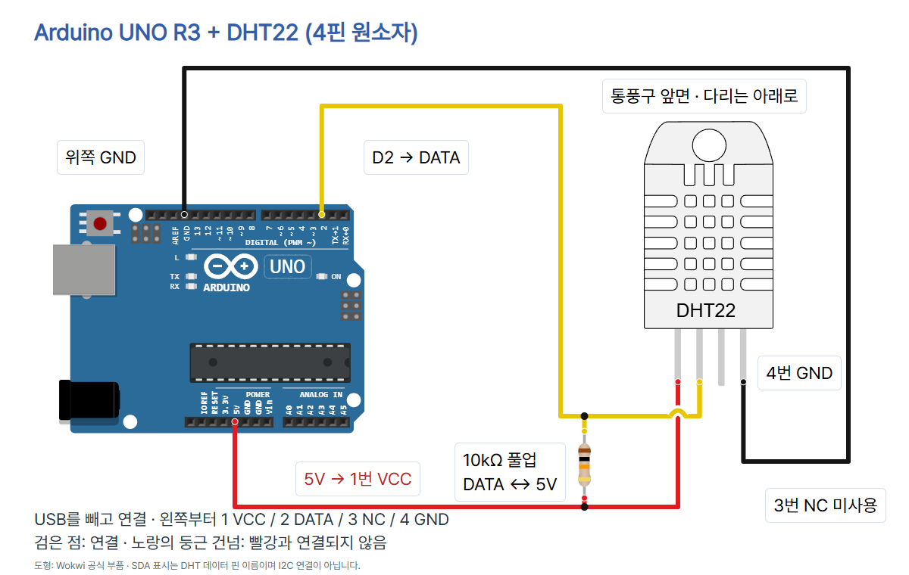

# 온도와 습도를 읽는 DHT22 · Arduino UNO R3

통풍구가 있는 **DHT22 4핀 원소자**로 주변 공기의 온도(°C)와 상대습도(%RH)를 읽습니다. 상대습도는 같은 온도에서 포화 상태와 비교한 수증기의 비율입니다. DHT22는 디지털 데이터로 두 값을 전달하며 A0나 `analogRead()`를 쓰지 않습니다. 접점 스위치처럼 `digitalRead()` 한 번으로 온습도가 나오는 센서도 아닙니다. 라이브러리가 센서 통신을 처리합니다.

## 준비물과 정확한 모델

- Arduino UNO R3, Arduino IDE, USB 데이터 케이블
- **DHT22 4핀**(사진 Adafruit PID 385), **10kΩ 저항**, 브레드보드, 점퍼선
- DHT sensor library **1.4.7** by Adafruit, Adafruit Unified Sensor **1.1.15**

[Aosong 제조사 자료](https://cdn.sparkfun.com/assets/f/7/d/9/c/DHT22.pdf)의 표지에 DHT22/AM2302가 명시되어 있고 4핀 표·주기를 확인했습니다. Adafruit 다운로드 페이지의 DHT22.pdf 링크는 확인 당시 본문에 **AM2303**가 적혀 있어 이 편의 사양 근거로 사용하지 않았습니다. 3핀 모듈이나 배선형 제품은 배열·내장 풀업이 다를 수 있으므로 이 표를 그대로 적용하지 않습니다.

이 예제는 UNO의 USB 공급과 5V 핀을 사용합니다. Adafruit 연결 안내의 3.3–5V 및 10kΩ 풀업 구성을 따릅니다. 제조사 표에는 더 넓은 전원 범위가 있어도 이 예제에서는 **5V만 사용**하며 VIN이나 외부 전원을 센서에 넣지 않습니다. 전원을 넣은 뒤 1초 이내 통신을 피하고, 읽기 주기는 2초보다 길게 두라는 제조사 안내에 맞춰 첫 읽기 전과 반복 읽기 사이 모두 2500ms 기다립니다.

## 회로와 연결표

**USB를 빼고 배선합니다.** 통풍구가 보이는 앞면을 바라보고 다리를 아래로 두면 왼쪽부터 1·2·3·4번입니다. 네 다리를 서로 다른 브레드보드 연결 줄에 꽂아 전원과 데이터가 서로 닿지 않게 합니다.



| UNO / 부품 | DHT22 다리 | 역할 |
| --- | --- | --- |
| 5V | 1번 VCC (제조사 VDD) | 전원 |
| D2 | 2번 DATA | 온도·습도 데이터 통신 |
| 연결하지 않음 | 3번 NC (NULL) | 미사용 |
| 위쪽 GND | 4번 GND | 접지 |
| 10kΩ 저항 한쪽 | 1번 VCC와 같은 줄 | 풀업의 전원 쪽 |
| 10kΩ 저항 반대쪽 | 2번 DATA와 같은 줄 | 풀업의 데이터 쪽 |

저항은 **DATA↔5V 사이**에 놓습니다. DATA↔GND에 넣는 풀다운이 아닙니다. 저항은 방향이 없습니다. 풀업은 통신이 쉬는 동안 데이터선을 HIGH 전압 상태로 잡아 줍니다. 내부 약한 풀업에만 의존하지 않고 Adafruit 공식 배선처럼 외부 10kΩ을 사용합니다. 이 저항을 잘못 연결하거나 빼면 실물 통신이 실패할 수 있습니다.

이 그림은 **디지털 헤더 AREF 옆 위쪽 GND**를 사용합니다. Wokwi 이름은 `GND.1`입니다. Wokwi DHT22의 `SDA`는 이 부품의 DATA 핀 이름이며 **I2C SDA/A4와 연결하라는 뜻이 아닙니다.** UNO D2와 연결합니다. `NC`에는 선을 그리지 않았습니다.

검은 연결 점은 같은 net의 분기입니다. 노랑이 빨강을 둥글게 건너는 부분은 **연결되지 않는 교차**입니다. 실제 브레드보드에서는 각 전원·DATA 줄과 저항 연결을 표대로 확인하세요. `diagram.json`은 공식 UNO/DHT22/저항 부품 및 5개 연결을 사용하며, `scale`, `pins`, `previewRoutes`는 로컬 배선 그림의 좌표 검증 메타데이터입니다. Wokwi 시뮬레이션을 실행한 결과는 아닙니다.

## Arduino IDE에서 설치·업로드

Arduino IDE는 코드를 작성하고 보드로 보내는 프로그램입니다. 아래는 기존 UNO 기본 세팅에서 보존한 **Arduino IDE 2.3.4 실제 실행 화면**이며 **08편 온습도 측정 화면은 아닙니다.** 버전에 따라 화면이 다를 수 있습니다.

1. [Arduino 공식 설치 안내](https://www.arduino.cc/en/software)를 따라 IDE를 준비합니다. 회로를 확인한 뒤 USB 데이터 케이블로 UNO를 연결합니다.
2. 보드를 **Arduino Uno**, 포트를 실제 연결된 COM 포트로 선택합니다. 사진에 보이는 COM 번호를 그대로 고르지 않습니다. Arduino AVR Boards **1.8.6**에서 컴파일했습니다.
   
3. **스케치 → 라이브러리 포함하기 → 라이브러리 관리**를 엽니다. IDE 버전에 따라 왼쪽 라이브러리 관리자 아이콘으로도 열 수 있습니다. `DHT sensor library`를 검색하고 **Adafruit** 제작 항목을 설치합니다. 예제 검증 버전은 **1.4.7**입니다. 의존성 설치 안내가 뜨면 Adafruit Unified Sensor를 함께 설치하고, 없으면 따로 검색해 **1.1.15**를 설치합니다. 이름이 비슷한 다른 제작자의 DHT 라이브러리와 섞지 않습니다.
4. 새 스케치를 만들고 아래 **전체 코드**를 복사·저장합니다. 확인(컴파일)을 누른 뒤 업로드(오른쪽 화살표)를 누릅니다. `DHT.h: No such file`이면 라이브러리 설치 여부를 확인합니다.
   
5. 시리얼 모니터를 열고 **9600 baud**로 맞춥니다. 처음에는 약 2.5초 기다리고 출력이 나타나는지 확인합니다.
   

위 라이브러리 설치 설명은 [Adafruit 공식 Arduino 안내](https://learn.adafruit.com/dht/using-a-dhtxx-sensor-with-arduino)를 따른 것입니다. 라이브러리 관리자 설치 화면을 직접 캡처한 것처럼 표시하지 않습니다. `libraries.txt`는 Wokwi/설치 참조용이며 Arduino IDE가 자동으로 읽는 설치 파일은 아닙니다.

## 전체 코드

```cpp
#include <DHT.h>
const byte DHT_PIN = 2;
const unsigned long READ_MS = 2500;
DHT dht(DHT_PIN, DHT22);

void setup() {
  Serial.begin(9600);
  dht.begin();
}

void loop() {
  delay(READ_MS);
  float h = dht.readHumidity();
  float t = dht.readTemperature();
  if (isnan(h) || isnan(t)) {
    Serial.println("ERROR: DHT22");
    return;
  }
  Serial.print("temp_C=");
  Serial.print(t, 1);
  Serial.print(" humidity_pct=");
  Serial.println(h, 1);
}
```

공식 Adafruit DHTtester 예제의 DHT22 설정·읽기·NaN 처리 패턴을 단순화했습니다. 해당 예제는 public domain으로 표시되어 있습니다. 설치한 라이브러리 자체의 라이선스는 각 원본 저장소를 따릅니다.

## 각 줄의 역할

| 줄 | 역할 |
| --- | --- |
| 1 | DHT 라이브러리를 불러옴 |
| 2 | 데이터 핀을 D2로 정함 |
| 3 | 읽기 대기 시간을 2500ms(2.5초)로 정함 |
| 4 | D2에 연결한 DHT22 객체를 만듦; DHT11과 혼동하지 않음 |
| 6 | 시작할 때 한 번 실행하는 setup 시작 |
| 7 | 시리얼 통신을 9600 baud로 시작 |
| 8 | DHT 통신을 초기화 |
| 9 | setup 끝 |
| 11 | 반복 실행하는 loop 시작 |
| 12 | 센서 초기 안정화 및 다음 읽기 사이에 2.5초 기다림 |
| 13 | 상대습도를 부동소수점 h로 읽음 |
| 14 | 기본 단위인 섭씨 온도를 t로 읽음 |
| 15 | 어느 하나라도 NaN(유효한 숫자가 아님)이면 실패 처리 |
| 16 | 오류 안내만 출력하고 줄바꿈 |
| 17 | 이번 loop를 끝냄; 다음 loop에서도 먼저 2.5초 기다림 |
| 18 | 실패 처리 블록 끝 |
| 19 | 온도 값 앞에 temp_C= 이름을 출력 |
| 20 | 온도를 소수 첫째 자리까지 출력 |
| 21 | 띄어쓰기와 습도 값 이름 humidity_pct= 출력 |
| 22 | 상대습도를 소수 첫째 자리까지 출력하고 줄바꿈 |
| 23 | loop 끝; 다시 대기부터 반복 |

## 출력과 관찰

유효한 값을 읽었을 때 나오는 **출력 형식 예시**입니다. 아래 숫자는 실제 측정 기록이나 센서가 항상 보내는 값이 아닙니다.

```text
temp_C=24.0 humidity_pct=40.0
```

`temp_C`는 섭씨 온도, `humidity_pct`는 상대습도(%RH)입니다. 습도 40.0은 물의 양 40mL가 아니라 상대습도 40.0%입니다. 두 값은 같은 통신의 온습도 데이터이며, 짧은 시간에 여러 함수 호출을 해도 센서의 새 데이터가 계속 생기는 것은 아닙니다. 소수 첫째 자리를 표시하는 것은 표시 형식이지 그만큼의 측정 정확도를 보장한다는 뜻은 아닙니다.

센서는 제조 과정에서 보정된 값을 제공하며 이 실습에 임의의 오프셋이나 보정 숫자를 넣지 않았습니다. 실제 정확도를 확인하려면 안정된 환경에서 신뢰할 기준 온습도계와 비교해야 합니다. UNO·모터 등 열을 내는 부품과 떨어뜨리고, 같은 장소에서 안정될 시간을 준 뒤 주변 공기 변화에 따른 값을 기록하세요. 바로 손으로 잡거나 드라이어·물로 변화를 강하게 주는 실습은 하지 않습니다. 결로·물·화학 증기를 피하라는 제조사 주의사항을 따릅니다.

### 읽기에 실패했을 때

```text
ERROR: DHT22
```

어느 하나라도 NaN이면 위 안내만 출력하고 그 회차의 온습도 숫자는 출력하지 않습니다. 다음 회차는 다시 2.5초 기다리고 읽습니다.

- 반복 실패: USB를 빼고 4핀 앞면 방향, 1→5V / 2→D2 / 3미사용 / 4→GND, 10kΩ DATA–5V 풀업, 점퍼선 접속을 점검합니다.
- 코드의 센서 종류가 DHT22인지 확인합니다. DHT11이나 3핀 모듈을 이 설정과 혼동하지 않습니다.
- 글자가 깨짐: 시리얼 모니터와 코드 양쪽의 9600 baud를 확인합니다.
- 출력 없음: 보드·실제 COM 포트·USB 데이터 케이블·업로드 결과를 확인하고 첫 2.5초를 기다립니다.
- `READ_MS`는 시작값 2500을 유지하세요. 바꾸더라도 제조사 안내에 맞춰 **2000ms보다 길게** 둡니다.
- 이 **UNO 5V 회로**를 ESP32나 Pico의 3.3V GPIO에 그대로 옮기지 않습니다.

## 검증 범위

`python verify.py`는 전원/DATA/GND net 분리, 10k 저항의 양쪽 net, NC 미연결, 공식 부품 핀 좌표와 미리보기 선 끝점, 코드·README·연결표·사진·캡션 일치를 확인합니다. 기본 스킬 검사기는 서보/CDS 템플릿 전용이므로 DHT22 검사에 대신 통과했다고 쓰지 않습니다. UNO 컴파일 통과: Arduino AVR Boards 1.8.6, DHT sensor library 1.4.7, Adafruit Unified Sensor 1.1.15, flash 5088B / SRAM 255B. 전용 verify.py 검사와 고의 오류 3개(전원 단락, DATA–GND 연결, NC 연결)의 거부를 확인했습니다. check.mjs에서 7장 PNG 1080×1350, 사진 로딩·푸터 겹침·TECH 블루·모바일·저장/재열기·캡션 복사·카드 이미지 붙여넣기·전체 PNG ZIP 다운로드를 통과했습니다. 표지 라벨과 회로 라벨의 최종 위치도 렌더링 후 확인했습니다.

실제 UNO 업로드, 통신, 온도·습도 값·오차·주기, 브레드보드 접속은 미시험입니다. 컴파일·정적 회로·카드 검사를 실물 실험과 구분합니다. Instagram 게시 및 게시물별 DM 활성화는 이번 제작 작업에 포함되지 않습니다.

## 출처와 사진 사용 조건

- [Aosong DHT22/AM2302 제조사 데이터시트 · SparkFun 제공](https://cdn.sparkfun.com/assets/f/7/d/9/c/DHT22.pdf) · 2026-10-11 확인
- [Adafruit DHT22 4핀 제품·주기·사진](https://www.adafruit.com/product/385) · 2026-10-11 확인
- [Adafruit DHT 연결·10k 풀업·D2](https://learn.adafruit.com/dht/connecting-to-a-dhtxx-sensor) · 2026-10-11 확인
- [Adafruit Arduino 라이브러리 설치](https://learn.adafruit.com/dht/using-a-dhtxx-sensor-with-arduino) · 2026-10-11 확인
- [Adafruit DHTtester 공식 예제 · 읽기 실패 처리](https://github.com/adafruit/DHT-sensor-library/blob/master/examples/DHTtester/DHTtester.ino) · 2026-10-11 확인
- [DHT sensor library 1.4.7](https://github.com/adafruit/DHT-sensor-library/blob/master/library.properties) · 2026-10-11 확인
- [Adafruit Unified Sensor 1.1.15](https://github.com/adafruit/Adafruit_Sensor/blob/master/library.properties) · 2026-10-11 확인
- [Arduino UNO R3 공식 보드 자료](https://docs.arduino.cc/hardware/uno-rev3/) · 2026-10-11 확인
- [Wokwi DHT22 핀 이름](https://docs.wokwi.com/parts/wokwi-dht22) · 2026-10-11 확인
- [Wokwi 공식 DHT22 핀 좌표](https://github.com/wokwi/wokwi-elements/blob/main/src/dht22-element.ts) · 2026-10-11 확인
- [Wokwi 공식 UNO 핀 좌표](https://github.com/wokwi/wokwi-elements/blob/main/src/arduino-uno-element.ts) · 2026-10-11 확인
- [Wokwi 공식 저항 핀 좌표](https://github.com/wokwi/wokwi-elements/blob/main/src/resistor-element.ts) · 2026-10-11 확인
- [UNO 실제 사진 SparkFun CC BY 2.0](https://commons.wikimedia.org/wiki/File:Arduino_Uno_-_R3.jpg) · 2026-10-11 확인
- [DHT22 실제 제품 사진 원본](https://cdn-shop.adafruit.com/970x728/385-00.jpg) · 2026-10-11 확인
- [CODEPLANT 유튜브 채널 공개 목록](https://www.youtube.com/@codeplant2024/videos) · 2026-10-11 확인

UNO R3 사진: SparkFun Electronics, CC BY 2.0, 표시 크기만 조절. DHT22 사진: Adafruit 공식 제품번호 385의 385-00.jpg 원본, 실제 DHT22와 저항이 함께 있는 사진이며 표시 크기만 조절. 제품 사진의 별도 자유 이용 라이선스는 확인하지 못했고 CC/상업적 재배포 허가를 주장하지 않습니다. 캠페인 사진 이용 조건은 원권리자의 기준을 확인합니다. 회로 도형은 Wokwi 공식 부품을 사용했습니다.

CODEPLANT 채널 공개 목록을 확인했지만 이 4핀 DHT22 예제와 일치하는 개별 영상을 확정하지 못했습니다. 영상의 핀이나 내용을 추정해서 옮기지 않았으며, 기술 근거는 위 제조사·Adafruit·Arduino·Wokwi 자료를 사용했습니다.
