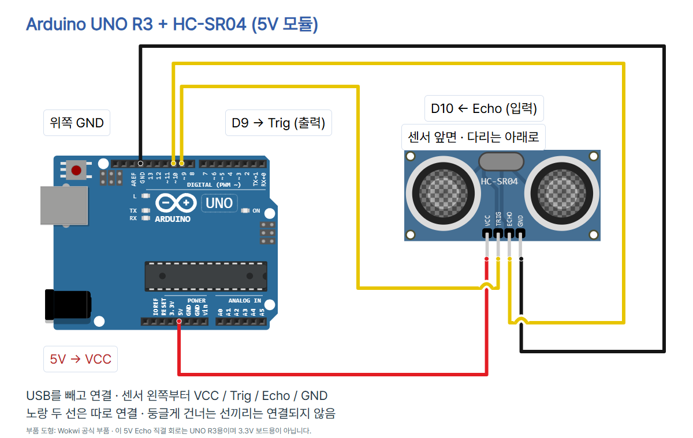
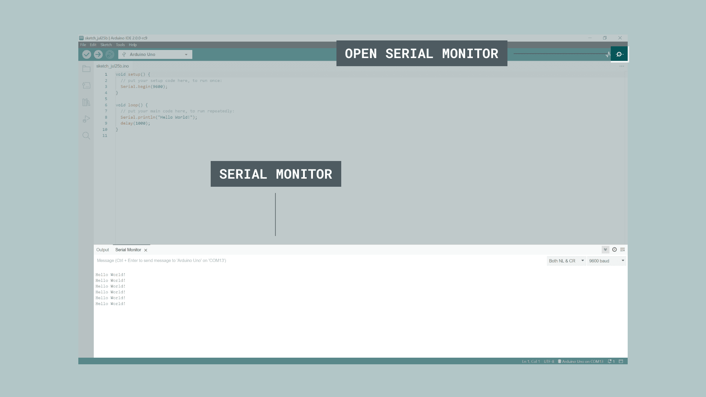

# 초음파로 거리를 재는 HC-SR04 · Arduino UNO R3

**classic HC-SR04 5V·4핀 모듈**로 물체까지의 거리를 읽습니다. 센서가 초음파를 보내고 반사음을 받습니다. Echo HIGH 펄스는 소리가 갔다 돌아온 시간을 나타냅니다. 시간이 길면 대상이 더 멀다는 뜻이며, 이 예제는 `echoUs / 58`로 거리를 cm로 환산합니다. 58에는 왕복 거리 계산이 이미 들어 있으므로 다시 2로 나누지 않습니다.

## 준비물·모델·전압

- Arduino UNO R3, Arduino IDE, USB 데이터 케이블
- HC-SR04 classic 5V 모듈(사진 Adafruit 제품번호 3942), 브레드보드, 점퍼선 4개
- 자, 벽이나 큰 평평한 반사면; 외부 라이브러리 불필요

[Adafruit 3942 공식 자료](https://www.adafruit.com/product/3942)의 전원과 Echo 신호는 5V입니다. [UNO R3 공식 자료](https://docs.arduino.cc/resources/datasheets/A000066-datasheet.pdf)의 디지털 로직 기준은 5V이므로 이 UNO 구성에서는 Echo를 D10에 직결합니다. UNO는 USB, 센서는 UNO 5V 핀으로 공급합니다. 이 실습은 VIN이나 외부 전원을 사용하지 않습니다.

3.3V 보드(ESP32/Pico)에 이 Echo 5V를 직접 넣지 않습니다. 해당 트랙에서는 분압 등 적절한 레벨 변환을 별도로 구성해야 합니다. Adafruit 제품에 동봉한 저항 2개는 3.3V 보드용 변환에 쓸 수 있지만 **이 UNO R3 회로에는 넣지 않습니다.** US-100, RCWL-1601, Qwiic/I2C 변형을 같은 배선·코드로 대체하지 않습니다.

## 회로와 연결표

**USB를 빼고 연결**합니다. 센서 앞면의 두 원통을 바라보고 핀을 아래로 두면 왼쪽부터 VCC, Trig, Echo, GND입니다. 실물의 인쇄된 핀 이름도 확인하고, 각 핀이 서로 다른 브레드보드 연결 줄에 들어가게 꽂습니다.



| UNO 핀 | HC-SR04 핀 | 역할 | 코드 모드 |
| --- | --- | --- | --- |
| 5V | VCC | 센서 전원 | 전원 핀 |
| D9 | Trig | UNO→센서 측정 시작 | OUTPUT |
| D10 | Echo | 센서→UNO 왕복 시간 | INPUT |
| 위쪽 GND | GND | 공통 접지 | 접지 핀 |

그림은 디지털 헤더의 AREF 옆 **위쪽 GND**(Wokwi `GND.1`)를 사용합니다. 노랑 두 선은 서로 다른 신호선입니다. 색이 같아도 두 선을 연결하지 않습니다. 둥근 건넘 표시에서 노랑과 빨강/검정은 서로 연결되지 않습니다. D9/D10에 ~ 표시가 있어도 이 예제는 PWM 제어를 하지 않으며 `analogWrite()`가 필요하지 않습니다.

`diagram.json`은 공식 UNO/HC-SR04 부품과 4개의 분리된 net을 사용합니다. `scale`, `pins`, `previewRoutes`는 로컬 배선 그림의 좌표 검증 메타데이터입니다. Wokwi 도형은 설명용이며 표지의 실제 제품 사진과 구분합니다. 시뮬레이션을 실행한 결과는 아닙니다.

## Arduino IDE에서 실행

Arduino IDE는 코드를 작성하고 보드에 보내는 프로그램입니다. 아래 이미지는 기존 UNO 기본 세팅에서 보존한 **Arduino IDE 2.3.4 실제 실행 화면**이며 **09편 초음파 측정·시리얼 출력 화면은 아닙니다.** 버전에 따라 메뉴 위치가 다를 수 있습니다.

1. [Arduino 공식 설치 안내](https://www.arduino.cc/en/software)를 따라 IDE를 준비하고 회로를 확인한 뒤 UNO를 데이터 케이블로 연결합니다.
2. 보드 **Arduino Uno**와 실제 연결된 COM 포트를 선택합니다. 사진 속 COM 번호를 그대로 고르지 않습니다. Arduino AVR Boards **1.8.6**을 사용했습니다.
   
3. 새 스케치에 아래 전체 코드를 복사·저장합니다. 추가 센서 라이브러리는 필요 없습니다. 확인(컴파일)을 누른 뒤 업로드(오른쪽 화살표)를 누릅니다.
   
4. 시리얼 모니터를 **9600 baud**로 맞춥니다. 센서를 벽이나 큰 평평한 판에 수직으로 향하게 하고 값을 읽습니다.
   

## 전체 코드

```cpp
const byte TRIG_PIN = 9;
const byte ECHO_PIN = 10;
const unsigned long ECHO_TIMEOUT_US = 30000UL;
const unsigned long MEASURE_MS = 100;
const float US_PER_CM = 58.0f;
const float MIN_CM = 2.0f;
const float MAX_CM = 400.0f;

void setup() {
  pinMode(TRIG_PIN, OUTPUT);
  pinMode(ECHO_PIN, INPUT);
  digitalWrite(TRIG_PIN, LOW);
  Serial.begin(9600);
}

void loop() {
  delay(MEASURE_MS);
  digitalWrite(TRIG_PIN, LOW);
  delayMicroseconds(2);
  digitalWrite(TRIG_PIN, HIGH);
  delayMicroseconds(10);
  digitalWrite(TRIG_PIN, LOW);
  unsigned long echoUs = pulseIn(ECHO_PIN, HIGH, ECHO_TIMEOUT_US);
  if (echoUs == 0) {
    Serial.println("NO_ECHO");
    return;
  }
  float cm = echoUs / US_PER_CM;
  if (cm < MIN_CM || cm > MAX_CM) {
    Serial.println("OUT_OF_RANGE");
    return;
  }
  Serial.print("distance_cm=");
  Serial.println(cm, 1);
}
```

## 각 줄의 역할

| 줄 | 역할 |
| --- | --- |
| 1 | D9에서 측정 시작 펄스를 보냄 |
| 2 | D10에서 Echo 펄스 길이를 읽음 |
| 3 | Echo 대기 제한은 30000μs(30ms) |
| 4 | 반복 측정 전 100ms 기다림 |
| 5 | 왕복 펄스 시간을 cm로 바꾸는 기본 계수; 보정 가능 |
| 6 | 이 예제에서 허용하는 최솟값 2cm |
| 7 | 이 예제에서 허용하는 최댓값 400cm |
| 9 | 시작할 때 한 번 실행할 setup 시작 |
| 10 | Trig는 UNO에서 센서로 보내는 출력 |
| 11 | Echo는 센서에서 UNO로 들어오는 입력 |
| 12 | Trig를 처음에 LOW로 둠 |
| 13 | 시리얼 통신을 9600 baud로 시작 |
| 14 | setup 끝 |
| 16 | 반복 실행하는 loop 시작 |
| 17 | 정상·오류 여부와 관계없이 다음 측정 전에 100ms 대기 |
| 18 | 측정 직전 Trig를 LOW로 정리 |
| 19 | LOW 상태로 2μs 대기 |
| 20 | 측정 시작 신호를 HIGH로 올림 |
| 21 | HIGH를 10μs 유지 |
| 22 | HIGH 펄스를 끝냄 |
| 23 | Echo HIGH 펄스 길이를 μs로 읽음; 제한 시간을 명시 |
| 24 | 완성된 펄스를 제한 시간 안에 읽지 못한 경우 |
| 25 | 응답 없음 안내만 출력하고 줄바꿈 |
| 26 | 이번 loop를 끝냄; 다음 loop에서 다시 100ms 대기 |
| 27 | 응답 없음 처리 끝 |
| 28 | 왕복 시간÷58로 거리를 cm로 환산; 다시 2로 나누지 않음 |
| 29 | 계산한 값이 2~400cm 범위를 벗어났는지 확인 |
| 30 | 범위 밖 안내만 출력하고 줄바꿈 |
| 31 | 해당 숫자를 정상 거리로 출력하지 않고 이번 loop 종료 |
| 32 | 범위 검사 끝 |
| 33 | 값의 이름 distance_cm= 출력 |
| 34 | 거리를 소수 첫째 자리까지 출력하고 줄바꿈 |
| 35 | loop 끝; 다시 대기부터 반복 |

## 코드 흐름과 출력

1. 첫 측정과 각 다음 회차 전에 100ms 기다립니다. 데이터시트의 측정 주기 **60ms 초과** 권고보다 길게 둡니다. 펄스 읽기 시간이 더해지므로 출력이 정확히 100ms 주기라는 보장은 없습니다.
2. Trig LOW 2μs로 정리하고 HIGH 10μs를 보낸 뒤 LOW로 내립니다.
3. `pulseIn(ECHO_PIN, HIGH, 30000UL)`로 Echo HIGH 시간을 μs로 읽습니다. 30000μs는 30ms입니다. Arduino pulseIn의 0 반환은 제한 시간 안에 완성된 펄스를 못 읽은 경우이며, 0cm 거리 측정이 아닙니다.
4. 응답이 있으면 왕복 시간을 58로 나눕니다. 2~400cm 안이면 거리 숫자를, 그 밖이면 OUT_OF_RANGE 안내만 출력합니다.

**유효한 출력 형식 예시**(실제 측정 기록 아님):

```text
distance_cm=20.0
```

반응을 읽지 못한 경우:

```text
NO_ECHO
```

계산값이 예제의 2~400cm 허용 범위를 벗어난 경우:

```text
OUT_OF_RANGE
```

NO_ECHO의 원인이 항상 ‘앞에 물체가 없다’고 단정할 수는 없습니다. 배선·전원·대상 방향·반사 조건·펄스 읽기 제한도 확인해야 합니다. OUT_OF_RANGE에서도 숫자를 정상 거리인 것처럼 표시하지 않습니다. 자료의 2~400cm는 명시된 범위이고, 모든 대상·거리에서 측정된 정확도를 보장하는 표현이 아닙니다. 소수 첫째 자리 표시도 0.1cm 정확도 보장이 아닙니다.

## 관찰과 환산 계수 확인

- 벽처럼 충분히 넓고 평평한 반사면을 정면으로 둡니다. 데이터시트 시험 안내는 반사 면적 **0.5m² 이상**, 매끈한 면을 권고합니다. 좁은 막대, 천, 비스듬한 면은 같은 결과를 보장하지 않습니다.
- 자를 센서 앞면에서 대상 평면까지 놓고 20·40·60cm 같은 여러 위치에서 여러 값을 기록합니다. 예제 위치는 실물 측정 기록이 아닙니다.
- 주변 온도와 반사 조건에 따라 환산 오차가 달라질 수 있습니다. 먼저 배선·각도·반사면·값의 안정성을 점검합니다. 아직 실물 보정을 했다고 주장하지 않습니다.
- `US_PER_CM=58.0f`는 데이터시트의 기본 환산값이며 조절 가능한 상수로 남겼습니다. 여러 기준 거리에서 비례하는 오차가 반복될 때에만 **새 계수 = 기존 계수 × 출력된 거리 / 자로 잰 거리**를 계산해 시험할 수 있습니다. 서로 다른 거리에서 새 계수가 일치하지 않으면 하나의 계수로 보정된다고 단정하지 않습니다. 임의의 보정 숫자를 미리 넣지 않습니다.
- `MEASURE_MS`는 기본 100ms를 유지하고, 바꾸더라도 60ms보다 길게 둡니다. `ECHO_TIMEOUT_US`는 기본 30000μs입니다. 400cm의 환산 펄스 시간은 계산상 23200μs라 기본 제한 안에 들어갑니다. 이는 실물 시간 측정이 아닙니다.

## 실패 시 확인

USB를 빼고 VCC/Trig/Echo/GND 순서, D9/D10 구분, 위쪽 GND, 센서 전원·점퍼선 연결을 확인합니다. 센서를 반사면에 정면으로 두세요. 글자가 깨지면 9600 baud, 아무 출력이 없으면 실제 보드·포트·데이터 케이블·업로드 성공을 확인합니다. UNO 회로에 3.3V 보드나 다른 통신 방식의 센서를 섞지 않습니다.

## 검증 범위

`python verify.py`로 4개 net과 전원 분리·Trig/Echo 구분, 공식 핀 좌표·미리보기 끝점, 10μs 펄스·100ms 대기·30ms 제한·0과 범위 밖 처리, 코드/README/캡션/사진의 일치를 확인합니다. 기본 educational-circuit-diagram 검사기는 서보/CDS 템플릿 전용이므로 HC-SR04에 템플릿 VALID라고 쓰지 않습니다. UNO 컴파일 통과: Arduino AVR Boards 1.8.6, flash 3930B / SRAM 234B, 추가 라이브러리 없음. 전용 verify.py의 연결·좌표·코드 정적 검사와 고의 오류 3개 거부, 환산 단위 계산 검사를 통과했습니다. check.mjs에서 7장 1080×1350 PNG, 사진 로딩·푸터 겹침·TECH 블루·모바일·저장/재열기·캡션 복사·이미지 붙여넣기·전체 PNG ZIP 다운로드를 통과했습니다. 전체 회로와 7장 시안도 시각 검수했습니다. 검사기는 공개 폴더에서도 실행되며, 로컬에 episode.json이 있을 때는 편집 원본 일치도 추가 확인합니다.

실제 UNO 업로드·센서 통신·거리·오차·보정·대기 시간·브레드보드 접속은 미시험입니다. 정적 회로·컴파일·카드 렌더를 하드웨어 실행과 구분합니다. Instagram 게시·DM 연결은 별도 승인된 오전 게시 자동화에서 미게시 순서를 따라 진행하며, 이번 제작만으로 해당 게시물이 게시·DM LIVE 상태라고 보고하지 않습니다.

## 출처와 사진 사용 조건

- [HC-SR04 데이터시트 · Elecfreaks 표기, SparkFun 제공](https://cdn.sparkfun.com/datasheets/Sensors/Proximity/HCSR04.pdf) · 2026-10-12 확인
- [Adafruit classic HC-SR04 3942 · 5V 전원·Echo](https://www.adafruit.com/product/3942) · 2026-10-12 확인
- [Adafruit HC-SR04 공식 핀 안내](https://learn.adafruit.com/ultrasonic-sonar-distance-sensors/pinouts) · 2026-10-12 확인
- [UNO R3 공식 데이터시트 · 5V 로직·핀](https://docs.arduino.cc/resources/datasheets/A000066-datasheet.pdf) · 2026-10-12 확인
- [Arduino pulseIn 공식 참고 원본 · timeout/0 반환](https://github.com/arduino/reference-en/blob/master/Language/Functions/Advanced%20IO/pulseIn.adoc) · 2026-10-12 확인
- [Wokwi HC-SR04 공식 작동·시간÷58](https://docs.wokwi.com/parts/wokwi-hc-sr04) · 2026-10-12 확인
- [Wokwi HC-SR04 공식 핀 좌표](https://github.com/wokwi/wokwi-elements/blob/main/src/hc-sr04-element.ts) · 2026-10-12 확인
- [Wokwi UNO 공식 핀 좌표](https://github.com/wokwi/wokwi-elements/blob/main/src/arduino-uno-element.ts) · 2026-10-12 확인
- [실제 HC-SR04 공식 제품 사진](https://cdn-shop.adafruit.com/970x728/3942-02.jpg) · 2026-10-12 확인
- [UNO 사진 · SparkFun CC BY 2.0](https://commons.wikimedia.org/wiki/File:Arduino_Uno_-_R3.jpg) · 2026-10-12 확인
- [CODEPLANT ESP32 초음파 센서 편 · 공개 제목 확인](https://www.youtube.com/watch?v=Qtp1k4BOiBs) · 2026-10-12 확인
- [CODEPLANT 채널 공개 목록](https://www.youtube.com/@codeplant2024/videos) · 2026-10-12 확인

UNO R3 사진은 SparkFun Electronics의 CC BY 2.0 원본이며 표시 크기만 조절했습니다. HC-SR04 사진은 Adafruit 제품번호 3942의 3942-02.jpg 원본이며 핀 인쇄가 보이는 실제 5V 모듈 사진입니다. 별도 자유 이용 라이선스는 확인하지 못했고 CC/상업적 재배포 허가를 주장하지 않습니다. 캠페인 이용 조건은 원권리자의 기준을 확인합니다. Wokwi 도형도 제품 사진과 구분합니다.

CODEPLANT 공개 채널 목록에서 ‘ESP32로 모든 센서 다뤄보기 – 초음파센서(HC-SR04)’ 영상 Qtp1k4BOiBs의 제목과 대상 보드를 확인했습니다. 현재 확보한 자료로는 영상 본문·자막의 정확한 배선·코드를 확정하지 못해 임의로 옮기지 않았습니다. 이 편은 UNO R3이며 ESP32의 3.3V 조건을 그대로 복사하지 않습니다. 학습 흐름은 개념→핀·배선→코드→값 비교로 유지하고 기술 근거는 위 공식 부품 자료를 따릅니다.
