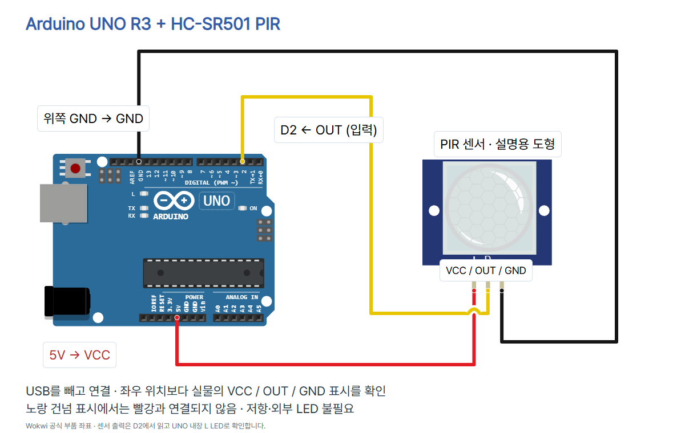
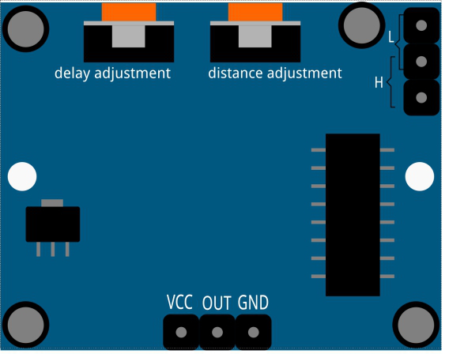

# 움직임을 감지하는 PIR 센서 · Arduino UNO R3

HC-SR501의 디지털 출력을 D2로 읽고 UNO 내장 L LED로 확인합니다. 감지 대상의 적외선 변화에 반응하며 거리·체온·인원수 측정용이 아닙니다. LOW만으로 사람이 없다고 판단하지 않습니다.

## 준비물과 연결

UNO R3, HC-SR501(SunFounder 자료의 VCC/OUT/GND 모듈), 점퍼선 3개, USB 데이터 케이블, 필요하면 브레드보드. 센서는 UNO **5V** 핀에서 전원을 받고 보드는 USB로 공급합니다. 3.3V 전원·VIN은 이 회로에서 사용하지 않습니다. 다른 PIR 변형은 전원·출력·핀 이름을 먼저 확인하세요.

USB를 뺀 상태에서 연결합니다. 아래 회로는 설명용 Wokwi 도형이며 제품 사진과 다릅니다. 좌우 순서로 추측하지 말고 실물 표시를 확인하세요.



| UNO 핀 | HC-SR501 핀 | 역할 |
| --- | --- | --- |
| 5V | VCC | 센서 전원 |
| 위쪽 GND | GND | 공통 접지 |
| D2 (INPUT) | OUT / DO | 디지털 입력 |

위쪽 GND는 AREF 옆 핀(Wokwi GND.1)입니다. 센서 출력은 모듈 자료에 따라 OUT 또는 DO라고 부릅니다. INPUT_PULLUP·외부 풀업은 사용하지 않습니다. LED_BUILTIN은 UNO R3의 내장 L LED(D13)이며 외부 LED나 저항이 필요 없습니다. Wokwi의 scale/pins/previewRoutes는 로컬 회로 좌표 메타데이터입니다.

## Arduino IDE 설치·실행 화면 안내

Arduino IDE는 코드를 보드에 보내는 프로그램입니다. 아래는 기존 기본 세팅 편의 **Arduino IDE 2.3.4 실제 실행 화면**을 재사용한 위치 안내이며, PIR 감지 실험 화면이 아닙니다. 버전에 따라 위치·이름이 다를 수 있습니다.

1. [Arduino 공식 설치 페이지](https://www.arduino.cc/en/software)에서 IDE를 설치하고 USB 데이터 케이블로 UNO를 연결합니다.
2. Arduino Uno와 실제 연결된 COM 포트를 선택합니다. 사진의 COM 번호를 그대로 선택하지 않습니다. 로컬 컴파일 기준 Arduino AVR Boards 1.8.6.
   
3. 아래 전체 코드를 복사하고 확인(컴파일), 업로드(화살표)를 누릅니다. 추가 라이브러리는 없습니다.
   
4. 시리얼 모니터를 9600 baud로 열고 WAIT_60S → READY를 확인합니다. 센서 앞을 가로질러 이동하고 멈춘 뒤 출력과 LED를 비교합니다.
   

## 전체 코드

```cpp
const byte PIR_PIN = 2;
const unsigned long WARMUP_MS = 60000UL;
int lastMotion = -1;

void setup() {
  pinMode(PIR_PIN, INPUT);
  pinMode(LED_BUILTIN, OUTPUT);
  digitalWrite(LED_BUILTIN, LOW);
  Serial.begin(9600);
  Serial.println("WAIT_60S");
  delay(WARMUP_MS);
  Serial.println("READY");
}

void loop() {
  int motion = digitalRead(PIR_PIN);
  digitalWrite(LED_BUILTIN, motion);
  if (motion != lastMotion) {
    Serial.print("pir=");
    Serial.println(motion);
    lastMotion = motion;
  }
  delay(50);
}
```

## 각 줄의 역할

| 줄 | 역할 |
| --- | --- |
| 1 | D2 신호 핀 |
| 2 | 초기 대기 60000ms(60초) |
| 3 | 첫 읽기와 상태 변화를 비교할 저장값 |
| 5 | 시작할 때 한 번 실행 |
| 6 | 센서 출력은 INPUT으로 읽기 |
| 7 | 내장 L LED를 출력으로 설정 |
| 8 | 대기 중 LED를 끄기 |
| 9 | 시리얼 9600 설정 |
| 10 | 대기 시작 안내 |
| 11 | 센서 안정화를 위한 60초 대기 |
| 12 | 읽기 시작 안내 |
| 13 | setup 끝 |
| 15 | 반복 읽기 시작 |
| 16 | D2 HIGH/LOW 읽기 |
| 17 | 읽은 상태를 내장 LED에 반영 |
| 18 | 첫 상태 또는 상태 변경 검사 |
| 19 | 출력 이름 |
| 20 | 현재 상태 0/1 출력 |
| 21 | 비교값 갱신 |
| 22 | 조건 끝 |
| 23 | 다음 확인 전 50ms 대기 |
| 24 | loop 끝 |

## 출력과 관찰

초기 대기 중에는 움직임 판정을 하지 않고 L LED를 끕니다. 대기 뒤 처음 읽은 상태, 이후 바뀐 상태만 출력합니다. 값이 그대로라면 새 줄이 안 나오는 것이 정상입니다. 아래는 **출력 형식 예시이며 실제 측정 기록이 아닙니다.**

```text
WAIT_60S
READY
pir=0
pir=1
pir=0
```

50ms는 코드의 확인 간격이고 HC-SR501의 지연/차단 시간과 다릅니다. 멈춰도 HIGH 유지 시간까지 LED가 켜질 수 있습니다. H 반복 트리거는 움직임이 이어질 때 HIGH 시간을 늘리고, L 비반복 트리거는 지정 유지 시간이 지나면 LOW로 바뀝니다. 점퍼·감도·지연 조절은 USB를 빼고 실물 H/L 표시와 제품 자료를 확인한 뒤 합니다. SunFounder 자료의 지연 상한 표기가 200s/300s로 서로 달라 고정 상한을 보장하지 않습니다. 직접 유지 시간을 관찰하세요.



5V 전원을 공급해도 출력 HIGH 전압이 5V라는 뜻은 아닙니다. HC-SR501 계열의 3.3V HIGH 참고는 [Freenove 공식 HC-SR501 설명](https://raw.githubusercontent.com/Freenove/Freenove_Ultimate_Starter_Kit_for_ESP32/master/Python/Python_Tutorial.pdf)에 있습니다. 이 UNO 예제의 직결 입력은 [SunFounder UNO 예제](https://docs.sunfounder.com/projects/umsk/en/latest/02_arduino/uno_lesson12_pir_motion.html)를 기준으로 합니다. 다른 제품·긴 배선·불안정 전원에서는 실제 신호를 확인해야 합니다.

## 반응이 이상하면

- 전원 직후 신호: 약 1분 안정화 안내에 따라 60초 기다립니다. 계속 불안정하면 더 기다리고 배선·전원·환경을 확인하세요.
- 계속 1: 모듈 지연과 H 반복 감지를 확인합니다. 열원·직사광·바람을 피하고 멈춘 뒤 충분히 기다립니다.
- 계속 0: VCC/GND/OUT, D2, INPUT 설정, 감도, 센서 방향을 확인합니다. 가만히 서 있는 것보다 앞을 가로질러 움직여 보세요.
- 시리얼 글자 깨짐: 9600 baud, 실제 포트·보드와 업로드 완료 여부를 확인합니다.
- LED를 센서 출력에 직접 달거나 모터·릴레이를 OUT에서 구동하지 않습니다. 이번 실습은 신호 읽기와 내장 LED만 합니다.

## 검증 범위

UNO 컴파일(Arduino AVR Boards 1.8.6): flash 2398 bytes / SRAM 210 bytes 통과. verify.py의 세 전원·접지·신호망과 잘못된 연결 3개 거부, 공식 핀 좌표·초기 60초 대기·코드/README 일치 검사를 통과했습니다. check.mjs의 7장 1080×1350·사진·하단 여백·블루·모바일·이미지 붙여넣기·캡션·전체 PNG ZIP 검사를 통과했고 최종 모든 장을 눈으로 검수했습니다. 기본 스킬 검사기는 PIR을 지원하지 않으므로 이 편 전용 검사기로 검증했습니다. 실제 HC-SR501·UNO 배선, 감지·유지 시간·전압 측정과 Wokwi 시뮬레이션은 미시험입니다. 소프트웨어 검사 성공을 실제 센서 실행 확인이라고 쓰지 않습니다.

## 출처·사진 사용 조건

- [HC-SR501 전원·초기화·모드](https://docs.sunfounder.com/projects/umsk/en/latest/01_components_basic/12-component_pir_motion.html) — 2026-10-13 확인
- [SunFounder UNO D2 INPUT 예제](https://docs.sunfounder.com/projects/umsk/en/latest/02_arduino/uno_lesson12_pir_motion.html) — 2026-10-13 확인
- [Wokwi PIR 작동·핀 이름](https://docs.wokwi.com/parts/wokwi-pir-motion-sensor) — 2026-10-13 확인
- [Wokwi PIR 공식 핀 좌표](https://github.com/wokwi/wokwi-elements/blob/main/src/pir-motion-sensor-element.ts) — 2026-10-13 확인
- [Wokwi UNO 공식 핀 좌표](https://github.com/wokwi/wokwi-elements/blob/main/src/arduino-uno-element.ts) — 2026-10-13 확인
- [UNO R3 공식 자료](https://docs.arduino.cc/resources/datasheets/A000066-datasheet.pdf) — 2026-10-13 확인
- [CODEPLANT PIR 강의 공개 제목 확인 · ESP32](https://www.youtube.com/watch?v=8FfPgJ3KDgQ) — 2026-10-13 확인
- [PIR 실제 공식 사진](https://docs.sunfounder.com/projects/umsk/en/latest/_images/12_pir_module.png) — 2026-10-13 확인
- [PIR 뒷면 공식 설명 그림](https://docs.sunfounder.com/projects/umsk/en/latest/_images/12_pir_module_back.png) — 2026-10-13 확인
- [UNO SparkFun 사진](https://commons.wikimedia.org/wiki/File:Arduino_Uno_-_R3.jpg) — 2026-10-13 확인

UNO 사진은 SparkFun Electronics의 Arduino Uno R3 사진, CC BY 2.0이며 원본은 그대로 복사하고 표시 크기만 조절했습니다. PIR 실제 사진(pir-photo.png)·뒷면 그림(pir-back.png)은 SunFounder 공식 문서 자료이며 별도 자유 이용 라이선스는 확인되지 않았습니다. 재사용 조건을 확인해야 하며 임의로 CC 라이선스를 붙이지 않습니다. Wokwi 부품 도형은 공식 wokwi-elements(MIT)입니다. IDE 화면은 기존 편에서 직접 캡처한 도구 위치 참고로서 PIR 출력 사진이 아닙니다.

CODEPLANT 채널과 ESP32 PIR 강의의 공개 제목을 확인했습니다. 영상 내용을 전사·시청 검증한 것으로 표시하지 않습니다. 핀·전원·코드는 위 UNO 공식 예제와 제조사 자료로 구성했습니다. 자동 댓글 DM은 현재 중단 상태이며 게시글 캡션에서 이 편 GitHub 주소를 직접 안내합니다.
