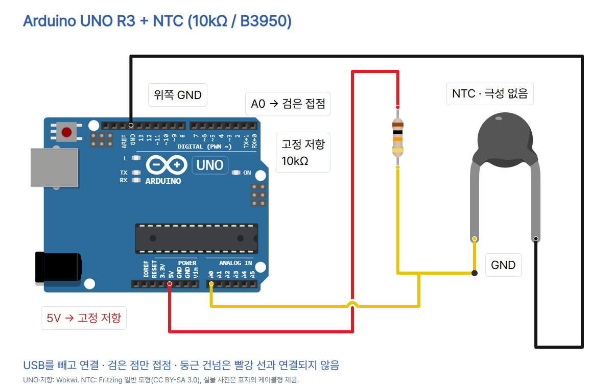

# 11 · 온도에 따라 저항이 바뀌는 NTC 센서

Arduino UNO R3 실습. [CODEPLANT TECH 이 편](https://github.com/CodeplantEDU/codeplant-tech/tree/main/arduino/011-ntc). NTC의 저항 변화를 A0로 읽고 섭씨 온도를 **계산**합니다. 실제 측정·시뮬레이션은 미시험입니다.

## 준비물과 기준 부품

UNO R3, USB 데이터 케이블, 브레드보드, 점퍼선, [Adafruit 372](https://www.adafruit.com/product/372) 2선 에폭시 NTC, 고정 10kΩ 저항(1% 권장). 25°C 기준 저항 R0=10000Ω, B25/50=3950입니다. 제품 사진에 함께 나온 저항을 쓸 수 있습니다. 다른 NTC는 R0, BETA 및 기준 온도를 해당 제품 자료로 바꾸세요. 외형만 같아서는 계수가 같다고 할 수 없습니다. 이 실습은 실내에서 손으로 가볍게 감쌌다가 놓으며 변화를 비교합니다. 불·뜨거운 물·침수 실습은 하지 않습니다.

## 연결

USB를 뺀 상태에서 **5V → 고정 10kΩ → 가운데 접점 → NTC → GND**로 연결합니다. A0는 가운데 접점에 연결합니다. NTC 두 선은 극성이 없습니다. 아래 1/2 표시는 그림에서 두 선을 구분하기 위한 이름이며 제품 핀 번호가 아닙니다. 피복이 아닌 도체 부분을 브레드보드·단자에 고정하고 필요하면 연결핀/단자를 쓰세요.

| UNO / 부품 | 연결 | 역할 |
|---|---|---|
| 5V | 고정 10kΩ 한쪽 | 분압 회로 전원 |
| A0 | 고정 저항 나머지 + NTC 1 | 가운데 접점 읽기 |
| 위쪽 GND | NTC 2 | 접지 |
| AREF / VIN | 미사용 | USB 전원 + 기본 ADC 기준 |

브레드보드에서는 고정 저항 나머지·NTC 한 선·A0 점퍼 **세 개만 같은 연결 줄**에 꽂습니다. NTC 나머지 선은 GND 쪽의 다른 줄입니다. 고정 저항과 NTC를 서로 바꾸면 아래 계산식은 맞지 않습니다. 양 끝 5V/GND 줄을 직접 연결하지 마세요.



UNO·고정 저항은 Wokwi 공식 도형, NTC는 Fritzing 일반 2선 도형입니다. 도형의 원판 외형은 표지의 케이블형 Adafruit 372 사진과 다릅니다. 회로는 같은 2선 저항 부품의 연결 관계를 설명하며 실물 모양을 복제한 그림이 아닙니다. diagram.json은 좌표/배선 편집 데이터이며 그대로 Wokwi 실행이 보장되는 프로젝트는 아닙니다.

## Arduino IDE에서 실행

카드에서는 제품명을 Arduino IDE로 표기합니다. 아래 화면은 기존 UNO 기본 세팅 편에서 저장한 도구 위치 참고 화면(Arduino IDE 2 계열)이며 이 NTC 출력의 실제 캡처가 아닙니다. Arduino IDE 1.8.x에서는 보드·포트를 도구 메뉴에서 고릅니다. 세부 UI가 달라도 UNO 보드/포트, 업로드, 시리얼 모니터와 9600 설정은 같은 작업입니다.

1. [공식 설치 페이지](https://www.arduino.cc/en/software)에서 운영체제용 Arduino IDE를 설치합니다. 이 편은 추가 라이브러리 없이 실행합니다.
2. USB 데이터 케이블로 UNO를 연결합니다. 도구 → 보드에서 **Arduino UNO**, 도구 → 포트에서 실제 연결 포트를 선택합니다. 포트가 없으면 데이터 케이블과 보드의 USB 장치 인식을 확인합니다.
3. 새 스케치에 아래 전체 코드를 붙여넣고 저장합니다. 검증(체크 표시)을 누른 뒤 오류가 없다면 업로드(오른쪽 화살표)를 누릅니다.
4. 업로드 완료 안내 뒤 도구 → 시리얼 모니터에서 **9600 baud**를 선택합니다. 이 예제는 문자를 보내는 실습이 아닙니다.
5. raw와 temp_C를 기록합니다. 센서 끝을 손으로 가볍게 감싼 뒤 변화를 기다리고, 놓은 뒤 다시 비교합니다. 즉시 반응한다고 가정하지 않습니다.


## 복사할 전체 코드

```cpp
// CODEPLANT: UNO R3 + Adafruit 372 (10k NTC, B25/50=3950).
// Divider: 5V -- fixed 10k -- A0 -- NTC -- GND.
// Based on the divider/B-parameter method in Adafruit's Thermistor guide.
#include <math.h>
const byte NTC_PIN = A0;
const float R_FIXED = 10000.0;
const float R0 = 10000.0;  // NTC resistance at 25 Celsius
const float T0_K = 298.15;
const float BETA = 3950.0;

float temperatureC(int raw) {
  if (raw <= 0 || raw >= 1023) return NAN;
  float r = R_FIXED * raw / (1023.0 - raw);
  float invK = 1.0 / T0_K + log(r / R0) / BETA;
  return 1.0 / invK - 273.15;
}

void setup() {
  pinMode(NTC_PIN, INPUT);  // No internal pull-up.
  analogReference(DEFAULT);  // 5V divider; leave AREF unconnected.
  Serial.begin(9600);
}

void loop() {
  delay(1000);
  int raw = analogRead(NTC_PIN);
  float tempC = temperatureC(raw);
  if (isnan(tempC)) {
    Serial.print("ERROR: ADC_ENDPOINT raw=");
    Serial.println(raw);
    return;
  }
  Serial.print("raw=");
  Serial.print(raw);
  Serial.print(" temp_C=");
  Serial.println(tempC, 1);
}
```

## 코드 줄별 역할

1~3: 기준 보드·부품·배선·계산 출처 주석. 4: 자연로그와 NAN을 제공하는 내장 math.h. 5: A0 입력. 6: 고정 저항. 7: 기준 온도의 NTC 저항. 8: 25°C를 켈빈으로 표시. 9: 해당 NTC B 계수.

10은 빈 줄입니다. 11은 온도 계산 함수 시작. 12는 raw가 양 끝이면 NAN 반환. 13은 분압식에서 NTC 저항을 구함. 14는 B 계수식으로 절대온도의 역수를 구함. 15는 역수를 뒤집고 273.15를 빼 섭씨로 반환. 16은 함수 끝. 17은 빈 줄입니다.

18~22: setup 시작, 풀업 없는 입력, UNO의 DEFAULT 기준 설정(AREF 연결 없음), 시리얼 9600 시작, setup 끝. 23은 빈 줄입니다. 24는 loop 시작. 25는 1초 대기. 26는 A0 입력 읽기. 27는 함수 호출. 28는 잘못된 계산 확인. 29~30은 오류와 raw 출력. 31는 이번 loop 종료. 32는 오류 조건 끝. 33~36은 raw·temp_C와 소수점 한 자리 출력. 37은 loop 끝. 빈 줄은 코드 구분용입니다.

## 계산과 출력 읽기

ADC 입력 raw는 온도나 저항이 아닙니다. 이 배선에서는 `R_NTC = R_FIXED × raw / (1023 − raw)`입니다. B 계수 근사식은 `1/T = 1/T0 + ln(R_NTC/R0)/BETA`; 켈빈 T에서 273.15를 빼 섭씨로 바꿉니다. 이 코드는 5V와 기본 ADC 기준을 함께 쓰는 UNO 실습입니다. 외부 AREF를 연결하는 다른 예제와 섞지 마세요.

아래는 **수학 계산/출력 형식 예시이며 센서로 측정한 기록이 아닙니다.**

```text
raw=512 temp_C=25.0
raw=400 temp_C=35.3
ERROR: ADC_ENDPOINT raw=0
```

따뜻해지면 이 배선의 NTC 저항과 raw가 내려가고 계산 온도는 올라갑니다. 소수점 한 자리 표시는 정확도가 0.1°C라는 뜻이 아닙니다. 부품 오차, ADC 분해능, 접촉·환경과 자기 발열의 영향을 받습니다. R_FIXED를 실제 측정 저항값으로 설정하고 기준 온도계와 비교해야 합니다. B 근사식은 정밀 보정의 대체가 아닙니다.

## 값이 이상하면

- 0/1023 오류: USB를 빼고 분압 접점·5V·GND·A0·부품값을 점검합니다. 끝값은 단선 위치를 확정하는 진단이 아닙니다. 부동 입력은 다른 숫자도 낼 수 있습니다.
- 온도 방향 반대: 고정 저항이 5V 쪽, NTC가 GND 쪽인지 확인합니다. NTC와 PTC를 섞지 않습니다.
- 숫자가 흔들림: 접촉·전원·케이블과 센서 끝의 움직임을 점검합니다. 처음에는 여러 줄을 기록해 변화를 비교합니다.
- 온도 차이가 큼: R0/BETA/기준 온도와 고정 저항값을 확인합니다. 사진만 보고 다른 제품에 3950을 넣지 않습니다.
- 글자가 깨짐: 시리얼 9600과 실제 업로드·보드·포트를 확인합니다.

## 검증 범위

UNO 컴파일(Arduino AVR Boards 1.8.6): flash 4044 bytes / SRAM 230 bytes 통과. verify.py는 세 분압 네트워크와 잘못된 연결/접지 누락 4개 거부, 공식 핀 좌표·선 끝점·건넘, 끝값 예외, 온도 변환 방향과 15/25/35°C 역산, 코드/README/캡션/사진 검사를 통과했습니다. check.mjs의 7장 1080×1350·전체 PNG ZIP·사진·하단 겹침·TECH 블루·모바일·저장 재열기·캡션 복사·카드 이미지 붙여넣기도 통과했습니다. 최종 전체 카드를 눈으로 검수했습니다. 기본 스킬 검사기는 서보/조도센서 템플릿용이므로 NTC를 검증하지 못하며, 이 편 검사기를 별도로 사용했습니다. 실제 UNO/NTC 배선·온도 측정·시뮬레이션은 미시험입니다.

## 출처·사진 사용 조건

- [Adafruit 372 제품·R25·B25/50·공식 사진](https://www.adafruit.com/product/372) — 2026-10-14 확인
- [Adafruit 분압·B 계수 계산·정확도 한계](https://learn.adafruit.com/thermistor/using-a-thermistor) — 2026-10-14 확인
- [Fritzing NTC 도형·다리 좌표](https://github.com/fritzing/fritzing-parts/blob/develop/svg/core/breadboard/ceramic_disk_thermistor_leg.svg) — 2026-10-14 확인
- [Fritzing 부품 정의·저작자](https://github.com/fritzing/fritzing-parts/blob/develop/core/thermistor_300mil.fzp) — 2026-10-14 확인
- [Fritzing 그림 라이선스](https://github.com/fritzing/fritzing-parts/blob/develop/LICENSE.txt) — 2026-10-14 확인
- [Wokwi UNO 핀 좌표](https://github.com/wokwi/wokwi-elements/blob/main/src/arduino-uno-element.ts) — 2026-10-14 확인
- [Wokwi 저항 핀 좌표](https://github.com/wokwi/wokwi-elements/blob/main/src/resistor-element.ts) — 2026-10-14 확인
- [Arduino UNO R3 공식 보드](https://docs.arduino.cc/hardware/uno-rev3/) — 2026-10-14 확인
- [UNO SparkFun 사진 CC BY 2.0](https://commons.wikimedia.org/wiki/File:Arduino_Uno_-_R3.jpg) — 2026-10-14 확인
- [CODEPLANT NTC 공개 검색 · 일치 콘텐츠 없음](https://www.youtube.com/@codeplant2024/search?query=NTC) — 2026-10-14 확인
- [실제 NTC 제품 사진 원본](https://cdn-shop.adafruit.com/970x728/372-01.jpg) — 2026-10-14 확인

UNO 사진은 SparkFun Electronics, CC BY 2.0이며 기존 원본을 복사하고 표시 크기만 조절했습니다. NTC 사진은 Adafruit 공식 제품 사진이며 별도 자유 이용 라이선스는 확인되지 않았습니다. 임의로 CC를 붙이지 않습니다. 회로 NTC 원본 도형은 Fritzing / Brendan Howell, CC BY-SA 3.0입니다. 다리까지 보이도록 표시 viewBox를 확장하고 배율·라벨·배선을 추가했습니다. 이 도형을 포함한 arduino_uno_ntc.png, circuit_preview.html 및 3번 회로 카드(cards/03.png)는 CC BY-SA 3.0으로 제공합니다. Wokwi UNO·저항 도형은 MIT 소스입니다. 원본 SVG와 Fritzing 라이선스는 로컬 제작 폴더에 보관했습니다. IDE 참고 화면의 출처·사용 조건은 UNO 기본 세팅 편의 README를 함께 확인하세요.

CODEPLANT 채널의 NTC 검색은 일치 콘텐츠가 없다고 표시되었습니다. NTC 강의를 시청한 것으로 쓰지 않습니다. 이번 기술 설명은 Adafruit 공식 제품·분압/계산 자료와 공식 부품 핀 정의를 기준으로 작성했습니다. 자동 DM은 중단 상태이며 이 편 캡션은 GitHub 주소를 직접 안내합니다.
