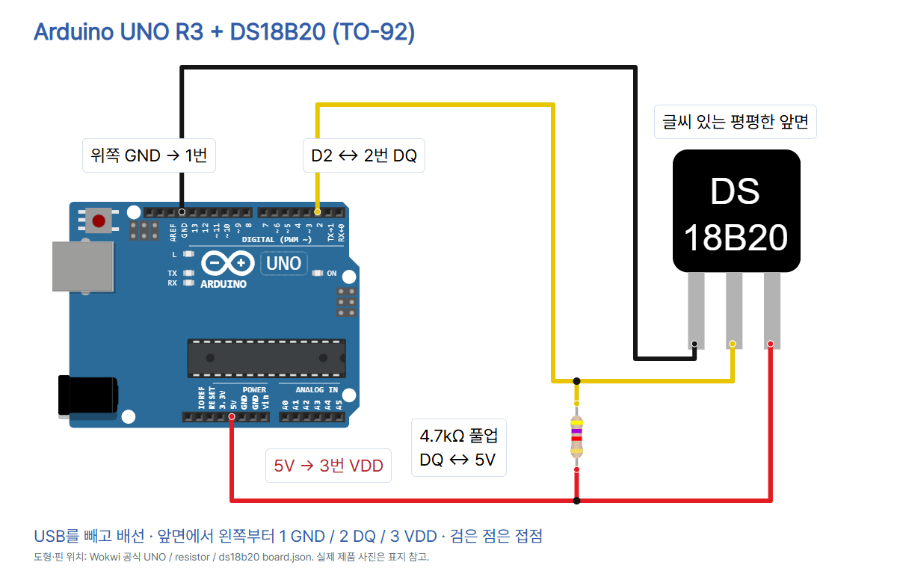

# 12 · 디지털로 온도를 읽는 DS18B20

Arduino UNO R3 · DS18B20 TO-92 3핀 한 개. [이 편의 전체 자료](https://github.com/CodeplantEDU/codeplant-tech/tree/main/arduino/012-ds18b20). 이전 NTC 편은 저항을 온도로 환산했지만 이 센서는 온도를 디지털 데이터로 전달합니다.

## 준비물과 부품 확인

UNO R3, DS18B20 TO-92(예: Adafruit 제품 374), 4.7kΩ 저항, 브레드보드, 점퍼선, USB 데이터 케이블. 이번에는 VDD에 5V를 공급하는 3선 연결을 사용합니다. 기생 전원 방식은 사용하지 않습니다. 표지의 실제 제품 사진은 Adafruit 공식 TO-92 사진입니다. 같은 외형의 TMP36·트랜지스터와 혼동하지 말고 DS18B20 표시와 구입 자료를 확인하세요. 방수 프로브·3핀 모듈은 별도 모델과 핀표가 필요하며 선 색만으로 판단하지 않습니다.

## 방향과 회로 연결

USB를 빼고 **글씨 있는 평평한 면을 앞으로, 다리를 아래로** 둡니다. 앞면에서 왼쪽부터 1 GND / 2 DQ / 3 VDD입니다. 제조사 PDF의 밑면 그림은 시점이 다르므로 앞면과 혼동하지 마세요.

| UNO / 부품 | DS18B20 핀 | 역할 |
|---|---|---|
| 위쪽 GND | 1번 GND | 접지 |
| D2 | 2번 DQ | 1-Wire 데이터 |
| 5V | 3번 VDD | 센서 전원 |
| 4.7kΩ 저항 | 2번 DQ ↔ 3번 VDD | 데이터 풀업 |

세 다리는 서로 다른 브레드보드 연결 줄에 꽂습니다. DQ 줄에는 센서 2번·D2 점퍼·저항 한쪽을 함께, 5V 줄에는 센서 3번·5V 점퍼·저항 나머지를 함께 연결합니다. GND는 센서 1번과 UNO 위쪽 GND끼리 연결합니다. 저항은 DQ와 GND 사이가 아닙니다. 내부 풀업만으로 외부 4.7kΩ을 대체하지 않습니다.



Wokwi 공식 DS18B20 board.json의 VCC 이름은 실제 부품의 VDD(3번)와 같은 전원 핀입니다. 로컬 diagram.json의 pins/scale/previewRoutes는 그림 편집용 메타데이터입니다. Wokwi에서 실행하거나 실제 배선 동작을 확인한 것으로 표시하지 않습니다.

## Arduino IDE와 라이브러리 설치

카드에서는 제품명을 Arduino IDE로 표기합니다. 아래 이미지는 기존 UNO 편에서 저장한 **Arduino IDE 2 계열 도구 위치 참고 화면**이며 이 센서의 실제 실행 캡처가 아닙니다. Arduino IDE 1.8.x는 도구 메뉴에서 보드·포트를 선택하고 스케치 → 라이브러리 포함하기 → 라이브러리 관리로 설치할 수 있습니다.

1. [공식 Arduino IDE](https://www.arduino.cc/en/software)를 설치하고 USB 데이터 케이블로 UNO를 연결합니다.
2. 도구 → 보드에서 Arduino UNO, 도구 → 포트에서 실제 연결 포트를 고릅니다. IDE 2에서는 상단 보드/포트 선택기를 써도 됩니다.
3. 라이브러리 관리자에서 **OneWire by Paul Stoffregen(2.3.8)**, **DallasTemperature(4.0.6)**를 설치합니다. 의존성 설치 안내가 나오면 OneWire가 포함되었는지 확인합니다.
4. 새 스케치에 아래 코드를 전부 붙여넣고 검증(체크 표시) → 업로드(오른쪽 화살표)를 누릅니다. 선택한 보드·포트와 업로드 완료 안내를 확인합니다.
5. 시리얼 모니터를 9600 baud로 열고 temp_C를 관찰합니다. 문자를 입력할 필요는 없습니다.


## 복사할 전체 코드

```cpp
// UNO R3 + one DS18B20 TO-92, external 5V power.
// Flat face forward: GND, DQ, VDD; 4.7k pull-up from DQ to 5V.
#include <OneWire.h>
#include <DallasTemperature.h>
const byte DATA_PIN = 2;
OneWire oneWire(DATA_PIN);
DallasTemperature sensors(&oneWire);

void setup() {
  Serial.begin(9600);
  sensors.begin();
  sensors.setResolution(12);
  sensors.setWaitForConversion(true);
}

void loop() {
  delay(1000);
  sensors.requestTemperatures();
  float tempC = sensors.getTempCByIndex(0);
  if (tempC == DEVICE_DISCONNECTED_C) {
    Serial.println("ERROR: DS18B20");
    return;
  }
  Serial.print("temp_C=");
  Serial.println(tempC, 2);
}
```

## 코드 줄별 역할

| 줄 | 역할 |
|---|---|
| 1 | 기준 보드·센서와 외부 전원 방식 주석 |
| 2 | 앞면 핀 순서와 풀업 배선 주석 |
| 3 | 1-Wire 통신 라이브러리 |
| 4 | 온도 센서 라이브러리 |
| 5 | 데이터 핀 D2 |
| 6 | 통신 객체 생성 |
| 7 | 통신 객체를 센서 라이브러리에 전달 |
| 8 | 빈 줄: 코드 구분 |
| 9 | 시작 시 한 번 실행 |
| 10 | 시리얼 9600 시작 |
| 11 | 센서 검색·초기화 |
| 12 | 12비트 변환 해상도 설정 |
| 13 | 온도 변환이 완료될 때까지 대기하도록 설정 |
| 14 | setup 끝 |
| 15 | 빈 줄: 코드 구분 |
| 16 | 반복 실행 시작 |
| 17 | 다음 온도 요청 전 1초 대기 |
| 18 | 온도 변환 요청 및 완료 대기 |
| 19 | 첫 센서의 섭씨 온도 읽기 |
| 20 | 읽기 실패 확인 |
| 21 | 오류 안내 |
| 22 | 이번 loop의 온도 출력을 건너뛰기 |
| 23 | 오류 조건 끝 |
| 24 | 출력 이름 표시 |
| 25 | 섭씨 값과 줄바꿈, 소수점 두 자리 |
| 26 | loop 끝 |

## 출력과 관찰

아래는 **출력 형식 예시이며 실제 측정 기록이 아닙니다.**

```text
temp_C=23.50
temp_C=24.25
ERROR: DS18B20
```

센서의 검은 몸통을 손으로 가볍게 감싼 뒤 기다리고, 놓은 뒤 다시 비교합니다. 다리를 꺾거나 도체를 함께 잡아 단락시키지 않습니다. TO-92 부품은 방수 프로브가 아니므로 물에 넣거나 불·뜨거운 물로 가열하지 않습니다.

1초 대기 후 12비트 변환을 요청합니다. DS18B20은 이 설정에서 변환에 최대 750ms가 걸려 출력 간격이 약 1.75초가 됩니다(통신·출력 시간이 더해짐). setWaitForConversion(true)는 라이브러리가 변환 완료를 기다리도록 합니다. 비동기 예제의 setWaitForConversion(false)와 섞지 마세요.

12비트의 온도 간격은 0.0625°C이고 센서의 정확도와는 다릅니다. 제조사 정확도 조건은 -10~85°C에서 ±0.5°C입니다. 출력의 소수점 두 자리가 0.01°C 정확도를 보장하지 않습니다. 이 코드는 센서 한 개를 전제로 첫 번째 검색 결과(index 0)를 사용합니다. 여러 센서의 고정 순서를 보장하는 코드는 아니며 주소로 지정하는 방식은 별도 실습입니다.

## 오류 점검

- ERROR: DS18B20: 라이브러리가 주소/온도를 읽지 못한 경우입니다. 내부의 DEVICE_DISCONNECTED_C(-127)를 온도로 출력하지 않습니다. USB를 빼고 부품명, 앞뒤 방향, GND/DQ/VDD, D2 및 4.7kΩ DQ–5V를 확인합니다. 오류만으로 고장 원인을 단정하지 않습니다.
- 처음부터 같은 값: 변화에 시간이 걸릴 수 있습니다. 85°C가 반복된다면 매번 온도 변환을 요청하고 완료 대기 후 읽는지와 전원·배선을 확인합니다. 실제 85°C 측정값 자체를 무조건 오류로 간주하지 않습니다.
- 라이브러리를 찾지 못함: OneWire와 DallasTemperature의 설치 이름·버전을 확인합니다.
- 글자가 깨짐: 시리얼 9600, 실제 업로드, 보드·포트를 확인합니다.
- 장거리 케이블·여러 센서는 배선·풀업 조건이 달라질 수 있습니다. 이 자료는 책상 위 단일 센서 실습입니다.

## 검증 범위

Arduino CLI에서 UNO R3 대상으로 컴파일했습니다. Arduino AVR Boards 1.8.6, OneWire 2.3.8, DallasTemperature 4.0.6(library.properties 기준)를 사용했고 플래시 6,164바이트, SRAM 269바이트입니다.

`python verify.py`는 전원·접지·데이터의 3개 넷, DQ–5V 4.7kΩ, 공식 핀 좌표와 그림 접점, 잘못된 배선/저항 5가지 거부, D2·12비트·변환 대기·오류 처리, 전체 코드 일치를 확인합니다. 교육용 범용 회로 검사기는 서보·조도센서만 지원하므로 DS18B20을 그 검사기의 통과로 표시하지 않습니다.

로컬 check.mjs에서 7장 1080×1350 PNG·순서가 맞는 한 편 ZIP·사진 표시·하단 겹침·TECH 블루·모바일·캡션 복사·이미지 붙여넣기·저장 후 재열기를 확인했습니다. 디자이너·학생·선생님 관점으로 자체 검토했으며 실제 사람의 피드백을 받은 것은 아닙니다.

실제 UNO·DS18B20 배선·온도 측정·Wokwi 시뮬레이션은 미시험입니다. 컴파일·정적 회로 검사는 실제 온도 정확도나 배선 작동을 보장하지 않습니다.

## 출처와 사진·도형 사용 조건

- [DS18B20 제조사 데이터시트 Rev6](https://www.analog.com/media/en/technical-documentation/data-sheets/ds18b20.pdf) — 2026-10-15 확인
- [제조사 구판 자료 · 앞면/밑면 핀 도해, Adafruit 제공](https://cdn-shop.adafruit.com/datasheets/DS18B20.pdf) — 2026-10-15 확인
- [Adafruit TO-92 제품·4.7k 풀업](https://www.adafruit.com/product/374) — 2026-10-15 확인
- [DallasTemperature 공식 Simple 예제](https://github.com/milesburton/Arduino-Temperature-Control-Library/blob/master/examples/Simple/Simple.ino) — 2026-10-15 확인
- [DallasTemperature 소스 · 대기/실패 처리](https://github.com/milesburton/Arduino-Temperature-Control-Library/blob/master/DallasTemperature.cpp) — 2026-10-15 확인
- [DallasTemperature 버전](https://github.com/milesburton/Arduino-Temperature-Control-Library/blob/master/library.properties) — 2026-10-15 확인
- [OneWire 버전](https://github.com/PaulStoffregen/OneWire/blob/master/library.properties) — 2026-10-15 확인
- [Wokwi DS18B20 공식 핀 좌표](https://github.com/wokwi/wokwi-boards/blob/main/boards/ds18b20/board.json) — 2026-10-15 확인
- [Wokwi DS18B20 도형 · Ariella Eliassaf](https://github.com/wokwi/wokwi-boards/blob/main/boards/ds18b20/board.svg) — 2026-10-15 확인
- [Wokwi UNO 공식 좌표](https://github.com/wokwi/wokwi-elements/blob/main/src/arduino-uno-element.ts) — 2026-10-15 확인
- [Wokwi 저항 공식 좌표](https://github.com/wokwi/wokwi-elements/blob/main/src/resistor-element.ts) — 2026-10-15 확인
- [실제 DS18B20 제품 사진](https://cdn-shop.adafruit.com/970x728/374-02.jpg) — 2026-10-15 확인
- [UNO SparkFun 사진 CC BY 2.0](https://commons.wikimedia.org/wiki/File:Arduino_Uno_-_R3.jpg) — 2026-10-15 확인
- [CODEPLANT 채널 DS18B20 검색 · 일치 콘텐츠 없음](https://www.youtube.com/@codeplant2024/search?query=DS18B20) — 2026-10-15 확인

UNO 사진은 SparkFun Electronics, CC BY 2.0이며 원본을 복사하고 표시 크기만 조절했습니다. DS18B20 실제 사진은 Adafruit 제품 374 공식 사진이며 별도 자유 이용 라이선스는 확인되지 않았습니다. Wokwi UNO·저항 도형은 wokwi-elements(MIT), DS18B20 도형·좌표는 wokwi-boards / Ariella Eliassaf 공식 자료입니다. wokwi-boards 저장소의 별도 라이선스 표기는 확인하지 못했으므로 MIT로 임의 표기하지 않습니다. IDE 참고 화면의 원본·사용 조건은 UNO 기본 세팅 편 README를 함께 확인하세요.

CODEPLANT 채널의 DS18B20 검색 결과는 일치 콘텐츠가 없다고 표시되었습니다. 관련 강의 내용을 시청·전사한 것으로 쓰지 않습니다. 핀·전원·통신·코드는 제조사 자료와 공식 라이브러리 예제를 기준으로 작성했습니다. 캡션은 해당 편의 GitHub 주소를 직접 안내하며 검증 상태 문구는 넣지 않습니다.
