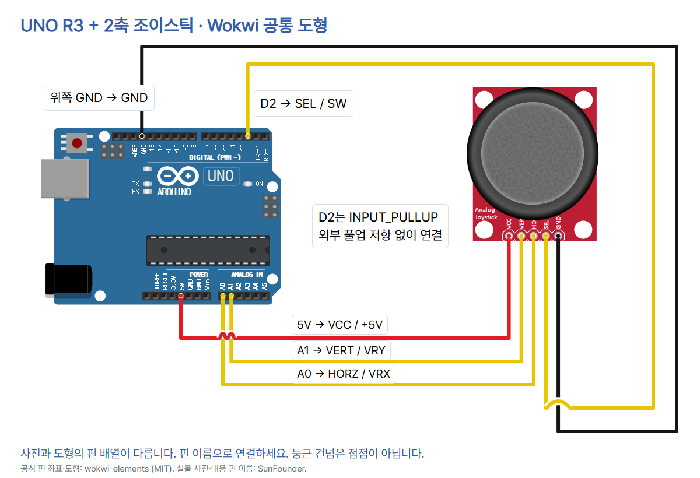

# 13 · 두 방향의 입력을 읽는 조이스틱

Arduino UNO R3와 SunFounder 5핀 조이스틱(+5V·GND·VRX·VRY·SW)을 사용합니다. [이 편 전체 자료](https://github.com/CodeplantEDU/codeplant-tech/tree/main/arduino/013-joystick). 기울이는 두 입력은 ADC로, 누르는 입력은 디지털 핀으로 읽습니다.

## 준비물과 부품 확인

UNO R3, SunFounder UMSK 문서의 5핀 조이스틱 모듈, 점퍼선 5개(모듈·보드 단자에 맞는 암수 형태), USB 데이터 케이블, 필요하면 브레드보드. 사진처럼 모듈의 인쇄된 GND·+5V·VRX·VRY·SW를 확인합니다. 이 자료는 별도 LED/모터를 연결하지 않습니다. 3핀 센서나 USB 게임패드는 대상이 아닙니다.

## 연결표 · USB를 빼고 연결

| UNO | 실제 SunFounder 핀 | 그림의 Wokwi 이름 | 역할 |
|---|---|---|---|
| 5V | +5V | VCC | 모듈 전원 |
| 위쪽 GND | GND | GND | 공통 접지 |
| A0 | VRX | HORZ | X 아날로그 입력 |
| A1 | VRY | VERT | Y 아날로그 입력 |
| D2 | SW | SEL | 누름 디지털 입력 |

**실물과 공통 도형의 핀 배열은 다릅니다.** 순서를 외워 꽂지 말고 위 대응 이름으로 연결합니다. 제조사 사진은 핀 헤더가 왼쪽일 때 위에서부터 GND / +5V / VRX / VRY / SW입니다. 그림은 Wokwi 공식 공통 조이스틱으로 아래쪽 핀이 왼쪽부터 VCC / VERT / HORZ / SEL / GND입니다. 연결 기능은 표로 일치시켰고 같은 제품의 핀 배열인 것처럼 표시하지 않습니다.



D2는 INPUT_PULLUP으로 설정해 SW가 떠 있지 않게 합니다. 손잡이를 놓으면 HIGH(1), 눌러 접지에 연결되면 LOW(0)입니다. 이 연결에서는 외부 풀업 저항이 필요 없습니다. +5V 전원과 GND를 반대로 연결하거나 SW를 전원선처럼 사용하지 마세요. 모듈은 UNO 5V로 공급하므로 출력도 5V 범위가 될 수 있습니다. ESP32·RP2040 Pico의 3.3V GPIO에는 이 배선을 그대로 쓰지 않습니다. AREF에는 아무것도 연결하지 않습니다.

## Arduino IDE에서 실행

1. [Arduino IDE](https://www.arduino.cc/en/software)를 설치하고 UNO를 USB 데이터 케이블로 연결합니다.
2. Arduino UNO 보드와 실제 연결 포트를 선택합니다. 도구 → 보드 / 도구 → 포트에서 확인할 수 있습니다. IDE 2 계열은 상단 선택기도 사용할 수 있습니다.
3. 추가 라이브러리 없이 아래 전체 코드를 새 스케치에 복사합니다. 검증 버튼 → 업로드 버튼을 눌러 완료 안내를 확인합니다.
4. 시리얼 모니터를 9600 baud로 엽니다. 글자를 입력하지 않아도 x=... y=... sw=... 형식으로 출력됩니다.
5. 중앙에서 값을 기록한 뒤 한 축씩 움직이고, 손잡이를 위에서 가볍게 눌렀다가 놓으며 비교합니다.

다음 3개 이미지는 기존 UNO 기본 세팅 편의 **Arduino IDE 2 계열 도구 위치 참고 화면**입니다. 조이스틱 실제 실행·출력 캡처가 아닙니다. IDE 1.8.x에서는 도구 메뉴의 보드·포트와 시리얼 모니터를 사용합니다. 원본은 Arduino Documentation / Karl Söderby, CC BY-SA 4.0이며 [기본 세팅 편의 상세 출처](../001-basic-setup/README.md)를 함께 확인하세요.


## 복사할 전체 코드

```cpp
// UNO R3 + SunFounder 5-pin joystick, powered by UNO 5V.
const byte X_PIN = A0;
const byte Y_PIN = A1;
const byte SW_PIN = 2;

void setup() {
  pinMode(X_PIN, INPUT);
  pinMode(Y_PIN, INPUT);
  pinMode(SW_PIN, INPUT_PULLUP);
  analogReference(DEFAULT);
  Serial.begin(9600);
}

void loop() {
  int x = analogRead(X_PIN);
  int y = analogRead(Y_PIN);
  int sw = digitalRead(SW_PIN);
  Serial.print("x=");
  Serial.print(x);
  Serial.print(" y=");
  Serial.print(y);
  Serial.print(" sw=");
  Serial.println(sw);
  delay(100);
}
```

## 코드 줄별 역할

| 줄 | 역할 |
|---|---|
| 1 | 기준 부품과 5V 전원 주석 |
| 2 | X 입력을 A0에 지정 |
| 3 | Y 입력을 A1에 지정 |
| 4 | 누름 입력을 D2에 지정 |
| 5 | 빈 줄: 코드 구분 |
| 6 | 시작 시 한 번 실행 |
| 7 | X 핀을 입력으로 설정 |
| 8 | Y 핀을 입력으로 설정 |
| 9 | 스위치 입력과 내부 풀업 설정 |
| 10 | UNO 기본 ADC 기준 전압 선택(보드 전원 기준) |
| 11 | 시리얼 9600 시작 |
| 12 | setup 끝 |
| 13 | 빈 줄: 코드 구분 |
| 14 | 반복 실행 시작 |
| 15 | X축의 ADC 값 읽기 |
| 16 | Y축의 ADC 값 읽기 |
| 17 | SW의 0 또는 1 읽기 |
| 18 | x= 출력 이름 |
| 19 | X 값 출력 |
| 20 | y= 출력 이름 |
| 21 | Y 값 출력 |
| 22 | sw= 출력 이름 |
| 23 | SW 값과 줄바꿈 |
| 24 | 다음 읽기 전 100ms 대기 |
| 25 | loop 끝 |

## 출력과 관찰

아래 숫자는 **출력 형식 예시이며 실제 측정 기록이 아닙니다.** 중앙의 X·Y는 약 512가 예상되지만 정확히 512이거나 양 끝이 꼭 0/1023이라고 보장하지 않습니다.

```text
x=512 y=512 sw=1
x=710 y=508 sw=1
x=510 y=514 sw=0
```

| 할 행동 | 확인할 값 |
|---|---|
| 손잡이를 중앙에 놓기 | X·Y 중앙값 기록, SW=1 |
| 한 축씩 양쪽으로 움직이기 | 어떤 값이 주로 변하는지, 어느 방향이 증가하는지 |
| 손잡이를 위에서 누르기 | SW=0, 놓으면 SW=1 |

기울기 두 값은 UNO의 기본 10비트 ADC 입력값(0~1023)입니다. 각도·거리·전압 단위로 출력한 값이 아닙니다. 두 축은 차례로 읽으므로 동시에 샘플링한 것으로 해석하지 않습니다. 코드의 delay(100)는 통신·읽기 시간을 제외한 대기입니다. 이론상 정확한 10Hz 기록 장치라고 표시하지 않습니다.

실제 조이스틱 방향과 중앙값에는 편차가 있습니다. 본 예제는 방향 판정·모터 제어 없이 원시 입력을 관찰합니다. 중앙 구간(데드존)이 필요한 응용에서는 손을 떼고 중앙값 변동 범위를 먼저 기록해 범위를 정해야 합니다. 임의의 한 숫자를 모든 부품에 맞는 보정값으로 제시하지 않습니다.

SW는 상태만 관찰합니다. 기계식 접점의 바운스로 짧은 변화가 생기며, 이 예제의 100ms 간격이 바운스를 제거하는 알고리즘은 아닙니다. 한 번 누를 때 카운트를 정확히 한 번 올리려면 상태 변화 판정과 별도 디바운싱을 추가해야 합니다.

## 문제가 생기면

- SW가 항상 1: USB를 빼고 SW–D2 및 GND를 확인하고 손잡이를 수직으로 눌러 보세요. 눌렀을 때만 접지가 연결됩니다.
- SW가 항상 0: D2가 GND에 고정 연결되었는지, 버튼이 눌린 채인지 확인합니다.
- X·Y가 바뀌지 않거나 치우침: +5V/GND와 VRX–A0·VRY–A1을 점검합니다. 모듈을 돌려 잡았거나 축 이름을 바꾸어 연결하지 않았는지 확인하세요.
- 중앙이 정확히 512가 아님: 그 사실만으로 고장으로 단정하지 말고 중앙과 양 끝의 실제 변화를 비교합니다.
- 글자 깨짐·출력 없음: 시리얼 9600, UNO 보드·포트, 업로드 완료, USB 데이터 케이블을 확인합니다.

## 검증 범위

Arduino CLI에서 UNO(Arduino AVR Boards 1.8.6) 대상으로 컴파일했습니다. 추가 라이브러리는 없으며 플래시 2,488바이트, SRAM 200바이트입니다.

`python verify.py`로 5개 독립 네트워크, 잘못된 배선·누락·축 혼동 5가지 거부, 공식 핀 좌표와 그림 접점, 교차점 건넘 3곳, A0/A1/D2·INPUT_PULLUP·DEFAULT·시리얼 출력 순서·README 전체 코드와 실물/도형 대응표를 확인했습니다. 범용 educational-circuit-diagram 검사기는 서보·조도센서만 지원하므로 그 검사기의 통과로 표시하지 않습니다.

로컬 check.mjs에서 6장 1080×1350 PNG, 순서가 맞는 전체 ZIP, 사진·잘림·푸터·TECH 블루·모바일, 캡션 복사, 이미지 붙여넣기·저장 재열기를 확인했습니다. 디자이너·학생·선생님 관점의 자체 검토이며 실제 사람의 피드백을 받은 것은 아닙니다.

실제 UNO·조이스틱 연결·시리얼 측정·Wokwi 실행은 미시험입니다. 컴파일·정적 검사 결과를 실제 조이스틱의 중앙값·끝값·누름 동작 확인으로 해석하지 않습니다.

## 출처와 사진·도형 사용 조건

- [SunFounder 모듈 사양·핀·내부 풀업](https://docs.sunfounder.com/projects/umsk/en/latest/01_components_basic/09-component_joystick.html) — 2026-10-16 확인
- [SunFounder 실제 조이스틱 사진](https://docs.sunfounder.com/projects/umsk/en/latest/_images/09_joystick.png) — 2026-10-16 확인
- [Wokwi 조이스틱 핀·SW 설명](https://docs.wokwi.com/parts/wokwi-analog-joystick) — 2026-10-16 확인
- [Wokwi 조이스틱 공식 좌표](https://github.com/wokwi/wokwi-elements/blob/main/src/analog-joystick-element.ts) — 2026-10-16 확인
- [Wokwi UNO 공식 좌표](https://github.com/wokwi/wokwi-elements/blob/main/src/arduino-uno-element.ts) — 2026-10-16 확인
- [Arduino analogRead](https://docs.arduino.cc/language-reference/en/functions/analog-io/analogRead/) — 2026-10-16 확인
- [Arduino AnalogReadSerial 공식 예제](https://github.com/arduino/arduino-examples/blob/main/examples/01.Basics/AnalogReadSerial/AnalogReadSerial.ino) — 2026-10-16 확인
- [Arduino 내부 풀업 설명](https://docs.arduino.cc/built-in-examples/digital/InputPullupSerial/) — 2026-10-16 확인
- [UNO 사진 SparkFun CC BY 2.0](https://commons.wikimedia.org/wiki/File:Arduino_Uno_-_R3.jpg) — 2026-10-16 확인
- [CODEPLANT 채널 조이스틱 검색 · 일치 콘텐츠 없음](https://www.youtube.com/@codeplant2024/search?query=조이스틱) — 2026-10-16 확인

UNO 사진은 SparkFun Electronics의 CC BY 2.0 원본을 복사하고 표시 크기만 조절했습니다. 조이스틱 사진은 SunFounder 문서의 실제 제품 사진이며 별도 자유 이용 라이선스는 확인되지 않았습니다. Wokwi 공통 도형·공식 좌표는 wokwi-elements(MIT)입니다. 도형과 사진의 핀 순서 차이는 위 표에 따로 기록했습니다.

CODEPLANT 채널의 ‘조이스틱’ 공개 검색 자료에서 일치하는 콘텐츠가 없다고 표시되었습니다. 영상 시청·전사 내용을 사용한 것으로 적지 않습니다. 제조사 모듈 설명·Arduino 공식 예제·Wokwi 공식 핀 정의를 기준으로 작성했습니다. 캡션에는 GitHub 주소를 직접 안내하고 하드웨어 시험 상태는 이 README와 내부 review에 보존합니다.
