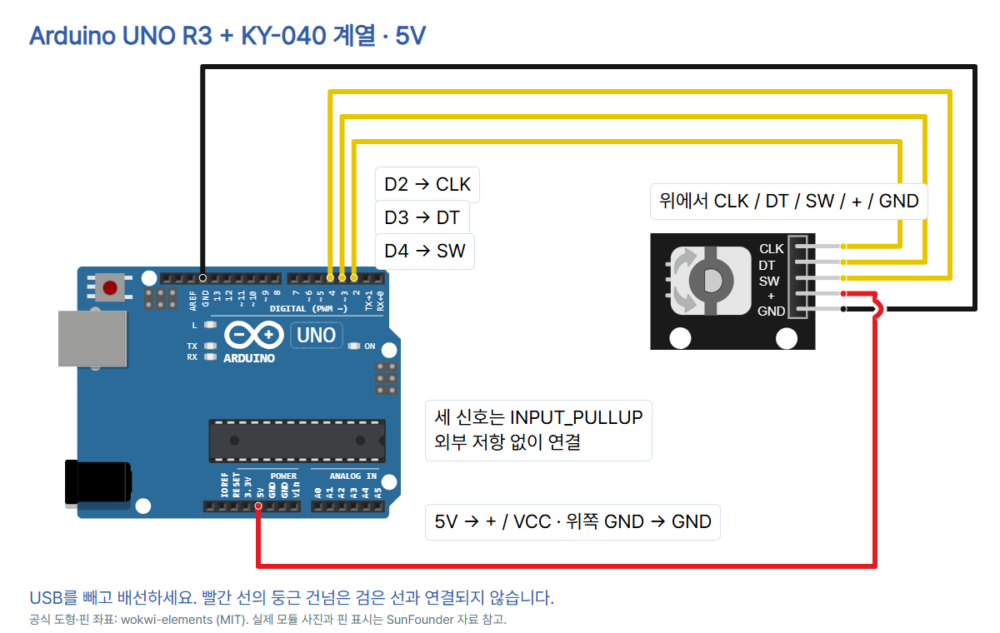

# 14 · 회전 방향을 읽는 로터리 인코더

Arduino UNO R3 · KY-040 계열 5핀 모듈. 표지 사진은 SunFounder HW-040(CLK/DT/SW/+/GND)입니다. [전체 자료](https://github.com/CodeplantEDU/codeplant-tech/tree/main/arduino/014-rotary-encoder). 회전의 **상대 카운트**와 누름 상태를 읽습니다. 정밀 각도계·속도계·절대 위치 센서로 쓰는 예제가 아닙니다.

## 준비물과 부품 확인

UNO R3, SunFounder HW-040 또는 동일 핀 기능이 확인된 KY-040 계열 5핀 모듈, 단자에 맞는 점퍼선 5개, USB 데이터 케이블. 분기가 필요할 때만 브레드보드를 사용합니다. 외부 LED·저항은 추가하지 않습니다. 모듈에 인쇄된 CLK·DT·SW·+·GND를 읽어 확인합니다. 3핀 인코더 원소자·광학 인코더·다른 전원 모듈은 대상이 아닙니다.

## 연결표 · USB를 뺀 상태

| UNO | 모듈 | 역할 |
|---|---|---|
| D2 | CLK | 회전 신호 A |
| D3 | DT | 회전 신호 B |
| D4 | SW | 누름 스위치 |
| 5V | + / VCC | 전원 |
| 위쪽 GND | GND | 공통 접지 |



사진처럼 헤더가 오른쪽이면 위에서 CLK/DT/SW/+/GND입니다. 다른 모듈 방향·핀 순서는 실물 인쇄로 확인하세요. 그림의 VCC는 사진의 +와 같습니다. 빨간 선의 둥근 건넘은 접지선과 **연결되지 않은 교차**입니다. CLK·DT·SW는 모두 INPUT_PULLUP으로 읽습니다. KY-040 계열의 CLK/DT 모듈 풀업 및 UNO 내부 풀업과 함께 쓰며, SW도 내부 풀업을 켜므로 이 배선에는 별도 외부 풀업이 필요 없습니다. 풀업은 신호가 열렸을 때 HIGH로 유지하는 저항입니다.

모듈 전원은 UNO 5V입니다. 모듈 풀업으로 신호가 5V가 될 수 있어 ESP32·RP2040 Pico 3.3V GPIO로 이 배선을 바로 옮기면 안 됩니다. 이번에는 AREF·VIN·외부 전원·모터를 연결하지 않습니다.

## Arduino IDE와 라이브러리

1. [Arduino IDE](https://www.arduino.cc/en/software)를 설치하고 UNO를 USB 데이터 케이블로 연결합니다. 도구 → 보드에서 Arduino UNO, 도구 → 포트에서 실제 연결 포트를 선택하세요.
2. 라이브러리 관리자에서 **RotaryEncoder by Matthias Hertel 1.6.0**을 설치합니다. 이름이 비슷한 다른 Encoder 라이브러리와 혼동하지 않습니다. IDE 1.8.x는 스케치 → 라이브러리 포함하기 → 라이브러리 관리에서 찾습니다.
3. 아래 전체 코드를 붙여넣고 검증 → 업로드를 누릅니다. 완료 후 시리얼 모니터를 **115200 baud**로 엽니다.
4. 손잡이를 천천히 한쪽으로 돌렸다가 반대로 돌려 pos를 비교합니다. 손잡이를 눌렀다가 놓아 sw와 내장 L LED를 관찰합니다.

다음은 기존 UNO 편의 **Arduino IDE 2 계열 도구 위치 참고 화면**입니다. 이 편의 실제 회전·출력 캡처가 아닙니다. 참고 이미지에 9600이 보이더라도 이번 예제는 115200으로 바꾸세요. IDE 2 계열은 상단 보드·포트 선택기를 사용할 수 있고 IDE 1.8.x는 도구 메뉴를 사용합니다. 원본 화면은 Arduino Documentation / Karl Söderby, CC BY-SA 4.0이며 [기본 세팅 편 상세 출처](../001-basic-setup/README.md)를 확인하세요.


## 복사해 실행할 전체 코드

```cpp
// UNO R3 + KY-040-type module, 5V; relative count, not degrees.
#include <RotaryEncoder.h>
const byte CLK_PIN = 2;
const byte DT_PIN = 3;
const byte SW_PIN = 4;
const unsigned long DEBOUNCE_MS = 50;
RotaryEncoder encoder(CLK_PIN, DT_PIN, RotaryEncoder::LatchMode::FOUR3);
long lastPosition = 0;
int lastRawSW = HIGH;
int stableSW = HIGH;
unsigned long changedAt = 0;

void setup() {
  pinMode(CLK_PIN, INPUT_PULLUP);
  pinMode(DT_PIN, INPUT_PULLUP);
  pinMode(SW_PIN, INPUT_PULLUP);
  pinMode(LED_BUILTIN, OUTPUT);
  digitalWrite(LED_BUILTIN, LOW);
  Serial.begin(115200);
  lastRawSW = digitalRead(SW_PIN);
  changedAt = millis();
  Serial.println("READY pos=0 sw=1");
}

void loop() {
  encoder.tick();
  unsigned long now = millis();
  int rawSW = digitalRead(SW_PIN);
  if (rawSW != lastRawSW) {
    lastRawSW = rawSW;
    changedAt = now;
  }
  bool swChanged = false;
  if (rawSW != stableSW && now - changedAt >= DEBOUNCE_MS) {
    stableSW = rawSW;
    swChanged = true;
  }
  digitalWrite(LED_BUILTIN, stableSW == LOW ? HIGH : LOW);
  long position = encoder.getPosition();
  if (position != lastPosition || swChanged) {
    lastPosition = position;
    Serial.print("pos=");
    Serial.print(position);
    Serial.print(" sw=");
    Serial.println(stableSW);
  }
}
```

## 줄별 역할

| 줄 | 역할 |
|---|---|
| 1 | 기준 보드·부품과 상대 카운트 주석 |
| 2 | 회전 신호 해석 라이브러리 포함 |
| 3 | CLK 입력 D2 |
| 4 | DT 입력 D3 |
| 5 | 누름 SW 입력 D4 |
| 6 | 누름 상태 안정 대기 50ms |
| 7 | 4상태 변화 뒤 두 신호 HIGH에서 확정하는 FOUR3 디코더 |
| 8 | 직전 출력한 회전 카운트 |
| 9 | 최근 관찰한 SW 원시 입력 |
| 10 | 안정된 SW 초기값(놓음) |
| 11 | 원시 SW가 바뀐 시각 |
| 12 | 빈 줄: 코드 구분 |
| 13 | 시작 시 한 번 실행 |
| 14 | CLK 입력·내부 풀업 |
| 15 | DT 입력·내부 풀업 |
| 16 | SW 입력·내부 풀업 |
| 17 | UNO 내장 L LED 출력 |
| 18 | 시작은 LED 끄기 |
| 19 | 시리얼 115200 |
| 20 | 첫 SW 원시 상태 읽기 |
| 21 | 첫 SW 시각 기록 |
| 22 | 논리 초기 상태 안내: pos=0, 안정된 SW=1 |
| 23 | setup 끝 |
| 24 | 빈 줄: 코드 구분 |
| 25 | 반복 실행 |
| 26 | 회전 신호 변화 해석 |
| 27 | 현재 시각 |
| 28 | SW 원시 입력 읽기 |
| 29 | 최근 입력과 달라졌는지 |
| 30 | 최근 입력 갱신 |
| 31 | 안정 시간 재시작 |
| 32 | 입력 변화 조건 끝 |
| 33 | 이번 반복의 SW 변경 플래그 초기화 |
| 34 | 원시/안정 상태가 다르고 50ms 이상 유지됐는지 |
| 35 | 안정 상태 갱신 |
| 36 | 변경 안내 플래그 켜기 |
| 37 | 안정 조건 끝 |
| 38 | 안정된 누름 상태에 맞춰 LED 켜기/끄기 |
| 39 | 라이브러리 상대 카운트 가져오기 |
| 40 | 회전 카운트 또는 안정 SW가 바뀌었는지 |
| 41 | 직전 출력 카운트 갱신 |
| 42 | pos= 이름 출력 |
| 43 | 회전 카운트 출력 |
| 44 | sw= 이름 출력 |
| 45 | 안정된 SW와 줄바꿈 |
| 46 | 출력 조건 끝 |
| 47 | loop 끝 |

## 출력과 관찰

아래는 **출력 형식 예시이며 실제 측정 기록이 아닙니다.**

```text
READY pos=0 sw=1
pos=1 sw=1
pos=2 sw=1
pos=1 sw=1
pos=1 sw=0
pos=1 sw=1
```

초기 READY의 sw=1은 코드가 정한 안정 상태입니다. 전원을 켤 때부터 누르고 있다면 50ms 안정 확인 뒤 sw=0으로 바뀝니다. READY를 실제 센서 검사 성공 메시지로 해석하지 않습니다. pos는 부호 있는 상대 카운트이며 재시작하면 0부터입니다. 같은 방향에서 증가 또는 감소가 일관되는지 확인합니다. 어느 물리 방향이 +인지는 CLK·DT 연결과 부품 방향에 따라 달라지므로 정해진 시계 방향이라고 단정하지 않습니다. 버튼을 눌러도 pos를 초기화하지 않습니다.

회전 해석은 RotaryEncoder의 4상태 전이와 FOUR3 모드를 사용합니다. 네 번의 유효한 상태 변화가 지나 CLK/DT가 HIGH/HIGH가 될 때 카운트를 확정합니다. 접점 튐(바운스)의 왕복 변화를 해석하는 방식이며 모든 잡음·잘못된 전이를 복구한다는 보장은 없습니다. 부품에 따라 걸림 위치와 상태 변화 수가 다릅니다. 한 걸림이 항상 1카운트라거나 한 바퀴가 정해진 카운트라고 전제하지 않습니다. 천천히 돌려 걸림당 변화를 기록한 후 공식 라이브러리의 FOUR3/FOUR0/TWO03 설정을 부품에 맞게 검토하세요. 이 예제의 기본값은 FOUR3입니다.

SW의 바운스는 별도로 처리합니다. 원시 입력이 바뀔 때 changedAt를 갱신하고, 안정 상태와 다르면서 마지막 변화 후 **50ms 이상**일 때 stableSW를 바꿉니다. 누른 상태(0)에서 LED를 켭니다. 바운스가 계속되거나 50ms보다 짧게 누르면 반영이 지연되거나 생략될 수 있습니다. 50ms는 이 예제의 조절 가능한 설정이며 모든 스위치에서 검증한 보정값이 아닙니다. unsigned long 뺄셈으로 millis의 순환 경계를 처리합니다.

loop에 delay를 넣지 않고 encoder.tick()을 계속 호출합니다. 시리얼도 카운트 또는 안정 SW가 바뀔 때만 출력합니다. 그래도 빠른 회전·긴 출력·추가 작업으로 신호를 놓칠 수 있습니다. 본 실습은 천천히 돌리는 폴링 예제이며 고속 회전 추적이나 안전 제어용이 아닙니다. 그런 용도는 인터럽트 방식과 실제 신호 측정을 별도로 검토합니다.

## 문제를 찾는 순서

- 출력 없음·깨짐: UNO 보드/포트·업로드 완료·USB 데이터 케이블과 **115200**을 확인합니다.
- 회전값 고정: USB를 빼고 CLK–D2, DT–D3, 모듈 +/GND와 단자 접촉을 점검합니다. 천천히 돌려 보세요.
- 방향이 예상과 반대: pos가 상대 카운트임을 확인합니다. 전체 배선을 확인한 뒤 필요하면 CLK와 DT의 소프트웨어 지정 순서를 바꿀 수 있습니다. 전원선과 신호선을 임의로 바꾸지 않습니다.
- 걸림당 카운트가 다름: 정지 시 CLK/DT 상태와 걸림당 변화를 관찰하고 공식 LatchMode 설명을 확인합니다. 모듈마다 다를 수 있습니다.
- SW 고정: SW–D4, GND, INPUT_PULLUP 설정을 확인하고 손잡이를 수직으로 가볍게 누릅니다. 50ms 이상 기다립니다.
- 값이 불안정: 점퍼선 접촉과 전원·접지, 회전 속도를 점검합니다. 라이브러리 해석·50ms 누름 안정화가 실제 모든 부품의 접점 품질을 보장하지는 않습니다.

## 검증 범위

Arduino CLI에서 UNO 대상으로 컴파일했습니다. Arduino AVR Boards 1.8.6과 RotaryEncoder 1.6.0을 사용했으며 플래시 3,090바이트, SRAM 269바이트입니다.

`python verify.py`는 5개 독립 넷, 잘못된 배선·누락·축 혼동 5가지 거부, 공식 핀 좌표와 그림 접점·절연 교차점, 세 입력 풀업·FOUR3·긴 delay 없음·README 전체 코드 일치를 확인합니다. 공식 KNOBDIR/FOUR3 전이와 누름 안정화의 독립 Python 입력 모델에서 정방향/역방향·왕복 바운스·회전 취소, 49/50ms 경계·누름 유지·놓기·시작부터 누름·32비트 millis 순환을 확인했습니다. 이 모델 검사는 실제 스케치 실행·하드웨어·Wokwi 시뮬레이션 결과가 아닙니다.

범용 educational-circuit-diagram 검사기는 서보·조도센서만 지원하므로 그 검사기의 통과로 표시하지 않습니다. 로컬 check.mjs에서는 카드 7장 1080×1350 PNG·순서가 맞는 한 편 ZIP·사진·잘림·푸터·TECH 블루·모바일·캡션 복사·이미지 붙여넣기·저장 재열기를 확인했습니다. 디자이너·학생·선생님 관점의 자체 검토이며 실제 사람의 피드백을 받은 것은 아닙니다.

실제 UNO·HW-040 배선·회전·누름·Wokwi 실행은 미시험입니다. 실제 걸림당 카운트·회전 방향·바운스·고속 입력 누락은 실물에서 확인해야 합니다.

## 출처와 사진·도형 사용 조건

- [SunFounder 로터리 인코더 핀·제품 사진](https://docs.sunfounder.com/projects/umsk/en/latest/01_components_basic/17-component_rotary_encoder.html) — 2026-10-17 확인
- [실제 HW-040 사진 원본](https://docs.sunfounder.com/projects/umsk/en/latest/_images/17_rotary_encoder.png) — 2026-10-17 확인
- [SunFounder UNO 연결표](https://docs.sunfounder.com/projects/sensorkit-v2-arduino/en/latest/lesson_28.html) — 2026-10-17 확인
- [Wokwi KY-040 신호·풀업·SW](https://docs.wokwi.com/parts/wokwi-ky-040) — 2026-10-17 확인
- [Wokwi 공식 KY-040 핀 좌표](https://github.com/wokwi/wokwi-elements/blob/main/src/ky-040-element.ts) — 2026-10-17 확인
- [Wokwi UNO 좌표](https://github.com/wokwi/wokwi-elements/blob/main/src/arduino-uno-element.ts) — 2026-10-17 확인
- [RotaryEncoder 공식 라이브러리](https://github.com/mathertel/RotaryEncoder) — 2026-10-17 확인
- [RotaryEncoder 디코더·LatchMode 소스](https://github.com/mathertel/RotaryEncoder/blob/master/src/RotaryEncoder.cpp) — 2026-10-17 확인
- [RotaryEncoder 버전](https://github.com/mathertel/RotaryEncoder/blob/master/library.properties) — 2026-10-17 확인
- [Arduino Debounce 공식 예제](https://docs.arduino.cc/built-in-examples/digital/Debounce/) — 2026-10-17 확인
- [UNO 사진 SparkFun CC BY 2.0](https://commons.wikimedia.org/wiki/File:Arduino_Uno_-_R3.jpg) — 2026-10-17 확인
- [CODEPLANT 채널 인코더 검색 · 일치 콘텐츠 없음](https://www.youtube.com/@codeplant2024/search?query=인코더) — 2026-10-17 확인

UNO 사진은 SparkFun Electronics CC BY 2.0 원본을 복사하고 표시 크기만 조절했습니다. HW-040 사진은 SunFounder 공식 제품 사진이며 별도 자유 이용 라이선스는 확인되지 않았습니다. 도형·공식 핀 좌표는 wokwi-elements(MIT)입니다. 라이브러리 원저작자는 Matthias Hertel이며 BSD 3-Clause 라이선스의 공식 코드를 Arduino 라이브러리 관리자로 설치합니다. 소스를 이 폴더에 재배포하지 않습니다.

CODEPLANT 채널의 ‘인코더’ 공개 검색 자료에서는 일치 콘텐츠가 없다고 표시되었습니다. 관련 영상 시청·전사 내용을 사용했다고 쓰지 않습니다. 제조사 연결표와 공식 라이브러리·Wokwi 자료를 기준으로 작성했습니다. SunFounder 부품 설명의 CLK/DT 문장에는 표기 혼선이 있어 공식 UNO 연결표와 Wokwi A/B 정의를 대조했습니다. 캡션에는 GitHub 주소를 직접 안내하고 시험 여부는 이 README와 내부 review에 보존합니다.
