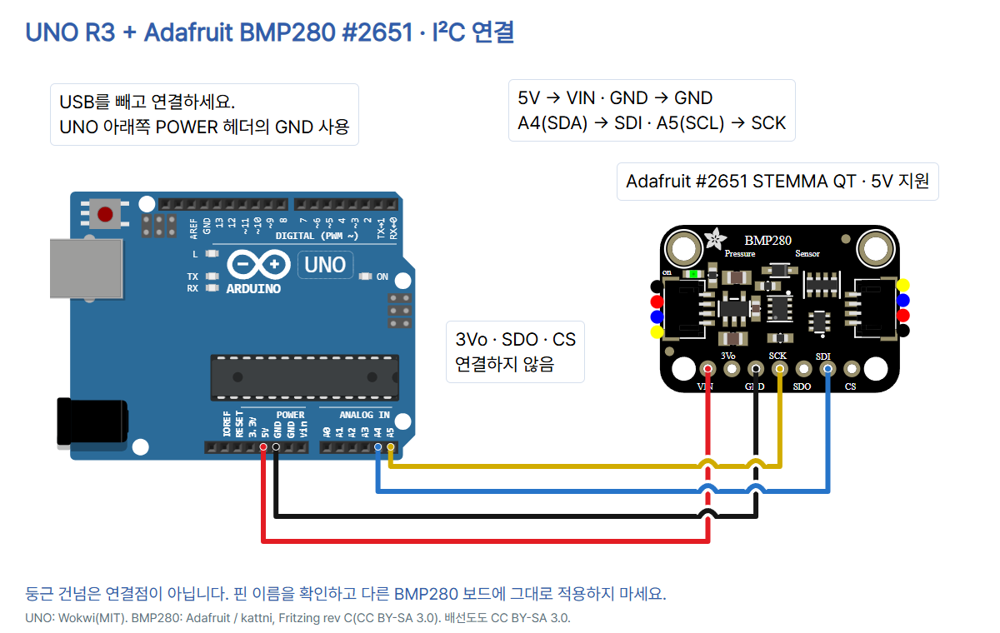

# 15 · 기압과 온도를 읽는 BMP280 센서

Arduino UNO R3 + **Adafruit BMP280 #2651 STEMMA QT(rev C)**. [전체 자료](https://github.com/CodeplantEDU/codeplant-tech/tree/main/arduino/015-bmp280). 센서의 온도와 그 위치의 기압을 읽습니다. 습도는 읽지 않으며 BME280용 코드를 섞지 않습니다.

## 준비물·부품 확인

UNO R3, 위 모델의 BMP280 보드, 핀이 납땜된 연결용 헤더, 브레드보드, 단자에 맞는 점퍼선 4개, USB 데이터 케이블. 납땜이 안 된 헤더는 구멍에 꽂기만 해서는 접촉이 보장되지 않으므로 준비된 헤더 또는 호환 케이블을 사용하세요. 별도 외부 전원·LED·저항은 추가하지 않습니다.

표지 사진과 배선 도형은 같은 #2651 STEMMA QT 모델입니다. 정면 아래쪽 헤더는 왼쪽부터 VIN, 3Vo, GND, SCK, SDO, SDI, CS입니다. 핀 이름이 다른 보드·노출된 BMP280 칩·3.3V 전용 모듈에 이 5V 배선을 그대로 적용하지 않습니다. 이 Adafruit 보드는 전압 조정과 신호 레벨 변환 회로를 포함합니다. 센서 칩 자체가 5V용이라는 뜻은 아닙니다.

## 연결표 · USB를 빼고 배선

| UNO | 모듈 핀 | 역할 |
|---|---|---|
| 5V | VIN | 모듈 전원 입력 |
| GND (아래쪽 POWER 헤더) | GND | 공통 접지 |
| A4 / SDA | SDI | I²C 데이터 |
| A5 / SCL | SCK | I²C 통신 박자 |
| 연결 안 함 | 3Vo · SDO · CS | 이번 I²C 실습 미사용 |



모듈 VIN은 **UNO 5V**에 연결합니다. UNO의 VIN과 연결하는 것이 아닙니다. 3Vo는 모듈의 조정된 전원 **출력**이라 비워 둡니다. 이 모델의 공식 I²C 안내에 따라 SDO·CS는 연결하지 않습니다. 다른 모듈의 CS/주소 풀업 회로를 가정하지 마세요. 그림의 둥근 건넘은 선끼리 이어지지 않은 절연 교차이며 접점이 아닙니다. A4/A5를 쓰므로 위쪽 중복 SDA/SCL 핀에는 별도 선을 넣지 않습니다.

## 설치·실행과 화면 안내

1. [Arduino IDE](https://www.arduino.cc/en/software)를 설치하고 UNO를 USB 데이터 케이블로 연결합니다. 도구 → 보드 → Arduino UNO, 도구 → 포트에서 실제 포트를 선택합니다. IDE 2 계열에서는 상단 선택기를 사용할 수도 있습니다.
2. 라이브러리 관리자에서 **Adafruit BMP280 Library 3.0.0**을 설치합니다. 의존성 설치를 묻는다면 Adafruit Unified Sensor와 Adafruit BusIO도 설치합니다. 여기서는 각각 1.1.15, 1.17.4로 컴파일합니다. IDE 1.8.x는 스케치 → 라이브러리 포함하기 → 라이브러리 관리에서 엽니다.
3. 아래 전체 코드를 복사해 검증 버튼을 누르고, 오류가 없으면 업로드합니다. 시리얼 모니터를 **9600 baud**로 엽니다.
4. READY에 실제로 찾은 주소가 나타나는지 확인합니다. 시작 시 0x77을 먼저 시도하고 실패하면 0x76을 시도합니다. 초기화는 BMP280의 기본 칩 ID 0x58도 검사하므로 BME280(다른 칩 ID)을 성공으로 취급하지 않습니다.
5. 센서를 같은 자리에 놓고 온도·기압 여러 줄을 비교합니다. 온도는 칩의 온도로 주변 공기와 차이가 날 수 있습니다. 급한 가열·물·압력 구멍 막기를 피하세요.

아래는 **Arduino IDE 2 계열의 도구 위치 공식 참고 화면**이며 이번 BMP280의 실제 설치·측정 캡처가 아닙니다. 포트명은 자신의 장치에 맞게 고르세요. IDE 1.8.x는 메뉴 위치와 시리얼 창 모습이 다릅니다. 원본: Arduino Documentation / Karl Söderby, CC BY-SA 4.0. [기본 세팅의 상세 화면 출처](../001-basic-setup/README.md).


## 복사해 실행할 전체 코드

```cpp
// Arduino UNO R3 + Adafruit BMP280 #2651 STEMMA QT, I2C.
#include <Wire.h>
#include <Adafruit_BMP280.h>
#include <math.h>
Adafruit_BMP280 bmp;
uint8_t address = 0x77;

void setup() {
  Serial.begin(9600);
  Wire.begin();
  Wire.setWireTimeout(25000, true);
  if (!bmp.begin(address)) {
    address = 0x76;
    if (!bmp.begin(address)) {
      Serial.println("ERROR: BMP280_NOT_FOUND");
      while (true) { delay(1000); }
    }
  }
  Serial.print("READY address=0x");
  Serial.println(address, HEX);
}

void loop() {
  float tempC = bmp.readTemperature();
  float pressureHpa = bmp.readPressure() / 100.0F;
  if (!isfinite(tempC) || !isfinite(pressureHpa) ||
      tempC < -40.0F || tempC > 85.0F ||
      pressureHpa < 300.0F || pressureHpa > 1100.0F) {
    Serial.println("ERROR: BMP280_RANGE");
  } else {
    Serial.print("temp_C=");
    Serial.print(tempC, 2);
    Serial.print(" pressure_hPa=");
    Serial.println(pressureHpa, 2);
  }
  delay(1000);
}
```

## 각 줄의 역할

| 줄 | 역할 |
|---|---|
| 1 | 기준 보드·모듈·I²C 방식 주석 |
| 2 | I²C 통신 라이브러리 |
| 3 | BMP280 라이브러리 |
| 4 | 유한한 수인지 확인할 수학 함수 |
| 5 | 기본 I²C 버스의 센서 객체 |
| 6 | 먼저 확인할 주소 0x77 |
| 7 | 빈 줄: 코드 구분 |
| 8 | 시작 시 한 번 실행 |
| 9 | 9600 baud 출력 설정 |
| 10 | UNO I²C 시작(A4/A5) |
| 11 | AVR Wire 버스 대기 제한 25,000μs, 시간 초과 시 버스 리셋 |
| 12 | 0x77에서 초기화·칩 ID 확인 |
| 13 | 대체 주소 0x76 선택 |
| 14 | 0x76에서 초기화·칩 ID 확인 |
| 15 | 두 주소 모두 실패했다는 오류 |
| 16 | 오류 후 측정 반복에 들어가지 않고 대기 |
| 17 | 대체 주소 조건 끝 |
| 18 | 첫 주소 조건 끝 |
| 19 | 시작 안내와 주소 이름 |
| 20 | 찾은 주소를 16진수로 출력 |
| 21 | setup 끝 |
| 22 | 빈 줄: 코드 구분 |
| 23 | 반복 실행 |
| 24 | 섭씨 온도 읽기 |
| 25 | 기압 Pa를 읽고 hPa로 환산 |
| 26 | NaN·무한대 걸러내기 |
| 27 | 온도 범위 -40~85°C 확인 |
| 28 | 기압 범위 300~1100hPa 확인 |
| 29 | 숫자/범위 오류 안내 |
| 30 | 정상 범위인 경우 |
| 31 | 온도 항목 이름 |
| 32 | 온도 소수점 두 자리 출력 |
| 33 | 기압 항목 이름 |
| 34 | 기압 소수점 두 자리와 줄바꿈 |
| 35 | 정상 출력 조건 끝 |
| 36 | 다음 출력까지 1초 대기 |
| 37 | loop 끝 |

## 출력과 값의 의미

다음은 **출력 형식 예시이며 실제 측정 기록이 아닙니다.**

```text
READY address=0x77
temp_C=24.50 pressure_hPa=1008.20
temp_C=24.51 pressure_hPa=1008.19
```

실제 온도·기압을 미리 정해 놓지 않습니다. 100Pa=1hPa이므로 라이브러리의 Pa를 100으로 나눕니다. 두 자릿수는 표시 형식이며 정확도 보장이 아닙니다. 지표면에서 읽은 현지 기압과 날씨 앱의 해면기압은 기준이 달라 그대로 일치하지 않을 수 있습니다. 고도를 계산하거나 날씨를 예보하는 코드는 포함하지 않습니다. 고도 환산은 그날 해당 지역의 해면기압 등 추가 기준이 필요합니다.

## 오류 점검

- 출력 없음·깨짐: USB 데이터 케이블·보드·포트·업로드 완료·9600을 확인합니다.
- `ERROR: BMP280_NOT_FOUND`: 0x77/0x76 초기화가 모두 실패했습니다. USB를 빼고 VIN–5V, GND, A4–SDI, A5–SCK, 헤더 납땜과 BMP280 모델을 확인합니다. 전원을 다시 연결해 시작하세요. 이 메시지만으로 고장이나 특정 단선을 확정할 수 없습니다.
- `ERROR: BMP280_RANGE`: 유한한 숫자가 아니거나 코드의 점검 범위(온도 -40~85°C, 기압 300~1100hPa)를 벗어났습니다. 그 줄은 측정값 대신 오류로 표시합니다. 범위는 Bosch의 동작 범위를 이용한 입력 점검이며 정밀도 보증·교정값이 아닙니다.
- 값이 날씨 앱과 다름: 현지 기압과 해면기압 기준, 주변 열과 센서 자체 온도를 구분합니다. 수치를 임의로 맞추지 않습니다.

Wire 대기 제한 25ms는 AVR Boards 1.8.6의 시간 초과·버스 리셋 기능입니다. 모든 장애를 복구하거나 검출한다는 뜻은 아닙니다. Adafruit 라이브러리의 읽기 함수는 통신 실패를 모두 독립 오류로 반환하지 않습니다. 범위 안의 그럴듯한 잘못된 숫자까지 이 예제가 걸러낸다고 주장하지 않습니다. 배선 후 실제 값과 반복 동작을 확인해야 합니다.

## 검증 범위

Arduino CLI에서 UNO 대상으로 컴파일했습니다. AVR Boards 1.8.6, Adafruit BMP280 Library 3.0.0, Adafruit Unified Sensor 1.1.15, Adafruit BusIO 1.17.4를 사용했으며 플래시 12,308바이트, SRAM 592바이트입니다.

`python verify.py`에서 4개 독립 넷, 합선/누락/핀 혼동 7가지 거부, 공식 Adafruit SVG 핀 중심·배선 끝점·절연 건넘 5곳, 표/README 전체 코드/주소/단위의 일치를 확인했습니다. 범용 스킬 검사기는 BMP280 템플릿 미지원 결과이므로 해당 검사가 통과했다고 쓰지 않습니다.

기존 check.mjs에서 카드 7장 1080×1350 PNG, TECH 블루·사진·하단 겹침·모바일, 캡션 복사·이미지 붙여넣기·저장 재열기, 한 차시 전체 PNG ZIP을 확인했습니다. 디자이너·학생·선생님 관점의 자체 검토이며 실제 사람의 피드백은 받지 않았습니다.

실제 UNO·BMP280 배선·압력/온도 측정·교정 및 Wokwi 시뮬레이션은 미시험입니다. 컴파일·문서/넷 검사는 센서 동작·정밀도·통신 장애 복구를 증명하지 않습니다.

`diagram.json`은 편집 가능한 부품·넷·핀 좌표·선 경로 메타데이터입니다. BMP280은 Wokwi 시뮬레이터 부품이 아닌 **공식 Adafruit Fritzing 도형**을 HTML에 포함했습니다. 따라서 이 파일을 Wokwi에서 곧바로 실행할 수 있다고 표시하지 않습니다. 범용 교육용 회로 검사기는 BMP280 전용 검증을 지원하지 않으므로 별도 `verify.py`로 네트워크·접점·누락/합선·그림·표·코드를 대조합니다.

## 출처·사용 조건

- [Adafruit #2651 제품·사진](https://www.adafruit.com/product/2651) — 2026-10-18 확인
- [사진 원본](https://cdn-shop.adafruit.com/640x480/2651-08.jpg) — 2026-10-18 확인
- [모듈 전원·핀 기능](https://learn.adafruit.com/adafruit-bmp280-barometric-pressure-plus-temperature-sensor-breakout/pinouts) — 2026-10-18 확인
- [UNO I2C 배선·단위](https://learn.adafruit.com/adafruit-bmp280-barometric-pressure-plus-temperature-sensor-breakout/arduino-test) — 2026-10-18 확인
- [Bosch BMP280 데이터시트](https://cdn-shop.adafruit.com/datasheets/BST-BMP280-DS001-11.pdf) — 2026-10-18 확인
- [공식 라이브러리](https://github.com/adafruit/Adafruit_BMP280_Library) — 2026-10-18 확인
- [라이브러리 버전·의존성](https://github.com/adafruit/Adafruit_BMP280_Library/blob/master/library.properties) — 2026-10-18 확인
- [API·주소·칩 ID](https://github.com/adafruit/Adafruit_BMP280_Library/blob/master/Adafruit_BMP280.h) — 2026-10-18 확인
- [읽기·오류 처리 범위](https://github.com/adafruit/Adafruit_BMP280_Library/blob/master/Adafruit_BMP280.cpp) — 2026-10-18 확인
- [Adafruit Fritzing 공식 rev C 부품](https://github.com/adafruit/Fritzing-Library/blob/master/parts/Adafruit%20BMP280.fzpz) — 2026-10-18 확인
- [Fritzing 라이선스](https://github.com/adafruit/Fritzing-Library/blob/master/LICENSE) — 2026-10-18 확인
- [UNO 공식 도형·핀 좌표](https://github.com/wokwi/wokwi-elements/blob/main/src/arduino-uno-element.ts) — 2026-10-18 확인
- [UNO 사진 SparkFun CC BY 2.0](https://commons.wikimedia.org/wiki/File:Arduino_Uno_-_R3.jpg) — 2026-10-18 확인
- [CODEPLANT 채널 BMP280 검색 · 일치 콘텐츠 없음](https://www.youtube.com/@codeplant2024/search?query=BMP280) — 2026-10-18 확인

UNO 사진은 SparkFun Electronics CC BY 2.0 원본을 복사하고 표시 크기만 조절했습니다. BMP280 사진은 Adafruit 공식 제품 사진이며 별도 자유 이용 라이선스는 확인되지 않았습니다. 사진의 교육용 설명 재사용 근거로 자유 이용 허락이 있다고 주장하지 않습니다.

BMP280 도형은 Adafruit Fritzing Library의 kattni가 작성한 rev C 부품이며 저장소 LICENSE의 CC BY-SA 3.0 조건을 따릅니다. HTML에 원본 벡터를 포함하고 배율·배선·한국어 설명을 추가했습니다. 해당 배선도·circuit_preview.html의 BMP280 도형·3번 회로 카드도 **CC BY-SA 3.0**으로 제공합니다. 라이선스: https://creativecommons.org/licenses/by-sa/3.0/ . 원저작자를 위에 표시했으며 보증이나 승인을 뜻하지 않습니다. UNO 도형은 Wokwi(MIT). Adafruit BMP280 라이브러리는 MIT이며 설치해서 사용하고 이 폴더에 전체 소스를 재배포하지 않습니다.

코드플랜트 채널의 BMP280 검색에는 일치 콘텐츠가 없다는 안내가 나왔습니다. 관련 영상 시청·전사 내용을 사용했다고 쓰지 않습니다. 공식 제조사·라이브러리·핀 자료를 기준으로 제작했습니다. Instagram 캡션은 GitHub 주소를 직접 안내하며 검증 상태는 이 README와 내부 review에 기록합니다.
