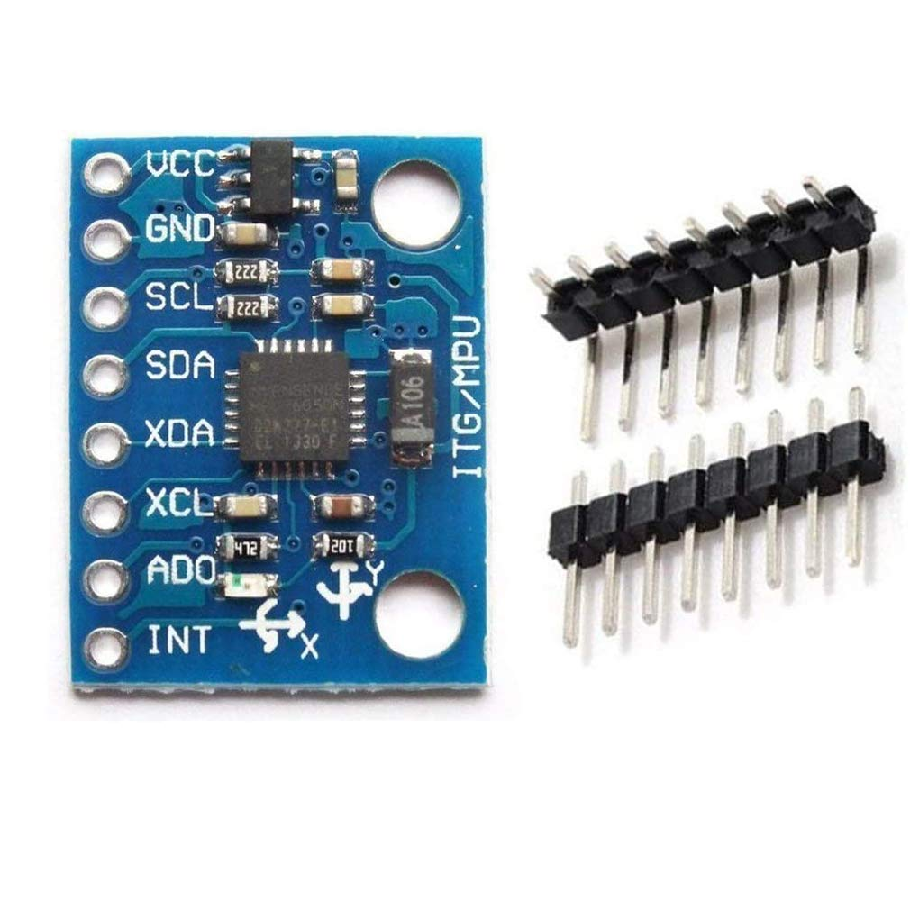
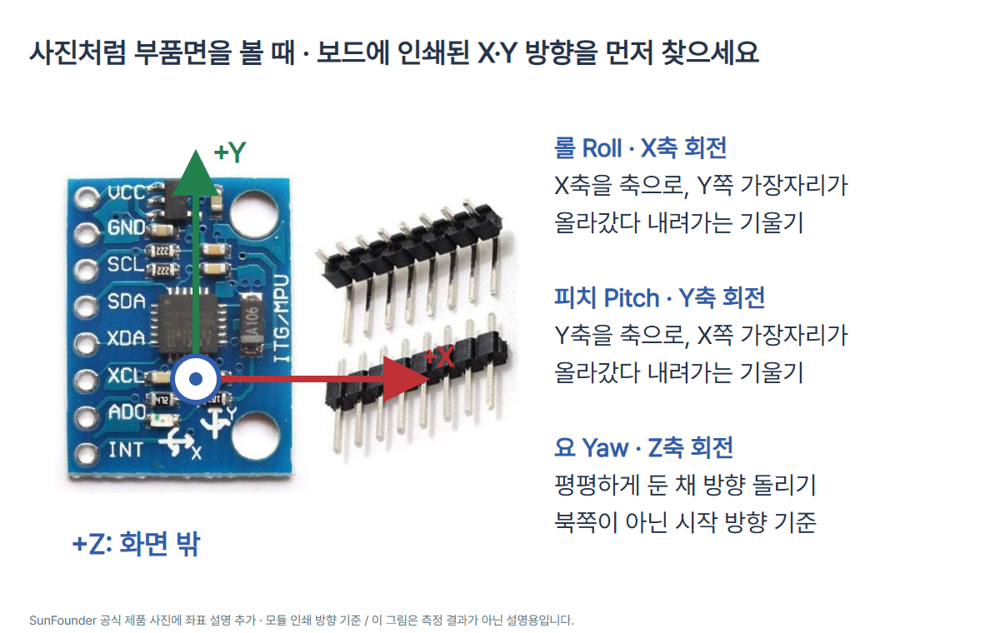

# CODEPLANT TECH 16 · 파란색 GY-521로 롤·피치·요 읽기

아두이노 UNO R3와 **파란색 8핀 GY-521 MPU6050**으로 I²C 통신과 자세각을 배웁니다. 가속도 3축·각속도 3축을 읽고 Madgwick의 **6-DoF IMU 모드**로 롤·피치·상대 요각을 계산합니다. 자력계가 없으므로 북쪽 기준 방위나 시간이 지나도 유지되는 절대 요각을 제공하지 않습니다.

2026-10-19 사용자 지정에 따라 기존 Adafruit 3886 편을 **같은 편 ID와 주소에서** GY-521로 교체했습니다. 3886의 VIN·3Vo 핀과 이 GY-521의 VCC·8핀 배열은 다릅니다. 표지·사진·회로·코드·캡션도 함께 교체했습니다.

## 1. 준비물과 정확한 모듈

- Arduino UNO R3, 데이터 통신용 USB 케이블.
- SunFounder GY-521(SF-0122)과 같은 **파란색 8핀 / 3.3V 전원 레귤레이터 탑재형** MPU6050 한 개, 연결용 헤더.
- **Adafruit 757 BSS138 4채널 I²C 양방향 레벨 변환기** 한 개, 브레드보드·점퍼선. 다른 BSS138 보드는 A/B 대신 LV1/HV1 등의 이름을 쓸 수 있으므로 제조사 핀표로 대응합니다. TXB0108 같은 다른 방식의 변환기로 임의 대체하지 않습니다.



사진의 부품면을 볼 때 헤더는 왼쪽, 위→아래는 **VCC, GND, SCL, SDA, XDA, XCL, AD0, INT**입니다. 도형은 헤더가 위쪽인 방향이므로 그림의 좌우 위치보다 실물에 인쇄된 이름을 먼저 찾습니다. GY-521이라는 이름과 파란색만으로 모든 판매 제품의 회로·품질을 보증하지 않습니다. 사진·핀 이름·3.3V 레귤레이터를 확인한 모듈에 적용합니다.

**전원과 신호 전압을 구별합니다.** 이 레귤레이터 탑재 모듈의 VCC에는 5V를 공급하지만 MPU6050 칩 자체는 5V 칩이 아닙니다. UNO의 5V 신호는 변환기의 B(HV)쪽, 센서의 3.3V 신호는 A(LV)쪽입니다. GY-521 전원 레귤레이터를 신호 레벨 변환기로 취급하지 않습니다. 변환기의 내부 풀업을 사용하므로 외부 풀업 저항은 추가하지 않습니다.

## 2. I²C 연결

모든 전원을 빼고 배선합니다. I²C의 **SDA**는 데이터, **SCL**은 데이터를 주고받는 박자입니다. UNO R3에서 SDA=A4, SCL=A5이며 별도 SDA/SCL 헤더도 같은 신호지만 이 그림에서는 A4/A5만 사용합니다. `0x68`은 핀 번호가 아닌 **7비트 I²C 장치 주소**입니다. 통신 속도는 100kHz로 설정합니다.


| UNO / 기준 | 실제 연결 | 목적 |
| --- | --- | --- |
| 5V | GY-521 VCC + 변환기 HV | 모듈 전원과 높은 신호 기준 |
| 3.3V | 변환기 LV | 낮은 신호 기준; GY-521 VCC에는 연결하지 않음 |
| GND (아래쪽 POWER 헤더) | 변환기 GND_H | UNO 쪽 접지 |
| 변환기 GND_L | GY-521 GND | 센서 쪽 접지; 변환기의 두 GND는 내부 공통 |
| A4 / SDA | 변환기 B1 ↔ A1 → GY-521 SDA | 데이터 전압 변환 |
| A5 / SCL | 변환기 B2 ↔ A2 → GY-521 SCL | 클록 전압 변환 |
| GY-521 AD0 | GY-521 GND | 주소를 0x68로 선택 |

같은 전원을 여러 곳으로 나누는 검은 접점은 브레드보드의 같은 연결 줄로 만듭니다. 선이 교차하되 접점 표시가 없으면 서로 연결하지 않습니다. 브레드보드 전원 레일이 중간에서 끊긴 제품은 연속성을 확인합니다. 변환기 GND_L/GND_H는 설명용 구분이며 실물 양쪽에는 모두 GND라고 인쇄되어 있습니다. UNO VIN은 사용하지 않습니다.

| GY-521 8핀 | 기능 | 이번 연결 |
| --- | --- | --- |
| VCC | 모듈 전원 입력; 탑재 레귤레이터가 칩 전원 생성 | UNO 5V |
| GND | 공통 0V 기준 | GND |
| SCL | 주 I²C 클록 | 변환기 A2 |
| SDA | 주 I²C 데이터 | 변환기 A1 |
| XDA / XCL | 보조 I²C 데이터/클록; 외부 센서 확장용 | 미사용 |
| AD0 | 주소 선택; LOW=0x68, HIGH=0x69 | GND 고정 |
| INT | 데이터 준비 등 설정된 이벤트의 인터럽트 출력 | 미사용; 주기적으로 읽음 |

AD0를 HIGH로 바꾸려면 센서의 **3.3V 논리 조건**을 따라야 합니다. 이 예제에서는 바꾸지 않습니다. 변환기의 A3·A4·B3·B4도 비워 둡니다. MPU6050은 SPI 모드가 없으며 이 실습은 I²C만 사용합니다.

## 3. 축, 롤·피치·요



사진처럼 부품면을 정면에서 보면 보드 인쇄의 **+X는 오른쪽, +Y는 위쪽, +Z는 사진 밖(관찰자 쪽)**입니다. 보드를 책상에 평평하게 두고 부품면을 위로 향하면 +Z도 위쪽입니다. 센서 축은 보드에 붙어 함께 움직이며, 책상의 고정된 동서남북이 아닙니다. 양의 회전은 오른손 엄지를 +축으로 향했을 때 손가락이 감기는 방향입니다.

| 자세각 | 회전 축 | 평평한 출발 자세에서 할 동작 | 출력 |
| --- | --- | --- | --- |
| 롤 Roll | X | +Y 가장자리를 천천히 들기. 반대로 내려 음수도 비교 | `roll_deg` |
| 피치 Pitch | Y | +X 가장자리를 천천히 내리기. 들면 음수 방향 | `pitch_deg` |
| 요 Yaw | Z | 평평하게 둔 채 위에서 보아 반시계 방향으로 돌리기 | `yaw_rel_deg` |

출력은 오른손 좌표계의 **ZYX(Yaw-Pitch-Roll) Euler 각 표현**입니다. 한 축씩 작은 각도로 움직이는 실습부터 하세요. 세 축을 크게 섞어 돌리면 각 출력은 독립적인 세 개의 경첩 각도가 아닙니다. 내부 계산은 쿼터니언이지만 출력은 Euler 각이므로 **피치 ±90° 부근에서는 롤·요가 서로 구분하기 어려워지고 표시가 급변할 수 있습니다**. 작은 각도 예제를 정밀 항법 장치나 드론 제어에 그대로 사용하지 않습니다.

### 롤·피치를 중력으로 구하는 비교식

정지하거나 아주 천천히 움직여 가속도 입력이 주로 중력일 때, 현재 부호 기준은 다음과 같습니다. 아래 식은 학습용 비교식이며 전체 코드는 필터 출력을 사용합니다.

```text
rollAcc_rad  = atan2(ay, az)
pitchAcc_rad = atan2(-ax, sqrt(ay*ay + az*az))
angle_deg    = angle_rad * 180 / pi
```

수평 +Z 위 자세에서는 이상적으로 `ax=0, ay=0, az=9.80665`입니다. 예를 들어 **합성 입력** `ax=0, ay=g*sin(30°), az=g*cos(30°)`을 위 식에 넣으면 롤 30°, 피치 0°입니다. 이는 계산 예시이며 실물 측정값이 아닙니다. 급가속·진동도 가속도에 포함되므로 가속도만으로는 회전과 이동을 항상 구별할 수 없습니다. `atan2(ay,az)`의 ±180° 경계도 연속된 숫자처럼 단순 빼기 하지 않습니다.

### 요는 왜 떠다닐까요

평평한 상태의 짧은 Z축 회전은 `각속도(°/s) × 시간(s)`을 누적하는 것으로 이해할 수 있습니다. 예를 들어 **가상의 일정한 각속도** 30°/s가 1초면 약 30°입니다. 실제 예제는 `gz`만 더하지 않고 Madgwick의 `updateIMU()`로 X/Y/Z 각속도를 쿼터니언에 함께 반영합니다. 기울어진 보드의 `gz`는 곧바로 세계 Z축 요각 변화율이 아닙니다.

가속도는 아래/위 방향을 알려주지만 그 축 주위로 어느 방위를 바라보는지는 알려주지 않습니다. MPU6050에는 지자기 센서가 없어서 요의 절대 기준을 관측하지 못합니다. 정지 각속도 오차가 0.5°/s 남았다면 10초에 약 5°가 쌓일 수 있다는 **계산 예시**가 가능합니다. 실제 오차량은 실물로 기록합니다. Madgwick 6축 융합도 이 관측 한계를 없애지 못합니다.

`z`/`Z`를 전송하면 현재 방향을 상대 요각 0°로 다시 표시합니다. **각속도 편향을 다시 측정하거나 드리프트를 제거하는 동작이 아닙니다.** 상대 요각은 `[-180°, +180°)`로 접어 표시하므로 +179° 부근에서 -179°로 바뀌어도 반대 방향으로 358° 회전한 뜻은 아닙니다. RESET하면 처음부터 정지 보정합니다.

## 4. Arduino IDE와 실행

1. Arduino IDE는 코드를 작성·컴파일해서 보드로 보내는 프로그램입니다. 이 안내는 UNO R3 / Arduino AVR Boards 1.8.6을 기준으로 합니다. 실제 메뉴 배치는 IDE 버전에 따라 다를 수 있습니다.
2. 라이브러리 관리자에서 **Madgwick by Arduino 1.2.0**을 설치합니다. Wire는 UNO 보드 코어에 포함됩니다. 이번 전체 코드는 센서 레지스터를 Wire로 읽으므로 Adafruit MPU6050 라이브러리를 추가 설치할 필요가 없습니다.
3. USB를 연결하고 Arduino Uno 보드와 실제 연결된 포트를 선택합니다. 전체 코드를 복사하거나 `sketch.ino`를 엽니다. 이 저장소의 강의 폴더 이름과 Arduino 스케치 기본 이름이 다르므로 IDE가 같은 이름의 스케치 폴더 생성을 제안하면 **로컬 사본**으로 저장합니다.
4. 확인(컴파일) 후 업로드합니다. 보드를 평평하게 두고 **부품면을 위로**, 배선이 당기지 않게 놓습니다. 시작 후 1초 안정화, `CALIBRATING` 중 약 5초 정지, `READY` 순서입니다. 시리얼 모니터를 여는 과정에서 UNO가 재시작할 수 있으므로 다시 정지 보정을 기다립니다.
5. 시리얼 모니터를 **115200 baud**로 엽니다. `BIAS_DPS`는 시작 때 잰 각속도 평균이며 미리 지어낸 보정 상수가 아닙니다.
6. 한 축씩 작게 기울이고 원위치로 돌아와 다른 두 각도도 비교합니다. 마지막에 평평하게 Z축으로 돌리고 `z`를 전송해 상대 요각을 다시 0°로 표시합니다. 줄바꿈 설정은 어느 것이어도 z/Z 이외 문자는 무시합니다.

| 공식 참고 화면 | 확인할 행동 |
| --- | --- |
|  | 자신의 UNO와 실제 포트를 고릅니다. |
|  | 확인 후 업로드합니다. |
|  | 이 예제는 115200 baud, RPY 출력 이름을 확인합니다. |

위 세 화면은 **Arduino Documentation / Karl Söderby의 공식 참고 화면(CC BY-SA 4.0)**을 재사용한 것이며 이번 실물 보드에서 촬영한 화면이 아닙니다. 화면의 다른 예제 출력이나 속도를 이 예제의 출력으로 주장하지 않습니다. 원 출처: [UNO 시작](https://docs.arduino.cc/tutorials/uno-rev3/getting-started/) 및 [Arduino IDE 안내](https://docs.arduino.cc/software/ide-v2/). 실제 Arduino IDE 제품명은 버전과 구별합니다.

## 5. 단위·설정·출력 읽기

| 항목 | 설정 / 의미 |
| --- | --- |
| 센서 주소 / 식별 | AD0 LOW → 주소 0x68 / WHO_AM_I의 기대값도 0x68 |
| PWR_MGMT_1 0x6B | 먼저 0x80으로 이전 설정 초기화, 이후 0x01로 수면 해제·X 자이로 PLL 클록 |
| CONFIG 0x1A | 0x04: 가속도 약 21Hz / 자이로 약 20Hz 저역 통과 필터 |
| SMPLRT_DIV 0x19 | 19: 필터 사용 시 1kHz/(19+1)=50Hz |
| GYRO_CONFIG 0x1B | 0x00: ±250°/s, 131 LSB/(°/s) |
| ACCEL_CONFIG 0x1C | 0x00: ±2g, 16384 LSB/g |
| 계산 간격 | 목표 20ms. 실제 `micros()` 간격을 초로 바꿔 매번 필터에 전달 |
| 출력 간격 | 약 100ms마다 한 줄. 실제 계산 속도는 실물의 `dt_ms`로 확인 |

가속도는 `raw × 9.80665/16384`로 m/s², 자이로는 `raw/131`로 °/s입니다. Madgwick Arduino API의 각속도 입력은 **°/s**입니다. 이전 Adafruit 라이브러리의 **rad/s**와 다릅니다. 만약 rad/s 입력을 이 API로 보내려면 먼저 ×180/π가 필요하지만 이 전체 코드에서는 직접 °/s로 변환하므로 추가 변환하지 않습니다. 가속도는 필터 내부에서 정규화되지만 이 예제 전체에서는 m/s²로 일관되게 다룹니다.

`filter.begin(1/dt)`는 1.2.0 소스에서 적분 시간만 갱신합니다. 쿼터니언을 재시작하지 않습니다. `getYaw()`가 붙이는 180° 오프셋은 `yawZero`를 빼서 상쇄합니다. `elapsed`는 부호 없는 차이이므로 micros()의 약 71.6분 순환에도 차이를 계산할 수 있습니다. 100ms를 넘는 지연은 `TIME_GAP`으로 멈추므로 긴 공백을 정상적인 회전으로 이어 붙이지 않습니다.

표시 형식은 다음과 같습니다. 기호는 실제 측정으로 채워질 자리이며 아래 줄을 실물 로그로 제시하지 않습니다.

```text
roll_deg=<도> pitch_deg=<도> yaw_rel_deg=<도> acc_ms2=<가속도 크기> dt_ms=<간격>
```

정지 때 `acc_ms2`는 대략 9.8입니다. 롤·피치는 수평 기준이고 요만 시작/재설정 방향 기준입니다. 소수점 한 자리를 표시한다고 0.1° 정확도가 보장되지는 않습니다.

## 6. 복사해 실행할 전체 코드

```cpp
// CODEPLANT TECH 16: UNO R3 + blue 8-pin GY-521 + BSS138 I2C level shifter.
// Educational 6-DoF attitude estimate. Yaw is relative, not a compass heading.
#include <Wire.h>
#include <MadgwickAHRS.h>
#include <math.h>

const uint8_t ADDRESS = 0x68;  // AD0 -> GND
const uint32_t PERIOD_US = 20000;  // target 50 updates/s
const float G0 = 9.80665f;
Madgwick filter;
float biasX = 0, biasY = 0, biasZ = 0;  // stationary gyro bias, deg/s
float yawZero = 0;
uint32_t lastSample = 0, lastPrint = 0;
struct Sample { float ax, ay, az, gx, gy, gz; };

void stopWith(const __FlashStringHelper *message) {
  Serial.println(message);
  while (true) { delay(1000); }  // fix the cause, then press RESET
}

bool writeRegister(uint8_t reg, uint8_t value) {
  Wire.beginTransmission(ADDRESS);
  Wire.write(reg); Wire.write(value);
  return Wire.endTransmission() == 0;
}

bool readBytes(uint8_t reg, uint8_t count, uint8_t *data) {
  Wire.clearWireTimeoutFlag();
  Wire.beginTransmission(ADDRESS); Wire.write(reg);
  if (Wire.endTransmission(false) != 0) return false;
  if (Wire.requestFrom(ADDRESS, count) != count) return false;
  for (uint8_t i = 0; i < count; ++i) data[i] = Wire.read();
  return !Wire.getWireTimeoutFlag();
}

int16_t signed16(const uint8_t *b) {
  return (int16_t)(((uint16_t)b[0] << 8) | b[1]);
}

bool readSample(Sample &s) {
  uint8_t b[14];
  if (!readBytes(0x3B, sizeof(b), b)) return false;
  // +/-2g: 16384 LSB/g; +/-250 deg/s: 131 LSB/(deg/s).
  s.ax = signed16(b) * (G0 / 16384.0f);
  s.ay = signed16(b + 2) * (G0 / 16384.0f);
  s.az = signed16(b + 4) * (G0 / 16384.0f);
  // b[6..7] is temperature, not a gyro axis.
  s.gx = signed16(b + 8) / 131.0f;
  s.gy = signed16(b + 10) / 131.0f;
  s.gz = signed16(b + 12) / 131.0f;
  return true;
}

float norm(const Sample &s) {
  return sqrtf(s.ax*s.ax + s.ay*s.ay + s.az*s.az);
}

float wrap180(float degrees) {
  while (degrees >= 180.0f) degrees -= 360.0f;
  while (degrees < -180.0f) degrees += 360.0f;
  return degrees;
}

void calibrate() {
  Serial.println(F("CALIBRATING: flat, component side up; keep still for 5 s"));
  float sum[3] = {0}, sum2[3] = {0};
  const uint16_t N = 250;
  for (uint16_t i = 0; i < N; ++i) {
    Sample s;
    if (!readSample(s)) stopWith(F("ERROR: I2C_READ"));
    // Teaching thresholds: require a nearly level, stationary start.
    if (fabsf(norm(s)-G0) > 0.6f || fabsf(s.ax) > 1.7f ||
        fabsf(s.ay) > 1.7f || s.az < 9.0f ||
        fabsf(s.gx) > 5 || fabsf(s.gy) > 5 || fabsf(s.gz) > 5)
      stopWith(F("ERROR: CAL_MOVE_OR_NOT_LEVEL"));
    float g[3] = {s.gx, s.gy, s.gz};
    for (uint8_t k = 0; k < 3; ++k) { sum[k] += g[k]; sum2[k] += g[k]*g[k]; }
    delay(20);
  }
  float mean[3];
  for (uint8_t k = 0; k < 3; ++k) {
    mean[k] = sum[k]/N;
    float variance = sum2[k]/N - mean[k]*mean[k];
    if (variance > 0.64f) stopWith(F("ERROR: CAL_NOISE"));
  }
  biasX = mean[0]; biasY = mean[1]; biasZ = mean[2];
}

void setup() {
  Serial.begin(115200);
  Wire.begin(); Wire.setClock(100000); Wire.setWireTimeout(25000, true);
  uint8_t who = 0;
  if (!readBytes(0x75, 1, &who) || who != 0x68)
    stopWith(F("ERROR: MPU6050_NOT_FOUND"));
  if (!writeRegister(0x6B, 0x80)) stopWith(F("ERROR: I2C_CONFIG"));
  delay(100);  // reset any settings left by an earlier sketch
  if (!writeRegister(0x6B, 0x01)) stopWith(F("ERROR: I2C_CONFIG"));
  delay(100);  // wake, use X gyro PLL clock
  if (!writeRegister(0x1A, 0x04) || !writeRegister(0x19, 19) ||
      !writeRegister(0x1B, 0x00) || !writeRegister(0x1C, 0x00))
    stopWith(F("ERROR: I2C_CONFIG"));
  delay(1000);
  calibrate();
  filter.begin(50.0f);
  yawZero = filter.getYaw();
  Serial.print(F("BIAS_DPS=")); Serial.print(biasX, 3); Serial.print(',');
  Serial.print(biasY, 3); Serial.print(','); Serial.println(biasZ, 3);
  Serial.println(F("READY: roll_deg pitch_deg yaw_rel_deg; send z to zero yaw"));
  lastSample = micros(); lastPrint = millis();
}

void loop() {
  if ((uint32_t)(micros()-lastSample) < PERIOD_US) return;
  Sample s;
  if (!readSample(s)) stopWith(F("ERROR: I2C_READ"));
  uint32_t now = micros();
  uint32_t elapsed = now-lastSample; lastSample = now;
  if (elapsed > 100000UL) stopWith(F("ERROR: TIME_GAP"));
  if (fabsf(s.ax) > 19.0f || fabsf(s.ay) > 19.0f || fabsf(s.az) > 19.0f ||
      fabsf(s.gx) > 240 || fabsf(s.gy) > 240 || fabsf(s.gz) > 240)
    stopWith(F("ERROR: NEAR_RANGE_LIMIT"));
  // begin() updates only dt; it does not reset the quaternion.
  filter.begin(1000000.0f/elapsed);
  filter.updateIMU(s.gx-biasX, s.gy-biasY, s.gz-biasZ, s.ax, s.ay, s.az);
  float roll = filter.getRoll(), pitch = filter.getPitch(), yaw = filter.getYaw();
  if (!isfinite(roll) || !isfinite(pitch) || !isfinite(yaw))
    stopWith(F("ERROR: FILTER_VALUE"));
  while (Serial.available()) {
    char command = Serial.read();
    if (command == 'z' || command == 'Z') { yawZero = yaw; Serial.println(F("YAW_ZERO")); }
  }
  if ((uint32_t)(millis()-lastPrint) >= 100) {
    lastPrint = millis();
    Serial.print(F("roll_deg=")); Serial.print(roll, 1);
    Serial.print(F(" pitch_deg=")); Serial.print(pitch, 1);
    Serial.print(F(" yaw_rel_deg=")); Serial.print(wrap180(yaw-yawZero), 1);
    Serial.print(F(" acc_ms2=")); Serial.print(norm(s), 2);
    Serial.print(F(" dt_ms=")); Serial.println(elapsed/1000.0f, 1);
  }
}
```

### 코드 줄별 역할

아래 줄 번호는 위 전체 코드와 `sketch.ino` 기준입니다. 중괄호는 블록 경계, 빈 줄은 읽기 간격입니다. 같은 역할의 연속 줄은 묶었습니다.

| 줄 | 역할 |
| --- | --- |
| 3~5 | I²C 통신·Madgwick 자세 필터·삼각함수와 유한값 검사를 준비합니다. |
| 7~14 | 7비트 주소, 목표 계산 간격 20ms, 표준 중력, 필터·편향·시각·가속도/각속도 저장 공간입니다. |
| 16~18 | 오류 문장을 출력하고 멈춥니다. 연결·자세를 고친 뒤 RESET으로 다시 시작합니다. |
| 21~24 | 센서의 설정 레지스터 한 개에 값을 쓰고 ACK를 확인합니다. |
| 27~33 | 레지스터 주소 전송 → repeated START → 필요한 바이트 수 확인 → 읽기 → Wire 시간 초과 확인입니다. |
| 36~37 | 상위/하위 바이트를 16비트 부호 있는 수로 합칩니다. 음수도 복원합니다. |
| 40~50 | 0x3B부터 14바이트를 읽습니다. 가속도는 m/s², 자이로는 °/s로 바꿉니다. 온도 2바이트를 건너뜁니다. |
| 54~55 | 가속도 세 축의 합성 크기입니다. 정지할 때 대략 중력 크기와 비교합니다. |
| 58~61 | 상대 요각을 -180° 이상 +180° 미만으로 표시합니다. 회전 횟수 누적값이 아닙니다. |
| 64~86 | 평평하게 정지한 250회 표본에서 각속도 평균을 구합니다. 자세·움직임·분산 조건에 실패하면 중단합니다. |
| 89~109 | 시리얼·I²C 초기화, 센서 ID와 설정 확인, 1초 안정화, 약 5초 정지 보정 후 READY와 기준값을 준비합니다. |
| 112~118 | 20ms 이상 경과했을 때만 읽고, 실제 읽기 시각 차이를 구합니다. 100ms 넘는 간격은 자세를 이어 계산하지 않고 중단합니다. |
| 119~121 | 설정 범위에 가까운 큰 가속도·회전이면 중단합니다. 이 기준은 센서 정밀 보정이 아닙니다. |
| 123~125 | 실제 간격으로 필터의 dt를 갱신하고 정지 편향을 뺀 자이로·가속도를 융합합니다. 라이브러리 출력은 도입니다. |
| 126~127 | NaN·무한값을 잘못된 자세각으로 출력하지 않고 멈춥니다. |
| 128~130 | z/Z 문자만 요 기준을 현재 방향으로 바꿉니다. 줄바꿈 등 다른 문자는 무시합니다. |
| 132~138 | 약 100ms마다 롤·피치·상대 요각·가속도 합성 크기·실제 계산 간격을 출력합니다. |

## 7. 정지 보정과 실패 시 점검

정지 보정은 현재 온도·상태에서 자이로 세 축의 평균 편향만 추정합니다. 가속도 6면 보정·축 정렬·온도별 보정은 수행하지 않습니다. 정상 정지여도 모듈 특성 때문에 편차가 크면 검사를 통과하지 못할 수 있습니다. 아래 판정 기준은 **이 수업 예제의 보수적인 시작 조건**이며 제조사의 합격 기준이나 자동 정밀 보정 수치가 아닙니다.

- 250회, 각 회차 20ms 대기(읽기 시간까지 더해져 약 5초 이상). 가속도 크기와 g의 차이 0.6m/s² 이하, X/Y 크기 각 1.7m/s² 이하, Z>9.0m/s²로 거의 수평 +Z 위 자세를 요구합니다.
- 세 자이로의 순간 크기 각 5°/s 이하, 표본 분산 각 0.64(°/s)² 이하를 요구합니다. 모든 종류의 움직임을 검출하는 것은 아니므로 사용자가 실제로 정지 상태를 유지해야 합니다.
- 보정 뒤에도 온도·시간에 따른 편향 변화가 남을 수 있습니다. 정지 상태·작은 각도·가속 운동에서 결과를 따로 기록합니다.

| 메시지 / 현상 | 할 일 |
| --- | --- |
| MPU6050_NOT_FOUND | 전원 차단 후 SDA/SCL, AD0 GND, HV/LV, 부품 모델과 납땜을 확인합니다. 다른 칩의 WHO_AM_I를 무시하고 통과시키지 않습니다. |
| I2C_CONFIG / I2C_READ | ACK·받은 바이트 수·타임아웃 오류입니다. 배선과 GND, 전원·접촉 상태를 고친 뒤 RESET합니다. 오류를 센서 측정값으로 대체하지 않습니다. |
| CAL_MOVE_OR_NOT_LEVEL | 책상에 평평하게 부품면을 위로 놓고 손을 뗀 후 RESET합니다. |
| CAL_NOISE | 흔들림·접촉·진동을 줄이고 다시 시작합니다. 계속되면 센서 상태를 확인합니다. |
| NEAR_RANGE_LIMIT | 빠른 회전·충격을 멈춥니다. 범위를 임의로 바꾸면 환산 계수도 함께 바꿔야 합니다. |
| TIME_GAP | 읽기/출력/작업 지연을 확인하고 RESET합니다. |
| FILTER_VALUE | 유한하지 않은 필터 값입니다. RESET 후 계속되면 코드·라이브러리 버전과 데이터를 확인합니다. |
| 요가 천천히 변함 | 6축 요의 관측 한계입니다. 북쪽을 검출한 것으로 해석하지 않습니다. z는 표시 기준만 재설정합니다. |
| +179°에서 -179°로 바뀜 | 정상적인 상대 요각 표시 경계입니다. 차이를 구할 때도 -180~180°로 정규화합니다. |
| 기울일 때 세 값이 함께 변함 | 실제 축 방향과 복합 회전을 확인합니다. 수평 근처에서 한 축씩 작게 시험합니다. |

## 8. 검증 범위

UNO R3 컴파일 통과(AVR Boards 1.8.6 / Wire 1.0 / Madgwick 1.2.0): flash 14066 B / SRAM 477 B. 7개 전압 구분 네트·잘못된 배선 11종 거부·공식 핀 좌표/접점·README 전체 코드/단위/축 설명·독립 합성 수학 검사 통과. 10장 PNG 1080x1350·전체 ZIP·하단 겹침·블루 배경·모바일·캡션 복사/저장·이미지 붙여넣기·저장 재열기 검사 통과. 실제 UNO/GY-521 배선·전압·측정·자세 정확도·현장 보정과 시뮬레이션은 미시험. 정지 보정 기능을 코드에 넣은 것과 실제 센서를 보정·시험한 것은 다릅니다. 합성 입력으로 확인한 수학 결과를 측정 결과로 쓰지 않습니다.

## 9. 출처·사진 사용 조건

- [GY-521 실제 모델·사진](https://www.sunfounder.com/products/3pcs-gy-521-mpu-6050-mpu6050-3-axis-accelerometer-gyroscope-module-6-dof-6-axis-accelerometer-gyroscope-sensor-module-16-bit-ad-converter-data-output-iic-i2c-for-arduino)
- [사용한 GY-521 단독 사진](https://www.sunfounder.com/cdn/shop/files/sunfounder-default-title-3pcs-gy-521-mpu-6050-mpu6050-3-axis-accelerometer-gyroscope-module-6-dof-6-axis-accelerometer-gyroscope-sensor-module-16-bit-ad-converter-data-output-iic-i2c-for-arduino-32536733417707_1600x.jpg?v=1768447042)
- [MPU6050 칩 사양·전원·단위·축](https://product.tdk.com/system/files/dam/doc/product/sensor/mortion-inertial/imu/data_sheet/mpu-6000-datasheet1.pdf)
- [MPU6050 레지스터](https://invensense.tdk.com/wp-content/uploads/2015/02/MPU-6000-Register-Map1.pdf)
- [GY-521 UNO 연결·기본 예제](https://docs.sunfounder.com/projects/umsk/en/latest/02_arduino/uno_lesson05_mpu6050.html)
- [I2C 양방향 레벨 변환기](https://www.adafruit.com/product/757)
- [레벨 변환기 공식 도형·andydoro](https://github.com/adafruit/Fritzing-Library/blob/master/parts/Adafruit%204-channel%20I2C-safe%20Bi-directional%20Logic%20Level%20Converter.fzpz)
- [도형 라이선스](https://github.com/adafruit/Fritzing-Library/blob/master/LICENSE)
- [GY-521 공식 Wokwi 핀](https://github.com/wokwi/wokwi-elements/blob/main/src/mpu6050-element.ts)
- [가속도 기울기와 오차](https://www.analog.com/en/resources/app-notes/an-1057.html)
- [Madgwick 필터 API·원본·라이선스](https://github.com/arduino-libraries/MadgwickAHRS)
- [센서 융합 알고리즘 원문](https://x-io.co.uk/open-source-imu-and-ahrs-algorithms/)
- [UNO 원본 사진·라이선스](https://commons.wikimedia.org/wiki/File:Arduino_Uno_-_R3.jpg)
- [CODEPLANT 채널](https://www.youtube.com/@codeplant2024)
- [칩 레지스터·분주·범위 상수 대조(하드웨어는 GY-521)](https://github.com/adafruit/Adafruit_MPU6050/blob/master/Adafruit_MPU6050.h)
- [센서 원시값 변환 대조](https://github.com/adafruit/Adafruit_MPU6050/blob/master/Adafruit_MPU6050.cpp)
- [SunFounder GY-521 VCC 5V 전원 예시](https://docs.sunfounder.com/projects/vincent-kit/en/latest/arduino/2.34_mpu6050_module.html)

- UNO 사진: SparkFun Electronics, CC BY 2.0, 표시 크기만 변경. GY-521: SunFounder 공식 제품 사진, 별도의 자유 이용 라이선스는 확인하지 못했습니다. 원본을 보존하고 표지 크기 조절 및 별도 축 안내 그림에서 설명을 덧붙였습니다.
- 도형: Wokwi UNO/MPU6050, MIT. 레벨 변환기 도형: Adafruit Fritzing Library / andydoro, CC BY-SA 3.0. 파생 배선도와 3번 회로 카드도 CC BY-SA 3.0. 소스 HTML/JSON에 원 도형과 핀 정보를 함께 남깁니다.
- 자세 계산: Arduino Madgwick 1.2.0 및 Sebastian Madgwick 알고리즘. 원 라이브러리의 GPL 고지를 따릅니다. 라이브러리 소스는 수정·복제하지 않고 Arduino 관리자로 설치합니다. 본 편의 전체 스케치도 GPL-3.0-or-later로 제공합니다. 사진·회로 도형에는 각 자료의 별도 조건이 적용됩니다.
- TDK 레지스터 원문의 기존 URL은 현재 리디렉션으로 직접 열람하지 못했습니다. 레지스터 주소·범위·환산 계수는 공식 Adafruit 드라이버 정의/구현과 대조했으며 칩 전원 사양은 TDK 제품 사양서에서 확인했습니다.
- 자료 확인일: 2026-10-19. SunFounder 기초 페이지의 압전 설명처럼 칩 원리와 충돌할 수 있는 문구는 옮기지 않았으며 TDK 칩 자료, 실제 사진 핀 이름, 라이브러리 구현을 기준으로 작성했습니다.

## 10. 편집·다운로드

기존 로컬 편집기의 편 ID `arduino-016-mpu6050`를 유지합니다. 카드 10장, 회로와 축 PNG, 전체 코드·README·캡션을 같은 GitHub 폴더에 제공합니다. Ctrl+V 이미지 삽입·캡션 복사·한 편 전체 PNG ZIP 기능은 기존 편집기를 사용합니다.
