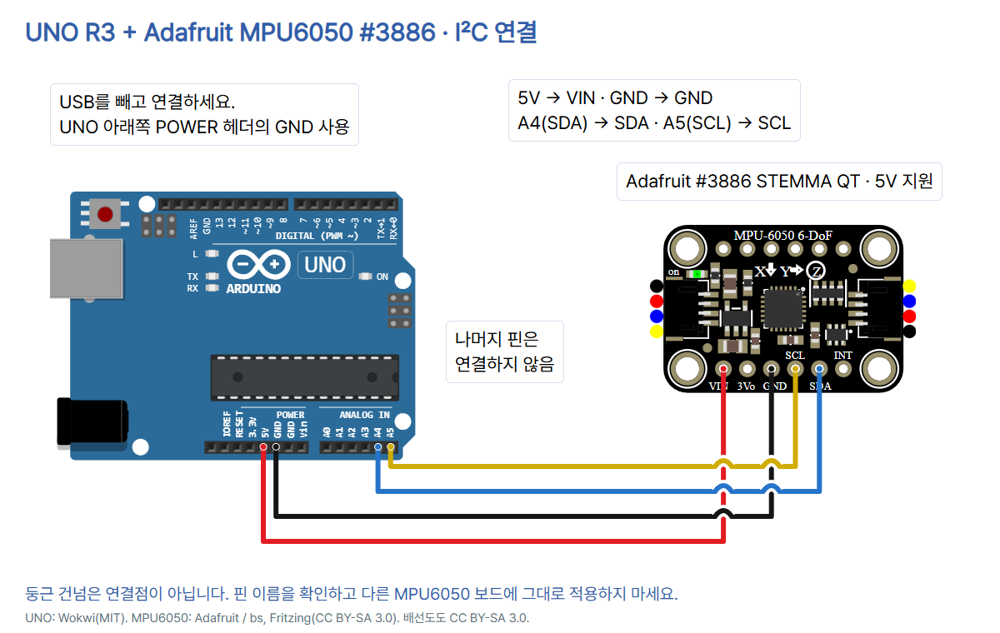

# 16 · 가속도와 회전을 읽는 MPU6050 센서

Arduino UNO R3 + **Adafruit MPU6050 제품번호 3886 STEMMA QT**. [전체 자료](https://github.com/CodeplantEDU/codeplant-tech/tree/main/arduino/016-mpu6050). 가속도·각속도 세 축의 변화를 비교하는 입문 예제입니다. 각도·속도·위치·방위 추정은 구현하지 않습니다.

## 사용할 부품

UNO R3, 위 모델 모듈, 납땜이 준비된 헤더, 브레드보드, 단자에 맞는 점퍼선 4개, USB 데이터 케이블. 헤더를 구멍에 꽂기만 해서는 접촉이 보장되지 않습니다. 외부 LED·저항·전원은 추가하지 않습니다.

계획 목록에는 GY-521이 있었으나 UNO의 5V I²C와 연결할 정확한 전압 조건을 확정하기 위해 **5V 전원·신호 레벨 변환이 명시된 Adafruit 3886**을 이번 기준으로 선택했습니다. 센서 칩의 기능과 학습 순서는 유지합니다. 이 연결을 GY-521에 그대로 적용하지 않습니다. GY-521은 실제 보드 회로·풀업 전압을 확인하고 필요하면 양방향 I²C 레벨 변환을 별도 설계해야 합니다.

Adafruit 모듈은 전압 조정기와 SCL/SDA 레벨 변환·10kΩ 풀업을 포함합니다. 노출된 MPU6050 칩 자체가 5V용이라는 뜻은 아닙니다. 공식 제품 사진과 도형은 같은 제품 계열입니다. 제조사에 따르면 2023년 인쇄체 변경판은 회로가 같고 글씨만 달라, 사진과 도형의 글씨체 차이를 같은 것으로 그리지 않고 그대로 유지했습니다.

## 연결표 · USB를 빼고 연결

| UNO | 모듈 핀 | 역할 |
|---|---|---|
| 5V | VIN | 모듈 전원 입력 |
| GND (아래쪽 POWER 헤더) | GND | 공통 접지 |
| A4 / SDA | SDA | I²C 데이터 |
| A5 / SCL | SCL | I²C 통신 박자 |
| 연결 안 함 | 3Vo·INT·AD0·위쪽 보조 핀 | 이번 실습 미사용 |



아래쪽 헤더를 왼쪽부터 VIN, 3Vo, GND, SCL, SDA, INT로 확인합니다. 3Vo는 출력이므로 비워 두고 UNO의 VIN도 쓰지 않습니다. 위쪽 AD0·FS·SCE·SDE·CLKIN·보조 GND 및 QT 단자는 연결하지 않습니다. 주소 점퍼를 바꾸지 않은 기본 0x68을 사용합니다. AD0를 HIGH로 바꾸면 0x69가 되므로 이 코드 그대로 시작되지 않습니다. 코드 주소와 실물 설정을 함께 확인하세요. 둥근 건넘은 연결점이 아닌 절연 교차입니다.

## Arduino IDE·라이브러리·실행

1. [Arduino IDE](https://www.arduino.cc/en/software)를 설치하고 USB 데이터 케이블로 UNO를 연결합니다. 도구 → 보드 → Arduino UNO, 도구 → 포트에서 실제 포트를 선택합니다.
2. 라이브러리 관리자에서 **Adafruit MPU6050 2.2.9**를 설치합니다. 설치 요청되는 의존성도 설치하세요. 이번 환경은 Unified Sensor 1.1.15, BusIO 1.17.4, GFX Library 1.12.6, SSD1306 2.5.17입니다. 뒤의 두 라이브러리는 패키지 메타데이터의 예제 의존성이며 이 스케치에서 화면을 사용하지 않습니다.
3. 전체 코드를 붙여넣고 검증 → 업로드를 누릅니다. 시리얼 모니터를 **115200 baud**로 엽니다. READY 뒤 가만히 두고 값의 기준을 봅니다.
4. 센서 가장자리를 잡아 천천히 기울입니다. 그다음 한 방향으로 천천히 돌렸다 멈춥니다. 선을 잡아당기거나 센서를 떨어뜨리지 않습니다. 두 동작에서 가속도·각속도가 어떻게 다른지 기록합니다.

아래는 **Arduino IDE 2 계열 공식 도구 위치 참고 화면**이며 이번 편의 설치·가속도 측정 캡처가 아닙니다. 참고 그림의 9600 표시는 이번 코드에서 **115200**으로 바꿉니다. IDE 1.8.x에서는 도구 메뉴로 보드·포트, 스케치 → 라이브러리 포함하기 → 라이브러리 관리에서 설치합니다. 원본: Arduino Documentation / Karl Söderby, CC BY-SA 4.0. [기본 세팅 편 상세 출처](../001-basic-setup/README.md).


## 전체 코드

```cpp
// UNO R3 + Adafruit MPU6050 #3886 STEMMA QT, 5V I2C.
#include <Wire.h>
#include <Adafruit_MPU6050.h>
Adafruit_MPU6050 mpu;
const uint8_t ADDRESS = 0x68;

void setup() {
  Serial.begin(115200);
  Wire.begin();
  Wire.setWireTimeout(25000, true);
  if (!mpu.begin(ADDRESS)) {
    Serial.println("ERROR: MPU6050_NOT_FOUND");
    while (true) { delay(1000); }
  }
  mpu.setAccelerometerRange(MPU6050_RANGE_2_G);
  mpu.setGyroRange(MPU6050_RANGE_250_DEG);
  mpu.setFilterBandwidth(MPU6050_BAND_21_HZ);
  Serial.println("READY address=0x68");
}

void loop() {
  Wire.beginTransmission(ADDRESS);
  if (Wire.endTransmission() != 0) {
    Serial.println("ERROR: I2C_ACK");
    delay(500);
    return;
  }
  sensors_event_t a, g, t;
  mpu.getEvent(&a, &g, &t);
  Serial.print("acc_ms2=");
  Serial.print(a.acceleration.x, 2); Serial.print(",");
  Serial.print(a.acceleration.y, 2); Serial.print(",");
  Serial.print(a.acceleration.z, 2);
  Serial.print(" gyro_rads=");
  Serial.print(g.gyro.x, 2); Serial.print(",");
  Serial.print(g.gyro.y, 2); Serial.print(",");
  Serial.println(g.gyro.z, 2);
  delay(500);
}
```

## 각 줄의 역할

| 줄 | 역할 |
|---|---|
| 1 | 기준 보드·모듈·전압 주석 |
| 2 | I²C 라이브러리 |
| 3 | MPU6050 라이브러리 |
| 4 | 기본 I²C 센서 객체 |
| 5 | 기본 주소 0x68 |
| 6 | 빈 줄: 코드 구분 |
| 7 | 시작 시 한 번 실행 |
| 8 | 시리얼 115200 |
| 9 | UNO I²C 시작(A4/A5) |
| 10 | 25,000μs 대기 제한·시간 초과 시 버스 리셋 |
| 11 | 주소 응답·칩 ID와 초기화 확인 |
| 12 | 초기화 실패 안내 |
| 13 | 실패 시 반복 측정하지 않고 대기 |
| 14 | 초기화 조건 끝 |
| 15 | 가속도 범위 ±2g |
| 16 | 각속도 범위 ±250°/s |
| 17 | 저역 통과 필터 대역 21Hz |
| 18 | 초기화 성공 안내 |
| 19 | setup 끝 |
| 20 | 빈 줄: 코드 구분 |
| 21 | 반복 실행 |
| 22 | 측정 전 해당 주소에 통신 시작 |
| 23 | 주소 응답이 실패했는지 확인 |
| 24 | 주소 응답 오류 출력 |
| 25 | 다음 시도 전 500ms 대기 |
| 26 | 이번 loop의 값 출력을 생략 |
| 27 | 응답 실패 조건 끝 |
| 28 | 가속도·각속도·온도 이벤트 저장 공간 |
| 29 | 세 이벤트 읽기(온도 t는 이번 출력에서 미사용) |
| 30 | 가속도 이름과 m/s² 단위 표시 |
| 31 | X 가속도·쉼표 |
| 32 | Y 가속도·쉼표 |
| 33 | Z 가속도 |
| 34 | 각속도 이름과 rad/s 단위 표시 |
| 35 | X 각속도·쉼표 |
| 36 | Y 각속도·쉼표 |
| 37 | Z 각속도·줄바꿈 |
| 38 | 매회 출력 뒤 500ms 대기 |
| 39 | loop 끝 |

## 단위와 관찰

- `acc_ms2` 뒤 세 값은 X,Y,Z 가속도이며 단위는 **m/s²**입니다. 정지 상태에서도 중력이 포함됩니다. 세 축의 합성 크기 √(x²+y²+z²)는 대략 9.8m/s²이며 어느 축에 나타나는지는 센서 방향에 따라 다릅니다. 출력은 합성값이 아닌 각 축입니다.
- `gyro_rads` 뒤는 X,Y,Z 각속도이며 **rad/s**입니다. 1rad는 약 57.3도이지만 이 코드는 도/초로 변환하지 않습니다. 설정의 ±250°/s와 출력 단위 rad/s를 구분하세요. 천천히 돌리는 동안과 정지 후를 비교합니다.
- 가속도 ±2g, 각속도 ±250°/s, 필터 21Hz는 관찰용 설정입니다. 21Hz는 출력 간격이 아닙니다. 매회 500ms 대기 외에 읽기·문자 전송 시간도 더해집니다.
- `t`는 라이브러리가 함께 채우는 센서 내부 온도 이벤트이며 이번 출력에서는 사용하지 않습니다. 장치 위치나 사람의 체온을 추정하지 않습니다.

**형식 예시이며 실제 측정값이 아닙니다.** 아래 숫자가 꼭 나와야 하는 것은 아닙니다.

```text
READY address=0x68
acc_ms2=0.02,-0.03,9.81 gyro_rads=0.01,0.00,-0.01
```

정지한 자이로에도 편차(바이어스)와 잡음이 있을 수 있고 온도·장착 조건도 영향을 줍니다. 이 코드는 보정값을 임의로 넣거나 시작 때 자동 영점 보정을 하지 않습니다. 정밀 측정에는 실제 정지 데이터로 축별 오차·온도·장착을 점검해야 합니다. 소수점 두 자리는 정확도 보장이 아닙니다. 가속도를 단순 적분해 이동 거리로 쓰거나 각속도를 바로 회전 각도라고 읽지 않습니다.

## 오류·점검 순서

- 출력 없음·깨짐: USB 데이터 케이블·UNO 보드·실제 포트·업로드 완료·115200을 확인합니다.
- `ERROR: MPU6050_NOT_FOUND`: 주소 0x68의 초기화·칩 ID 확인 실패입니다. USB를 빼고 5V–VIN, GND, A4–SDA, A5–SCL·헤더 접촉·제품 모델·주소 점퍼를 확인한 뒤 다시 시작합니다. 고장이나 특정 단선을 확정하는 메시지는 아닙니다.
- `ERROR: I2C_ACK`: 반복 측정 전 해당 주소가 응답하지 않았습니다. 그 회차에는 값을 출력하지 않고 500ms 후 다시 시도합니다. 전원을 연결한 채로 배선을 바꾸지 마세요.
- 정지값이 정확히 0이 아님: 중력과 자이로 편차를 구분합니다. 판에 안정적으로 둔 뒤 여러 줄의 변화를 먼저 관찰합니다. 센서 포화·빠른 충격은 이 입문 실습 대상이 아닙니다.

Wire 제한은 AVR Boards 1.8.6에서 25,000μs 대기 뒤 버스를 리셋하는 설정입니다. 모든 고장을 복구한다는 뜻이 아닙니다. 주소 ACK 점검은 장치 응답만 검사하며, 이어지는 데이터 읽기 성공·정확도까지 검증하지 않습니다. Adafruit 2.2.9의 getEvent는 내부 읽기 결과를 모두 실패로 전파하지 않으므로, 예제의 ACK 검사를 모든 통신 오류 검출로 해석하지 않습니다.

## 검증 범위

Arduino CLI에서 UNO 대상으로 컴파일했습니다. Arduino AVR Boards 1.8.6, Adafruit MPU6050 2.2.9, BusIO 1.17.4, Unified Sensor 1.1.15를 사용했으며 플래시 12,822바이트·SRAM 644바이트입니다.

`python verify.py`는 4개 독립 넷, 합선·누락·핀 혼동 7가지 거부, 공식 도형의 두 단계 translate를 포함한 실제 핀 좌표·선 끝점·절연 건넘 5곳, README 전체 코드·연결표·주소·단위·X/Y/Z 출력 순서를 검사했습니다.

기존 check.mjs에서 7장 1080×1350 PNG, TECH 블루·사진·푸터 겹침·모바일, 캡션 복사·이미지 붙여넣기·저장 재열기·한 편 전체 PNG ZIP을 확인했습니다. 최종 PNG로 다시 구성한 전체 ZIP의 7장 순서·크기·파일 바이트 일치를 확인했습니다. 디자이너·학생·선생님 관점 자체 검토이며 실제 사람의 피드백은 받지 않았습니다.

실제 UNO/MPU6050 배선·가속도/회전 측정·보정 및 시뮬레이션은 미시험입니다. 컴파일·넷/문서 검사는 센서의 실제 동작·정밀도·통신 장애 복구를 증명하지 않습니다.

diagram.json은 편집용 넷·좌표 메타데이터입니다. MPU6050은 공식 Adafruit Fritzing 도형을 HTML에 포함한 것이며 Wokwi에서 곧바로 실행되는 프로젝트라고 표시하지 않습니다. 범용 교육용 회로 검사기는 BMP/MPU 전용 템플릿을 지원하지 않으므로 verify.py로 넷·공식 좌표·핀 끝점·절연 건넘·코드/표 일치를 검사합니다.

## 출처·사용 조건

- [Adafruit 제품번호 3886·사진·모듈 버전](https://www.adafruit.com/product/3886) — 2026-10-19 확인
- [실제 모듈 사진](https://cdn-shop.adafruit.com/970x728/3886-10.jpg) — 2026-10-19 확인
- [전원·레벨 변환·풀업·핀·주소](https://learn.adafruit.com/mpu6050-6-dof-accelerometer-and-gyro/pinouts) — 2026-10-19 확인
- [Arduino 공식 가이드·단위](https://learn.adafruit.com/mpu6050-6-dof-accelerometer-and-gyro/arduino) — 2026-10-19 확인
- [라이브러리 버전·의존성](https://github.com/adafruit/Adafruit_MPU6050/blob/master/library.properties) — 2026-10-19 확인
- [라이브러리 기본 예제](https://github.com/adafruit/Adafruit_MPU6050/blob/master/examples/basic_readings/basic_readings.ino) — 2026-10-19 확인
- [API·범위·주소](https://github.com/adafruit/Adafruit_MPU6050/blob/master/Adafruit_MPU6050.h) — 2026-10-19 확인
- [읽기 처리·출력 단위](https://github.com/adafruit/Adafruit_MPU6050/blob/master/Adafruit_MPU6050.cpp) — 2026-10-19 확인
- [공식 Fritzing MPU6050 도형](https://github.com/adafruit/Fritzing-Library/blob/master/parts/Adafruit%20MPU6050.fzpz) — 2026-10-19 확인
- [도형 라이선스 CC BY-SA 3.0](https://github.com/adafruit/Fritzing-Library/blob/master/LICENSE) — 2026-10-19 확인
- [UNO 공식 도형·핀](https://github.com/wokwi/wokwi-elements/blob/main/src/arduino-uno-element.ts) — 2026-10-19 확인
- [UNO 사진 SparkFun CC BY 2.0](https://commons.wikimedia.org/wiki/File:Arduino_Uno_-_R3.jpg) — 2026-10-19 확인
- [CODEPLANT 채널 MPU6050 검색 · 일치 콘텐츠 없음](https://www.youtube.com/@codeplant2024/search?query=MPU6050) — 2026-10-19 확인

UNO 사진: SparkFun Electronics, CC BY 2.0. MPU6050 사진: Adafruit 공식 제품 사진이며 별도 자유 이용 라이선스는 확인되지 않았습니다. 크기 조절 외에 제품 모습을 편집하지 않았습니다.

공식 MPU6050 Fritzing 도형의 author는 bs이며 Adafruit Fritzing Library의 CC BY-SA 3.0을 따릅니다. 원본 벡터·누적 translate 좌표를 사용하고 배선·한국어 설명·배율을 추가했습니다. 해당 배선도, HTML의 도형 및 3번 회로 카드는 CC BY-SA 3.0으로 제공합니다(https://creativecommons.org/licenses/by-sa/3.0/). UNO 도형은 Wokwi MIT. 센서 라이브러리는 BSD 계열이며 원본 소스를 이 폴더에 재배포하지 않습니다.

코드플랜트 공개 채널의 MPU6050 검색에는 일치 콘텐츠가 없다는 안내가 나왔습니다. 관련 영상 시청·전사 내용을 사용했다고 쓰지 않습니다. 제조사·공식 라이브러리와 핀 자료를 근거로 구성했습니다. Instagram 캡션은 직접 GitHub 주소를 안내하며 검증 상태는 README와 내부 review에 기록합니다.
