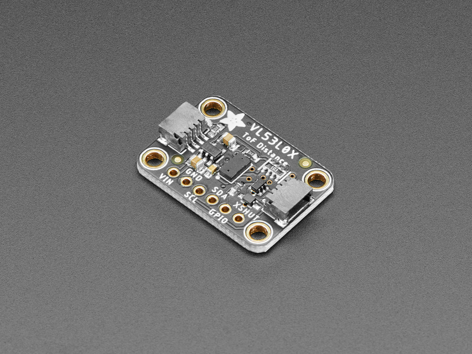
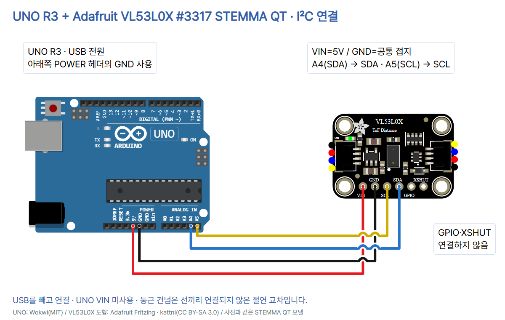

# 17 · 빛으로 거리를 읽는 VL53L0X 센서

Arduino UNO R3 + **Adafruit VL53L0X #3317 STEMMA QT rev C**. [전체 자료](https://github.com/CodeplantEDU/codeplant-tech/tree/main/arduino/017-vl53l0x). 센서가 빛의 왕복 시간을 이용해 거리를 구하고, UNO는 I²C로 결과를 읽습니다. 초음파 센서의 Trig/Echo 방식이나 조도 센서의 밝기값과 다릅니다.

## 준비물·사진·모델 확인

UNO R3, 위 모델 센서 한 개, 연결용 헤더·브레드보드·점퍼선 4개, USB 데이터 케이블, 자와 넓은 종이. 헤더는 납땜된 것을 준비합니다. 구멍에 꽂아 두는 것만으로는 접촉이 보장되지 않습니다. GPIO·XSHUT를 사용하지 않는 기본 단발 측정 예제입니다. LED·저항·외부 전원을 추가하지 않습니다.



사진과 회로는 두 QT 커넥터와 6핀 헤더가 있는 같은 STEMMA QT 모델입니다. 앞면 아래쪽 핀은 왼쪽부터 **VIN, GND, SCL, SDA, GPIO, XSHUT**입니다. 공식 Fritzing 내부 커넥터 이름 VCC(29번)는 실물 인쇄의 VIN입니다. GPIO는 일반 용도 5V 입출력으로 취급하지 않습니다. 2020년 이전 구형 보드에 있던 2V8 출력 핀은 이 QT 보드에 없습니다. 사진과 도형의 커넥터 색상이 다를 수 있으나 제조사는 검정·베이지 QT 커넥터가 같은 기능이라고 설명합니다.

이 모듈은 전압 조정과 I²C 신호 레벨 변환을 포함하므로 UNO의 5V 전원·논리에 맞춰 씁니다. **VL53L0X 칩 자체가 5V용이라는 뜻은 아닙니다.** 이름만 같은 3.3V 전용 브레이크아웃에 이 배선을 그대로 쓰지 않습니다.

## USB를 빼고 연결

| UNO | 모듈 핀 | 역할 |
|---|---|---|
| 5V | VIN | 모듈 전원 입력 |
| GND (아래쪽 POWER 헤더) | GND | 공통 접지 |
| A4 / SDA | SDA | I²C 데이터 |
| A5 / SCL | SCL | I²C 클록 |
| 연결 안 함 | GPIO · XSHUT | 이번 실습 미사용 |



UNO VIN은 연결하지 않습니다. XSHUT(SHDN)는 LOW에서 센서를 정지시키는 핀으로 이 모듈에서 기본 풀업이 있으므로 비워 둡니다. GPIO는 데이터 준비 신호용이며 2.8V 논리, 미사용입니다. QT 커넥터·UNO 위쪽의 중복 SDA/SCL 헤더도 이번에는 사용하지 않습니다. 그림의 둥근 건넘은 선이 연결되지 않는 절연 교차입니다.

기본 주소 **0x29는 7비트 I²C 주소**이며 핀 번호나 장치의 고유 식별 번호가 아닙니다. 이 코드는 한 개만 연결하고 주소를 바꾸지 않습니다. 여러 같은 센서를 붙이면 XSHUT로 하나씩 켜고 주소를 설정하는 별도 구성이 필요합니다. 센서는 전원을 다시 켜면 기본 주소로 돌아옵니다.

## Arduino IDE 설치·실행·화면 안내

1. [Arduino IDE](https://www.arduino.cc/en/software)는 코드를 작성·컴파일하고 보드에 업로드하는 프로그램입니다. UNO를 데이터용 USB로 연결하고 보드 **Arduino Uno**, 실제 포트를 선택하세요.
2. 라이브러리 관리자에서 **Adafruit_VL53L0X 1.2.5**를 설치합니다. 의존성 설치를 물으면 함께 설치합니다. 메타데이터 의존성은 Adafruit SSD1306/GFX로 관련 예제를 위한 것이며 이 스케치는 OLED를 사용하지 않습니다. 컴파일에 실제 연결된 라이브러리 버전은 아래 검증 기록으로 구분합니다.
3. 아래 전체 코드를 복사해 확인(컴파일) 후 업로드합니다. 저장소 폴더명과 스케치 파일명이 달라 IDE가 새 스케치 폴더를 제안하면 로컬 사본으로 저장해 업로드합니다.
4. 시리얼 모니터를 **115200 baud**로 엽니다. `READY address=0x29`가 나온 뒤 센서 광학창의 정면에 넓고 평평한 종이를 놓습니다.
5. 광학창 앞부터 자로 10·20·30cm 위치를 정하고 종이를 옮깁니다. 이는 비교 실습의 목표 위치이며 센서가 그 수치를 실제로 출력했다는 기록이 아닙니다. 센서를 고정하고 종이만 옮겨 여러 줄을 기록합니다.
6. 같은 거리에서 종이를 약간 기울이거나 주변 빛을 바꾸어 상태와 거리값이 어떻게 달라지는지 비교합니다. 광학창을 손가락·테이프·물로 가리지 않습니다.

아래 세 화면은 **Arduino IDE 2 계열 도구 위치의 공식 참고 화면**(Arduino Documentation / Karl Söderby, CC BY-SA 4.0)이며 이번 센서로 실제 실행한 캡처가 아닙니다. 예전 IDE 1.8.x에서는 도구→보드·포트, 스케치→라이브러리 포함하기→라이브러리 관리의 메뉴 위치와 창 모양이 다릅니다. 화면의 다른 예제 출력이나 baud를 이 예제에 적용하지 마세요. [기본 세팅의 화면 출처](../001-basic-setup/README.md).


## 복사해 실행할 전체 코드

```cpp
// UNO R3 + Adafruit VL53L0X #3317 STEMMA QT, I2C, default mode.
#include <Wire.h>
#include <Adafruit_VL53L0X.h>
Adafruit_VL53L0X lox;
const uint8_t ADDRESS = 0x29;

void setup() {
  Serial.begin(115200);
  Wire.begin();
  Wire.setWireTimeout(25000, true);
  if (!lox.begin(ADDRESS, false, &Wire)) {
    Serial.println(F("ERROR: VL53L0X_NOT_FOUND_OR_INIT"));
    while (true) { delay(1000); }
  }
  Wire.setClock(100000);
  Wire.setWireTimeout(25000, true);
  Serial.println(F("READY address=0x29, distance in mm and cm"));
}

void loop() {
  VL53L0X_RangingMeasurementData_t measure = {};
  Wire.clearWireTimeoutFlag();
  VL53L0X_Error error = lox.rangingTest(&measure, false);
  if (Wire.getWireTimeoutFlag()) {
    Serial.println(F("ERROR: I2C_TIMEOUT"));
    Wire.clearWireTimeoutFlag();
  } else if (error != VL53L0X_ERROR_NONE) {
    Serial.print(F("ERROR: API_ERROR code="));
    Serial.println((int)error);
  } else if (measure.RangeStatus != 0) {
    Serial.print(F("RANGE_INVALID status="));
    Serial.println(measure.RangeStatus);
  } else {
    Serial.print(F("distance_mm="));
    Serial.print(measure.RangeMilliMeter);
    Serial.print(F(" distance_cm="));
    Serial.println(measure.RangeMilliMeter / 10.0f, 1);
  }
  delay(250);  // measurement time is added to this wait
}
```

## 코드 줄별 역할

위 전체 코드와 `sketch.ino`의 줄 번호입니다. 빈 줄은 간격, 중괄호는 블록의 경계입니다.

| 줄 | 역할 |
|---|---|
| 1 | 실습 보드·모듈·주기 또는 처리 이유를 적은 주석입니다. |
| 2 | I²C 통신 기능을 포함합니다. |
| 3 | VL53L0X 센서 드라이버와 자료형을 포함합니다. |
| 4 | 센서 한 개를 제어할 lox 객체입니다. |
| 5 | 센서의 기본 7비트 I²C 주소 0x29입니다. |
| 7 | 부팅 때 한 번 실행할 초기화 블록입니다. |
| 8 | 시리얼 모니터를 115200 baud로 맞춥니다. |
| 9 | UNO의 A4/A5 I²C를 시작합니다. |
| 10 | Wire 단일 통신 대기 제한과 버스 복구를 설정합니다. 전체 드라이버 호출의 25ms 제한은 아닙니다. |
| 11 | 지정 주소로 센서 연결·초기화를 시도하고 실패를 검사합니다. |
| 12 | 출력 문구로 READY·오류 종류·거리 단위와 값을 구분합니다. |
| 13 | 초기화 실패 후 멈춥니다. 전원 차단 후 연결을 확인하고 재시작합니다. |
| 15 | I²C 통신을 100kHz로 맞춥니다. |
| 16 | Wire 단일 통신 대기 제한과 버스 복구를 설정합니다. 전체 드라이버 호출의 25ms 제한은 아닙니다. |
| 17 | 출력 문구로 READY·오류 종류·거리 단위와 값을 구분합니다. |
| 20 | 반복 측정 블록입니다. |
| 21 | 이번 측정 구조체를 0으로 초기화합니다. 값이 0이라고 측정 성공으로 판단하지 않습니다. |
| 22 | 이전 통신 시간 초과 표시를 지웁니다. |
| 23 | 단발 측정을 기다려 받은 뒤 API 오류 코드를 저장합니다. 반환값은 단순 bool이 아닙니다. |
| 24 | 이번 Wire 통신에 시간 초과가 있었는지 먼저 검사합니다. |
| 25 | 출력 문구로 READY·오류 종류·거리 단위와 값을 구분합니다. |
| 26 | 이전 통신 시간 초과 표시를 지웁니다. |
| 27 | API 오류가 0이 아니면 거리 출력 블록으로 가지 않습니다. |
| 28 | 출력 문구로 READY·오류 종류·거리 단위와 값을 구분합니다. |
| 29 | 부호 있는 API 오류 번호를 숫자로 출력합니다. |
| 30 | API 성공 뒤에도 측정 상태가 0인지 별도로 검사합니다. |
| 31 | 출력 문구로 READY·오류 종류·거리 단위와 값을 구분합니다. |
| 32 | 유효하지 않은 측정의 상태 번호를 출력합니다. |
| 33 | 통신·API·측정 상태가 모두 유효할 때만 거리 출력 블록으로 들어갑니다. |
| 34 | 출력 문구로 READY·오류 종류·거리 단위와 값을 구분합니다. |
| 35 | 유효한 거리의 mm 값을 출력합니다. |
| 36 | 출력 문구로 READY·오류 종류·거리 단위와 값을 구분합니다. |
| 37 | mm를 10.0으로 나누어 cm로 표시합니다. 소수점 한 자리는 정확도 보장이 아닙니다. |
| 39 | 측정 처리 뒤 250ms를 추가로 기다립니다. 정확히 초당 네 번 측정한다는 뜻은 아닙니다. |

## 출력과 오류를 구별하기

정상 형식은 `distance_mm=<정수> distance_cm=<소수>`입니다. mm를 10으로 나누면 cm입니다. **계산 예시** 200mm=20.0cm는 단위 환산 설명이며 실물 측정 로그가 아닙니다. 소수점 한 자리나 mm 단위 출력이 그만큼의 정확도를 보증하지 않습니다.

이 예제는 기본 단발 측정 모드입니다. 한 측정 호출이 끝난 뒤 매회 250ms를 더 기다리므로 정확히 4Hz 출력이 아닙니다. `Wire.setWireTimeout(25000,true)`는 Wire 통신 대기 제한으로, 센서의 측정 및 ST 드라이버 전체가 25ms 이내 끝난다는 뜻은 아닙니다. API 내부에서 측정 완료를 기다리는 블로킹 예제입니다. 시간에 민감한 모터 제어와 함께 쓸 때는 그대로 사용하지 않습니다.

| 메시지 | 의미와 다음 행동 |
|---|---|
| VL53L0X_NOT_FOUND_OR_INIT | 센서 연결 또는 초기화 실패. 전원 차단 후 VIN/GND·SDA/SCL·헤더·XSHUT를 확인하고 재시작합니다. 주소 0x29에 응답하는 것만으로 센서 정상 여부를 확정하지 않습니다. |
| I2C_TIMEOUT | 이번 Wire 통신에서 시간 초과. 그 회차에는 거리값을 출력하지 않습니다. 전원 차단 후 배선·접촉·접지를 확인합니다. |
| API_ERROR code=... | 드라이버 호출 실패. 이때 구조체의 거리/상태를 유효 결과로 쓰지 않습니다. |
| RANGE_INVALID status=... | API 호출은 성공했지만 거리 측정 결과가 유효하지 않습니다. 0mm나 먼 거리로 바꾸지 않습니다. 넓은 종이를 가까운 정면에 놓고 주변 빛과 표면 상태를 비교합니다. |

`rangingTest()`는 `VL53L0X_Error` 코드(0이면 성공)를 반환하며 단순 bool 반환으로 해석하지 않습니다. 성공한 뒤에도 `RangeStatus`를 확인합니다. ST API 기준 0은 유효, 1은 sigma 판정 실패, 2는 신호 판정 실패, 3은 최소 거리 판정 실패, 4는 phase 판정 실패, 5는 하드웨어 실패, 255는 측정 갱신 없음입니다. 숫자만 보고 정확한 고장 부위를 단정하지 않습니다. 특히 4만 거르고 나머지를 모두 정상 거리로 쓰지 않도록 **0만 허용**합니다.

유효 상태라도 표면의 반사 특성·주변광·표적 크기·방향·설정에 따라 정확도와 범위가 달라집니다. 광학창에서부터 자로 잰 위치와 여러 회차를 비교합니다. 매우 가까운 물체, 유리·거울, 검은 표면, 좁은 물체를 만능으로 정확히 측정한다고 주장하지 않습니다. 이번에는 장거리 모드·오프셋/크로스토크 현장 보정·커버유리 추가를 하지 않습니다. 보정값을 지어내지 않습니다.

## 검증 범위

Arduino AVR Boards 1.8.6의 UNO R3 대상으로 실제 컴파일을 통과했습니다. Wire 1.0과 Adafruit_VL53L0X 1.2.5를 사용했으며 플래시 18,920B, 전역 SRAM 1,170B(남은 공간 878B)입니다.

전용 `verify.py`에서 전원·접지·데이터·클록의 독립 배선, 7종 잘못된 연결 거부, 공식 핀 중심 좌표·도선 끝점·절연 교차, 전체 코드/README 일치, 오류·상태 검사 순서와 단위 환산을 확인했습니다. 공통 회로 검증기는 서보/조도센서만 지원하므로 이번 모델의 통과 근거로 사용하지 않았습니다. `check.mjs`는 1080×1350 카드 7장·전체 PNG ZIP·사진·하단·TECH 블루·모바일·캡션 저장/복사·이미지 삽입/붙여넣기·저장 후 재열기 검수를 통과했습니다. 최종 카드와 회로 이미지도 눈으로 확인했습니다.

실제 UNO/센서 전원·배선·거리·정확도·주변광·보정 및 시뮬레이션은 미시험입니다. 카드 생성 또는 코드 컴파일 성공은 실물 측정 성공을 뜻하지 않습니다. 실제 시험이 없다는 기록은 여기와 내부 review에 보존하고 Instagram 캡션에는 넣지 않습니다.

## 출처·사진·도형 사용 조건

- [Adafruit #3317 제품·STEMMA QT 개정](https://www.adafruit.com/product/3317)
- [실제 모듈 사진](https://cdn-shop.adafruit.com/970x728/3317-06.jpg)
- [전원·I2C·제어 핀](https://learn.adafruit.com/adafruit-vl53l0x-micro-lidar-distance-sensor-breakout/pinouts)
- [공식 Arduino 연결·라이브러리](https://learn.adafruit.com/adafruit-vl53l0x-micro-lidar-distance-sensor-breakout/arduino-code)
- [라이브러리 버전·의존성](https://github.com/adafruit/Adafruit_VL53L0X/blob/master/library.properties)
- [rangingTest API](https://github.com/adafruit/Adafruit_VL53L0X/blob/master/src/Adafruit_VL53L0X.h)
- [반환값·상태 해석](https://github.com/adafruit/Adafruit_VL53L0X/blob/master/src/Adafruit_VL53L0X.cpp)
- [ST VL53L0X API 사용자 설명서](https://www.st.com/resource/en/user_manual/um2039-world-smallest-timeofflight-ranging-and-gesture-detection-sensor-application-programming-interface-stmicroelectronics.pdf)
- [공식 Fritzing 도형](https://github.com/adafruit/Fritzing-Library/blob/master/parts/Adafruit%20VL53L0X%20Time%20of%20Flight%20Distance%20Sensor.fzpz)
- [도형 라이선스](https://github.com/adafruit/Fritzing-Library/blob/master/LICENSE)
- [UNO 공식 핀 좌표](https://github.com/wokwi/wokwi-elements/blob/main/src/arduino-uno-element.ts)
- [UNO 원본 사진](https://commons.wikimedia.org/wiki/File:Arduino_Uno_-_R3.jpg)
- [CODEPLANT 채널 · 검색에서 VL53L0X 강의 확인 못함](https://www.youtube.com/@codeplant2024)

- UNO 사진: SparkFun Electronics, CC BY 2.0, 표시 크기만 조절. 센서 사진: Adafruit 공식 제품 사진, 별도 자유 이용 라이선스는 확인하지 못했습니다. 사진의 원본을 보존하고 크기만 바꿨습니다.
- UNO 도형은 Wokwi(MIT). VL53L0X 도형은 Adafruit Fritzing Library / kattni, CC BY-SA 3.0. 파생 회로 이미지와 3번 회로 카드도 CC BY-SA 3.0입니다. 공식 SVG를 HTML 안에 넣고 핀 좌표를 그대로 변환했습니다. 이 교육용 JSON은 해당 센서가 자동으로 동작하는 Wokwi 시뮬레이터 파일이라는 뜻이 아닙니다.
- Arduino 라이브러리는 Adafruit wrapper(BSD)와 ST 원본 API의 고지를 따릅니다. 원 라이브러리를 복제·수정해 배포하지 않고 라이브러리 관리자로 설치합니다.
- CODEPLANT 채널과 해당 센서 검색을 확인했으나 이번 조사에서 일치하는 강의·자막을 확정하지 못했습니다. 특정 영상에서 배웠다고 쓰지 않습니다. 공식 제품 페이지의 관성센서용 6-DoF 홍보 문구 등 이 거리 센서와 맞지 않는 표현도 옮기지 않았습니다.
- 기술 자료 확인일: 2026-10-20. 원본 ZIP·입력서·비밀값은 공개하지 않습니다.

## 편집·내보내기

로컬 편 ID `arduino-017-vl53l0x`를 유지합니다. 기본 7장 1080×1350 PNG, 회로 PNG, 전체 코드·README·캡션을 같은 공개 폴더에 제공합니다. 기존 로컬 편집기의 카드 내부 Ctrl+V 이미지 삽입, 캡션 복사와 전체 PNG ZIP 다운로드를 사용합니다.
