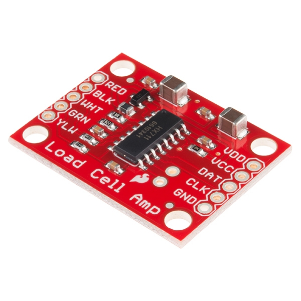
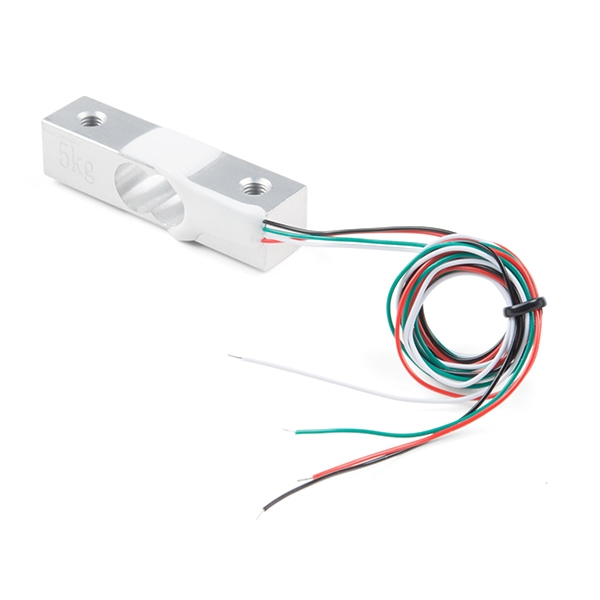
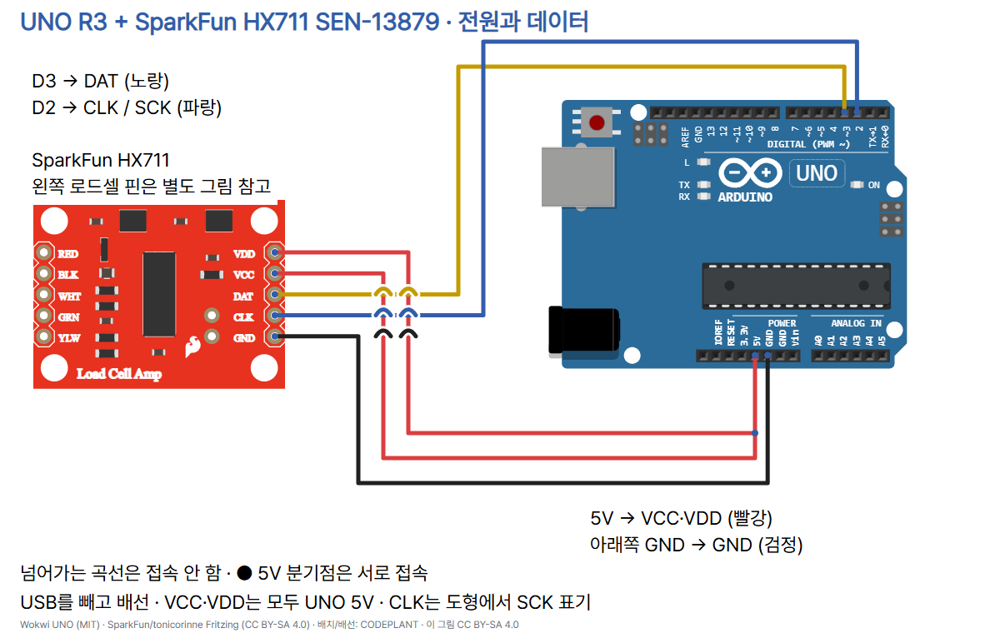
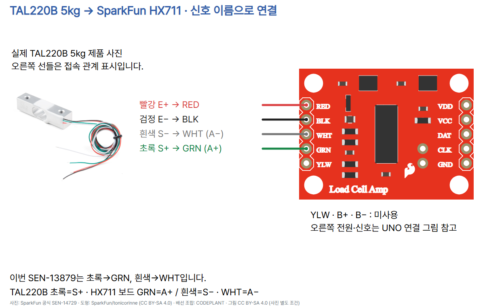

# 18 · 무게를 숫자로 읽는 HX711과 로드셀

Arduino UNO R3 + **SparkFun HX711 SEN-13879** + **TAL220B 5kg SEN-14729**. 로드셀의 미세한 전기 신호를 HX711이 디지털 값으로 바꿉니다. 원시값 자체에 g 단위는 없으며, 빈 받침판의 영점과 실제 기준 추를 이용한 보정을 거쳐 질량을 비교합니다. 이 구성의 전압·핀 배열을 다른 HX711 제품에 그대로 적용하지 않습니다.

## 준비물과 기계적 설치

위 부품 각 1개, 데이터 USB 케이블, 점퍼선·납땜된 헤더·접속부 절연재, UNO 5V를 두 핀으로 나눌 브레드보드 또는 절연된 분기선, 받침·받침판·간격재·부품 치수에 맞는 나사, g 질량이 확인된 기준 추를 준비합니다. 종이 위에 로드셀을 눕히고 물체를 올리는 것만으로 올바른 저울이 되지 않습니다.




로드셀 한쪽 끝은 아래 받침에, 반대쪽 끝은 위 받침판에 고정하여 힘이 로드셀을 통해 전달되게 합니다. 간격재로 휘어질 공간을 확보하고 중앙부를 받침에 닿게 하거나 양쪽을 같은 바닥에 단단히 붙이지 않습니다. 기준 추와 측정 물체는 판의 같은 위치에 올리고, 로드셀의 하중 방향 표시를 확인하세요. 나사 길이·간격은 실제 부품과 [치수도](https://cdn.sparkfun.com/assets/e/5/f/5/6/TAL220B.pdf)를 대조합니다. 받침판을 포함한 총 하중이 **5kg을 넘지 않도록** 합니다. 떨어뜨리기·강하게 누르기·비틀기는 피합니다. 5kg 이하라는 코드 판정은 실제 과부하를 막는 장치가 아닙니다.

## USB를 빼고 배선

| UNO R3 | SEN-13879 핀 | 역할 |
|---|---|---|
| 5V | VCC와 VDD 두 핀 | VCC는 아날로그 전원, VDD는 디지털 논리 전원 |
| 아래쪽 POWER GND | GND | 공통 접지 |
| D3 | DAT | 데이터 입력, HX711의 DOUT |
| D2 | CLK (도형은 SCK) | 통신 클록, HX711의 PD_SCK |



빨강은 전원, 검정은 접지, 노랑·파랑은 데이터·클록입니다. 작은 곡선은 서로 접속하지 않는 건넘이며 파란 점이 있는 5V 분기는 접속됩니다. 그림은 UNO 5V 논리 전용입니다. ESP32나 Pico의 3.3V GPIO에 그대로 연결하지 않습니다. 외부 모터 전원·UNO VIN·아날로그 입력 A0는 사용하지 않습니다. 통신은 I2C가 아니며 이 예제에 I2C 주소는 없습니다.

| TAL220B 선 | 의미 | SEN-13879 인쇄 | 공식 도형 커넥터 |
|---|---|---|---|
| 빨강 | E+ / Excitation+ | RED | connector27 / AVDD |
| 검정 | E− / Excitation− | BLK | connector26 / GND |
| 초록 | S+ / Signal+ | GRN | connector24 / A+ |
| 흰색 | S− / Signal− | WHT | connector25 / A− |
| 연결 없음 | 4선 로드셀에 실드선 없음 | YLW | connector23 / GND |
| 연결 없음 | 채널 B 미사용 | B+ / B− | connector21 / connector22 |



**지정한 조합은 초록→GRN(A+), 흰색→WHT(A−)입니다.** 그림의 사진 옆 선은 접속 관계를 나타낸 것으로 실제 케이블 끝 위치를 측정한 그림이 아닙니다. 배선 작업은 전원을 끄고 하고 노출 도선을 절연합니다.

### 충돌하는 공식 설명을 대조한 기록

SparkFun 저장소 readme에는 White=A+, Green=A−라는 일반 설명이 있으나, 해당 SEN-13879의 공식 Fritzing 커넥터와 PCB는 **GRN=A+, WHT=A−**로 대응합니다. TAL220B 데이터시트는 초록=S+, 흰색=S−입니다. 이 예제는 실제 보드 도형·PCB 패드·해당 로드셀 데이터시트를 함께 따라 연결했습니다. PCB JP4의 pad2=A+, pad3=A−이며, JP4의 R90 배치에서 이 두 패드는 GRN/WHT에 대응합니다. 이름만 같은 모듈에는 이 색상 표를 복사하지 않습니다. 음수 보정계수는 수학적으로 허용되지만 잘못된 전원 배선을 보정으로 해결할 수는 없습니다.

## Arduino IDE 설치·실행

1. [Arduino IDE](https://www.arduino.cc/en/software)는 코드를 쓰고 보드로 올리는 프로그램입니다. UNO를 USB 데이터 케이블로 연결하고 보드 **Arduino Uno**, 실제 연결된 포트를 고릅니다.
2. 왼쪽 라이브러리 관리자에서 **HX711 Arduino Library**, 저자 **Bogdan Necula / Andreas Motl**, 버전 **0.7.5**를 설치합니다. 이름이 비슷한 HX711_ADC나 다른 작성자의 HX711 라이브러리를 자동 대체하지 않습니다.
3. 아래 전체 코드를 새 스케치에 복사합니다. `KNOWN_MASS_G = 0.0f`의 0을 **직접 가진 기준 추의 g 질량**으로 바꿉니다. 예를 들어 질량이 확인된 100g 추를 가진 경우에만 `100.0f`로 바꿉니다. 이것은 실제 측정값·실습에 제공된 추의 사양이 아닌 입력 방법 예시입니다. 단위 kg를 넣지 않습니다. 0은 보정 금지 상태이고 물체 질량을 추측해 입력하지 않습니다.
4. 확인(컴파일) 후 업로드합니다. 저장소의 `sketch.ino`를 IDE가 별도 스케치 폴더로 저장하도록 제안하면 로컬 사본으로 저장합니다.
5. 시리얼 모니터를 **115200 baud**로 엽니다. 첫 메시지를 확인한 뒤 빈 받침판이 안정될 때까지 기다리고 입력칸에 소문자 `t`를 입력해 전송합니다. `ZERO_OK`가 나오면 영점 저장 성공입니다. 줄바꿈 설정은 무엇이어도 됩니다. 코드는 t/c 외 문자를 무시합니다.
6. `KNOWN_MASS_G`에 입력한 바로 그 추를 받침판에 올립니다. 값과 설치 상태가 안정된 뒤 소문자 `c`를 전송합니다. `CAL_OK counts_per_g=...` 이후에만 `mass_g=...`가 출력됩니다. c를 보낸다고 물체가 기준 추인지 자동 판별되는 것은 아닙니다.
7. 추를 내려 0 근처로 돌아오는지, 같은 추를 다시 올려 비슷하게 읽는지 확인합니다. 다른 확인된 질량의 추로도 비교합니다. 기준 추를 다시 올리는 확인만으로 전체 구간 정확도를 증명할 수 없습니다. 실제 로그는 직접 기록하세요.
8. 리셋 또는 재업로드하면 영점과 보정이 사라집니다. `t`를 다시 보내도 기존 보정은 해제됩니다. 빈 판 영점→추 보정 순서를 다시 진행합니다. 측정 중 설치 방향·받침판·온도가 달라지면 재확인합니다.

세 이미지는 **Arduino Documentation / Karl Söderby의 Arduino IDE 2 계열 도구 위치 공식 참고 화면(CC BY-SA 4.0)**을 기존 기본 세팅 편에서 재사용한 것입니다. HX711 실습을 실제 실행한 캡처가 아닙니다. IDE 1.8.x에서는 도구→보드/포트, 스케치→라이브러리 포함하기→라이브러리 관리에서 찾습니다. 화면의 예제명·출력값·baud를 이 예제의 값으로 보지 마세요. 원본 화면 주소는 [기본 세팅 출처](../001-basic-setup/README.md)에 있습니다.


## 복사해 실행할 전체 코드

```cpp
#include <HX711.h>
#include <math.h>

const byte DOUT_PIN = 3;
const byte SCK_PIN = 2;
// Set this to the actual known mass in grams before uploading; 0 disables calibration.
const float KNOWN_MASS_G = 0.0f;
const byte SAMPLES = 10;
HX711 scale;
long zeroRaw = 0;
float countsPerGram = 0;
bool zeroed = false;
bool calibrated = false;

bool averageRaw(long &value) {
  long sum = 0;
  for (byte i = 0; i < SAMPLES; ++i) {
    if (!scale.wait_ready_timeout(1000, 1)) {
      Serial.println(F("HX711_TIMEOUT: check wiring with USB disconnected"));
      return false;
    }
    long sample = scale.read();
    if (sample <= -8388608L || sample >= 8388607L) {
      Serial.println(F("ADC_SATURATED: check load and wiring"));
      return false;
    }
    sum += sample;
  }
  value = sum / SAMPLES;
  return true;
}

void setup() {
  Serial.begin(115200);
  scale.begin(DOUT_PIN, SCK_PIN, 128);
  Serial.println(F("Empty the mounted tray, wait for settling, then send t"));
  Serial.println(F("Set KNOWN_MASS_G before upload; place that mass then send c"));
}

void loop() {
  if (Serial.available()) {
    char command = Serial.read();
    if (command == 't') {
      zeroed = calibrated = false;
      if (averageRaw(zeroRaw)) {
        zeroed = true;
        Serial.println(F("ZERO_OK: place known mass, wait, then send c"));
      }
    } else if (command == 'c') {
      calibrated = false;
      if (!zeroed || !isfinite(KNOWN_MASS_G) ||
          KNOWN_MASS_G <= 0 || KNOWN_MASS_G > 5000) {
        Serial.println(F("CAL_REQUIRED: set known grams (0 < g <= 5000) and tare first"));
      } else {
        long raw;
        if (averageRaw(raw)) {
          countsPerGram = (raw - zeroRaw) / KNOWN_MASS_G;
          if (isfinite(countsPerGram) && countsPerGram != 0) {
            calibrated = true;
            Serial.print(F("CAL_OK counts_per_g="));
            Serial.println(countsPerGram, 6);
          } else {
            Serial.println(F("CAL_FAILED: no usable change; check mounting and known mass"));
          }
        }
      }
    }
  }
  if (calibrated) {
    long raw;
    if (averageRaw(raw)) {
      float massG = (raw - zeroRaw) / countsPerGram;
      if (fabs(massG) > 5000) Serial.println(F("OUT_OF_RANGE: remove load"));
      else {
        Serial.print(F("mass_g="));
        Serial.println(massG, 1);
      }
    }
  }
  delay(250);
}
```

## 코드의 각 부분과 줄별 역할

| 코드 또는 블록 | 역할 |
|---|---|
| `#include <HX711.h>` | 검증한 라이브러리의 데이터 읽기 기능을 불러옵니다. |
| `#include <math.h>` | 유한수 판정과 절댓값 함수를 사용합니다. |
| `DOUT_PIN=3`, `SCK_PIN=2` | 실제 배선 D3·D2와 맞춥니다. |
| `KNOWN_MASS_G=0.0f` | 가진 추의 실제 g값을 입력하는 자리입니다. 0은 보정을 막습니다. |
| `SAMPLES=10` | 평균 한 번에 새 변환 10개를 읽습니다. |
| `HX711 scale` | HX711 통신 객체를 만듭니다. |
| `zeroRaw`, `countsPerGram` | 빈 판 원시값과 1g당 원시값 차이를 보관합니다. |
| `zeroed`, `calibrated` | 성공한 영점·보정 상태를 별도로 기억합니다. |
| `averageRaw(long &value)` | 10회 읽기에 성공할 때만 평균을 출력 인수로 돌려줍니다. |
| `sum=0`, `for` | 누적합을 0으로 시작하고 10회 반복합니다. AVR 32비트 long에 10개의 24비트 샘플 합은 들어갑니다. |
| `wait_ready_timeout(1000,1)` | 매번 준비 신호를 최대 1초 기다리며 1ms 간격으로 확인합니다. 실패하면 오류를 찍고 false를 반환합니다. |
| `scale.read()` | 준비된 원시 ADC 값을 읽습니다. 기본 채널 A, 이득 128을 사용합니다. |
| 두 ADC 한계값 비교 | 양/음 끝값을 포화로 간주해 오류를 출력하고 평균을 버립니다. 모든 배선 이상을 판별하지는 못합니다. |
| `sum += sample`, `value=sum/SAMPLES` | 유효 샘플을 더하고 정수 평균을 저장합니다. 마지막 true는 성공을 뜻합니다. |
| `Serial.begin(115200)` | 모니터와 맞출 통신 속도입니다. |
| `scale.begin(...,128)` | 데이터·클록 핀 및 채널 A 이득을 지정합니다. |
| setup의 두 `Serial.println(F(...))` | 빈 판 t·기준 추 c 순서를 안내합니다. F는 고정 문자열을 플래시에 보관합니다. |
| `Serial.available`, `Serial.read` | 도착한 문자 한 개를 읽습니다. |
| t 분기의 상태 초기화 | 영점 시도 즉시 기존 영점·보정을 무효화합니다. 실패한 영점으로 무게를 내지 않습니다. |
| `averageRaw(zeroRaw)` | 성공한 빈 판 평균만 영점으로 저장하고 ZERO_OK를 출력합니다. |
| c 분기의 `calibrated=false` | 재보정 시도에서는 이전 보정을 먼저 해제합니다. |
| `!zeroed`, `!isfinite`, 범위 검사 | 영점 미완료·0 이하·무한/NaN·5000g 초과 기준 질량이면 보정을 거부합니다. |
| c 분기의 `long raw`, `averageRaw(raw)` | 올려놓은 기준 추의 평균을 읽습니다. |
| `(raw-zeroRaw)/KNOWN_MASS_G` | 빈 판을 뺀 변화량을 실제 기준 질량으로 나누어 counts/g를 구합니다. |
| 계수 유한수·0 검사 | 유효한 비영 계수에서만 calibrated=true와 CAL_OK를 출력합니다. 음수 계수도 허용합니다. |
| `if(calibrated)` | 보정 성공 후에만 물체를 읽고 mass_g를 출력합니다. |
| `(raw-zeroRaw)/countsPerGram` | 영점을 뺀 평균을 보정계수로 나눕니다. |
| `fabs(massG)>5000` | 표시값이 ±5000g 밖이면 숫자 대신 OUT_OF_RANGE를 냅니다. 기계적 과부하 검출 보장은 아닙니다. |
| `Serial.print`, `Serial.println(...,1)` | mass_g와 소수점 한 자리를 출력합니다. 표시 자릿수는 정확도 사양이 아닙니다. |
| `delay(250)` | 한 loop 끝에서 250ms 더 기다립니다. |
| `{ }`와 `else`, `return` | 성공/실패 분기 범위, 실패 시 빠져나오기, 함수 종료를 구분합니다. |

`countsPerGram=(기준 추 원시값−빈 판 원시값)/기준 추 g`, `질량 g=(현재 원시값−빈 판 원시값)/countsPerGram`입니다. tare는 빈 판 무게를 빼는 영점 과정, calibration은 원시값 변화를 g에 맞추는 과정입니다. 이 코드는 두 과정을 분리합니다. 라이브러리의 `tare(10)`·`get_units(10)`는 내부에서 새 값을 기다리는 반복이 있어, 여기서는 **각 샘플마다 제한 시간을 확인하는 평균 함수**를 사용했습니다.

표본마다 최대 1초 대기이므로 함수 전체에 1초 제한이 있는 것은 아닙니다. 10개 평균 시간과 250ms 추가 대기가 있어 정확히 4Hz로 표시되지 않습니다. HX711 기본 출력 속도 점퍼는 변경하지 않습니다. 이 스케치는 블로킹 교육 예제이며 정밀한 주기 제어나 인증 저울용 코드가 아닙니다. `countsPerGram`·영점은 메모리에만 있고 자동 저장 기능은 없습니다.

## 실패 메시지와 점검

| 메시지 / 상태 | 다음 행동 |
|---|---|
| `HX711_TIMEOUT` | USB를 빼고 VCC·VDD·GND·DAT·SCK·납땜 접촉을 점검합니다. 그 회차에 무게는 출력하지 않습니다. |
| `ADC_SATURATED` | 추를 내리고 전원을 끈 뒤 로드셀 배선·받침·범위를 점검합니다. 센서 종류나 질량을 이 메시지만으로 판단하지 않습니다. |
| `CAL_REQUIRED` | 올바른 기준 질량을 코드에 넣어 다시 업로드하고 빈 판 t부터 진행합니다. |
| `CAL_FAILED` | 기준 추를 올렸는지·하중 경로·배선·고정을 확인합니다. 값이 거의 바뀌지 않는 보정을 그대로 쓰지 않습니다. |
| `OUT_OF_RANGE` | 하중을 내립니다. 잘못된 보정·방향·기계 구조도 원인일 수 있습니다. |
| 아무 mass_g도 없음 | 부팅 안내·115200 설정·t/c 성공 여부를 먼저 확인합니다. |
| 값이 흔들림 / 반복성이 나쁨 | 같은 위치·고정·주변 진동·선 접촉·안정 시간을 확인합니다. 임의 계수로 숫자를 맞추지 않습니다. |

0이 아닌 변화만으로 추의 정확성·기계 고정·노이즈 크기를 자동 판정하지 않습니다. 작은 신호 변화나 노이즈에서도 수학적 보정은 성공할 수 있으므로 빈 판 복귀·반복·다른 기준 추 확인이 필요합니다. 실패 값을 0g으로 바꾸어 쓰지 않습니다. 원시 ADC 한계값 검사는 로드셀 연결 감지나 5kg 과부하 감지의 대체 수단이 아닙니다.

## 검증 범위

2026-10-21 UNO R3 실제 컴파일 통과: Arduino AVR core 1.8.6, HX711 Arduino Library 0.7.5. 플래시 5,590B, 전역 SRAM 236B(남은 1,812B). 실제 업로드·실물 전원/배선·힘·영점·보정·정확도·반복성 및 시뮬레이터 실행은 미시험입니다. 시뮬레이션 전용 계수를 실물 보정값으로 제공하지 않습니다.

- UNO R3 actual compile PASS: AVR core 1.8.6, HX711 Arduino Library 0.7.5; flash 5590 B, global SRAM 236 B, 1812 B remaining
- verify.py PASS: nine connections/eight isolated nets; eight invalid wiring mutations rejected; official UNO/Fritzing connector circles, all wire endpoints, six insulated bridges; signed calibration arithmetic and static timeout/calibration guards
- check.mjs PASS on port 8773: eight ordered 1080x1350 PNGs and latest-edit ZIP; whole card backgrounds/footer/mobile, photos, caption copy/save/templates, image paste/insertion, save/reopen and write boundaries
- Visual review: all eight cards inspected; cards 1/3/5/6 rechecked after source-resolution/photo/label/text changes; original photos, logo, Pretendard and TECH blue preserved
- Official PCB JP4 pads 2/3 and Fritzing connectors 24/25 checked: GRN=A+, WHT=A-; TAL220B datasheet green=S+, white=S-. Legacy repository readme conflict recorded
- Generic circuit validator does not support this HX711 model; dedicated physical-wiring verifier used. diagram.json is wiring metadata, not an executable Wokwi project
- Hardware power/wiring/load/mounting/tare/calibration/accuracy/repeatability and simulator execution not tested; no invented physical calibration factor; mass output disabled until explicit tare/calibration
- Official HX711/TAL220B photo origin confirmed; separate open photo license not confirmed; not described as CC. IDE images are official reference screens, not this run output

## 출처·사진·도형 사용 조건

아래 자료를 2026-10-21 확인했습니다. 원문 파일과 부품 트리 SHA는 내부 output/research/hx711에 보존했습니다. SparkFun 회로/PCB commit `38228f8f6602e1349d7130c7a382a436ceaca26e`, Fritzing 도형 commit `71b17bbea66f92123f0a39dcf6f8c9ae566e31d1`, bogde 라이브러리 commit `be5e3d251b0aa6c1279edf76ab985825de4ebfd9`입니다.

- [SparkFun HX711 SEN-13879](https://www.sparkfun.com/sparkfun-load-cell-amplifier-hx711.html)
- [TAL220B 5kg SEN-14729](https://www.sparkfun.com/load-cell-5kg-straight-bar-tal220b.html)
- [TAL220B 배선·정격·설치 치수](https://cdn.sparkfun.com/assets/e/5/f/5/6/TAL220B.pdf)
- [공식 설치·고정 안내](https://learn.sparkfun.com/tutorials/load-cell-amplifier-hx711-breakout-hookup-guide/all)
- [공식 회로 원문](https://github.com/sparkfun/HX711-Load-Cell-Amplifier/blob/38228f8f6602e1349d7130c7a382a436ceaca26e/hardware/SparkFun_HX711_Load_Cell.sch)
- [HX711 ADC 원문](https://cdn.sparkfun.com/assets/b/f/5/a/e/hx711F_EN.pdf)
- [HX711 Arduino 라이브러리 0.7.5](https://github.com/bogde/HX711/tree/be5e3d251b0aa6c1279edf76ab985825de4ebfd9)
- [공식 Fritzing 도형](https://github.com/sparkfun/Fritzing_Parts/blob/71b17bbea66f92123f0a39dcf6f8c9ae566e31d1/products/13879_sfe_load_cell_amplifier-hx711.fzpz)
- [도형 라이선스](https://github.com/sparkfun/Fritzing_Parts/blob/71b17bbea66f92123f0a39dcf6f8c9ae566e31d1/License.md)
- [UNO 핀 중심](https://github.com/wokwi/wokwi-elements/blob/main/src/arduino-uno-element.ts)
- [UNO 사진](https://commons.wikimedia.org/wiki/File:Arduino_Uno_-_R3.jpg)
- [CODEPLANT 채널·이번 실행에서 HX711 강의 확인 못함](https://www.youtube.com/@codeplant2024)
- [실제 PCB 패드와 A+/A− 연결 확인](https://github.com/sparkfun/HX711-Load-Cell-Amplifier/blob/38228f8f6602e1349d7130c7a382a436ceaca26e/hardware/SparkFun_HX711_Load_Cell.brd)

- UNO 실제 사진: SparkFun / [Wikimedia Commons](https://commons.wikimedia.org/wiki/File:Arduino_Uno_-_R3.jpg), [CC BY 2.0](https://creativecommons.org/licenses/by/2.0/), 기존 기본 세팅 편의 원본 파일 재사용. 크기만 맞추며 보드 사진을 재생성하지 않았습니다.
- HX711·TAL220B 실제 제품 사진: 위 SparkFun 공식 제품 페이지의 SEN-13879/SEN-14729 사진. **별도 자유 이용 라이선스는 확인하지 못했습니다.** 공식 제품 소개 사진으로 출처를 표기했으며 CC 사진이라고 주장하지 않습니다. 제3자의 상업 재사용 허가를 이 문서가 부여하지 않습니다.
- 배선도 속 HX711: SparkFun/tonicorinne 공식 Fritzing 도형. [CC BY-SA 4.0](https://creativecommons.org/licenses/by-sa/4.0/). 도형은 변형하지 않고 배치·배율과 새 배선·한국어 설명을 추가했습니다. 이 도형에서 만든 두 배선 이미지 및 이를 포함하는 3·5번 회로 카드의 배선/도형 기여분도 같은 CC BY-SA 4.0으로 제공합니다. 사진과 상표는 각각의 별도 권리를 따릅니다.
- UNO 도형: Wokwi elements, MIT. 공식 pinInfo 좌표로 배선 끝점을 계산했습니다. 초록/흰색 선의 신호는 TAL220B 데이터시트 및 SEN-13879 PCB로 확인했습니다.
- Arduino IDE 참고 화면: Arduino Documentation / Karl Söderby, CC BY-SA 4.0, 기존 기본 세팅 편에 원본 출처 링크. 실행 결과 캡처로 사용하지 않습니다.
- CODEPLANT 로고·Pretendard는 기존 공식 자산을 유지합니다. HX711의 브랜드·사진과 로고를 일반 재사용 가능하다고 묶어 설명하지 않습니다.
- CODEPLANT YouTube 채널의 공개 영상 목록을 확인했으나 이번 실행에서 HX711 전용 강의는 확인하지 못했습니다. 존재하지 않는 영상 주소나 실습 결과를 만들어 넣지 않습니다.

공식 원본 제품 사진: [HX711](https://www.sparkfun.com/media/catalog/product/1/3/13879-SparkFun_Load_Cell_Amplifier_-_HX711-01.jpg), [TAL220B](https://www.sparkfun.com/media/catalog/product/1/4/14729-Mini_Load_Cell_-_5kg__Straight_Bar__TAL220B_-01.jpg).
