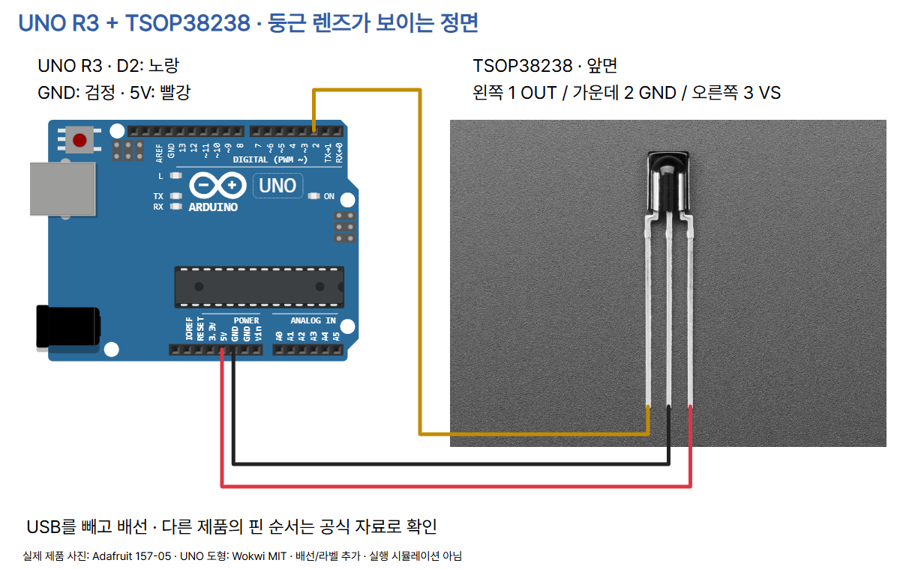

# 19 · 리모컨의 빛 신호를 IR 수신기로 읽기

Arduino UNO R3 / Vishay TSOP38238 (Adafruit 157) / IRremote 4.7.1.

## 준비물과 안전

UNO R3, TSOP38238, 호환 38kHz 리모컨과 배터리, 브레드보드, 점퍼선 3개, USB 데이터 케이블이 필요합니다. 전원을 끄고 연결하세요. 사진과 같은 둥근 렌즈 정면에서 핀을 확인합니다. 다른 3핀 수신기나 breakout 모듈에는 같은 핀 순서를 적용하지 마세요. TSOP38238 데이터시트의 공급 범위는 2.0–5.5V이고, Adafruit 제품 안내는 3–5V입니다. 이 예제는 UNO의 5V를 씁니다. ESP32/Pico 배선으로 전용하지 않습니다.

| TSOP38238 정면 | UNO R3 | 역할 |
|---|---|---|
| 왼쪽 1 OUT | D2 | 반송파가 제거된 디지털 펄스 |
| 가운데 2 GND | GND | 전압 기준 |
| 오른쪽 3 VS | 5V | 전원 |



센서 사진은 실제 Adafruit 제품 원본입니다. 선은 사진 속 리드의 중심에 연결했습니다. `diagram.json`은 핀/배치/배선 메타데이터이며 실행 가능한 Wokwi 프로젝트가 아닙니다. Wokwi의 일반 IR 모듈 및 Fritzing TSOP312 도형은 이 제품과 핀 순서가 달라 대체하지 않았습니다. 공급 전원에 강한 리플·스파이크가 있다면 제조사 응용 회로의 R1/C1 필터 권고를 확인하세요. 기본 USB 실습 회로에 임의 부품을 추가하지 않았습니다.

## 원리: 버튼 → 빛 → 전기 펄스 → 명령

적외선(IR)은 눈에 보이지 않는 빛입니다. 38kHz 리모컨은 빠른 빛 깜빡임을 묶음으로 보내고 묶음/공백의 시간 패턴으로 정보를 전달합니다. 38kHz는 초당 38,000주기, 한 주기는 약 26.3µs입니다. 이 **반송파 주파수**와 데이터 펄스 길이, 프레임 반복 간격을 혼동하지 마세요. 모든 리모컨이 38kHz이거나 같은 프로토콜인 것은 아닙니다.

TSOP38238은 반송파를 제거(복조)하여 OUT에 active LOW 펄스를 만듭니다. 보통 대기 HIGH, 빛 묶음에 LOW, 묶음 사이 HIGH가 나타납니다. 실제 내부 처리에 따른 지연·펄스 폭 차이가 있으므로 빛과 OUT이 완벽히 같은 시간이라는 뜻은 아닙니다. LOW 한 번으로 버튼을 식별하지 않습니다. 라이브러리가 펄스 길이와 순서로 프로토콜(통신 규칙), 주소, 명령을 해석합니다. ADC 값·빛 세기·거리 측정이 아닙니다.

```text
시간 →                 (개념도, 실측 파형 아님)
빛 반송파:   ||||||       ||||||||||      (38kHz 깜빡임의 묶음)
수신 OUT:  ──┐    ┌──────┐        ┌────
             └────┘      └────────┘      (LOW 펄스와 HIGH 간격)
```

이 예제는 PWM 출력을 만들지 않으며 `analogWrite()`를 쓰지 않습니다. 리모컨의 반송파와 모터 속도 제어 PWM은 다른 역할입니다. 향후 PWM/tone 등과 합치면 라이브러리의 타이머 사용/충돌 안내를 확인해야 합니다.

## 설치·업로드·화면 안내

1. Arduino IDE를 설치해 실행합니다. IDE는 코드를 작성·검사하고 보드에 업로드하는 도구입니다. 아래 화면은 Arduino IDE 2 계열 공식 참고 화면이며 이번 실습 실행 캡처가 아닙니다. 버전/OS에 따라 메뉴 배치가 다를 수 있습니다.
2. USB 데이터 케이블로 UNO를 연결합니다. 보드 선택에서 Arduino UNO, 포트에서 연결된 보드의 포트를 선택합니다. 보드 패키지가 없다면 Arduino AVR Boards를 설치합니다. 포트가 없으면 케이블·USB 연결부터 확인합니다.
3. 왼쪽 라이브러리 관리자에서 **IRremote by Armin Joachimsmeyer...**를 검색하고 **4.7.1**을 설치합니다. 이 코드는 `IRremote.hpp`를 쓰는 4.x API 기준입니다. 구형 2.x의 `IRrecv`/`results.value` 예제와 섞지 마세요.
4. 아래 전체 코드를 새 스케치에 복사합니다. 확인(체크)으로 컴파일하고 업로드(화살표)합니다.
5. 시리얼 모니터를 열어 **115200 baud**로 설정합니다. `IR_READY` 뒤 수신기의 렌즈를 향해 버튼을 짧게 누릅니다. 시작 문구를 놓쳤다면 모니터를 연 뒤 UNO를 리셋하세요. 문자를 전송할 필요는 없습니다.


## 복사해 실행할 전체 코드

```cpp
#include <IRremote.hpp>

constexpr uint8_t IR_RECEIVE_PIN = 2;

void setup() {
  Serial.begin(115200);
  IrReceiver.begin(IR_RECEIVE_PIN, DISABLE_LED_FEEDBACK);
  Serial.println(F("IR_READY: point the remote at the receiver"));
}

void loop() {
  if (IrReceiver.decode()) {
    const uint8_t flags = IrReceiver.decodedIRData.flags;
    if (flags & IRDATA_FLAGS_WAS_OVERFLOW) {
      Serial.println(F("OVERFLOW: frame too long"));
    } else if (flags & IRDATA_FLAGS_PARITY_FAILED) {
      Serial.println(F("PARITY_ERROR: try again"));
    } else if (IrReceiver.decodedIRData.protocol == UNKNOWN) {
      Serial.println(F("UNKNOWN: unsupported protocol or noise"));
    } else {
      IrReceiver.printIRResultShort(&Serial);
      if (flags & IRDATA_FLAGS_IS_REPEAT) {
        Serial.println(F("REPEAT: held button frame"));
      } else {
        Serial.println(F("FRAME: decoded frame"));
      }
    }
    IrReceiver.resume();
  }
}
```

## 줄별 역할

| 코드/구문 | 역할 |
|---|---|
| `#include <IRremote.hpp>` | 디코더 구현을 포함합니다. |
| `constexpr uint8_t IR_RECEIVE_PIN = 2` | 수신기 OUT을 연결한 D2를 지정합니다. |
| `void setup()` | 전원/리셋 뒤 한 번 실행합니다. |
| `Serial.begin(115200)` | 모니터와 같은 통신 속도를 설정합니다. |
| `IrReceiver.begin(..., DISABLE_LED_FEEDBACK)` | 수신을 시작하고 내장 LED 피드백을 끕니다. |
| `Serial.println(F("IR_READY..."))` | 시작 안내를 출력합니다. F()는 문자열을 플래시에 둡니다. |
| `void loop()` | 수신 여부를 계속 확인합니다. |
| `if (IrReceiver.decode())` | 한 수신 프레임 해석이 준비되었을 때만 처리합니다. 참이어도 지원 프로토콜/정상 신호라는 보장은 없어 아래 상태를 확인합니다. |
| `const uint8_t flags = ...flags` | 현재 프레임의 상태 비트를 보관합니다. |
| `flags & IRDATA_FLAGS_WAS_OVERFLOW` | 수신 버퍼 초과면 명령으로 사용하지 않습니다. |
| `flags & IRDATA_FLAGS_PARITY_FAILED` | 무결성 검사 오류면 다시 입력하도록 안내합니다. |
| `protocol == UNKNOWN` | 미지원 규칙/잡음일 수 있어 명령으로 사용하지 않습니다. |
| `printIRResultShort(&Serial)` | 지원되는 정상 프레임의 프로토콜·주소·명령 등의 요약을 출력합니다. 프로토콜별 표시 항목이 다를 수 있습니다. |
| `flags & IRDATA_FLAGS_IS_REPEAT` | 라이브러리가 반복으로 표시한 프레임인지 확인합니다. |
| `REPEAT` / `FRAME` 출력 | 반복/일반 프레임을 구분합니다. FRAME을 새 버튼 누름 이벤트라고 확정하지 않습니다. |
| `IrReceiver.resume()` | 성공·오류 모두 다음 수신을 준비합니다. |
| `}` | 해당 if/else/함수 블록을 끝냅니다. |

## 관찰 활동과 결과 기록

실측 결과는 제공하지 않습니다. 리모컨마다 다르므로 임의의 Command 값을 복사해 버튼 이름에 대응시키지 마세요.

| 활동 | 직접 기록할 항목 |
|---|---|
| 같은 버튼 짧게 3회 | Protocol / Address / Command 각각 |
| 다른 버튼 2개 | Command가 어떻게 다른지 |
| 같은 버튼 길게 | REPEAT 여부, 출력이 이어지는지 |
| 버튼에서 손 떼기 | 출력이 멈추는지 |
| 방향/주변 빛 바꾸기 | 인식/오류 변화 |

`0x`는 16진수 접두사이고 Address/Command는 단위 없는 식별값입니다. Protocol은 신호 규칙 이름입니다. Raw-Data가 나오는 경우에도 거리·회전수·온도라는 뜻이 아닙니다. 지원 프로토콜마다 필드 폭/의미가 다르므로 하나의 공통 숫자 범위를 꾸며 넣지 않습니다. 길게 누르면 별도 반복 프레임 또는 전체 프레임 재전송 등이 발생할 수 있습니다. 모든 프로토콜에서 반복 플래그만으로 물리 버튼 이벤트를 완벽하게 구별할 수는 없습니다. 나중에 장치를 제어할 때는 수신한 프로토콜·주소·명령과 중복 처리 정책을 함께 정하세요.

## 문제가 생기면

- 출력 없음: USB를 빼고 정면 방향/핀 번호/5V/GND/D2를 재확인합니다. 리모컨 배터리·38kHz 호환 여부·수신 방향을 확인합니다.
- `UNKNOWN`: 다른 프로토콜, 비지원 장치 또는 잡음일 수 있습니다. 임의 명령으로 사용하지 마세요.
- `OVERFLOW`: 긴 프레임이나 잡음일 수 있습니다. 단순 리모컨으로 다시 비교하고 공식 라이브러리의 버퍼/프로토콜 설정을 확인합니다.
- `PARITY_ERROR`: 방향·거리·주변 빛·전원·배선을 점검하고 다시 누릅니다.
- 글자가 깨짐: 모니터를 115200으로 맞춥니다.
- 반복 출력: 길게 누를 때 반복 프레임인지 확인합니다. 긴 delay로 감추면 다음 입력도 놓칠 수 있습니다.

## 검증 범위

실제 하드웨어와 시뮬레이터 실행은 하지 않았습니다. 배터리·통신 거리·주변 빛 영향·실제 버튼 코드·전원 품질은 실물 확인이 필요합니다. 출력 예시를 실제 측정 결과처럼 만들지 않았습니다. 컴파일/배선/카드 검사 결과는 제작 완료 후 아래 기록에 남깁니다.

## 출처와 사용 조건

2026-10-22 확인. 라이브러리 4.7.1 commit `498dc591b255d8ba2e239c875804bdab2ab0fe91`. Vishay 문서 Rev.2.1, 2025-05-27. 핀/주파수/출력은 제조사 자료에 근거합니다.

- [TSOP38238 제품·정면 사진](https://www.adafruit.com/product/157)
- [제조사 핀·주파수·출력·전원](https://www.vishay.com/docs/82491/tsop382.pdf)
- [IRremote 4.7.1 원본](https://github.com/Arduino-IRremote/Arduino-IRremote/tree/498dc591b255d8ba2e239c875804bdab2ab0fe91)
- [정면 핀 사진](https://cdn-shop.adafruit.com/970x728/157-05.jpg)
- [표지 사진](https://cdn-shop.adafruit.com/970x728/157-02.jpg)
- [UNO 핀 좌표](https://github.com/wokwi/wokwi-elements/blob/main/src/arduino-uno-element.ts)
- [CODEPLANT 채널·전용 영상 미확인](https://www.youtube.com/@codeplant2024)

- UNO 사진: SparkFun / [Wikimedia Commons](https://commons.wikimedia.org/wiki/File:Arduino_Uno_-_R3.jpg), [CC BY 2.0](https://creativecommons.org/licenses/by/2.0/). 기존 원본 파일 재사용, 크기 조절.
- TSOP38238 사진: Adafruit 제품 157의 157-02와 157-05 원본. **별도 자유 이용 라이선스 미확인**. 출처 표시는 재사용 허가를 대신하지 않으며 CC라고 주장하지 않습니다. 배선도에 원본 사진을 배치하고 선과 한국어 라벨을 추가했습니다.
- UNO 도형: Wokwi elements 1.9.2, MIT. 공식 pinInfo 좌표 기준으로 연결선 끝점을 계산했습니다. 사진과 상표에는 별도 권리가 적용됩니다.
- Arduino IDE 화면: Arduino Documentation / Karl Söderby, CC BY-SA 4.0. [보드/포트](https://docs.arduino.cc/software/ide-v2/tutorials/ide-v2-board-manager/), [첫 스케치](https://docs.arduino.cc/software/ide-v2/tutorials/getting-started-ide-v2/), [시리얼 모니터](https://docs.arduino.cc/software/ide-v2/tutorials/ide-v2-serial-monitor/). 기존 기본 세팅 편의 공식 참고 화면 재사용. 이번 실행 캡처가 아닙니다.
- 라이브러리 코드는 원 프로젝트의 MIT 라이선스를 따릅니다. CODEPLANT 로고와 Pretendard는 기존 공식 자산을 유지합니다.
- CODEPLANT 채널 공개 목록은 확인했으나 이번 실행에서 IR 전용 강의는 확인하지 못했습니다. 존재하지 않는 영상 주소를 만들지 않습니다.

### 제작 검수 기록 (2026-10-22)

- Arduino CLI UNO compile PASS: Arduino AVR Boards 1.8.6, IRremote 4.7.1; flash 10094 B, SRAM 491 B, 1557 B remaining.
- verify.py PASS: exact 3 connections; 6 invalid wiring mutations rejected; UNO pinInfo and actual front-photo anchor transforms; error ordering/resume/no delay; README code match.
- check.mjs PASS: ten ordered 1080x1350 PNGs, latest saved edits and ZIP, whole-card blue/background/footer/mobile, photos, caption copy/save/category templates, image paste/insertion, save/reopen/write boundaries.
- Visual self-review: all 10 cards and full circuit inspected. Original board/sensor photos, logo, Pretendard and TECH blue preserved; no clipped content or footer collision.
- Generic circuit validator unsupported: expects a Wokwi servo/photoresistor template. Dedicated physical verifier used; diagram.json is physical wiring metadata, not executable Wokwi simulation.
- Hardware and simulator not tested; no measured remote codes, range, pulse trace or successful physical decoding claimed.
- Photo source confirmed as Adafruit TSOP38238; separate open photo license not confirmed. IDE images are official reference screens, not actual run captures.
