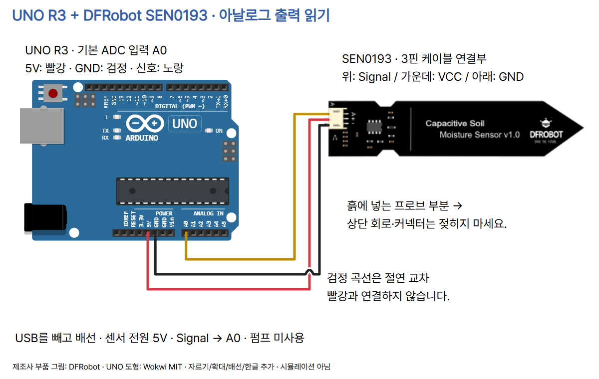
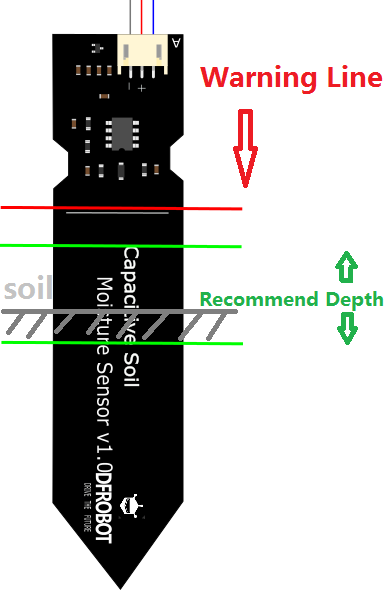
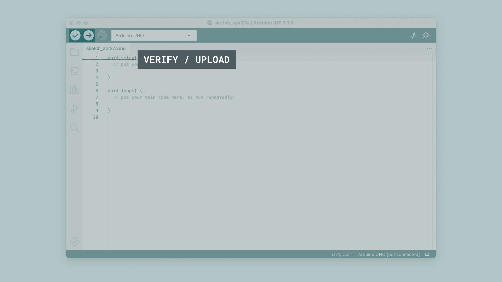

# 20 · 흙의 변화를 읽는 정전용량식 수분 센서

Arduino UNO R3 / DFRobot SEN0193 / 추가 라이브러리 없음.

## 준비물·정확한 부품

UNO R3, DFRobot SEN0193, 제품용 PH2.0-3P 케이블, 점퍼선, USB 데이터 케이블, 비교할 흙과 물을 준비합니다. 저항식 포크 센서나 다른 호환 보드를 자동 대체하지 않습니다. SEN0193은 정전용량 변화로 주변 수분 변화를 읽고 아날로그 전압을 출력합니다. 센서 전원은 제조사 사양 3.3–5.5V, 출력 사양 0–3.0V입니다. 이 예제는 UNO 5V로 전원을 공급합니다. ESP32/Pico로 그대로 옮기는 연결 안내가 아닙니다.

## 배선·삽입 한계

USB를 빼고 연결합니다. 실제 케이블 색과 함께 핀 이름을 확인하세요.

| SEN0193 케이블 | UNO | 역할 |
|---|---|---|
| 빨강 VCC | 5V | 전원 |
| 검정 GND | 아래쪽 GND | 공통 기준 |
| 노랑 Signal | A0 | 아날로그 입력 |



제조사 배선 이미지에서 센서 부품 부분만 잘라 배치하고 공식 Wokwi UNO 핀 좌표에 배선을 추가했습니다. 검정 선의 곡선은 빨강 선과 연결되지 않는 절연 교차입니다. 다른 센서 도형을 비슷한 모습으로 바꾸지 않았습니다. `diagram.json`은 실제 배선 메타데이터이며 실행 가능한 Wokwi 프로젝트가 아닙니다.



**전체 방수 제품이 아닙니다.** 빨간 경계선 아래 프로브만 흙/물에 넣습니다. 회로·커넥터·USB 보드를 젖히지 마세요. 제조사 초록 범위와 회색 흙 표시는 권장 삽입 깊이 안내입니다. 비교할 때 같은 깊이/다짐/위치를 유지합니다. 물을 넣거나 빼는 중에도 상단 회로가 젖지 않게 주의하세요. 펌프/릴레이/외부 모터 전원은 쓰지 않습니다.

## 원시값에서 판단까지

수분 변화 → 주변 정전용량 변화 → 센서 출력 전압 변화 → A0 ADC 숫자 → 두 기준 사이의 상대 지수 → 상태 판단 → 내장 L LED 순서입니다. ADC는 전압을 숫자로 바꾸는 기능입니다. 기본 UNO ADC는 10비트이므로 0~1023으로 읽습니다. 기본 기준 전압은 약 5V이며 실제 USB/전원 상태에 따라 차이가 납니다. 센서 출력 사양은 3V까지이므로 raw가 1023까지 변할 필요는 없습니다. ADC 숫자를 바로 수분 퍼센트라고 읽지 않습니다.

이 모델은 일반적으로 더 젖을수록 raw가 작아집니다. 물 외에도 흙 종류, 다짐, 삽입 깊이가 바뀌면 읽기가 달라집니다. 원시값 10회를 10ms 간격으로 읽어 정수 평균을 냅니다. 평균은 일부 흔들림을 줄이는 방법이며 정밀도/정확도를 입증하지 않습니다.

## Arduino IDE 설치·첫 실행

1. Arduino IDE는 코드 작성·컴파일·UNO 업로드 도구입니다. 보드 패키지 Arduino AVR Boards를 설치하고 보드 Arduino UNO, 포트는 실제 연결된 UNO를 선택합니다.
2. 새 스케치에 아래 전체 코드를 복사합니다. 추가 라이브러리는 없습니다. 확인 버튼으로 컴파일한 뒤 업로드합니다.
3. 시리얼 모니터를 **9600 baud**로 엽니다. 코드와 같은 속도여야 합니다. `SOIL_READY` 뒤 `raw=... CALIBRATE_FIRST`를 봅니다. 이때 L LED가 꺼지는 것이 코드의 의도입니다.
4. 공기 중에 프로브를 두고 여러 줄이 안정되면 대표값을 **DRY_RAW**로 기록합니다.
5. 제조사 빨간 경계선 아래 프로브만 물에 넣고 상단을 젖히지 않습니다. 안정된 여러 줄의 대표값을 **WET_RAW**로 기록합니다.
6. 코드의 두 `-1`을 직접 얻은 값으로 바꾸고 다시 업로드합니다. 0~1023 범위이고 DRY_RAW > WET_RAW여야 합니다. 같거나 반대이면 계산하지 않고 CALIBRATE_FIRST를 유지합니다. 범위가 아주 좁으면 잡음이 크게 확대되므로 깊이·접촉·배선·보정 절차를 점검합니다.
7. 흙의 같은 위치/깊이에 꽂아 조금씩 물을 더하고 물이 퍼진 뒤 raw, wet_index, alert와 L LED를 비교합니다. 약 0.5초마다 출력하므로 즉시 변화를 보장하지 않습니다.

아래 이미지는 Arduino IDE 2 계열의 **공식 참고 화면**을 기존 기본 세팅 편에서 재사용한 것입니다. 이번 센서 실행 결과 캡처가 아닙니다. IDE 버전/OS에 따라 메뉴 위치가 다를 수 있습니다. 제조사 페이지의 오래된 IDE 1.6.5 표기를 그대로 설치 요구 사항으로 쓰지 않았습니다.





## 전체 코드

```cpp
constexpr uint8_t SOIL_PIN = A0;
constexpr uint8_t ALERT_PIN = LED_BUILTIN;
// Replace both -1 values with your own readings; dry must exceed wet.
constexpr int DRY_RAW = -1;
constexpr int WET_RAW = -1;
// Classroom comparison thresholds, not a plant watering prescription.
constexpr int ALERT_ON_INDEX = 30;
constexpr int ALERT_OFF_INDEX = 40;
bool alert = false;

void setup() {
  Serial.begin(9600);
  pinMode(ALERT_PIN, OUTPUT);
  digitalWrite(ALERT_PIN, LOW);
  Serial.println(F("SOIL_READY: raw values first"));
}

void loop() {
  long total = 0;
  for (uint8_t i = 0; i < 10; i++) {
    total += analogRead(SOIL_PIN);
    delay(10);
  }
  const int raw = total / 10;
  Serial.print(F("raw="));
  Serial.print(raw);
  if (DRY_RAW < 0 || DRY_RAW > 1023 || WET_RAW < 0 ||
      WET_RAW > 1023 || DRY_RAW <= WET_RAW) {
    alert = false;
    Serial.println(F(" CALIBRATE_FIRST"));
  } else {
    const long indexUnclamped =
      (long)(DRY_RAW - raw) * 100L / (DRY_RAW - WET_RAW);
    const int wetIndex = constrain(indexUnclamped, 0L, 100L);
    if (wetIndex <= ALERT_ON_INDEX) alert = true;
    else if (wetIndex >= ALERT_OFF_INDEX) alert = false;
    Serial.print(F(" wet_index="));
    Serial.print(wetIndex);
    Serial.print(F(" alert="));
    Serial.print(alert ? 1 : 0);
    if (raw > DRY_RAW || raw < WET_RAW) Serial.print(F(" OUTSIDE_CAL"));
    Serial.println();
  }
  digitalWrite(ALERT_PIN, alert ? HIGH : LOW);
  delay(400);
}
```

## 각 줄/구문의 역할

| 코드 | 역할 |
|---|---|
| `SOIL_PIN = A0` | 노랑 신호선을 읽는 아날로그 핀입니다. |
| `ALERT_PIN = LED_BUILTIN` | UNO 내장 L LED(D13)로만 알립니다. 외부 LED 부품은 필요 없습니다. |
| `DRY_RAW`, `WET_RAW` | 직접 기록해야 할 보정 기준입니다. -1은 미입력 표시이며 실측값이 아닙니다. |
| `ALERT_ON_INDEX`, `ALERT_OFF_INDEX` | 30에서 켜고 40에서 끄는 수업용 정책입니다. 작물 권장값이 아닙니다. |
| `bool alert = false` | 시작할 때 알림을 끕니다. |
| `setup()` | 전원/리셋 후 한 번 초기화합니다. |
| `Serial.begin(9600)` | 모니터 통신 속도를 설정합니다. |
| `pinMode(..., OUTPUT)` | L LED를 출력으로 설정합니다. |
| `digitalWrite(..., LOW)` | 시작 시 LED를 끕니다. |
| `SOIL_READY` 출력 | 시작 안내입니다. 수분 측정 성공 주장이 아닙니다. F() 문자열은 플래시에 둡니다. |
| `loop()` | 읽기·계산·표시를 반복합니다. |
| `long total = 0` | 10회 합계의 저장 공간을 준비합니다. |
| `for (... i < 10; i++)` | 열 번 읽습니다. |
| `analogRead(SOIL_PIN)` | A0 입력을 0~1023 정수로 읽습니다. |
| `delay(10)` | 읽기 사이 10ms를 기다립니다. |
| `raw = total / 10` | 소수 부분을 버린 정수 평균입니다. |
| `Serial.print(raw)` | 보정 전에도 원시값을 표시합니다. |
| 보정 범위·순서 검사 if | 0~1023 범위, dry>wet을 확인해 0으로 나누기/반대 방향 보정을 막습니다. |
| `CALIBRATE_FIRST` | 아직 상대 지수/알림을 사용하지 않는다는 안내입니다. |
| `indexUnclamped` 계산 | 건조 기준 0, 젖음 기준 100으로 선형 변환합니다. 곱셈은 long으로 계산해 AVR int 범위를 넘지 않게 합니다. |
| `constrain(...,0L,100L)` | 표시 지수를 0~100으로 제한합니다. 실제 토양 수분 함량 %가 아닙니다. |
| `<=30` / `>=40` | 낮은 지수에서 알림 켜짐, 높은 지수에서 꺼짐입니다. 사이에서는 상태를 유지합니다. |
| `wet_index`, `alert` 출력 | 상대 지수와 알림 0/1을 표시합니다. |
| `OUTSIDE_CAL` 검사 | raw가 두 기준 밖일 때 표시합니다. 제한된 지수만 보고 범위 이탈을 놓치지 않게 합니다. |
| `Serial.println()` | 한 회차 출력의 줄을 끝냅니다. |
| 마지막 `digitalWrite` | alert에 따라 L LED를 켜거나 끕니다. |
| `delay(400)` | 나머지 대기 시간입니다. 전체 회차는 읽기/출력 시간 포함 약 0.5초입니다. |
| 중괄호 | 함수/분기/반복 블록을 구분합니다. |

## 상대 지수와 히스테리시스

`(DRY_RAW - raw) × 100 / (DRY_RAW - WET_RAW)`입니다. 공기/물 기준 사이의 선형 **상대 지수**입니다. 토양 부피 수분함량(VWC)이나 공기의 상대습도(%RH)가 아니며 정확한 물 함량을 보장하지 않습니다. 제조사 자료의 0/100%RH 표현도 이 실습의 실제 물리량 단위로 사용하지 않습니다.

히스테리시스는 켜짐/꺼짐 기준을 분리하는 방법입니다. 지수 ≤30이면 켜지고 ≥40이면 꺼집니다. 31~39는 직전 상태를 유지합니다. 예를 들어 이미 켜진 상태라면 35에서도 켜져 있고, 꺼진 상태에서 35라면 꺼진 채 유지합니다. **이는 코드의 논리 예시이며 실제 센서 측정 결과가 아닙니다.** 두 값은 교실에서 상태 변화를 비교하기 위한 기본값입니다. 식물·흙·화분에 적합한 물주기 기준은 별도 확인이 필요합니다.

## 기록할 관찰·오류 점검

| 직접 할 일 | 기록할 것 |
|---|---|
| 공기/물 기준 만들기 | 여러 줄 raw, 대표값, 삽입 깊이 |
| 흙을 같은 깊이에서 조금씩 적시기 | raw 감소 여부, 지수/LED 변화 |
| 임계값 사이에서 비교 | 직전 상태 유지 여부 |
| 흙/깊이 바꿔 보기 | 이전 보정의 차이 |

고정 숫자만 나오면 USB를 빼고 케이블 Signal→A0 및 전원/GND를 확인합니다. 물을 더해도 반응이 느리면 물이 퍼지고 안정될 때까지 기다립니다. CALIBRATE_FIRST는 두 상수의 범위·순서를 점검합니다. OUTSIDE_CAL은 기준 재측정/조건 변화를 확인합니다. 단선도 유효 범위 숫자를 만들 수 있으므로 값 하나로 센서 정상·단선을 확정하지 않습니다.

## 검증 범위

실제 UNO/SEN0193, 토양·물 보정, 전압, 알림 동작, 식물 물주기는 시험하지 않았습니다. 실행 시뮬레이터도 미시험입니다. 실제 dry/wet 값이나 측정 성공 결과를 만들어 넣지 않았습니다. 컴파일·독립 논리 참조 검사·배선·렌더링 검수 기록은 아래 추가합니다.

## 출처·사용 조건

2026-10-23 공식 자료를 확인했고 원문은 내부 output/research/soil-moisture에 보존했습니다. 이 코드의 평균·상태 유지·유효성 검사는 수업용으로 새로 작성했습니다. 제조사 LGPL 예제 전체 코드를 복사하지 않았습니다.

- [제조사 모델·전원·출력](https://wiki.dfrobot.com/sen0193)
- [제조사 보정·배선·삽입 한계](https://wiki.dfrobot.com/sen0193/docs/18037)
- [제조사 구간 판정 예제](https://wiki.dfrobot.com/sen0193/docs/18036)
- [정전용량식 원리](https://wiki.dfrobot.com/sen0193/docs/18035)
- [제조사 회로](https://dfimg.dfrobot.com/wiki/17627/SEN0193_capacitive-soil-moisture-sensor_schematics_1.0.pdf)
- [UNO ADC 공식 문서](https://docs.arduino.cc/language-reference/en/functions/analog-io/analogRead/)
- [제조사 부품 그림](https://raw.githubusercontent.com/DFRobot/DFRobotMediaWikiImage/master/Image/SEN0193-line.png)
- [제품 사진](https://dfimg.dfrobot.com/enshop/SEN0193/SEN0193_Main_01_360x240.jpg.webp)
- [CODEPLANT 채널·전용 영상 미확인](https://www.youtube.com/@codeplant2024)

- UNO 사진: SparkFun / [Wikimedia Commons](https://commons.wikimedia.org/wiki/File:Arduino_Uno_-_R3.jpg), CC BY 2.0. 원본 크기 조절.
- SEN0193 제품 사진·배선 원본·삽입 깊이 그림: DFRobot 공식 자료. **별도 자유 이용 라이선스 미확인**. CC 자료라고 주장하지 않으며 출처 표기가 제3자 상업 재사용 허가를 부여하지 않습니다. 부품 그림은 제조사 원본 배선 이미지에서 잘라 확대하고 UNO 도형·배선·한국어 라벨을 추가했습니다.
- Wokwi UNO 도형 MIT: [원본 pinInfo](https://github.com/wokwi/wokwi-elements/blob/main/src/arduino-uno-element.ts). 5V (160,191.5), GND.2 (169.5,191.5), A0 (208,191.5)에 배치/배율을 적용합니다. SEN0193 연결부는 제조사 원본 좌표 (330,78/85/92), crop (325,60), scale1.6, 화면 (650,200)을 사용합니다.
- Arduino IDE 공식 참고 화면: Arduino Documentation / Karl Söderby, CC BY-SA 4.0. [보드/포트](https://docs.arduino.cc/software/ide-v2/tutorials/ide-v2-board-manager/), [첫 실행](https://docs.arduino.cc/software/ide-v2/tutorials/getting-started-ide-v2/), [시리얼](https://docs.arduino.cc/software/ide-v2/tutorials/ide-v2-serial-monitor/). 실행 결과 캡처가 아닙니다.
- CODEPLANT 원본 로고·Pretendard는 기존 자산을 유지합니다. 채널 공개 목록은 확인했으나 이번 실행에서 SEN0193 전용 강의는 확인하지 못했습니다. 없는 영상 주소를 만들지 않았습니다.

### 제작 검수 기록 (2026-10-23)

- UNO actual compile PASS: AVR Boards1.8.6; default uncalibrated firmware flash2498 B / SRAM189 B (1859 B free). Synthetic valid-calibration branch compile flash2724 B / SRAM189 B. Synthetic600/300 used only in temporary test copy, not as measured values.
- verify.py PASS: three exact nets, six invalid wiring mutations rejected; manufacturer connector/UNO coordinate transform; insulated bridge; valid-calibration guard; synthetic index endpoints/outside cases and hysteresis boundary/state retention; README code match.
- check.mjs PASS: ten ordered1080x1350 PNGs, latest-edit ZIP, all card backgrounds/footer/mobile, photos, caption copy/save/templates, image paste/insertion, save/reopen and write boundaries.
- All ten cards and full circuit visually inspected. Card5 title clipping fixed; safety depth diagram and connector table combined in card5 and re-inspected. Card7 snippet uses full-code variable/cast.
- Generic circuit validator does not support SEN0193; requires servo/photoresistor Wokwi template. Dedicated physical wiring verifier used; diagram.json is metadata, not executable simulation.
- Hardware, simulator, real calibration values, sensor voltages, moisture accuracy, plant-specific irrigation thresholds and actual LED response not tested. No invented sensor readings.
- DFRobot official photo/diagram origins confirmed; separate open licenses not confirmed. IDE screens are official references, not actual run captures.
