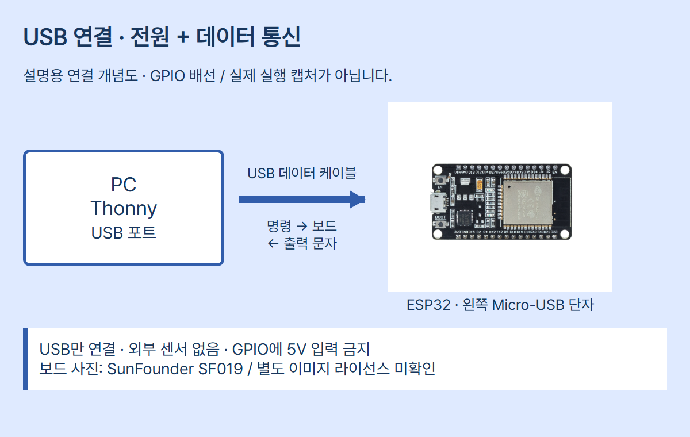

# ESP32 01 · MicroPython 기본 세팅부터 첫 실행까지

대상은 **일반 ESP32 칩의 ESP-WROOM-32 계열, 30핀 Micro-USB DevKit v1 보드**입니다. 표지 사진은 SunFounder SF019이며 금속 모듈 ESP-WROOM-32, Micro-USB 단자와 15핀씩 두 줄을 확인했습니다. 같은 판매명이라도 USB 단자·USB-시리얼 칩·LED가 다를 수 있습니다. S2/S3/C3 보드에는 이 편의 펌웨어를 그대로 쓰지 않습니다. LED 핀을 추정하지 않고 텍스트 출력으로 첫 실행을 확인합니다.

## 준비물과 역할

| 준비물 | 역할 |
|---|---|
| Windows 10/11 PC와 Thonny | 코드 작성·전송·Shell 출력 보기 |
| ESP32 DevKit v1 | MicroPython으로 학생 코드를 실행 |
| 보드에 맞는 Micro-USB 데이터 케이블 | USB 전원과 양방향 통신 |
| MicroPython ESP32_GENERIC 펌웨어 | ESP32 안에서 Python을 실행하는 기본 소프트웨어 |

센서·브레드보드·외부 전원은 필요 없습니다. 충전 전용 케이블로는 통신할 수 없습니다. USB만 연결하며 GPIO에 5V를 넣지 않습니다. 이후 센서 연결은 전원을 뺀 상태에서 보드별 핀과 3.3V 조건을 확인합니다.


이 그림은 설명용 개념도입니다. 실제 GPIO 회로도·측정 화면이 아닙니다. `diagram.json`은 USB 연결 메타데이터이며 Wokwi 실행 프로젝트가 아닙니다.

## 1. Thonny 설치

2026-10-24 공식 홈페이지 확인 기준 Thonny **5.0.0**입니다. Windows Intel/AMD PC에는 홈페이지의 x64 설치 파일, ARM PC에는 ARM64용을 구분합니다. 설치 프로그램을 실행해 설치한 뒤 Thonny를 엽니다. 메뉴의 언어·배치는 버전/운영체제에 따라 다를 수 있습니다. Thonny에 포함된 PC Python과 ESP32의 MicroPython은 실행 위치가 다릅니다.


**공식 참고 화면**: Thonny 홈페이지의 PC Python 팩토리얼 디버깅 예시입니다. ESP32 실행 캡처도, Thonny 5.0.0 실측 화면도 아닙니다. 편집 창과 Shell의 역할을 보여주기 위한 원본 참고입니다. 이 화면의 디버깅 창을 실습 성공 결과로 보지 않습니다.

## 2. 연결 포트 확인

1. 보드를 PC에 USB 데이터 케이블로 연결합니다. 외부 센서·전원은 연결하지 않습니다.
2. Windows 장치 관리자에서 포트(COM 및 LPT)를 확인하고 보드를 뺐다 꽂을 때 나타나는 장치의 COM 번호를 기록합니다. COM4 같은 번호는 예시이며 고정값이 아닙니다.
3. 포트가 없으면 다른 데이터 케이블/USB 포트로 확인합니다. USB-시리얼 드라이버가 필요할 때는 실제 보드의 칩 표기와 공급사 문서에 맞는 드라이버를 사용합니다. 모든 DevKit가 같은 드라이버를 쓰는 것은 아닙니다.
4. 다른 시리얼 프로그램과 Arduino 시리얼 모니터를 닫습니다. 한 포트를 동시에 사용하면 연결이 실패할 수 있습니다.

## 3. MicroPython 펌웨어 설치

**플래시 전체 지우기는 기존 프로그램·파일을 삭제합니다.** 기존 MicroPython에 연결할 수 있다면 장치 파일을 먼저 PC로 백업하세요. 학생 실습 보드인지 확인하고 다른 보드를 분리해 오선택을 막습니다. 이미 정상 MicroPython이 있으면 매 수업마다 지우거나 재설치할 필요가 없습니다.

1. 모듈 표기와 구매처 사양을 확인합니다. 이 편은 일반 ESP32/WROOM이고 4MiB 이상 플래시용 **ESP32_GENERIC**을 사용합니다. SPIRAM/WROVER·SOLO 등은 공식 다운로드의 변형 안내를 따릅니다.
2. Thonny의 우측 하단 실행 대상 선택 또는 **Run → Select interpreter**, **Tools → Options → Interpreter**에서 MicroPython (ESP32)와 실제 COM 포트를 고릅니다. 공식 Wiki는 3.2 이후 지원을 설명하며 버전에 따라 진입 위치가 다릅니다.
3. 인터프리터 설정의 **Install or update MicroPython** 기능에서 실제 장치 포트, ESP32 보드 종류와 안정 릴리스를 확인합니다. 메뉴 이름이 다르면 현재 Thonny 설정 안내를 확인합니다. S3/C3/S2로 바꾸지 않습니다.
4. 2026-10-24 확인 기준 공식 안정 릴리스는 **v1.29.0 (2026-08-24)**입니다. 직접 파일을 선택하는 경우 공식 ESP32_GENERIC 페이지의 전체 **.bin**을 사용합니다. `.app-bin`은 첫 전체 설치용 이미지와 다릅니다.
5. 설치를 시작하고 완료될 때까지 USB를 분리하지 않습니다. 연결 대기에서 실패하면 공식 ESP32 문제 해결을 확인합니다. 일부 보드는 BOOT 버튼을 누른 상태에서 연결/설치가 필요합니다. 무작정 핀을 단락하지 않습니다.
6. 설치를 마치고 장치에 다시 연결합니다. Shell에 MicroPython 배너와 `>>>`가 나타나는지 확인합니다. `>>>`가 없으면 정지/재시작으로 기존 실행을 멈추고 포트를 점검합니다.

공식 수동 설치 안내는 전체 플래시 지우기 후 일반 ESP32의 시작 주소 **0x1000**을 사용합니다. Thonny 설치기가 주소를 처리한다면 임의 주소를 입력하지 않습니다. esptool 버전별 명령 표기 차이는 공식 설치 문서를 따르며 이 제작 작업에서 실제 장치 플래시 명령은 실행하지 않았습니다.

## 4. 한 줄 명령으로 확인

실행 대상이 **MicroPython (ESP32)**인지 먼저 확인하세요. Local Python은 PC에서 실행하므로 같은 숫자가 나와도 보드 연결 증거가 아닙니다.

Shell의 `>>>` 뒤에 `print(1 + 1)`만 입력하고 Enter를 누릅니다. 코드상 예상 응답은 `2`입니다. `>>>`는 입력 대기 표시이므로 코드에 복사하지 않습니다. REPL은 명령을 읽고 실행해 결과를 보여주는 대화 방식입니다.

## 5. 전체 코드와 실행

편집 창에 아래 코드를 복사하고 PC에 `first_run.py`로 저장합니다. F5 또는 Run current script를 누릅니다. 저장 대화상자에서 PC/장치 중 위치를 확인하세요.

```python
from time import sleep

print("ESP32_READY")
for count in range(1, 6):
    print("count =", count)
    sleep(1)
print("DONE")
```

| 코드 | 역할 |
|---|---|
| `from time import sleep` | 시간 대기 함수 가져오기 |
| `print("ESP32_READY")` | 실행 시작을 구분할 문자를 Shell로 전송 |
| `for count in range(1, 6):` | count가 1~5로 바뀌며 반복, 끝값 6 제외 |
| 들여쓴 `print("count =", count)` | 현재 count 출력 |
| 들여쓴 `sleep(1)` | 각 반복에서 1초 대기 요청 |
| 들여쓰기 없는 `print("DONE")` | 반복이 모두 끝난 뒤 완료 문자 출력 |

들여쓰기는 공백 4칸을 사용합니다. print 두 인수 사이에는 공백이 출력됩니다. 이 예제에는 외부 라이브러리가 필요 없습니다.

## 6. 예상 관찰과 비교 활동

아래는 **코드로 예상한 텍스트**이며 실제 보드 캡처나 측정 로그가 아닙니다.

```text
ESP32_READY
count = 1
count = 2
count = 3
count = 4
count = 5
DONE
```

입력(F5) → USB로 코드 전달 → ESP32의 MicroPython이 문장/반복을 실행 → print 문자가 USB-시리얼로 돌아옴 → Thonny Shell 표시 순서입니다. 내장 LED 점멸을 확인하는 예제가 아닙니다. `sleep(1)`을 `sleep(2)`로 바꾸어 다시 실행하고 출력 간 기다림이 길어지는지 비교하세요. sleep의 단위는 초입니다. 정확한 간격은 다른 처리와 통신에도 영향을 받으므로 정밀 1초 측정이라고 주장하지 않습니다. `range(1, 4)`로 바꾸면 1~3까지만 출력하는지 예측한 뒤 확인합니다.

## 7. PC 파일과 장치 파일

PC의 `first_run.py`는 수업 코드 보관용입니다. 장치의 `main.py`는 부팅 시 실행할 파일입니다. 저장 위치가 다르면 같은 이름이라도 다른 파일입니다. 자동 실행을 원하면 기존 장치 main.py를 먼저 백업하고 File → Save as에서 MicroPython device를 선택해 정확히 `main.py`로 저장합니다. USB 재연결 시 Shell을 빨리 열지 않으면 초기 출력이 지나갈 수 있으므로, 연결 후 장치 재시작으로 출력 순서를 관찰합니다. Ctrl+C는 실행 중단, Ctrl+D는 REPL에서 소프트 재시작에 쓰입니다. Thonny가 연결/실행을 관리하므로 F5 실행과 단독 전원 부팅을 구분하세요.

## 오류가 나면

| 현상 | 확인 순서 |
|---|---|
| 전원은 켜지나 COM 없음 | 데이터 케이블 → USB 포트 → 실제 USB-시리얼 칩/드라이버 |
| 포트 사용 중 | 다른 시리얼 앱 닫기 → 정확한 포트 선택 |
| 펌웨어 설치 실패 | 칩/파일/포트 확인 → 공식 BOOT 절차·문제 해결 확인 |
| IndentationError | for 아래 두 줄 공백 4칸, DONE은 들여쓰기 없음 |
| 보드 없이도 2 출력 | Local Python이 아닌 MicroPython (ESP32)인지 확인 |
| 재연결 때 자동 실행 안 됨 | 장치에 main.py로 저장했는지, 기존 부팅 파일 오류 확인 |

## 출처·사진 사용 조건

확인일 2026-10-24. 공식 문서의 latest 경로는 개발 문서이며 향후 내용이 바뀔 수 있습니다. 버전 지정 릴리스/설치 화면과 차이가 있으면 해당 버전 안내를 우선합니다.

- [ESP32 / WROOM 펌웨어](https://micropython.org/download/ESP32_GENERIC/)
- [ESP32 시작 안내](https://docs.micropython.org/en/latest/esp32/tutorial/intro.html)
- [time.sleep](https://docs.micropython.org/en/latest/library/time.html)
- [Thonny 공식](https://thonny.org/)
- [Thonny MicroPython 안내](https://github.com/thonny/thonny/wiki/MicroPython)
- [보드 제품·사진](https://www.sunfounder.com/collections/esp32-1/products/esp-wroom-32-esp32-esp-32s-development-board)
- [공식 UI 참고 화면](https://thonny.org/img/screenshot.png)
- [CODEPLANT 채널·이 편 전용 영상 미확인](https://www.youtube.com/@codeplant2024)

보드 사진은 SunFounder SF019의 공식 제품 이미지 원본입니다. Thonny 화면은 공식 홈페이지 원본 UI 참고입니다. 제품 식별/도구 설명에 사용하며 이미지 권리는 각 권리자에게 있습니다. 별도 이미지 재배포 허락·공개 이미지 라이선스는 확인되지 않았고, 출처 표기가 자유로운 재사용을 허락하는 것은 아닙니다. 재사용 전 권리자 조건을 확인하세요. CODEPLANT 채널을 확인했으나 이 편 전용 영상은 특정하지 않았습니다.

## 검증 범위

실제 ESP32, USB 드라이버, 펌웨어 설치, 실제 출력 간격과 독립 부팅은 시험하지 않았습니다. 하드웨어/시뮬레이터 실행 성공을 주장하지 않습니다. 호스트 Python에서 코드 문법·출력 순서·대기 인수만 대체 검사하며 해당 검사는 ESP32 실행 증거가 아닙니다. PNG/편집기 검수 결과는 episode.review와 내부 결과 기록에 남깁니다.
