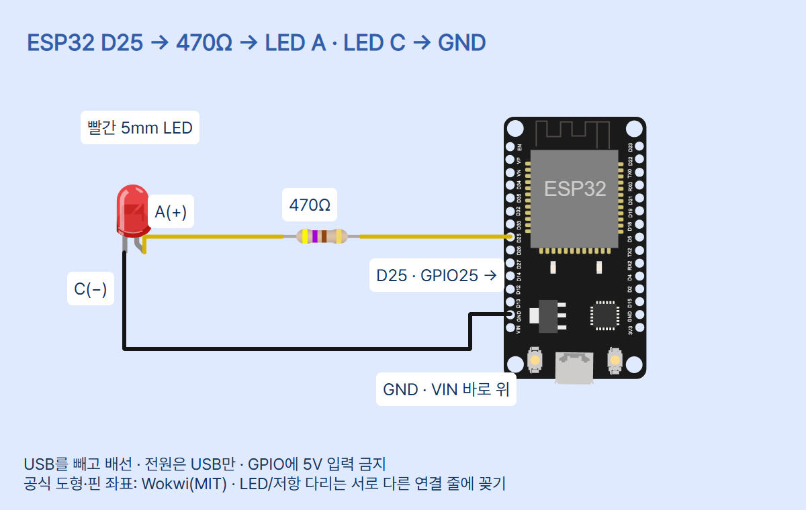
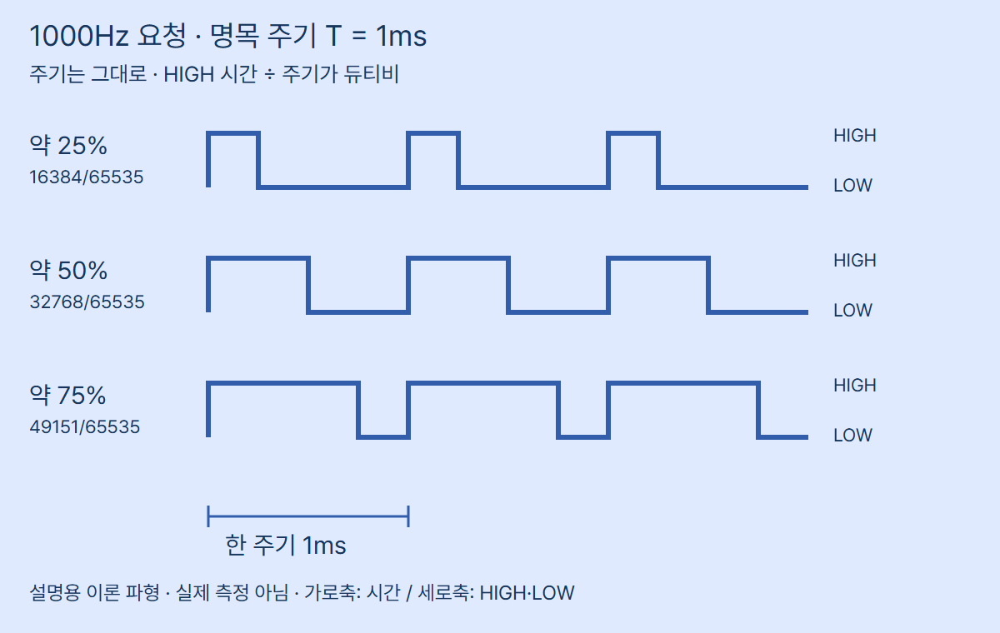

# ESP32 02 · 입력부터 출력까지, 신호처리

이 편은 ESP-WROOM-32 계열 **ESP32 DevKit v1, 30핀 Micro-USB**와 MicroPython **v1.29.0**을 대상으로 합니다. S3/C3/S2의 핀표·ADC 조건을 그대로 대입하지 않습니다. 내장 LED의 핀·극성이 보드마다 달라 **외부 빨간 LED**를 사용합니다.

## 준비물과 안전

ESP32, 빨간 5mm LED 1개(사진 Adafruit #297), **470Ω 저항 1개**, 브레드보드·점퍼선·데이터 USB 케이블, Thonny가 설치된 PC를 준비합니다. USB 전원을 빼고 배선하고 GPIO에 5V를 입력하지 않습니다. USB와 외부 전원을 함께 쓰지 않습니다. 이 회로에는 VIN·3V3 전원 배선이 없으며 GPIO25가 저항을 통해 LED를 구동합니다. 밝은 LED를 가까이서 직접 응시하지 않습니다.

저항은 LED에 흐르는 전류를 제한합니다. 470Ω은 황·보라·갈색(4밴드 기준)이며 47Ω과 구분하세요. 명목3.3V에서 LED 전압강하를0V로 놓아도 3.3/470≈7.02mA의 보수적 계산값입니다. 실제 전류는 LED 전압강하·GPIO 출력·허용오차에 따라 더 낮아집니다. 이 계산은 실측이나 핀 전류 용량 인증이 아닙니다. 판매 페이지와 연결 데이터시트의 LED 전류/전압 수치가 다르므로 최대 정격을 설계 목표로 쓰지 않고 낮은 전류로 비교합니다. 낮은 듀티에서 빛이 약할 수 있습니다.

## 연결표

| 시작 | 도착 | 의미 |
|---|---|---|
| ESP32 D25 / GPIO25 | 470Ω 저항 한쪽(도형2) | PWM 출력 |
| 저항 다른 쪽(도형1) | LED A, 애노드(+) | 저항과 LED 직렬 |
| LED C, 캐소드(−) | 보드 왼쪽 GND, VIN 바로 위 | 공통 기준 / 전류 귀환 |

LED의 긴 다리는 보통 A, 몸체 평평한 면 쪽은 C입니다. 다리를 자른 제품은 길이만 믿지 말고 해당 LED 핀표를 확인합니다. 저항에는 방향성이 없습니다. 두 LED 다리는 브레드보드에서 **서로 다른 전기 연결 줄**에 꽂습니다. 그림은 선 연결 관계를 보여주며 브레드보드 구멍 배치 사진은 아닙니다. 헤더가 없는 보드는 수업 전에 성인이 연결 헤더를 준비하세요.



원본 `diagram.json`과 `circuit_preview.html`을 제공합니다. 그림 보드 USB가 아래를 향할 때 왼쪽 맨 아래 VIN 바로 위가 사용 GND입니다. D25는 그 왼쪽 열의 표기이며 코드 `Pin(25)`는 GPIO25를 뜻합니다. 핀25번째 위치라는 뜻이 아닙니다. GPIO34와 다른 핀은 이번 배선에서 비워 둡니다.

## 학생이 따라갈 신호 흐름

Shell에 25+Enter 입력 → USB-시리얼로 문자 전달 → ESP32가 input()으로 문자열을 읽음 → 사전 levels에서16384 선택 → PWM 주변장치에 듀티 요청 → GPIO25에서 HIGH/LOW 반복 → 저항/LED에 흐르는 전류의 켜진 비율 변화 → LED 밝기 비교. ESP32의 하드웨어 PWM은 다음 입력을 기다리는 동안에도 계속됩니다. Enter 없이 숫자만 쓰면 input()이 한 줄 완성을 기다립니다. 문자"25"는25V·25번핀 입력이 아닙니다.

## 디지털·아날로그·ADC 구분

디지털 입력은 전압을 LOW/HIGH의 기준으로 구분해0/1로 읽습니다. 일반 GPIO의 입력은 내부/외부 풀업·풀다운으로 떠 있지 않게 해야 합니다. 입력 전용GPIO34~39에는 내부 풀업이 없습니다. ADC는 연속적인 전압을 단계가 있는 숫자로 변환합니다. 일반 ESP32의 기본12비트 원시값0~4095와 `read_u16()`의0~65535 표현을 구분하세요. 16비트로 스케일해도 실제 ADC 분해능·정확도가16비트가 되는 것은 아닙니다.

ADC 입력은 핀·감쇠(atten)·보정에 따라 유효 범위와 오차가 달라집니다. 감쇠 설정은5V 입력 허용을 뜻하지 않습니다. raw를65535로 나눠3.3을 곱했다고 정확한 전압이 되는 것은 아닙니다. 이 편의 main.py는 ADC를 만들거나GPIO34를 읽지 않습니다. 조도센서 입력/ADC 실습은 다음 편에서 전원·입력 조건을 정해 진행합니다. 현재 핀을 손으로 만져 난수를 관찰하는 활동은 하지 않습니다.

## PWM 주기·주파수·듀티비

주파수 f는1초의 반복 횟수(Hz), 주기 T는한번 반복하는 시간이며 T=1/f입니다. 1000Hz 요청의 명목 주기는1ms입니다. 듀티비 D=t_HIGH/T이며 `duty_u16(value)`의 요청 비율은 value/65535입니다. 약25%,50%,75%에서 명목 HIGH 시간은 각각 약0.25ms,0.5ms,0.75ms입니다. 여기서는 같은 주기를 유지한 채 HIGH 폭이 달라집니다.0은계속LOW,65535는계속HIGH입니다.



이 그림은 코드의 명목 조건을 그린 설명이며 오실로스코프 실측 화면이 아닙니다. 하드웨어의 주파수·듀티 분해능과 반올림으로 실제 신호는 요청과 조금 다를 수 있습니다. `duty_u16`은16비트 API 범위이지 모든 주파수에서 실제16비트 분해능 보장이 아닙니다. GPIO의 HIGH/LOW 레벨을 빠르게 바꾸는 PWM은 일정한 중간 전압을 직접 내보내는 DAC와 다릅니다. GPIO25에DAC 기능도 있지만 이 코드는DAC가 아니라PWM을 씁니다. LED의 체감 밝기, 모터 회전수, 센서 측정값과 듀티 명령은 구분해야 합니다.

## Thonny 설정·화면 안내

1. 기본 세팅 편처럼 보드 모델에 맞는 MicroPython을 준비합니다. 설치 완료된 보드를 매번 지우지 않습니다.
2. USB를 빼고 연결표대로 배선한 뒤 USB 데이터 케이블로 연결합니다.
3. Thonny 실행 대상을 **MicroPython (ESP32)**, 포트를 내 보드의 COM 번호로 선택합니다. Local Python은 machine 모듈을 제공하지 않습니다. 다른 시리얼 앱을 닫습니다.
4. main.py 전체 코드를 편집 창에 복사하고 PC에 `signal_pwm.py`로 저장합니다. 장치 main.py 자동 실행으로 저장하려면 기존 파일을 먼저 백업합니다.
5. F5를 눌러 실행합니다. 아래 Shell에서 READY와 duty>를 확인하고 명령을 한 줄씩 Enter로 보냅니다. Thonny는 REPL 연결을 관리합니다. 별도 시리얼 터미널로 직접 연결할 때 일반 ESP32 REPL UART0는115200baud입니다.


이 화면은 공식 홈페이지의 **PC Python 팩토리얼 디버깅 UI 참고**입니다. ESP32 출력이나 이번 코드의 실행 캡처가 아닙니다. Thonny 홈페이지 확인 기준5.0.0(2026-10-24)이며 공식 이미지의 버전/언어/메뉴 배치는 다를 수 있습니다. 위 편집 창에 코드, 아래 Shell에 READY·입력 프롬프트·요청값이 표시되는 역할을 참고합니다.

## 복사해서 실행할 전체 코드

```python
from machine import Pin, PWM

levels = {"0": 0, "25": 16384, "50": 32768,
          "75": 49151, "100": 65535}
pwm = PWM(Pin(25), freq=1000, duty_u16=0)
print("READY: 0 / 25 / 50 / 75 / 100, q: stop")
try:
    while True:
        command = input("duty> ").strip()
        if command == "q":
            break
        if command not in levels:
            print("USE: 0 / 25 / 50 / 75 / 100 / q")
            continue
        requested = levels[command]
        pwm.duty_u16(requested)
        print("requested_u16 =", requested)
except (KeyboardInterrupt, EOFError):
    pass
finally:
    pwm.duty_u16(0)
    pwm.deinit()
    Pin(25, Pin.OUT, value=0)
    print("STOP")
```

## 줄별 역할

| 코드 | 역할 |
|---|---|
| from machine import Pin, PWM | ESP32 GPIO·PWM 내장 기능 가져오기 |
| levels 사전의 두 줄 | 허용 문자 명령과0~65535 요청값 대응 |
| PWM(Pin(25), freq=1000, duty_u16=0) | GPIO25,1000Hz 요청,처음은꺼짐 |
| READY 출력 | 준비된 명령과 종료 문자를 안내 |
| try / while True | 반복 입력을 받으며 종료 시 정리할 범위 |
| input(...).strip() | Enter까지 문자열을 받고 양끝공백 제거 |
| command == q / break | 사용자가 종료 선택 |
| command not in levels | 잘못된 문자 검사 |
| USE 출력 / continue | 기존 PWM은 바꾸지 않고 다음 입력 대기 |
| requested = levels[command] | 허용 명령에서 요청값 선택 |
| pwm.duty_u16(requested) | 실제 GPIO 출력을 만드는 PWM 설정 변경 |
| requested_u16 출력 | 보낸 명령을 문자로 보여줌;측정값아님 |
| except KeyboardInterrupt, EOFError / pass | Ctrl+C·입력종료 후 정리로 진행 |
| finally | q·Ctrl+C·일반 오류에서도 정리 실행 |
| duty_u16(0) / deinit() | PWM 요청을0으로하고주변장치사용해제 |
| Pin(25, Pin.OUT, value=0) | PWM 해제 후에도 핀을LOW출력으로 설정 |
| STOP 출력 | 정리 단계까지 도달했음을 표시 |

## 명령과 관찰 활동

| 입력 | requested_u16 출력 | 요청 듀티 |
|---|---:|---:|
| 0 | 0 | 0% |
| 25 | 16384 | 약25% |
| 50 | 32768 | 약50% |
| 75 | 49151 | 약75% |
| 100 | 65535 | 100% |

1. 0→25→50→75→100을 차례로 입력해 LED가 달라지는지 비교합니다. 출력 숫자는 예상 요청값이며 실측 전압·광량이 아닙니다.
2. 50 뒤에 잘못된 명령 abc를 보냅니다. USE 안내만 나오고 직전 PWM이 유지되는지 관찰합니다.
3. q 또는 Ctrl+C로 종료해 STOP과 LED 꺼짐을 확인합니다. 종료되지 않으면 정지 버튼을 사용하고 USB를 뺍니다. 강제 전원 해제/프로세스 중단까지 finally 실행을 보장하지는 않습니다.
4. 선택 활동: 코드의 freq=1000을 2000으로 바꾸면 명목 주기가 0.5ms가 됩니다. 눈으로 주파수를 잴 수 없고 같은 듀티에서 밝기 차이를 보장하지 않습니다. 파형 측정 장비는 별도 준비가 필요하며 접지·3.3V 호환 조건을 확인해야 합니다.

## 문제가 생기면

machine 모듈이 없으면 Local Python 선택 여부를 확인합니다. 빛이 나지 않으면 USB를 빼고 핀25 표기·470Ω 값·LED 극성·브레드보드 연결 줄·공통 GND를 확인하세요. 명령 반응이 없으면 Shell의 duty>에 입력했는지와 Enter를 확인합니다. 전원이 켜진 채로 배선이나 극성을 바꾸지 않습니다. 부품 뜨거워짐·타는 냄새·단락이 의심되면 USB를 즉시 뺍니다.

## 출처·사용 조건

확인일 2026-10-25. MicroPython v1.29.0 문서를 기준으로 코드를 작성했습니다. ESP32 사진은 SunFounder SF019이며 핀표와 실제 30핀 사진을 확인했습니다. LED 사진은 Adafruit #297의 297-02 원본입니다. 공식 제품 사진의 별도 공개 이미지 라이선스·재배포 허락은 확인되지 않았습니다. 권리는 각 권리자에게 있으며 출처 표기가 자유로운 재사용 허락을 뜻하지 않습니다. 재사용 전 권리자 조건을 확인하세요. Wokwi 도형과 핀 좌표는 MIT입니다. 파형은 CODEPLANT가 만든 설명용 이론 도식입니다. Thonny 이미지는 공식 UI 참고이며 실제 실행 증거가 아닙니다. CODEPLANT 채널을 확인했으나 전용 신호처리 영상은 특정하지 않았습니다.

- [MicroPython v1.29.0 ESP32 GPIO/ADC/PWM](https://docs.micropython.org/en/v1.29.0/esp32/quickref.html)
- [PWM API·범위·분해능](https://docs.micropython.org/en/v1.29.0/library/machine.PWM.html)
- [ADC API](https://docs.micropython.org/en/v1.29.0/library/machine.ADC.html)
- [ESP32 Series datasheet v5.3](https://www.espressif.com/sites/default/files/documentation/esp32_datasheet_en.pdf)
- [보드 제품·사진](https://www.sunfounder.com/collections/esp32-1/products/esp-wroom-32-esp32-esp-32s-development-board)
- [빨간 LED #297](https://www.adafruit.com/product/297)
- [LED 원본 사진](https://cdn-shop.adafruit.com/970x728/297-02.jpg)
- [LED 데이터시트](https://cdn-shop.adafruit.com/product-files/297/C128-001_Fedy_FD-5TR-6.pdf)
- [LED 극성과 저항](https://learn.adafruit.com/all-about-leds)
- [Wokwi ESP32 핀 좌표](https://github.com/wokwi/wokwi-elements/blob/main/src/esp32-devkit-v1-element.ts)
- [Wokwi LED 핀 좌표](https://github.com/wokwi/wokwi-elements/blob/main/src/led-element.ts)
- [Wokwi 저항 핀 좌표](https://github.com/wokwi/wokwi-elements/blob/main/src/resistor-element.ts)
- [Wokwi MIT 라이선스](https://github.com/wokwi/wokwi-elements/blob/main/LICENSE)
- [Thonny 공식 UI 참고](https://thonny.org/img/screenshot.png)
- [CODEPLANT 채널·전용 영상 미확인](https://www.youtube.com/@codeplant2024)

## 검증 범위

실제 ESP32·LED·저항·GPIO 전압·전류·주파수·듀티 파형·빛의 양은 시험/측정하지 않았습니다. 시뮬레이터도 실행하지 않았습니다. 호스트 Python의 machine 대체 객체로 입력 분기·요청값·종료 정리 동작을 검사한 것은 실제 MicroPython 실행 증거가 아닙니다. 회로의 전기 연결·핀 좌표와 PNG·모바일·편집기 검사 결과는 내부 review에 보존합니다.
