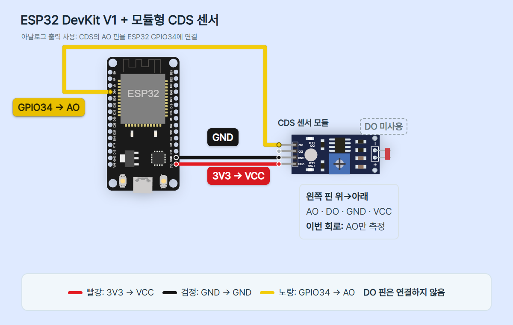

# ESP32 03 · 빛의 변화를 조도센서 AO로 읽기

대상은 **ESP32 DevKit v1, ESP-WROOM-32 계열 30핀 Micro-USB 보드**와 **SunFounder Universal Maker Sensor Kit의 4핀 Photoresistor Module**입니다. 모듈 제조사 문서의 전원3.3~5V 지원, VCC/GND/DO/AO 표기를 확인했습니다. 이 실습에서는 **3.3V로만 공급**하고 AO를 GPIO34에 연결합니다. S3/C3/S2, 다른 센서 모듈의 핀 순서·전원 조건을 그대로 대입하지 않습니다.

## 준비물·안전

보드, 해당 모듈, 점퍼선3개, 브레드보드, USB 데이터 케이블, Thonny PC를 준비합니다. 모듈은 외부 분압 저항 없이 사용합니다. USB를 빼고 배선하고 전원은 USB만 사용합니다. 센서 VCC를 VIN·5V에 연결하지 않습니다. ESP32 GPIO에 5V를 직접 넣지 마세요. 도형의 회전 방향보다 실제 모듈의 인쇄 핀 이름을 우선합니다. 빛 비교는 LDR만 가리고 금속 핀을 만지지 않습니다.

## 정확한 연결

| ESP32 | 모듈 | 역할 |
|---|---|---|
| 3V3 | VCC | 3.3V 센서 전원 |
| GND.1: 오른쪽 3V3 바로 위 GND | GND | 공통 전압 기준 |
| D34 = GPIO34 | AO | 아날로그 전압 입력 |
| 미연결 | DO | 이번 편에서 사용하지 않음 |



그림 센서 도형은180° 회전되어 핀이 왼쪽을 향합니다. 그 방향에서 위→아래는 AO·DO·GND·VCC입니다. 표지의 실제 사진은 핀이 오른쪽이며 위→아래는 VCC·GND·DO·AO입니다. 실습에서는 표기 이름으로 연결하세요. 세 연결은 서로 독립된 네트워크이고 DO를 전원·AO에 묶지 않습니다. GPIO34는 입력 전용이며 내부 풀업이 없습니다. 연결이 빠진 입력은 떠서 임의 값이 나올 수 있으며, 코드가 모든 오배선을 검출하지는 못합니다.

## 빛에서 표시까지

LDR은 빛에 반응해 저항이 바뀌는 부품입니다. 빛이 강해지면 저항이 작아지고, 모듈 안의 저항들과 전압을 나누는 비율이 달라져 AO 전압이 바뀝니다. 이 제조사 모듈의 AO 값은 밝아질수록 낮아집니다. GPIO34의 ADC가 전압을 숫자로 바꾸고, 코드는8개의 숫자를 평균 낸 뒤 기준과 비교합니다. 결과는 USB-시리얼을 통해 Thonny Shell에 표시됩니다. 일반적인 모듈 이름만으로 모든 제품의 변화 방향을 단정하지 않습니다.

## ADC 범위와 한계

MicroPython **v1.29.0**의 일반 ESP32용 코드를 사용합니다. 코드가12비트 설정을 명시하므로 ADC 원시 표현은0~4095(4096단계)입니다. `read_u16()`은 이를0~65535 범위로 스케일해 반환합니다. 16비트 API 표현은 실제16비트 분해능·정확도를 뜻하지 않습니다. 표시 raw는 lux·V·%·저항Ω이 아닙니다.

`ATTN_11DB`는 입력 감쇠 설정입니다. 해당 버전 ESP32 문서상 근사 선형 측정 범위는 약150~2450mV(0.15~2.45V)입니다. 센서 AO는3.3V 전원 범위 안에서도 이 선형 구간을 벗어날 수 있습니다. 값이0 또는65535 근처에서 포화되거나 비선형 구간에 들어가면 빛을 조금 바꿔도 값 변화가 작거나 멈출 수 있습니다. 이는3.3V 전체를 정확히 측정한다는 뜻이 아니며, 감쇠 설정이5V 입력을 허용하지도 않습니다.

`raw*3.3/65535` 같은 단순 환산은 이 ESP32의 정확한 전압 보정식이 아닙니다. `read_uv()`도 유효 구간과 보정 조건이 있으므로 이번 편에서는 전압/조도로 환산하지 않습니다. 제조사별 LDR 특성·저항값·광원·설치 방향에 따른 보정이 없는 상태에서 임의의 lux 식을 넣지 않습니다. Wokwi 문서의5V·UNO용 표를 이3.3V ESP32의 실제 측정표로 옮기지 않습니다.

## Thonny 설정과 화면 안내

1. ESP32 기본 세팅 편처럼 일반 ESP32용 MicroPython을 준비합니다. 대상 펌웨어는v1.29.0입니다. 이미 설치한 보드의 파일을 매번 지우지 않습니다.
2. USB를 빼고 연결표대로 배선한 뒤 USB 데이터 케이블로 연결합니다.
3. Thonny 실행 대상을 **MicroPython (ESP32)**, 포트를 실제 보드 COM으로 고릅니다. Local Python에서는 machine 모듈을 사용할 수 없습니다. 다른 시리얼 앱을 닫습니다.
4. 아래 전체 코드를 편집 창에 넣고 PC에 `cds_ao.py`로 저장한 뒤 F5로 실행합니다. 자동 부팅용 장치 main.py로 저장할 경우 기존 파일을 먼저 백업하세요.
5. 아래 Shell에서 READY 다음의 raw_u16·band 줄을 관찰합니다. 별도 터미널로 일반 ESP32 REPL UART0에 연결할 때는115200baud이며 Thonny는 연결을 관리합니다.


이 이미지는 Thonny 공식 홈페이지의 **PC Python 팩토리얼 디버깅 UI 참고**입니다. ESP32나 이 코드의 실행 캡처가 아닙니다. Thonny 홈페이지의5.0.0 확인일은2026-10-24이며 공식 참고 이미지와 설치 버전의 언어·메뉴 배치는 다를 수 있습니다. 편집 창/아래 Shell의 역할만 참고합니다.

## 복사해 실행할 전체 코드

```python
from machine import Pin, ADC
from time import sleep_ms

SAMPLES = 8
THRESHOLD = 32768
adc = ADC(Pin(34), atten=ADC.ATTN_11DB)
adc.width(ADC.WIDTH_12BIT)
print("READY: AO -> GPIO34, 3.3V module")
try:
    while True:
        total = 0
        for _ in range(SAMPLES):
            total += adc.read_u16()
            sleep_ms(25)
        raw = total // SAMPLES
        if raw >= THRESHOLD:
            band = "AT_OR_ABOVE"
        else:
            band = "BELOW"
        print("raw_u16 =", raw, "band =", band)
except KeyboardInterrupt:
    print("STOP")
except OSError as error:
    print("ADC_ERROR:", error)
finally:
    adc.deinit()
```

## 각 줄의 역할

| 코드 | 역할 |
|---|---|
| from machine import Pin, ADC | 보드 핀·ADC 기능 가져오기 |
| from time import sleep_ms | 밀리초 대기 함수 가져오기 |
| SAMPLES = 8 | 표시 한 번에 읽을 개수 |
| THRESHOLD = 32768 | 수업용 소프트웨어 비교 기준 |
| ADC(Pin(34), atten=ADC.ATTN_11DB) | GPIO34에서 지정 감쇠로 전압 읽기 준비 |
| adc.width(ADC.WIDTH_12BIT) | 일반 ESP32의12비트 설정 명시 |
| READY 출력 | 대상 연결 조건과 시작 알림 |
| try / while True | 반복 읽기를 시작하고 종료 시 자원 정리 |
| total = 0 | 매 표시 회차의 합을0으로 초기화 |
| for _ in range(SAMPLES) | 8번 반복; _는 쓰지 않는 반복 번호 |
| total += adc.read_u16() | ADC 숫자를 합산 |
| sleep_ms(25) | 읽은 뒤25ms 대기 |
| raw = total // SAMPLES | 합을8로 나누고 소수 부분을 버린 정수 평균 |
| if raw >= THRESHOLD | 평균이 기준 이상인지 판단; 경계값 포함 |
| band = AT_OR_ABOVE / BELOW | 기준 이상/미만의 표시 문자열 선택 |
| print(raw_u16, band) | 숫자와 판단 문구를 Shell로 전달 |
| except KeyboardInterrupt | Ctrl+C 종료에서 STOP 표시 |
| except OSError | ADC 읽기 오류에서 ADC_ERROR 표시 후 반복 종료 |
| finally / adc.deinit() | 정상 중단·오류 뒤 ADC 사용 해제 |

## 평균·기준·관찰

8회×25ms 대기 합은200ms입니다. 실제로는 ADC 읽기와 출력 시간이 더해져 정확한0.2초 주기가 아닙니다. 평균은 일부 숫자 흔들림을 줄일 수 있지만 모든 잡음·오차·포화를 해결하지 않습니다. 이번에는 변동 폭·정밀도가 개선됐다고 측정한 것이 아닙니다.

THRESHOLD=32768은0~65535 표현을 둘로 비교해 보는 임시 숫자 기준입니다. 특정 lux·전압·낮/밤 경계나 제조사의 정확한 조도 기준이 아닙니다. 모듈의 작은 가변저항은 **DO 하드웨어 비교 기준**을 바꾸며, 이번 코드의 AO 소프트웨어 기준과 다릅니다. 원시값이32767이면BELOW,32768이면AT_OR_ABOVE라는 것은 분기 계산 예시이며 실제 측정 기록이 아닙니다. 기준 주변에서 값이 흔들리면 band도 오갈 수 있습니다. 릴레이나 모터 제어용 안정화 알고리즘은 이 편에 포함하지 않습니다.

1. 같은 위치·광원에서 여러 줄을 기록합니다.
2. 핀에 손이 닿지 않게 LDR만 가리고 다시 엽니다. 제조사 설명대로 가리면 값이 커지고 빛을 더 받으면 작아지는지 비교합니다. 완전 차광하면 선형 구간을 벗어나 포화될 수 있습니다.
3. 두 상태 모두 같은 band라면 두 평균 사이에32768이 없을 수 있습니다. 자신의 두 상태 기록 사이 값을 THRESHOLD로 정해 다시 실행해 봅니다. 구간이 겹치거나 끝값으로 포화되면 기준을 바꾸는 것만으로 해결되지 않습니다.
4. 기록 예시 서식은 `raw_u16 = <평균 정수> band = <AT_OR_ABOVE 또는 BELOW>`입니다. 여기에는 실제 측정 숫자를 채워 넣지 않았습니다.
5. Ctrl+C로 종료하면 STOP을 확인합니다. 다시 실행하면 새 회차부터 평균을 시작합니다.

## 실패 시 점검

| 현상 | 다음 행동 |
|---|---|
| machine 모듈 없음 | Local Python 대신 MicroPython(ESP32) 선택 |
| ADC.width/deinit 등 API 오류 | 보드 모델·MicroPython 버전 확인; 이 코드는v1.29.0 기준 |
| READY 뒤 ADC_ERROR | USB를 빼고 보드·센서·핀·전원 조건 점검 |
| 숫자가 무작위로 흔들림 | AO 연결·공통GND·핀 접촉·광원 깜빡임 확인 |
| 0/65535 근처에서 고정 | 포화 가능성과 전원/신호 오배선 모두 점검 |
| DO LED만 변하고 숫자 차이 작음 | DO와AO 구분, ADC 선형 구간, 실제 연결 핀 확인 |
| band가 계속 동일 | 기준이 두 상태 사이에 있는지 자신의 기록으로 확인 |

배선은 전원이 꺼진 상태에서만 수정합니다. 센서의 출력 방향이나 동작을 확인하려고 GPIO를5V에 연결하지 않습니다. 뜨거워짐·단락·냄새가 의심되면USB를 즉시 뺍니다. 전원이 켜졌다는 것과 안전한 배선·유효한 ADC 관찰은 별개입니다.

## 출처와 사진 사용 조건

확인일2026-10-26. SunFounder의 실제4핀 모듈 사진과 사양·동작 방향을 사용했습니다. 모듈 사진은 기존 UNO 편의 같은 제조사 원본을 재사용했고 보드 사진은SunFounder SF019의30핀 ESP-WROOM-32입니다. 공식 사진과 Thonny UI 이미지의 별도 공개 이미지 라이선스·재배포 허락은 확인되지 않았습니다. 권리는 각 권리자에게 있으며 출처 표기만으로 자유 재사용이 허용되지는 않습니다. 재사용 전 권리자 조건을 확인하세요. Wokwi 도형·핀 좌표는MIT입니다. CODEPLANT 채널을 확인했으나 이 편 전용 영상을 특정하지 않았습니다.

- [SunFounder 모듈 사양·핀·동작 방향](https://docs.sunfounder.com/projects/umsk/en/latest/01_components_basic/11-component_photoresistor.html)
- [SunFounder ESP32 연결 참고](https://docs.sunfounder.com/projects/umsk/en/latest/03_esp32/esp32_lesson11_photoresistor.html)
- [MicroPython v1.29.0 ESP32 ADC](https://docs.micropython.org/en/v1.29.0/esp32/quickref.html)
- [MicroPython ADC API](https://docs.micropython.org/en/v1.29.0/library/machine.ADC.html)
- [time.sleep_ms](https://docs.micropython.org/en/v1.29.0/library/time.html)
- [Wokwi LDR 설명·5V 표와 실제 조건 구분](https://docs.wokwi.com/parts/wokwi-photoresistor-sensor)
- [Wokwi ESP32 핀 좌표](https://github.com/wokwi/wokwi-elements/blob/main/src/esp32-devkit-v1-element.ts)
- [Wokwi 센서 핀 좌표](https://github.com/wokwi/wokwi-elements/blob/main/src/photoresistor-sensor-element.ts)
- [Wokwi MIT 라이선스](https://github.com/wokwi/wokwi-elements/blob/main/LICENSE)
- [ESP32 공식 제품 사진](https://www.sunfounder.com/collections/esp32-1/products/esp-wroom-32-esp32-esp-32s-development-board)
- [Thonny 공식 UI 참고](https://thonny.org/img/screenshot.png)
- [CODEPLANT 채널·전용 영상 미확인](https://www.youtube.com/@codeplant2024)

## 검증 범위

실제 ESP32·센서·AO 전압·빛의 양·ADC 정확도·비교 기준은 시험/측정하지 않았습니다. 시뮬레이터 실행도 하지 않았습니다. 호스트 Python에서 machine/time 대체 객체로 평균 계산·임계값 경계·중단·읽기 오류와 정리를 검사한 것은 실제 보드 실행 증거가 아닙니다. 배선·공식 핀 좌표·PNG·모바일·편집기 검사 결과는 episode.review와 내부 기록에 보존합니다.
