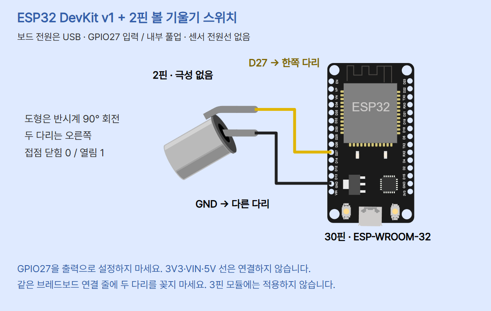

# 기울기로 접점을 바꾸는 2핀 볼 스위치 · ESP32 MicroPython

ESP32 DevKit v1(ESP-WROOM-32, 30핀 Micro-USB)에서 **2핀 수동 기계식 볼 스위치**의 접점 상태를 읽습니다. 부품 기준은 Adafruit PID 173 형태입니다. 내부 공의 이동 → 접점 연결/분리 → GPIO27의 HIGH/LOW → 50ms 디바운싱 → Thonny Shell의 상태 표시 흐름입니다. 각도(°)·가속도·움직임 횟수를 측정하는 자료가 아닙니다. 어느 방향에서 닫히는지는 부품과 고정 방향에 따라 직접 확인하세요.

## 준비물과 연결

ESP32 DevKit v1, 해당 2핀 스위치, 브레드보드, 점퍼선 2개, USB 데이터 케이블, Thonny가 필요합니다. 일반 ESP32용 MicroPython **v1.29.0** 기준입니다. S3/C3/S2나 다른 핀 배열로 자동 대체하지 않습니다. 추가 라이브러리·LED·외부 저항은 사용하지 않습니다.

USB를 빼고 두 다리를 서로 연결되지 않은 브레드보드 줄에 꽂습니다. 사진의 브레드보드 배치는 부품 형태 참고입니다. 배선은 아래 그림과 표를 따릅니다.



| ESP32 | 스위치 | 역할 |
|---|---|---|
| D27 · GPIO27 | 한쪽 다리 | 디지털 입력 |
| GND · 왼쪽 VIN 바로 위 | 다른 다리 | 접지 연결 |
| 3V3 / VIN / 5V | 연결하지 않음 | 센서 전원선 없음 |

두 다리는 극성이 없어 바꿔도 됩니다. 그림은 Fritzing 2핀 도형을 **반시계 90° 회전**해 다리가 오른쪽을 봅니다. 그림의 위쪽 다리→D27, 아래쪽→GND입니다. 보드는 USB 전원만 사용합니다. GPIO27을 OUTPUT으로 설정하거나 5V를 넣지 마세요. 3핀 VCC/GND/OUT 모듈은 별도 회로가 필요합니다.

## 풀업과 논리 상태

`Pin(27, Pin.IN, Pin.PULL_UP)`은 GPIO27을 입력으로 쓰며 내부 풀업을 켭니다. 풀업은 저항으로 입력을 3.3V 쪽에 약하게 연결해 열린 상태에서도 기준을 만드는 기능입니다. 접점이 열리면 HIGH·1, 닫혀 GND로 연결되면 LOW·0으로 읽습니다. 0/1은 논리 상태이며 전압 측정값이나 각도가 아닙니다. GPIO34~39에는 내부 풀업/풀다운이 없으므로 앞 조도센서 편의 GPIO34로 바꿔 쓰면 안 됩니다. 이 예제는 GPIO27만 사용합니다.

## Thonny에서 실행

첫 설치·펌웨어 준비는 [기본 세팅 편](../001-basic-setup/README.md)을 참고하세요. ESP32_GENERIC용 MicroPython v1.29.0이 설치된 일반 ESP32를 사용합니다.

1. USB를 뺀 상태에서 위 표대로 연결하고 핀 이름을 확인합니다.
2. 데이터 USB 케이블로 PC에 연결합니다. Thonny를 열고 **Tools → Options → Interpreter**에서 **MicroPython (ESP32)**를 선택합니다. Windows 포트는 연결 전후 생긴 COM을 선택합니다. 다른 사람의 번호를 복사하지 않습니다.
3. 아래 `main.py` 전체를 새 편집 창에 붙여넣고 먼저 **이 컴퓨터**에 저장합니다. F5(Run current script)로 실행합니다. MicroPython Shell에서 동작하며 Local Python 실행이 아닙니다. 자동실행이 필요할 때만 MicroPython device에 main.py로 저장합니다.
4. READY 뒤 처음 상태도 디바운스 조건을 거친 뒤 나옵니다. 처음 한 번과 이후 **확정 상태 변화 때만** 줄이 추가됩니다. 계속 같은 상태면 조용할 수 있습니다.
5. 천천히 기울여 잠깐 멈추고 Shell의 상태를 기록하세요. Ctrl+C로 종료하면 STOP을 표시합니다. 다시 F5를 누르면 초기 판정부터 다시 시작합니다.


위 이미지는 thonny.org의 **공식 UI 참고 화면**이며 이번 센서를 실제 실행한 캡처가 아닙니다. 화면의 기존 예제 출력은 이 실습 결과가 아닙니다. 설치 버전에 따라 메뉴 위치·번역이 다를 수 있습니다. 본 실습의 예상 형식은 다음과 같습니다. 숫자와 순서는 설명 예시이며 실측 로그가 아닙니다.

```text
READY: GPIO27, pull-up, debounce 50ms
state = 1 contact = OPEN
state = 0 contact = CLOSED
STOP
```

MicroPython USB 직렬 REPL은 일반 ESP32 UART0 115200 baud 기준입니다. Thonny는 해당 인터프리터의 연결을 관리합니다. 별도 Arduino 시리얼 모니터를 동시에 열지 않습니다. 이 예제는 UNO의 9600 baud 설정 코드를 사용하지 않습니다. 내장 LED는 보드 변형마다 다를 수 있어 제어하지 않습니다.

## 전체 코드

[main.py](main.py)와 동일합니다. `machine.Pin`과 `time`은 MicroPython 내장 기능입니다.

```python
# CODEPLANT TECH 04 - ESP32 DevKit v1 / MicroPython 1.29.0
from machine import Pin
from time import ticks_ms, ticks_diff, sleep_ms

TILT_PIN = 27
DEBOUNCE_MS = 50
POLL_MS = 5

tilt = Pin(TILT_PIN, Pin.IN, Pin.PULL_UP)
try:
    last_raw = tilt.value()
    stable = None
    changed_at = ticks_ms()
    print("READY: GPIO27, pull-up, debounce 50ms")
    while True:
        raw = tilt.value()
        now = ticks_ms()
        if raw != last_raw:
            last_raw = raw
            changed_at = now
        if (stable is None or raw != stable) and (
            ticks_diff(now, changed_at) >= DEBOUNCE_MS
        ):
            stable = raw
            contact = "CLOSED" if stable == 0 else "OPEN"
            print("state =", stable, "contact =", contact)
        sleep_ms(POLL_MS)
except KeyboardInterrupt:
    print("STOP")
except OSError as exc:
    print("PIN_ERROR:", exc)
```

## 각 줄의 역할

| 줄/구문 | 역할 |
|---|---|
| 주석 | 대상 보드·펌웨어 기준을 기록합니다. |
| `from machine import Pin` | 보드 GPIO 클래스를 가져옵니다. |
| `from time ...` | 시간 읽기·순환 안전 차이·대기 기능을 가져옵니다. |
| `TILT_PIN = 27` | D27 표시의 GPIO27을 선택합니다. 헤더 순번이 아닙니다. |
| `DEBOUNCE_MS = 50` | 같은 값이 읽힌 뒤 확정까지 비교할 ms 기준입니다. |
| `POLL_MS = 5` | 반복마다 요청하는 최소 대기 ms입니다. |
| `tilt = Pin(...)` | 입력 모드와 내부 풀업을 설정합니다. |
| `try:` | 읽기·반복 중의 중단과 I/O 오류를 아래 except에서 처리합니다. |
| `last_raw = tilt.value()` | 초기 원시 입력을 읽습니다. |
| `stable = None` | 초기 확정값이 아직 없음을 표시합니다. |
| `changed_at = ticks_ms()` | 최초 비교 시각을 기록합니다. |
| 첫 `print` | 준비 안내를 출력합니다. 배선이 맞다는 검증 메시지는 아닙니다. |
| `while True:` | 중단 또는 오류까지 반복합니다. |
| `raw = tilt.value()` | 현재 디지털 입력 0/1을 읽습니다. |
| `now = ticks_ms()` | 이번 비교 시각을 가져옵니다. |
| `if raw != last_raw:` | 직전 읽기와 다른지 비교합니다. |
| `last_raw = raw` | 새 원시값을 저장합니다. |
| `changed_at = now` | 변화가 관측된 시각으로 기준을 다시 시작합니다. |
| 두 번째 `if` | 초기 또는 기존 확정값과 다르고 50ms 이상 지났는지 확인합니다. |
| `ticks_diff(now, changed_at)` | 시각 카운터 순환을 고려해 차이를 구합니다. 직접 뺄셈하지 않습니다. |
| `stable = raw` | 조건을 통과한 입력을 확정값으로 저장합니다. |
| `contact = ...` | 0이면 CLOSED, 1이면 OPEN 문자열로 바꿉니다. |
| 두 번째 `print` | 최초 확정 또는 확정값 변화만 상태와 의미를 출력합니다. |
| `sleep_ms(POLL_MS)` | 최소 5ms 기다리고 다음 읽기로 갑니다. |
| `except KeyboardInterrupt` | Ctrl+C 중단에 STOP을 출력하고 반복을 끝냅니다. |
| `except OSError as exc` | 읽기 I/O 오류 내용을 PIN_ERROR로 출력하고 끝냅니다. 오류 상태를 정상 상태로 출력하지 않습니다. |
| 들여쓰기·빈 줄 | Python 코드 범위와 읽기 순서를 구분합니다. |

## 접점 튐과 비교 활동

금속 공이 흔들릴 때 접점이 짧게 여러 번 붙었다 떨어질 수 있습니다. **바운스**를 곧바로 새 상태로 쓰지 않도록 확정을 늦추는 처리가 **디바운싱**입니다. 이번 코드는 읽은 값이 바뀔 때마다 기준 시각을 재설정하고, 같은 값이 읽힌 채 50ms가 지난 다음에만 확정합니다. 시작 상태도 같은 조건을 거칩니다.

예를 들어 0ms에 0, 20ms에 1, 30ms에 0이 관측되면 기준은 30ms입니다. 79ms에는 49ms만 지났고 80ms에 50ms가 되어 확정할 수 있습니다. 이것은 알고리즘 계산 예시이며 실측 파형이 아닙니다. 실제 입력은 약 5ms 이상의 간격으로 샘플링하므로 사이의 짧은 변화는 놓칠 수 있습니다. 실제 접점이 연속으로 50ms 붙어 있었다는 계측 증거도 아닙니다.

- 천천히 기울여 멈춘 상태에서 0·CLOSED 또는 1·OPEN이 바뀌는지 기록합니다. 특정 몇 도에서 바뀐다고 가정하지 않습니다.
- 약하게 흔든 상태와 멈춘 상태의 표시를 비교합니다. 흔들림이 계속되면 새 상태 확정이 늦어질 수 있습니다.
- DEBOUNCE_MS를 50에서 100으로 바꿔 재실행하고 반응 지연을 비교합니다. 숫자를 크게 하면 언제나 더 정확한 센서가 되는 것이 아닙니다. 짧은 접점 변화는 더 많이 생략될 수 있습니다.
- `sleep_ms(5)`는 최소 대기입니다. 실행·출력 시간이 더해져 정확한 5ms 주기나 50ms 응답시간 보장이 아닙니다. 정확한 각도·진동 횟수·안전 제어 감지 용도로 쓰지 않습니다.

## 오류 점검

| 현상 | 확인할 것 |
|---|---|
| 항상 0·CLOSED | 두 다리가 같은 연결 줄인지, D27과 GND가 직결됐는지 USB를 빼고 점검 |
| 항상 1·OPEN | 빠진 선·접촉 불량·부품 방향 확인. 천천히 다른 방향으로 기울여 멈추기 |
| READY 뒤 새 줄 없음 | 같은 확정 상태라면 정상. 기울이고 멈춰 변화 비교 |
| 반응이 늦음 | 흔들림 동안 시간 재시작. 멈춰 보기, 50/100ms 설정 비교 |
| machine 모듈 없음 | Local Python 대신 MicroPython(ESP32) 선택 |
| PIN_ERROR | 프로그램이 종료됨. USB를 빼고 보드·연결·접촉부터 점검 |
| 실행/연결 실패 | 실제 COM·케이블·일반 ESP32용 펌웨어 버전 점검 |

배선 불량은 OSError 없이도 0이나 1로 읽힐 수 있습니다. 에러가 없다고 회로가 검증된 것은 아닙니다. 전원을 끈 상태에서만 배선을 바꿉니다.

## 회로 편집·검증 범위

`diagram.json`은 좌표·회전·연결을 저장하는 CODEPLANT 편집용 데이터입니다. Fritzing 2핀 SVG와 Wokwi ESP32 도형을 조합한 `circuit_preview.html`을 렌더링합니다. Wokwi 3핀 tilt-switch 모듈을 2핀 부품으로 대체하지 않았습니다. 그대로 Wokwi에 넣어 실행 가능한 프로젝트라고 표시하지 않습니다.

스킬 기본 검증기는 서보·조도센서 전용이어서 이 2핀 도형을 지원하지 않습니다. 이 편의 `verify.py`가 별도로 정확한 두 net·회전한 다리 끝·코드 핀·전체 코드 문서 일치·디바운스 초기/경계/바운스/긴 유지/시각 순환/중단/오류를 호스트 대체 객체로 검사합니다. 호스트 테스트는 실제 MicroPython 펌웨어나 실제 보드 실행 증거가 아닙니다.

실제 ESP32·센서·직렬 수신·접점 파형·50ms 적합성·5ms 실제 주기는 시험/측정하지 않았습니다. 시뮬레이터도 실행하지 않았습니다. 카드/모바일/편집기 검사와 배선 검사 결과는 episode.review 및 내부 결과에 남깁니다. 실제 사람의 피드백을 받은 것으로 쓰지 않습니다.

## 출처와 사용 조건

확인일 2026-10-27. 사진·부품 도형은 기존 확인한 원본을 재사용하고 표시 크기/회전만 조절했습니다. 생성 이미지를 제품 사진으로 사용하지 않았습니다.

- [Adafruit 2핀 볼 스위치 구조](https://learn.adafruit.com/tilt-sensor/overview), [풀업과 바운스 설명](https://learn.adafruit.com/tilt-sensor/using-a-tilt-sensor), [PID 173](https://www.adafruit.com/product/173). Arduino 예제의 핀·전압·LED 코드를 ESP32에 그대로 옮기지 않았습니다.
- 실제 스위치 사진: lady ada / Adafruit [asset 496](https://learn.adafruit.com/assets/496), [CC BY-SA 3.0](https://creativecommons.org/licenses/by-sa/3.0/). 브레드보드에 꽂힌 원본 사진 비율 유지. 원본 asset 상세 페이지의 오늘 직접 조회는 실패했으며 기존 출처 기록과 현재 가이드로 교차 확인했습니다.
- 실제 보드 사진: [SunFounder ESP-WROOM-32 30핀 제품 사진](https://www.sunfounder.com/collections/esp32-1/products/esp-wroom-32-esp32-esp-32s-development-board). 별도 자유 이용 라이선스·재배포 허락 미확인. 출처만으로 자유 재사용이 허용되는 것은 아닙니다.
- [MicroPython v1.29.0 Pin](https://docs.micropython.org/en/v1.29.0/library/machine.Pin.html), [ESP32 핀·GPIO34~39 제한](https://docs.micropython.org/en/v1.29.0/esp32/quickref.html), [ticks_ms/ticks_diff/sleep_ms](https://docs.micropython.org/en/v1.29.0/library/time.html).
- ESP32 도형·D27/GND.2 좌표: [Wokwi 원본](https://github.com/wokwi/wokwi-elements/blob/main/src/esp32-devkit-v1-element.ts), [MIT](https://github.com/wokwi/wokwi-elements/blob/main/LICENSE). 렌더 라이브러리 @wokwi/elements 1.9.2.
- 2핀 도형: Fritzing / Lionel Michel [공식 부품](https://github.com/fritzing/fritzing-parts/blob/develop/core/Tilt%20switch.fzp), [원본 SVG](https://github.com/fritzing/fritzing-parts/blob/develop/svg/core/breadboard/tilt_switch.svg), [CC BY-SA 3.0](https://github.com/fritzing/fritzing-parts/blob/develop/LICENSE.txt). 도형을 확대·반시계 회전하고 두 다리 끝에 선을 추가했습니다. 회로 PNG와 이를 담은 카드는 CC BY-SA 3.0입니다. 각 원본 자산·상표는 별도 권리를 유지합니다.
- [Thonny 공식 UI 이미지](https://thonny.org/img/screenshot.png)는 이번 실행 캡처가 아닙니다. 별도 공개 이미지 라이선스 미확인.
- [CODEPLANT 유튜브](https://www.youtube.com/@codeplant2024/videos) 공개 목록을 브라우저에서 확인했습니다. 이번 편에 대응하는 ESP32 2핀 스위치 개별 영상을 확정하지 않았으므로 해당 영상으로 배선·코드를 검증했다고 쓰지 않습니다.

[게시용 캡션](caption.md)에는 이 편의 실제 GitHub 주소와 사진 출처를 담았습니다. 신규 댓글 DM은 중단 정책을 유지합니다. GitHub 공개와 Instagram 게시·예약은 별개입니다.

## 이번 제작 검수 결과 (2026-10-27)

- 전용 `python verify.py`: 문법·전체 코드 문서 일치·두 net·회전 다리 좌표·초기/경계/바운스/장시간 유지/시각 순환/중단/읽기 오류 검사 통과. 실제 입력이 아닌 호스트 대체 객체입니다.
- 실제 브라우저 DOM: 공식 ESP32 pinInfo에 렌더링 CSS 변환을 적용한 위치, 회전한 두 SVG 다리 끝, 네 배선 끝점이 0.01px 이내로 일치했습니다.
- `PORT=8773`, `CODEPLANT_CHECK_EPISODE=esp32-004-tilt`, `node check.mjs`: 10장 전체 1080×1350 PNG·편집/저장·사진·공통 블루·하단 여백·모바일·캡션 복사·이미지 붙여넣기·최신 편집 전체 ZIP 검사 통과.
- 10장과 회로를 시각적으로 확인했습니다. 마지막 카드 하단 겹침과 회로 라벨의 보드 가림을 수정했습니다. 실제 하드웨어·MicroPython 펌웨어 실행·시뮬레이터는 미시험입니다.
