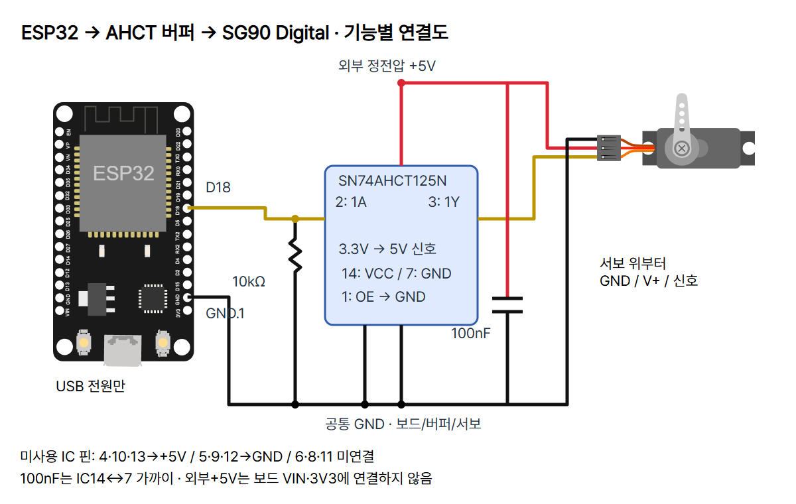
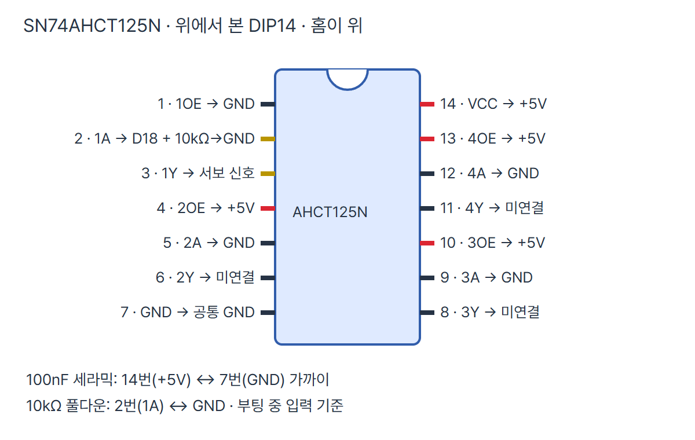
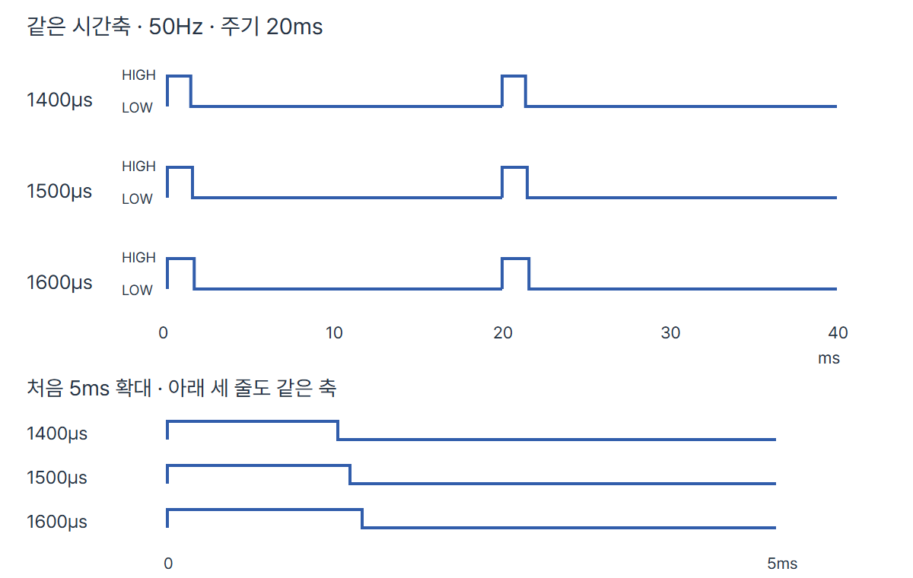
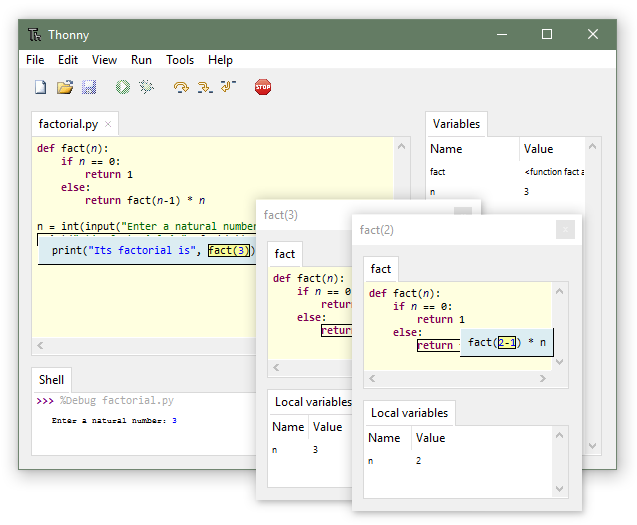

# 05 · 펄스 폭으로 위치를 명령하는 서보모터

ESP32 DevKit v1 / ESP-WROOM-32 30핀 Micro-USB / MicroPython **v1.29.0** 기준입니다. ESP32-C3/S3나 CircuitPython 코드를 섞지 않습니다. SG90 Digital 위치 제어형 한 개를 부하 없이 다룹니다.

## 목표와 준비물

코드의 시간 명령 → D18 신호 → AHCT 레벨 변환 → 서보 내부 위치 제어 → 눈으로 확인한 위치의 흐름을 살펴봅니다. 보낸 펄스 폭과 실제 축 각도는 다른 값입니다. 축 위치를 ESP32로 되돌리는 선은 없습니다.

- ESP32 DevKit v1(ESP-WROOM-32 30핀), USB 데이터 케이블, Thonny.
- **TowerPro SG90 Digital 위치 제어형**. SG90 표기만으로 정품·회전 범위·전류·3.3V 신호 호환을 확정하지 않습니다. 연속 회전형에는 이 실습을 적용하지 않습니다.
- **Texas Instruments SN74AHCT125N, PDIP14** 버퍼. SN74HC125는 같은 입력 기준이 아니므로 임의 대체하지 않습니다.
- 100nF(0.1µF) 세라믹 콘덴서, 10kΩ 저항, 브레드보드·점퍼선, 극성을 확인할 수 있는 전원 연결 단자.
- 외부 **정전압 5V, 2A 이상** 전원은 이 실습의 권장 설계입니다. 부하·배선·보호를 포함한 전원 안전을 인증한 수치가 아닙니다. 가정용 교류 전원부를 직접 배선하지 말고 완제품 저전압 어댑터를 사용합니다.

제조사 제품 사양은 4.8V, 외부 어댑터 급전을 안내하며 제조사 답변에 4.8~6V·약0.5~2A가 제시되어 있습니다. 일반 모델의 실제 움직임 범위는 별도180/360 표기 없이 모두180°라고 하지 않습니다. 정품·사양이 다른 부품을 자동 대체하지 마세요.

## 3.3V 신호와 5V 전력

SG90 Digital 공식 페이지에는 입력 HIGH 임계값이 수치로 명시되지 않았습니다. 이 예제는 GPIO18을 서보에 직접 연결한다고 보장하지 않고 AHCT 버퍼를 사용합니다. TI는 VCC4.5~5.5V에서 HIGH 입력 최소2V, LOW 최대0.8V를 제시합니다. ESP32 신호를 1A가 받고 1Y가 외부5V 수준의 신호를 내보냅니다. **버퍼 출력은 ESP32 입력으로 되돌리지 않습니다.** 이 버퍼는 모터 전력을 공급하는 드라이버가 아닙니다.

## 연결표

두 전원을 끈 채 배선합니다. 그림 [circuit.png](circuit.png)는 기능별 연결도이며 IC 핀의 공간 배치도는 아닙니다. 실제 DIP14 다리 순서는 [buffer-pins.png](buffer-pins.png)처럼 **홈 위·위에서 본 모습**입니다. 왼쪽 위1에서 아래7, 오른쪽 아래8에서 위14로 셉니다.

| 시작 | 연결 대상 | 역할 |
| --- | --- | --- |
| ESP32 D18(GPIO18) | IC2 · 1A | 3.3V 신호 |
| IC3 · 1Y | 서보 신호선 | 5V 수준 펄스 |
| 외부+5V | 서보 V+, IC14(VCC), IC4/10/13(OE) | 서보·버퍼 급전, 미사용 게이트 비활성 |
| 외부GND | 서보GND, ESP32 GND.1(3V3 바로 위), IC7 | 공통 접지 |
| IC1 · 1OE | 공통GND | 첫 게이트 활성·LOW에서 통과 |
| IC5/9/12 · 미사용 A | 공통GND | 미사용 입력 고정 |
| IC6/8/11 · 미사용 Y | 연결하지 않음 | 미사용 출력 |
| 10kΩ 두 다리 | IC2 ↔ 공통GND | 부팅 중 입력 풀다운 |
| 100nF 두 다리 | IC14 ↔ IC7 가까이 | 버퍼 전원 바이패스 |
| 보드 3V3/VIN/다른 GPIO | 외부+5V 연결 금지 | 역급전·GPIO 손상 방지 |

서보는 보통 갈색/검정GND, 빨강V+, 주황/노랑신호입니다. 케이블 색만 믿지 말고 실제 제품 핀표와 확인합니다. 회로의 노란 선은 신호 역할의 표시이며 실제 선 색을 바꾼다는 뜻이 아닙니다. 두 다리를 같은 브레드보드 연결 줄에 넣지 마세요. 분리된 전원 레일도 실제로 이어졌는지 확인합니다.




## 펄스·주기·듀티비

PWM은 디지털 HIGH/LOW를 반복하면서 HIGH 시간의 비율을 바꾸는 출력 방식입니다. 이 편은 주기를20ms로 고정하고 HIGH 시간만 조절합니다. 주파수는1초 반복 횟수로50Hz입니다. 서보의 위치 제어기는 반복 펄스의 폭에 반응합니다. 50Hz는 축이50회 회전한다는 뜻이 아닙니다.



위 파형은 코드 상수로 계산한 도식이며 오실로스코프 측정 캡처가 아닙니다. 두 주기는 같은 시간축이고 아래 부분은 첫5ms를 확대했습니다. GPIO쪽 HIGH는3.3V 수준, 버퍼 뒤 HIGH는5V 수준입니다. 버퍼의 작은 전파 지연·실제 PWM 분해능·부하에 따른 차이는 측정하지 않았습니다.

| 명령 | ns 인자 | 20,000µs 기준 계산 듀티비 |
| --- | --- | --- |
| 1400µs | 1,400,000ns | 7% |
| 1500µs | 1,500,000ns | 7.5% |
| 1600µs | 1,600,000ns | 8% |

1ms=1000µs,1µs=1000ns입니다. `duty_ns()`는 ns 펄스 폭을 받습니다. 다른 API `duty_u16()`은0~65535의 비율 값이며 이 예제에서는 사용하지 않습니다. 그 범위를 각도나 RPM으로 읽지 마세요. 50%를 중앙 명령으로 쓰면20ms의 절반10ms가 되어 이번 예제 범위를 벗어납니다.

일반 서보 예시의1~2ms는 초기 설명 범위일 뿐 이 제품 모든 각도의 보정표가 아닙니다. 여기서는 중심 부근1500µs에서 시작해1400~1600µs만 비교하며 이조차 모든 서보의 안전 범위를 보장하지 않습니다. 정품·제품 차이와 혼 장착 위치에 따라 실제 각도가 다릅니다. 1500µs=정확히90°라고 쓰지 않습니다.

## 실행 순서와 화면

1. 기본 세팅 편에 따라 일반 ESP32용 MicroPython v1.29.0을 설치합니다. 실제 보드에 맞는 펌웨어인지 확인합니다. Thonny **도구 → 옵션 → 인터프리터**(버전에 따라 메뉴명·배치 차이)에서 MicroPython(ESP32)와 실제 USB COM 포트를 선택합니다. CPython(Local Python)은 보드의 machine 모듈을 제공하지 않습니다.
2. 외부 전원OFF,USB분리. 위 핀표대로 연결합니다. 부하와 주변 장애물을 없애고 손으로 축을 잡지 않습니다. 혼 장착·배선 변경은 두 전원OFF에서 합니다.
3. 외부 전원은 끈 채 USB를 연결합니다. 아래 전체 코드를 편집기에 붙여 PC의 연습 파일로 보관하고 실행합니다. 처음에는 `COMPARE=False`를 유지합니다. 처음부터 보드main.py로 자동 실행 저장할 필요는 없습니다.
4. Shell에서 READY와 command_us=1500을 확인하고 배선·극성 확인 후 외부5V를 켭니다. 중앙 부근 움직임을 관찰합니다. 출력 문자열만으로 모터가 움직였다고 판단하지 않습니다.
5. 이상이 없다면 외부 전원을 먼저 끄고 Ctrl+C. `COMPARE=True`로 바꿔 재실행·READY확인 후 외부 전원을 켭니다. 다음 비교가 반복됩니다. 중심만 설정했을 때 같은 명령은 한 줄만 출력합니다.
6. 끝낼 때 외부 전원을 먼저 끄고 Ctrl+C,USB분리. 재실행·리셋·전원 변경·배선 수정 전에도 외부 전원부터 끕니다. Ctrl+C는 PWM 신호를 종료하지만 전력 차단·기계적 안전 정지를 보장하지 않습니다.



위 이미지는 **Thonny 공식 일반 UI 참고 화면**이며 이번 ESP32·서보의 실제 실행 캡처가 아닙니다. 화면 속 인터프리터·코드·출력을 이번 실습 결과로 해석하지 않습니다. 실제로 볼 위치는 아래 Shell과 인터프리터/포트 선택 영역입니다.

## 전체 코드

```python
from machine import Pin, PWM
from time import sleep_ms

SERVO_PIN = 18
FREQUENCY_HZ = 50
CENTER_US = 1500
STEP_US = 100
HOLD_MS = 2000
COMPARE = False


def check_pulse(pulse_us):
    if not isinstance(pulse_us, int) or not 1400 <= pulse_us <= 1600:
        raise ValueError("pulse must be integer 1400..1600 us")
    return pulse_us


signal = None
servo = None
try:
    center = check_pulse(CENTER_US)
    if not isinstance(STEP_US, int) or not 0 <= STEP_US <= 100:
        raise ValueError("STEP_US must be integer 0..100")
    if not isinstance(HOLD_MS, int) or HOLD_MS < 2000:
        raise ValueError("HOLD_MS must be at least 2000")
    positions = (center,)
    if COMPARE:
        positions = (center, check_pulse(center - STEP_US),
                     center, check_pulse(center + STEP_US))
    signal = Pin(SERVO_PIN, Pin.OUT, value=0)
    servo = PWM(signal, freq=FREQUENCY_HZ, duty_ns=center * 1000)
    print("READY: external servo power ON only after wiring check")
    previous = None
    while True:
        for pulse_us in positions:
            servo.duty_ns(pulse_us * 1000)
            if pulse_us != previous:
                print("command_us =", pulse_us, "period_ms = 20")
                previous = pulse_us
            sleep_ms(HOLD_MS)
except KeyboardInterrupt:
    print("STOP: remove external servo power")
except (ValueError, OSError) as error:
    print("PWM_ERROR:", error)
finally:
    try:
        if servo is not None:
            servo.deinit()
    finally:
        if signal is not None:
            signal.init(Pin.OUT, value=0)
```

## 각 줄의 역할

| 줄 | 코드 | 역할 |
| --- | --- | --- |
| 1 | `from machine import Pin, PWM` | 보드 GPIO와 하드웨어 PWM을 가져옵니다. |
| 2 | `from time import sleep_ms` | ms 단위 최소 대기를 가져옵니다. |
| 4 | `SERVO_PIN = 18` | D18에 해당하는 GPIO번호입니다. |
| 5 | `FREQUENCY_HZ = 50` | 반복 주파수50Hz,주기20ms를 설정합니다. |
| 6 | `CENTER_US = 1500` | 센터 부근을 찾는 초기 펄스 명령입니다. 각도 측정값이 아닙니다. |
| 7 | `STEP_US = 100` | 센터에서 비교할 시간 차이100µs입니다. |
| 8 | `HOLD_MS = 2000` | 명령 뒤 최소 대기2000ms입니다. 이동 완료를 감지하지 않습니다. |
| 9 | `COMPARE = False` | 처음에는 센터만 명령하고 True일 때 비교합니다. |
| 12 | `def check_pulse(pulse_us):` | 허용 명령인지 검사하는 함수를 정의합니다. |
| 13 | `if not isinstance(pulse_us, int) or not 1400 <= pulse_us <= 1600:` | 정수이며1400~1600µs 범위인지 확인합니다. |
| 14 | `raise ValueError("pulse must be integer 1400..1600 us")` | 잘못된 명령을 PWM에 보내기 전에 오류로 중단합니다. |
| 15 | `return pulse_us` | 검사를 통과한 값을 반환합니다. |
| 18 | `signal = None` | 아직GPIO를 만들지 않았음을 기록합니다. |
| 19 | `servo = None` | 아직PWM을 만들지 않았음을 기록합니다. |
| 20 | `try:` | 중단·설정 오류에도 정리하도록 실행 영역을 시작합니다. |
| 21 | `center = check_pulse(CENTER_US)` | 센터값을 검사합니다. |
| 22 | `if not isinstance(STEP_US, int) or not 0 <= STEP_US <= 100:` | 비교 폭 0~100µs의 정수인지 검사합니다. |
| 23 | `raise ValueError("STEP_US must be integer 0..100")` | 잘못된 비교 폭이면 시작하지 않습니다. |
| 24 | `if not isinstance(HOLD_MS, int) or HOLD_MS < 2000:` | 대기 시간이 2000ms 이상 정수인지 검사합니다. |
| 25 | `raise ValueError("HOLD_MS must be at least 2000")` | 너무 짧은 대기 설정을 거부합니다. |
| 26 | `positions = (center,)` | 처음에는 하나의 센터값만 사용합니다. |
| 27 | `if COMPARE:` | 비교 모드일 때만 다음 목록으로 바꿉니다. |
| 28 | `positions = (center, check_pulse(center - STEP_US),` | 센터·작은 펄스를 검사해 비교 목록을 만듭니다. |
| 29 | `center, check_pulse(center + STEP_US))` | 다시 센터·큰 펄스까지 검사합니다. |
| 30 | `signal = Pin(SERVO_PIN, Pin.OUT, value=0)` | GPIO18을 LOW 출력으로 초기화합니다. |
| 31 | `servo = PWM(signal, freq=FREQUENCY_HZ, duty_ns=center * 1000)` | 50Hz PWM과 초기 센터 펄스를 생성합니다. µs를 ns로 바꿉니다. |
| 32 | `print("READY: external servo power ON only after wiring check")` | 외부 전원을 켜기 전 배선 확인 안내입니다. 장치 성공 판정이 아닙니다. |
| 33 | `previous = None` | 앞서 출력한 명령을 기록할 자리를 초기화합니다. |
| 34 | `while True:` | 전원 중단 또는 Ctrl+C까지 반복합니다. |
| 35 | `for pulse_us in positions:` | 비교 목록의 명령을 차례로 선택합니다. |
| 36 | `servo.duty_ns(pulse_us * 1000)` | µs×1000을 ns로 바꿔 HIGH 시간을 명령합니다. |
| 37 | `if pulse_us != previous:` | 같은 명령의 불필요한 반복 출력을 막습니다. |
| 38 | `print("command_us =", pulse_us, "period_ms = 20")` | 보낸 시간 명령과 설정 주기를 표시합니다. 각도 측정이 아닙니다. |
| 39 | `previous = pulse_us` | 출력한 명령을 기억합니다. |
| 40 | `sleep_ms(HOLD_MS)` | 설정한 시간 이상 기다립니다. PWM은 하드웨어에서 계속됩니다. |
| 41 | `except KeyboardInterrupt:` | Ctrl+C 중단을 처리합니다. |
| 42 | `print("STOP: remove external servo power")` | 외부 전원 제거를 안내합니다. |
| 43 | `except (ValueError, OSError) as error:` | 설정·PWM 오류를 처리합니다. |
| 44 | `print("PWM_ERROR:", error)` | 실제 오류를 Shell에 표시합니다. |
| 45 | `finally:` | 정상 중단·오류 모두 자원 정리를 시도합니다. |
| 46 | `try:` | 중단·설정 오류에도 정리하도록 실행 영역을 시작합니다. |
| 47 | `if servo is not None:` | PWM 객체가 생겼을 때만 정리합니다. |
| 48 | `servo.deinit()` | PWM 출력을 해제합니다. |
| 49 | `finally:` | 정상 중단·오류 모두 자원 정리를 시도합니다. |
| 50 | `if signal is not None:` | GPIO 객체가 생겼을 때만 정리합니다. |
| 51 | `signal.init(Pin.OUT, value=0)` | PWM 정리에 오류가 있어도 GPIO를 LOW로 되돌리는 시도를 합니다. |

## 예상 출력과 기록 활동

아래는 코드로부터 예상한 문자열이며 실제 하드웨어 로그가 아닙니다.

```text
READY: external servo power ON only after wiring check
command_us = 1500 period_ms = 20
```

COMPARE=True일 때 1500→1400→1500→1600µs를 반복합니다. 최소 2초 간격이며 처리 시간이 더해져 정확히 2초 주기는 아닙니다. 출력 발생은 명령 전달이지 실제 도착 판정이 아닙니다.

| 명령µs | 실제 관찰한 방향·정지 위치 | 떨림·소음 | 측정한 각도·시간(장비 있을 때만) |
| --- | --- | --- | --- |
| 1400 | 직접 기록 | 직접 기록 | 측정 전 공란 |
| 1500 | 직접 기록 | 직접 기록 | 측정 전 공란 |
| 1600 | 직접 기록 | 직접 기록 | 측정 전 공란 |

STEP_US=50으로 줄여 비교하고 HOLD_MS=3000으로 관찰 시간을 늘려 봅니다. CENTER_US를 바꿀 경우 모든 비교값이 1400~1600 범위여야 코드가 시작합니다. 보정은 실제 제품의 허용 폭·장착·측정으로 확인해야 하며 모든 제품이 동일하다고 쓰지 않습니다. 정격 속도값을 실제 실습 도착 시간으로 대신하지 않습니다.

## 오류와 다음 행동

- 숫자만 나오고 움직임 없음: 외부 전원 OFF 후 5V·공통 GND·D18·IC2/3·OE1과 실제 서보 핀표를 대조합니다.
- 보드 리셋·떨림: 보드 3V3/VIN에서 서보 전력을 끌어오지 않았는지, 전원 용량·접촉을 확인합니다. 전압 저하는 별도 측정이 필요합니다.
- 심한 소음·막힘·발열: 외부 전원을 즉시 끕니다. 혼·부하·기계적 끝단을 점검합니다. 펄스 범위를 무작정 넓히지 않습니다.
- 계속 회전: 연속 회전형인지 모델을 확인합니다. 위치형 코드를 속도형으로 해석하지 않습니다.
- machine/PWM/duty_ns 오류: 보드용 MicroPython 버전·Thonny 인터프리터를 확인합니다. PC 파이썬 문법 검사 통과는 보드 실행 검증이 아닙니다.

## 출처·사용 조건·검증 경계

2026-10-28 공식 원문을 확인했습니다.

- [MicroPython v1.29.0 PWM](https://docs.micropython.org/en/v1.29.0/library/machine.PWM.html), [ESP32 quick reference](https://docs.micropython.org/en/v1.29.0/esp32/quickref.html): duty_ns·주파수·단위·하드웨어 분해능과 오차. 내장 API만 사용합니다.
- [TowerPro SG90 Digital](https://towerpro.com.tw/product/sg90-7/): 정격·전류/전압·제품 변형에 관한 제조사 답변. [사진 원본 SG90-D2.jpg](https://towerpro.com.tw/wp-content/uploads/2014/08/SG90-D2.jpg)은 기존 동일 모델 원본 재사용, 비율·워터마크 유지. Copyright Torq Pro & Tower Pro, All Rights Reserved. 자유 이용·재배포 허락 미확인.
- [TI SN74AHCT125 Rev.R](https://www.ti.com/lit/ds/symlink/sn74ahct125.pdf): N패키지 위에서 본 핀표 3쪽, 입력 기준 5쪽, 바이패스·미사용 입력 12쪽. IC 핀 그림은 원문 번호·기능으로 CODEPLANT가 작성한 설명도입니다.
- [Adafruit hardware](https://learn.adafruit.com/using-servos-with-circuitpython/hardware), [low level](https://learn.adafruit.com/using-servos-with-circuitpython/low-level-servo-control): 전원 분리·공통 GND·펄스 개념. 해당 CircuitPython 예제를 MicroPython 실행 코드로 복사하지 않았습니다. 일반 180° 설명을 SG90의 보장값으로 옮기지 않습니다.
- 보드 사진: [SunFounder ESP-WROOM-32 30핀](https://www.sunfounder.com/collections/esp32-1/products/esp-wroom-32-esp32-esp-32s-development-board). 기존 동일 보드 공식 사진 재사용. 별도 자유 이용·재배포 허락 미확인. 사진 출처 표기만으로 재사용 권리가 생기지는 않습니다.
- 보드·서보 도형: [Wokwi ESP32](https://github.com/wokwi/wokwi-elements/blob/main/src/esp32-devkit-v1-element.ts), [서보](https://github.com/wokwi/wokwi-elements/blob/main/src/servo-element.ts), MIT, @wokwi/elements 1.9.2. 서보 도형은 기능 설명용이며 SG90 제품 사진과 구별합니다.
- [Thonny 공식 화면](https://thonny.org/img/screenshot.png)은 일반 UI 참고로 재사용했으며 별도 공개 이미지 라이선스 미확인입니다. 이번 실행 캡처가 아닙니다.
- [CODEPLANT 채널](https://www.youtube.com/@codeplant2024), [기존 ESP32 서보 강의](https://www.youtube.com/watch?v=T1hUZ203-2Y) 확인을 시도했으나 현재 웹 조회 실패. 과거 편의 링크를 참고로 남기며 오늘 영상·자막·해당 회로를 확인했다고 쓰지 않습니다. 이번 핀·버퍼·MicroPython API 근거는 위 공식 원문입니다.

실습 안내·자체 작성 코드는 CC BY 4.0, 사진·로고·공식 화면은 각 원본 권리를 유지합니다. 생성 제품 사진을 쓰지 않았습니다. diagram.json은 편집 가능한 net 자료이며 custom-sn74ahct125n 시뮬레이션 모델은 등록하지 않았습니다. Wokwi 시뮬레이션 완료라고 쓰지 않습니다. episode.json은 로컬 편집 원본입니다.

## 검수 결과 (2026-10-28)

- `verify.py`: 4개 정확한 net·TI 14핀 역할·미사용 출력·금지 전원 연결 변이·Python AST·README 전체 코드 일치·센터/비교 모드·50µs 비교폭·범위/대기 오류 거부·Ctrl+C·PWM 생성/갱신/정리 오류 검사 통과. 호스트의 대체 객체 검사입니다.
- 스킬 `validate_diagram.py`: VALID, 7개 부품·18개 연결. custom 버퍼의 세부 핀 역할은 별도 전용 검사로 확인했습니다. 시뮬레이션 모델이 유효하다는 뜻이 아닙니다.
- 렌더링 DOM: 공식 Wokwi ESP32 D18/GND.1 및 서보 3핀 좌표 5개가 선 끝과 0.01px 이내 일치합니다. IC 그림은 TI N패키지의 위에서 본 핀 순서를 대조했습니다.
- `PORT=8773`, `CODEPLANT_CHECK_EPISODE=esp32-005-servo-motor`, `node check.mjs`: 12장 전체 1080×1350 PNG·최신 편집 ZIP·모바일·사진·공통 블루·하단 겹침·캡션 저장/복사·이미지 삽입/Ctrl+V·저장 재열기·쓰기 경계 통과.
- 전체 12장 축소 모음과 회로/핀표를 시각 검수했습니다. 원본 로고·Pretendard·블루 #DFEAFF와 #315DAB 유지. 실제 디자이너·학생·교사의 피드백을 받았다는 뜻이 아닙니다.
- 실제 ESP32 업로드·MicroPython 펌웨어 실행·서보 이동/각도/전류·오실로스코프 측정·시뮬레이터는 미시험입니다. 캡션에서 검증 문구를 생략해도 이 경계는 유지합니다.

[전체 예제 주소](https://github.com/CodeplantEDU/codeplant-tech/tree/main/esp32/005-servo-motor) / [게시용 캡션](caption.md)
