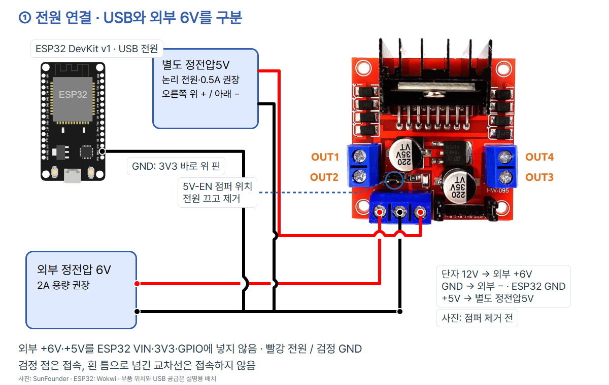
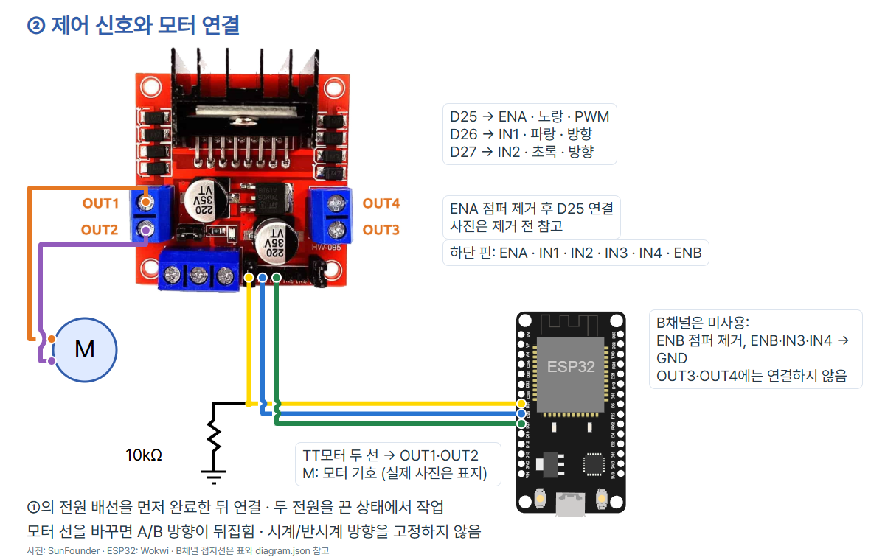
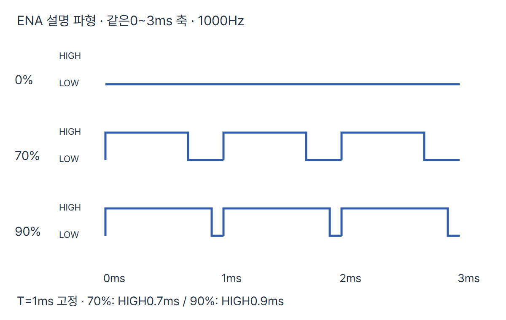

# 06 · 드라이버로 방향과 출력을 바꾸는 DC모터

ESP32 DevKit v1(ESP-WROOM-32 30핀 Micro-USB), MicroPython **v1.29.0**, SunFounder L298N 모듈, Adafruit #3777 TT모터 한 개를 기준으로 합니다. 다른 모듈의 점퍼·전원·핀 배열을 자동 대체하지 않습니다.

## 목표와 준비물

`run` 입력 → 코드의 순서 판단 → D25 PWM과 D26/D27 방향 신호 → L298N H브리지 → TT모터 출력을 연결합니다. H브리지는 모터 두 선에 걸리는 방향을 바꾸는 회로입니다. 70/90%는 전기적인 구동 비율 명령이며 RPM·토크·실제 전압이 아닙니다.

- ESP32 DevKit v1, 데이터 USB 케이블, Thonny.
- SunFounder 문서와 같은 L298N 모듈(78M05, 5V-EN·ENA·ENB 점퍼가 있는 형태).
- Adafruit #3777 TT모터 1개, 정격3~6V. 바퀴·부하를 빼고 모터를 단단히 고정합니다.
- **모터용 정전압6V·2A 이상**, **별도 논리용 정전압5V·0.5A** 전원은 실습 권장 용량입니다. 전원 전류 정격은 필요한 만큼 공급할 수 있는 용량이지 강제로 모터에 흘리는 전류가 아닙니다. 완제품 저전압 전원을 사용하고 교류 전원부를 직접 배선하지 않습니다.
- 10kΩ 저항 1개(ENA 풀다운), 브레드보드·신호 점퍼선·접지 분기 단자·절연된 전원/모터 배선·단자 조임용 드라이버. 모터 전류를 가는 신호선·헐거운 브레드보드 접촉으로 흘리지 않습니다.

## 전원과 3.3V GPIO

ESP32는 USB만 사용합니다. 보드 VIN/5V 핀의 공급 방향을 가정하지 않고 논리5V를 별도로 공급합니다. 모듈의 `12V`는 단자 인쇄 이름이며 이번 모터 전원은6V입니다. TT모터에12V를 공급하지 않습니다.

ST L298 Rev5는 논리 VSS=5V 조건에서 IN/ENABLE의 HIGH 최소2.3V, LOW 최대1.5V를 제시합니다. 따라서 이 모듈의 입력은 ESP32의3.3V 제어 신호를 받을 수 있습니다. **논리 전원5V와 제어 HIGH3.3V는 다른 역할**입니다. 모듈5V·모터 출력·ENA의5V 점퍼를 ESP32 GPIO로 연결하지 않습니다.

L298N에는 전압 손실이 있어 공급6V가 모터에 그대로 걸리지 않습니다. 낮은 출력에서 출발하지 못할 수 있습니다. 모터 제품명의200RPM은 제조사 조건의 명목값이며 이번 연결의 실제 측정 결과가 아닙니다. 정격·모듈의 최대 전류 숫자를 연속 안전 구동 보장으로 사용하지 않습니다.

## 점퍼와 연결표

모든 전원을 끄고 **5V-EN·ENA·ENB 점퍼를 모두 제거**합니다. 5V-EN을 제거한 뒤 +5V 단자는 논리 전원 입력으로 사용합니다. ENA/ENB 점퍼는5V에 연결되므로 ESP32와 동시에 남겨 두지 않습니다. 핀 이름을 제품 사진과 대조합니다. 아래 사진은 제거 전의 참고 사진입니다.

| 시작 | 연결 대상 | 역할 |
| --- | --- | --- |
| 모터 전원 +6V | 모듈12V 표시 단자 | 모터 전력 |
| 별도 논리 전원 +5V | 모듈+5V 단자 | 논리 전력 |
| 두 전원 −와 ESP32 GND.1 | 모듈GND | 공통 기준·귀환 |
| ESP32 D25 / Pin(25) | ENA | 1000Hz PWM |
| ESP32 D26 / Pin(26) | IN1 | 방향 신호1 |
| ESP32 D27 / Pin(27) | IN2 | 방향 신호2 |
| 모터 두 선 | OUT1·OUT2 | A채널 출력 |
| 10kΩ 저항 | ENA↔GND | 부팅 시 구동 해제 기준 |
| ENB·IN3·IN4 | GND | 미사용 B채널 OFF |
| OUT3·OUT4 | 미연결 | 미사용 출력 |
| 보드 VIN·3V3·GPIO | 외부+5V·+6V 연결 금지 | 보드 보호 |

GND.1은 보드 오른쪽3V3 바로 위 핀입니다. 내장 레귤레이터·보호 소자가 없는 L298 IC 단품은 이 완제품 모듈과 다릅니다. IC 단품에 필요한 외부 부품을 이 모듈 그림만 보고 생략하지 않습니다.




검정 점은 접속, 흰 틈으로 넘어가는 선은 교차일 뿐 접속이 아닙니다. 실제 선 색은 역할 표기와 다를 수 있습니다. B채널 세 GND 연결은 표·netlist에도 포함합니다. 10kΩ은 ENA–GND 사이이며5V 풀업이 아닙니다.

## PWM과 방향

PWM은 HIGH/LOW를 반복하며 HIGH인 시간 비율을 바꾸는 방식입니다. 이 예제의 주파수 요청은1000Hz로 고정, 주기는1/1000초=1ms입니다. ENA는 HIGH일 때 구동하고 LOW일 때 구동을 해제합니다. 코드의 비율을 바꾸면 구동 구간이 바뀝니다. 실제 전류는 모터의 유도성·관성·부하 영향도 받습니다.



파형은 요청값으로 계산한 설명도이며 실제 측정 화면이 아닙니다. 모든 줄은 같은0~3ms 시간축입니다. GPIO HIGH는3.3V 수준이며 아날로그 전압을70/90%로 직접 출력하는 것이 아닙니다. 1000Hz는 회전수도 아닙니다.

| percent | duty_u16 계산 요청 | HIGH 시간(1ms 기준) |
| --- | --- | --- |
| 0 | 0 | 0ms |
| 70 | 45875 | 약0.7ms |
| 90 | 58982 | 약0.9ms |

`duty_u16()`의 인자는0~65535, 비율은 인자/65535입니다. `(percent*65535+50)//100`으로 가장 가까운 정수에 반올림합니다. 실제 하드웨어는 주파수와 분해능에 따라 양자화·오차가 있으며16비트 API가16비트 정확도를 보장하지 않습니다. 이번 예제는 `duty()`의0~1023 범위나 Arduino analogWrite의0~255 범위를 사용하지 않습니다.

| ENA | IN1 | IN2 | 의미 |
| --- | --- | --- | --- |
| 0 | 어느 값이든 | 어느 값이든 | 구동 해제·관성 정지(coast) |
| PWM | 1 | 0 | A 방향 구동 |
| PWM | 0 | 1 | B 방향 구동 |

A/B는 배선 기준 이름입니다. 모터 선을 뒤집으면 방향도 바뀌므로 시계/반시계로 고정하지 않습니다. ENA=0은 강제 브레이크가 아닙니다. 방향을 바꾸기 전에2초 이상 기다리지만 코드에는 회전 센서가 없어 실제 완전 정지를 감지하지 못합니다. 축이 계속 돌면 외부 전원을 끄고 STOP_MS를 늘린 후 다시 확인합니다.

## 설치·첫 실행·화면

1. 일반 ESP32용 MicroPython v1.29.0을 설치합니다. ESP32-S3/C3와 펌웨어를 혼용하지 않습니다. Thonny에서 **도구 → 옵션 → 인터프리터**의 MicroPython(ESP32)와 실제 COM 포트를 선택합니다. 버전에 따라 메뉴명·배치가 달라질 수 있습니다. 추가 라이브러리는 필요 없습니다.
2. USB·논리5V·모터6V 모두 OFF. 점퍼 제거와 연결을 재확인하고 모터를 고정합니다. 바퀴·부하를 떼고 손이나 물체로 축을 잡지 않습니다. 회전부·방열판에 손을 대지 않습니다.
3. 외부 전원은 끈 채 USB만 연결합니다. 아래 코드를 PC의 연습 파일로 저장하고 Thonny에서 실행합니다. 처음부터 보드main.py로 자동 실행 저장할 필요는 없습니다.
4. Shell에 READY와 `run = one sequence, q = quit >`가 보이면 논리5V를 먼저, 모터6V를 다음에 켭니다. `run`을 입력하고 Enter를 누르면 한 번만 비교 순서를 실행합니다. 입력을 기다리는 동안 PWM=0입니다.
5. 구동 해제2초 → A70%2초 → A90%2초 → 구동 해제2초 → B70%2초 → B90%2초 → 구동 해제2초 → 입력 대기 순서입니다. 대기는 최소 시간이며 코드 실행 시간이 더해집니다.
6. 입력 대기에서 `q`는 종료합니다. 구동 중 `q`를 타이핑해도 다음 입력 지점까지 즉시 처리되지 않습니다. 실행 중 중단은 Ctrl+C, 위험·이상은 외부 전원을 즉시 끕니다. 정상 종료도 전력 차단이 아닙니다.
7. 모터6V를 먼저, 논리5V를 다음에 끄고 USB를 분리합니다. 리셋·재실행·배선 수정 전에도 외부 전원을 먼저 끕니다.


위 화면은 Thonny 공식 일반 UI 이미지이며 이번 ESP32 모터의 실행 캡처가 아닙니다. 이미지 속 코드·대상·출력은 이번 실습 결과가 아닙니다. 실제 확인 위치는 아래 Shell과 인터프리터·COM 포트 선택 영역입니다.

## 전체 코드

```python
from machine import Pin, PWM
from time import sleep_ms

ENA_PIN = 25
IN1_PIN = 26
IN2_PIN = 27
FREQUENCY_HZ = 1000
LOW_PERCENT = 70
HIGH_PERCENT = 90
RUN_MS = 2000
STOP_MS = 2000


def duty_value(percent):
    if type(percent) is not int or not 0 <= percent <= 100:
        raise ValueError("percent must be integer 0..100")
    return (percent * 65535 + 50) // 100


def coast():
    pwm.duty_u16(0)
    in1.value(0)
    in2.value(0)
    print("COAST: drive disabled, wait_ms =", STOP_MS)
    sleep_ms(STOP_MS)


def stage(reverse, percent):
    value = duty_value(percent)
    pwm.duty_u16(0)
    in1.value(0 if reverse else 1)
    in2.value(1 if reverse else 0)
    pwm.duty_u16(value)
    print("direction =", "B" if reverse else "A",
          "command_pct =", percent, "duty_u16 =", value)
    sleep_ms(RUN_MS)


ena = None
in1 = None
in2 = None
pwm = None
try:
    duty_value(LOW_PERCENT)
    duty_value(HIGH_PERCENT)
    if not 0 < LOW_PERCENT < HIGH_PERCENT <= 100:
        raise ValueError("require 0 < LOW_PERCENT < HIGH_PERCENT <= 100")
    if type(RUN_MS) is not int or RUN_MS < 2000:
        raise ValueError("RUN_MS must be at least 2000")
    if type(STOP_MS) is not int or STOP_MS < 2000:
        raise ValueError("STOP_MS must be at least 2000")
    ena = Pin(ENA_PIN, Pin.OUT, value=0)
    in1 = Pin(IN1_PIN, Pin.OUT, value=0)
    in2 = Pin(IN2_PIN, Pin.OUT, value=0)
    pwm = PWM(ena, freq=FREQUENCY_HZ, duty_u16=0)
    print("READY: check wiring, then external logic 5V and motor 6V ON")
    while True:
        command = input("run = one sequence, q = quit > ").strip().lower()
        if command == "q":
            break
        if command != "run":
            print("USE run or q; drive remains disabled")
            continue
        coast()
        stage(False, LOW_PERCENT)
        stage(False, HIGH_PERCENT)
        coast()
        stage(True, LOW_PERCENT)
        stage(True, HIGH_PERCENT)
        coast()
except KeyboardInterrupt:
    print("STOP: remove external power")
except (ValueError, OSError, EOFError) as error:
    print("MOTOR_ERROR:", error)
finally:
    try:
        if pwm is not None:
            try:
                pwm.duty_u16(0)
            finally:
                pwm.deinit()
    finally:
        try:
            if ena is not None:
                ena.init(Pin.OUT, value=0)
        finally:
            try:
                if in1 is not None:
                    in1.init(Pin.OUT, value=0)
            finally:
                if in2 is not None:
                    in2.init(Pin.OUT, value=0)
```

## 줄별 역할

| 줄 | 코드 | 역할 |
| --- | --- | --- |
| 1 | `from machine import Pin, PWM` | 보드 GPIO와 하드웨어 PWM을 가져옵니다. |
| 2 | `from time import sleep_ms` | ms 단위 최소 대기를 가져옵니다. |
| 4 | `ENA_PIN = 25` | D25로 ENA를 제어합니다. |
| 5 | `IN1_PIN = 26` | D26으로 IN1을 제어합니다. |
| 6 | `IN2_PIN = 27` | D27로 IN2를 제어합니다. |
| 7 | `FREQUENCY_HZ = 1000` | 주파수1000Hz를 요청합니다. |
| 8 | `LOW_PERCENT = 70` | 첫 비교 구동 비율입니다. |
| 9 | `HIGH_PERCENT = 90` | 두 번째 비교 비율입니다. |
| 10 | `RUN_MS = 2000` | 각 구동 명령 뒤2초 이상 대기합니다. |
| 11 | `STOP_MS = 2000` | 구동 해제 뒤2초 이상 대기합니다. |
| 14 | `def duty_value(percent):` | 비율을 PWM 정수로 바꾸는 함수를 정의합니다. |
| 15 | `if type(percent) is not int or not 0 <= percent <= 100:` | 0~100 정수만 허용합니다. |
| 16 | `raise ValueError("percent must be integer 0..100")` | 잘못된 비율을 전송 전에 거부합니다. |
| 17 | `return (percent * 65535 + 50) // 100` | 비율을0~65535에 반올림해 반환합니다. |
| 20 | `def coast():` | 구동 해제·대기 함수를 정의합니다. |
| 21 | `pwm.duty_u16(0)` | ENA 구동을 먼저 끕니다. |
| 22 | `in1.value(0)` | IN1을 LOW로 바꿉니다. |
| 23 | `in2.value(0)` | IN2를 LOW로 바꿉니다. |
| 24 | `print("COAST: drive disabled, wait_ms =", STOP_MS)` | 구동 해제와 설정 대기를 표시합니다. 실제 정지 판정이 아닙니다. |
| 25 | `sleep_ms(STOP_MS)` | 정지 관찰 시간을 확보합니다. |
| 28 | `def stage(reverse, percent):` | 방향·비율을 적용하는 함수를 정의합니다. |
| 29 | `value = duty_value(percent)` | 전송할 비율을 검사하고 변환합니다. |
| 30 | `pwm.duty_u16(0)` | ENA 구동을 먼저 끕니다. |
| 31 | `in1.value(0 if reverse else 1)` | B면0,A면1로 IN1을 설정합니다. |
| 32 | `in2.value(1 if reverse else 0)` | B면1,A면0으로 IN2를 설정합니다. |
| 33 | `pwm.duty_u16(value)` | ENA에 구동 비율을 적용합니다. |
| 34 | `print("direction =", "B" if reverse else "A",` | A/B 명령 이름을 표시합니다. |
| 35 | `"command_pct =", percent, "duty_u16 =", value)` | 비율과 PWM 정수 요청을 표시합니다. RPM이 아닙니다. |
| 36 | `sleep_ms(RUN_MS)` | 설정한 구동 관찰 시간 이상 대기합니다. |
| 39 | `ena = None` | ENA 객체가 아직 없음을 기록합니다. |
| 40 | `in1 = None` | IN1 객체가 아직 없음을 기록합니다. |
| 41 | `in2 = None` | IN2 객체가 아직 없음을 기록합니다. |
| 42 | `pwm = None` | PWM 객체가 아직 없음을 기록합니다. |
| 43 | `try:` | 오류에도 정리를 시도할 실행 영역입니다. |
| 44 | `duty_value(LOW_PERCENT)` | 첫 비율 설정을 검사합니다. |
| 45 | `duty_value(HIGH_PERCENT)` | 두 번째 비율 설정을 검사합니다. |
| 46 | `if not 0 < LOW_PERCENT < HIGH_PERCENT <= 100:` | 두 비교 비율의 크기와 범위를 검사합니다. |
| 47 | `raise ValueError("require 0 < LOW_PERCENT < HIGH_PERCENT <= 100")` | 잘못된 비교 설정이면 시작하지 않습니다. |
| 48 | `if type(RUN_MS) is not int or RUN_MS < 2000:` | 구동 관찰 대기2초 이상 정수인지 확인합니다. |
| 49 | `raise ValueError("RUN_MS must be at least 2000")` | 짧거나 잘못된 구동 대기를 거부합니다. |
| 50 | `if type(STOP_MS) is not int or STOP_MS < 2000:` | 구동 해제 대기2초 이상 정수인지 확인합니다. |
| 51 | `raise ValueError("STOP_MS must be at least 2000")` | 짧거나 잘못된 정지 대기를 거부합니다. |
| 52 | `ena = Pin(ENA_PIN, Pin.OUT, value=0)` | ENA GPIO를 LOW 출력으로 만듭니다. |
| 53 | `in1 = Pin(IN1_PIN, Pin.OUT, value=0)` | IN1 GPIO를 LOW 출력으로 만듭니다. |
| 54 | `in2 = Pin(IN2_PIN, Pin.OUT, value=0)` | IN2 GPIO를 LOW 출력으로 만듭니다. |
| 55 | `pwm = PWM(ena, freq=FREQUENCY_HZ, duty_u16=0)` | 초기 구동 해제 상태의1000Hz PWM입니다. |
| 56 | `print("READY: check wiring, then external logic 5V and motor 6V ON")` | 배선 점검 뒤 외부 전원 순서를 안내합니다. 동작 성공 판정이 아닙니다. |
| 57 | `while True:` | 입력 명령을 반복해 기다립니다. |
| 58 | `command = input("run = one sequence, q = quit > ").strip().lower()` | 입력 앞뒤 공백·대소문자를 정리합니다. |
| 59 | `if command == "q":` | 종료 명령인지 확인합니다. |
| 60 | `break` | 입력 반복을 종료합니다. |
| 61 | `if command != "run":` | 허용하지 않은 입력을 거릅니다. |
| 62 | `print("USE run or q; drive remains disabled")` | 허용 명령을 안내합니다. |
| 63 | `continue` | 구동하지 않고 입력 대기로 돌아갑니다. |
| 64 | `coast()` | ENA OFF·방향 LOW 후 대기합니다. |
| 65 | `stage(False, LOW_PERCENT)` | A 방향70% 비교 명령입니다. |
| 66 | `stage(False, HIGH_PERCENT)` | A 방향90% 비교 명령입니다. |
| 67 | `coast()` | ENA OFF·방향 LOW 후 대기합니다. |
| 68 | `stage(True, LOW_PERCENT)` | B 방향70% 비교 명령입니다. |
| 69 | `stage(True, HIGH_PERCENT)` | B 방향90% 비교 명령입니다. |
| 70 | `coast()` | ENA OFF·방향 LOW 후 대기합니다. |
| 71 | `except KeyboardInterrupt:` | Ctrl+C 중단을 처리합니다. |
| 72 | `print("STOP: remove external power")` | 외부 전원을 끄도록 안내합니다. |
| 73 | `except (ValueError, OSError, EOFError) as error:` | 설정·PWM·입력 오류를 표시할 영역입니다. |
| 74 | `print("MOTOR_ERROR:", error)` | 오류의 실제 내용을 Shell에 표시합니다. |
| 75 | `finally:` | 중단·오류 뒤에도 정리합니다. |
| 76 | `try:` | 오류에도 정리를 시도할 실행 영역입니다. |
| 77 | `if pwm is not None:` | 생성된 PWM만 정리합니다. |
| 78 | `try:` | 오류에도 정리를 시도할 실행 영역입니다. |
| 79 | `pwm.duty_u16(0)` | ENA 구동을 먼저 끕니다. |
| 80 | `finally:` | 중단·오류 뒤에도 정리합니다. |
| 81 | `pwm.deinit()` | PWM 출력을 해제합니다. |
| 82 | `finally:` | 중단·오류 뒤에도 정리합니다. |
| 83 | `try:` | 오류에도 정리를 시도할 실행 영역입니다. |
| 84 | `if ena is not None:` | 생성된 ENA GPIO만 정리합니다. |
| 85 | `ena.init(Pin.OUT, value=0)` | PWM 정리 오류에도 ENA를 LOW로 되돌리는 시도를 합니다. |
| 86 | `finally:` | 중단·오류 뒤에도 정리합니다. |
| 87 | `try:` | 오류에도 정리를 시도할 실행 영역입니다. |
| 88 | `if in1 is not None:` | 생성된 IN1만 정리합니다. |
| 89 | `in1.init(Pin.OUT, value=0)` | IN1을 LOW로 되돌립니다. |
| 90 | `finally:` | 중단·오류 뒤에도 정리합니다. |
| 91 | `if in2 is not None:` | 생성된 IN2만 정리합니다. |
| 92 | `in2.init(Pin.OUT, value=0)` | IN2를 LOW로 되돌립니다. |

## 예상 출력·비교 활동

아래는 코드가 만드는 예상 문자열이며 실제 보드 로그가 아닙니다.

```text
READY: check wiring, then external logic 5V and motor 6V ON
run = one sequence, q = quit > run
COAST: drive disabled, wait_ms = 2000
direction = A command_pct = 70 duty_u16 = 45875
direction = A command_pct = 90 duty_u16 = 58982
COAST: drive disabled, wait_ms = 2000
direction = B command_pct = 70 duty_u16 = 45875
direction = B command_pct = 90 duty_u16 = 58982
COAST: drive disabled, wait_ms = 2000
```

- 같은 축·부하 조건에서 A/B 방향,70/90의 움직임 차이·소음을 직접 기록합니다. 스마트폰 영상만으로 정확한RPM을 자동 주장하지 않습니다.
- 비교값은0<LOW_PERCENT<HIGH_PERCENT≤100 정수로 바꿉니다. 축이 막히거나 출발하지 못하면 외부 전원을 먼저 끄고 전압·부하·접촉을 확인합니다. 멈춘 채 PWM만 오래 인가하지 않습니다.
- STOP_MS를 늘려 관찰하고 실제 정지 뒤 방향을 바꿉니다. 코드상2초 대기와 실제 관성 정지 시간은 다릅니다. 정지·과전류·온도 센서가 없어 자동 보호를 대신하지 않습니다.
- 드라이버·모터 발열, 냄새, 이상 소리, 보드 리셋이면 외부 전원을 즉시 끕니다. 입력 q를 긴급 정지 장치로 쓰지 않습니다.

## 출처와 사용 조건

2026-10-29 다음 공식 자료를 확인했습니다.

- [SunFounder L298N 단자·5V-EN·ENA/ENB](https://docs.sunfounder.com/projects/sf-components/en/latest/component_l298n_module.html), [공식 사진](https://docs.sunfounder.com/projects/sf-components/en/latest/_images/l298n_pin.jpg): 기존 동일 모듈 사진과 원본 단자 좌표를 재사용했습니다. 사진 자체는 점퍼 제거 전입니다. 별도 자유 이용·재배포 허락은 미확인입니다.
- [ST L298 DS0218 Rev5](https://www.st.com/resource/en/datasheet/l298.pdf): 논리/입력 기준, enable, 관성 정지·제동 구분, 전압 손실. IC 단품 조건을 모듈 전체의 안전 인증으로 쓰지 않습니다.
- [Adafruit TT #3777](https://www.adafruit.com/product/3777), [원본 사진](https://cdn-shop.adafruit.com/970x728/3777-00.jpg):3~6V 모터와 부하·전류 조건. 기존 동일 제품 사진 재사용, 별도 자유 이용·재배포 허락 미확인.
- 보드 사진: [SunFounder ESP-WROOM-32 30핀](https://www.sunfounder.com/collections/esp32-1/products/esp-wroom-32-esp32-esp-32s-development-board), 별도 자유 이용·재배포 허락 미확인. 출처 표기만으로 재사용권이 생기지 않습니다.
- [MicroPython v1.29.0 PWM](https://docs.micropython.org/en/v1.29.0/library/machine.PWM.html), [Pin](https://docs.micropython.org/en/v1.29.0/library/machine.Pin.html), [ESP32](https://docs.micropython.org/en/v1.29.0/esp32/quickref.html): API·단위·분해능·GPIO 역할.
- [Wokwi ESP32 pinInfo](https://github.com/wokwi/wokwi-elements/blob/main/src/esp32-devkit-v1-element.ts), MIT, @wokwi/elements1.9.2. 사진 좌표는 기존851px 폭 원본의 단자 중심을 배율·이동 변환해 사용했습니다. 생성 이미지로 핀을 만들지 않았습니다.
- [Thonny 공식 UI 참고](https://thonny.org/img/screenshot.png): 이번 보드 실행 화면이 아니며 별도 공개 이미지 라이선스 미확인.
- [CODEPLANT 채널](https://www.youtube.com/@codeplant2024/videos), [기존 모터/드라이브 강의](https://www.youtube.com/watch?v=1hDqpFYsFl0): 현재 조회를 시도했으나 웹 도구 조회 실패. 기존 편의 링크를 참고로 남기며 오늘 영상·자막을 확인한 것처럼 쓰지 않습니다. 이번 회로·코드는 위 공식 자료가 근거입니다.

자체 작성 안내·코드는 CC BY4.0, 도형은 해당 원본 조건, 사진·로고·상표·공식 UI는 각 권리자가 권리를 유지합니다. `diagram.json`은 편집 가능한 연결 자료이며 custom-l298n-photo는 등록된 시뮬레이션 모델이 아닙니다. `episode.json`은 로컬 편집 원본입니다. 원본 ZIP·입력서는 공개하지 않습니다.

## 검증 범위

- `verify.py` 통과:15개 배선·3점퍼·전원 분리·10kΩ ENA·금지 연결 변이·8개 사진 단자 좌표·Python AST/README 전체 코드 일치·반올림/범위·잘못된 입력·관성 정지 후 역전 순서·Ctrl+C·PWM 생성/갱신/종료 오류. 호스트 대체 객체 검사입니다.
- 공통 스킬 검사기는 L298N을 지원하지 않아 unsupported template를 반환했습니다. VALID로 기록하지 않았으며 전용 배선·좌표 검사로 검증했습니다. custom 부품은 시뮬레이션 모델이 아닙니다.
- 브라우저 렌더링: 공식 ESP32 pinInfo의D25/D26/D27/GND.1과 선 끝이0.01px 이내 일치합니다. 사진의8개 단자 중심은 같은 원본의 배율·이동 좌표로 확인했습니다.
- `PORT=8773`, `CODEPLANT_CHECK_EPISODE=esp32-006-dc-motor`, `node check.mjs` 통과:12장 전체1080×1350·최신 편집 ZIP·모바일·사진·블루·하단 겹침·캡션 복사/저장·이미지 삽입/Ctrl+V·저장 재열기·쓰기 경계.
- 전체12장 모음과 회로 이미지를 시각 검수했습니다. 전원 상자·라벨·단자 주석과 배선의 겹침을 수정했습니다. 실제 교사·학생·디자이너의 피드백을 받았다는 뜻이 아닙니다.

실제 ESP32 펌웨어 실행·모터 회전·RPM·전압/전류·온도·완전 정지·실제 파형·시뮬레이터·사람의 피드백은 미시험입니다. 정적/호스트/화면 검사를 실물 시험과 구별합니다. 게시용 캡션에서 검증 문장을 빼도 이 기록은 보존합니다.

[전체 코드와 연결 방법](https://github.com/CodeplantEDU/codeplant-tech/tree/main/esp32/006-dc-motor) / [caption.md](caption.md)
