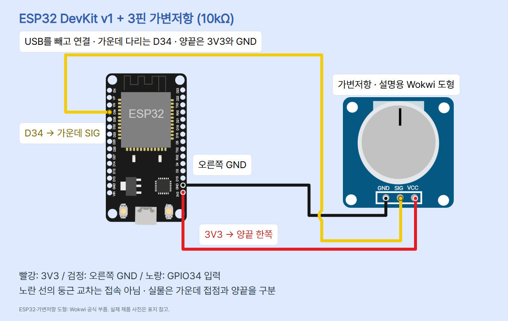
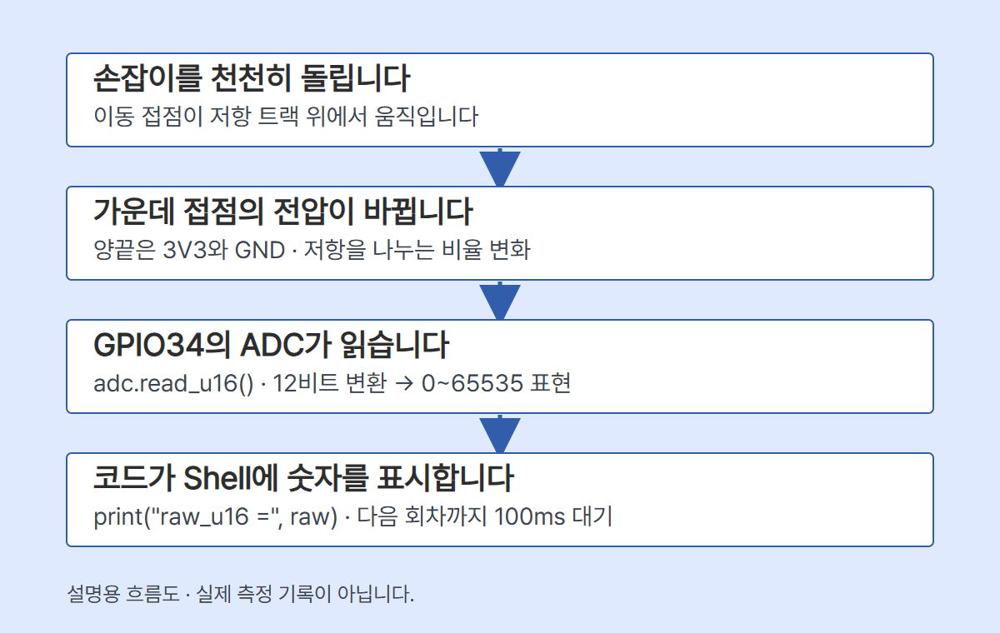

# ESP32 07 · 손잡이로 입력 전압을 바꾸는 가변저항

손잡이를 돌리며 GPIO34가 읽는 숫자를 비교합니다. Adafruit 562 3핀 10kΩ 선형 가변저항과 일반 ESP32 DevKit v1 30핀 기준입니다. S3/C3, 엔코더, 3핀 센서 모듈에 그대로 적용하지 않습니다.

## 준비와 연결

보드, 가변저항, 점퍼선 3개, 브레드보드, USB 데이터 케이블, Thonny를 준비합니다. 전원은 보드 USB만 사용합니다. USB를 빼고 세 다리를 서로 다른 연결 줄에 꽂으세요. Adafruit 부품의 가운데 다리가 이동 접점이며 양끝이 저항 트랙 끝입니다. 다른 부품은 자체 핀표를 확인합니다.

| 보드 | 가변저항 | 의미 |
| --- | --- | --- |
| 3V3 | 양끝 한쪽 | 3.3V 전원 |
| 오른쪽 3V3 바로 위 GND (Wokwi GND.1) | 반대쪽 양끝 | 기준 접지 |
| D34 = GPIO34 | 가운데 이동 접점 (Wokwi SIG) | ADC 입력 |

5V·VIN·외부전원·추가 풀업·LED·모터는 쓰지 않습니다. GPIO34는 입력 전용이고 내부 풀업이 없습니다. 양끝을 바꾸면 증가 방향이 반대가 되지만 배선 수정은 USB를 뺀 상태에서 합니다. 가운데를 양끝으로 착각해 전원끼리 직결하지 마세요.



Wokwi 도형은 실제 Adafruit 제품 사진과 모양이 다릅니다. 도형의 GND/SIG/VCC 이름은 역할을 설명하며 실제 부품의 인쇄 이름을 주장하지 않습니다. 공식 pinInfo 좌표를 보드 1.8배, 가변저항 3.5배로 변환했습니다. diagram.json과 circuit_preview.html을 편집할 수 있습니다.

## 손잡이·분압·ADC

10kΩ은 양끝 사이 명목 저항입니다. 가운데 접점이 움직이면 저항 트랙이 두 구간으로 나뉘고, GND에서 가운데까지 저항이 차지하는 비율에 따라 가운데 전압이 달라집니다. 이상적인 무부하 분압은 V중간 = V공급 × R아래/(R위+R아래)입니다. 두 구간이 같고 공급이 정확히 3.3V인 이상적 계산에서는 1.65V입니다. 실제 전압·중앙 위치를 측정한 결과가 아닙니다.



circuit_preview_control.html에 편집 가능한 HTML/SVG 원본이 있습니다. 그림은 네 단계의 설명이며 전기 회로를 대체하지 않습니다.

ADC는 전압을 단계가 있는 숫자로 바꿉니다. 이 코드는 12비트로 설정하고 read_u16()으로 0~65535 범위에 늘려 표현합니다. 16비트 정확도를 얻는 것이 아닙니다. raw_u16은 전압·저항·각도·손잡이 이동 백분율이 아닙니다.

일반 ESP32 ATTN_11DB의 문서상 근사 선형 측정 범위는 150~2450mV입니다. 이 회로의 가운데 전압은 이론상 GND~3.3V를 움직이므로 일부 구간은 선형 범위 밖이고 끝에서 포화될 수 있습니다. 전원이 3.3V라고 전체 회전 구간을 정확히 구별하는 것은 아닙니다. raw×3.3/65535를 정확한 전압으로 쓰지 않고 가운데 값 32768도 보장하지 않습니다. 전원을 높여 해결하지 마세요. 실제 전압을 읽는 read_uv()도 보정 유효 범위와 해상도를 확인해야 하며 이번 코드에서는 쓰지 않습니다.

## 설정과 실행

1. Thonny와 MicroPython 역할·펌웨어 설치는 [ESP32 기본 세팅](../001-basic-setup/)을 따릅니다. 대상은 MicroPython v1.29.0 ESP32_GENERIC과 ESP-WROOM-32 30핀 Micro-USB입니다. 기존 파일이 있으면 펌웨어를 다시 쓰기 전에 백업합니다.
2. 배선을 확인하고 USB를 연결합니다. Thonny 오른쪽 아래 실행 대상에서 MicroPython (ESP32)와 실제 연결된 COM 포트를 선택합니다. 포트 번호는 PC마다 다릅니다. 메뉴는 Thonny 버전과 언어에 따라 다를 수 있습니다.
3. 새 편집 탭에 아래 전체 코드를 붙이고 PC에 main.py로 저장합니다. 실행 버튼 또는 F5로 실행합니다. 모듈 설치는 필요 없습니다. 보드 main.py로 저장하면 다음 전원 연결 때 자동 실행할 수 있으므로 처음에는 PC 파일로 실행하는 편이 확인하기 쉽습니다.
4. 아래 Shell에서 READY 안내 다음 raw_u16 = 정수가 반복되는지 확인합니다. 모니터 창을 별도로 열거나 Arduino IDE의 baud 설정을 옮기지 않습니다. Thonny가 연결한 MicroPython Shell을 사용합니다.
5. 한쪽 끝·가운데·반대쪽 끝으로 천천히 옮겨 멈추고 여러 줄을 직접 기록합니다. 끝값 포화, 흔들림, 실제 증가 방향을 비교합니다. Ctrl+C로 멈춘 뒤 PRINT_MS를 100에서 500으로 바꿔 다시 실행하면 표시 간격도 비교할 수 있습니다.

아래 출력은 형식 설명입니다. 실제 측정 숫자를 넣지 않았습니다.

```text
READY: potentiometer -> GPIO34
raw_u16 = <내 보드에서 읽은 정수>
...
STOP
```

## 복사해 실행할 전체 코드

```python
from machine import Pin, ADC
from time import sleep_ms

POT_PIN = 34
PRINT_MS = 100
adc = ADC(Pin(POT_PIN), atten=ADC.ATTN_11DB)
try:
    adc.width(ADC.WIDTH_12BIT)
    print("READY: potentiometer -> GPIO34")
    while True:
        raw = adc.read_u16()
        print("raw_u16 =", raw)
        sleep_ms(PRINT_MS)
except KeyboardInterrupt:
    print("STOP")
except OSError as error:
    print("ADC_ERROR:", error)
finally:
    adc.deinit()
```

## 각 줄의 역할

| 코드 | 역할 |
| --- | --- |
| from machine import Pin, ADC | 보드 핀과 ADC 기능을 가져옵니다. |
| from time import sleep_ms | ms 단위 대기를 가져옵니다. |
| POT_PIN = 34 | D34에 해당하는 GPIO34를 선택합니다. |
| PRINT_MS = 100 | 한 번 읽고 출력한 뒤 기다릴 100ms를 정합니다. |
| adc = ADC(..., atten=ADC.ATTN_11DB) | ADC 입력과 감쇠 범위를 설정합니다. |
| try | 정상·중단·읽기 오류 뒤 정리를 수행할 구간입니다. |
| adc.width(ADC.WIDTH_12BIT) | 일반 ESP32의 변환 해상도를 12비트로 설정합니다. |
| print("READY: ...") | 설정 뒤 실행 시작 안내를 냅니다. 배선 점검 성공 판정은 아닙니다. |
| while True | 중단하거나 오류가 날 때까지 반복합니다. |
| raw = adc.read_u16() | 입력 전압에 대응하는 원시 정수를 읽습니다. |
| print("raw_u16 =", raw) | 접두어와 숫자를 Shell에 출력합니다. |
| sleep_ms(PRINT_MS) | 최소 대기를 요청합니다. 읽기·출력 시간이 더해져 정확한 10Hz가 아닙니다. |
| except KeyboardInterrupt / print("STOP") | Ctrl+C 중단을 표시합니다. |
| except OSError as error / print("ADC_ERROR:", error) | ADC 읽기·설정 오류 정보를 표시하고 반복을 끝냅니다. |
| finally / adc.deinit() | 정상 반복에서 빠져나온 뒤 ADC 자원을 해제합니다. |

ADC 생성 자체가 실패하면 ADC 객체가 없어 정리 구간에 들어가지 못하고 원래 오류가 표시됩니다. 종료 중 추가 중단·정리 API 자체 실패까지 복구하는 코드는 아닙니다.

## 예상과 다를 때

- 끝값 고정: 중간으로 움직여 보고 USB를 뺀 뒤 가운데 접점·D34·양끝 연결을 확인합니다. 고정값만으로 단선이나 포화를 확정하지 않습니다.
- 큰 흔들림: 느슨한 선과 접촉을 확인합니다. 작은 숫자 흔들림은 있을 수 있습니다. 평균은 노이즈 비교용 후속 실습이며 포화·비선형 오차를 해결하지 않습니다.
- 아무 출력 없음: 데이터 케이블, 실행 대상, 포트와 실행 완료 상태를 확인합니다. 다른 프로그램이 포트를 점유했는지도 확인합니다.
- ADC_ERROR: USB를 빼고 배선·일반 ESP32 펌웨어·API 버전을 확인합니다. 잘못된 배선이 항상 코드 오류를 내는 것은 아닙니다.
- 비정상 발열: USB를 즉시 빼고 전원 직결 여부부터 확인합니다. 힘을 주어 기계적 끝을 넘기지 않습니다.

## 검증 범위

호스트의 합성 ADC 입력으로 문법, 값 전달, 반복 순서, 100ms 요청, 중단·OSError 뒤 자원 해제를 검사합니다. 회로 net·공식 좌표·표·코드의 핀을 대조하고 카드 PNG와 편집기를 별도로 검사합니다. 개별 결과는 episode.review에 남깁니다. 실제 ESP32 펌웨어 실행, ADC 전압·저항·회전 방향·포화 구간·브레드보드 접속·Wokwi 시뮬레이션은 미시험입니다. 호스트 검사는 실제 하드웨어 검증이 아닙니다. Wokwi 문서상 완전한 아날로그 시뮬레이션을 지원하지 않아 전원 누락도 검출하지 못할 수 있습니다.

## 자료·사진 출처와 사용 조건

- [가변저항 제품·모델](https://www.adafruit.com/product/562) · 2026-10-30 확인
- [가운데 접점·분압](https://learn.adafruit.com/make-it-change-potentiometers) · 2026-10-30 확인
- [P160 제조사 자료](https://cdn-shop.adafruit.com/product-files/562/p160.pdf) · 2026-10-30 확인
- [일반 ESP32 ADC API와 범위](https://docs.micropython.org/en/v1.29.0/esp32/quickref.html#adc-analog-to-digital-conversion) · 2026-10-30 확인
- [ESP32 공식 핀 좌표](https://github.com/wokwi/wokwi-elements/blob/main/src/esp32-devkit-v1-element.ts) · 2026-10-30 확인
- [가변저항 공식 핀 좌표](https://github.com/wokwi/wokwi-elements/blob/main/src/potentiometer-element.ts) · 2026-10-30 확인
- [Wokwi 아날로그 한계](https://docs.wokwi.com/parts/wokwi-potentiometer) · 2026-10-30 확인
- [ESP32 사진](https://www.sunfounder.com/collections/esp32-1/products/esp-wroom-32-esp32-esp-32s-development-board) · 2026-10-30 확인
- [가변저항 사진](https://cdn-shop.adafruit.com/970x728/562-03.jpg) · 2026-10-30 확인

ESP32 사진은 기존 ESP32 03편의 SunFounder 공식 제품 사진, 가변저항 사진은 기존 UNO 07편에서 확인한 Adafruit 공식 562-03.jpg 원본을 재사용하고 표시 크기만 조절했습니다. 별도 자유 이용 라이선스는 확인하지 못했으며 재배포 허가를 주장하지 않습니다. Wokwi 부품 도형은 MIT이며 코드플랜트의 흐름도는 설명용 자체 도식입니다. 공식 사진과 설명용 도형을 구분합니다.

CODEPLANT 채널 https://www.youtube.com/@codeplant2024/videos 를 2026-10-30 조회했으나 도구의 fetch 실패로 목록·자막을 확인하지 못했습니다. 이 모델과 일치하는 영상의 핀이나 측정 결과를 추정하지 않았습니다. 기술 근거는 위 제조사·MicroPython·Wokwi 원문입니다.

적용 스킬: educational-circuit-diagram, codeplant-design, diagram-design, ui-ux-pro-max, humanizer. TECH 블루·Pretendard·원본 로고를 유지하고, 모바일 대비·여백과 의미 보존을 검수합니다.

배선 전문 스킬의 기본 검사기는 서보·조도센서만 지원하여 이 부품에 INVALID(지원 템플릿 없음)를 반환했습니다. 대신 verify.py의 전용 3개 net·6개 선 끝점·위험 배선 변이 검사를 사용합니다. 다이어그램 self_check는 브랜드의 로컬 Pretendard 파일 참조를 외부 CSS url로 거부합니다. HTML의 이 로컬 글꼴 선언만 제외한 검사본에서는 나머지 구조·접근성·범위 검사를 수행하며, 원본을 완전한 단일 파일 검사 통과로 표시하지 않습니다. 원본 HTML을 저장소 밖에서 독립 실행하면 글꼴이 대체될 수 있습니다.
