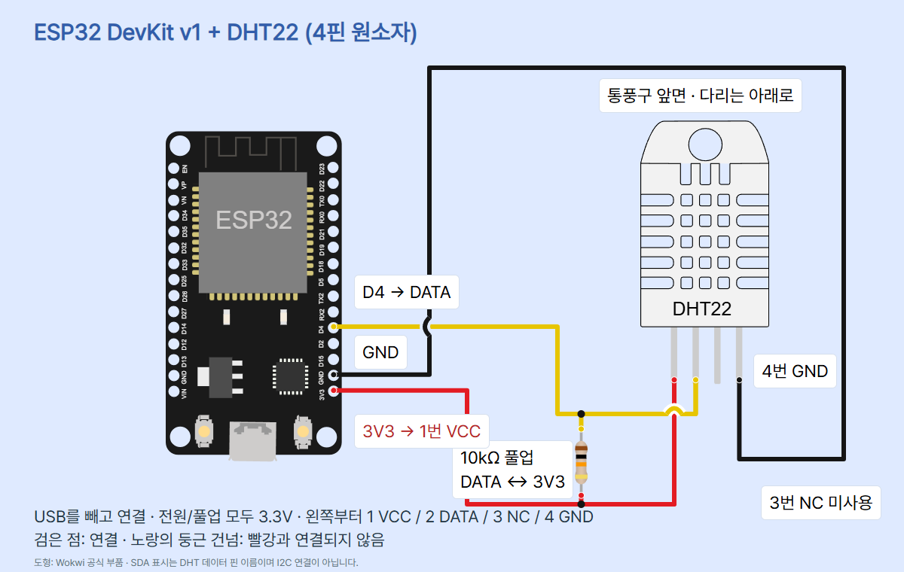
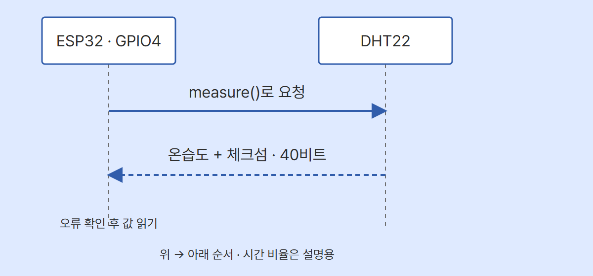

# DHT22로 온도와 습도 읽기 · ESP32 MicroPython

ESP32 DevKit v1 30핀과 DHT22 4핀 원소자로 온도·상대습도를 읽습니다. DATA는 GPIO4(D4), 전원과 풀업은 3.3V입니다. 3핀 모듈·DHT11·다른 ESP32 변형으로 핀과 코드를 그대로 옮기지 마세요.

## 준비물과 배선

ESP-WROOM-32 기반 ESP32 DevKit v1 30핀, DHT22/AM2302 4핀 원소자, 10kΩ 저항 1개, 브레드보드, 짧은 점퍼선, USB 데이터 케이블, Thonny를 준비합니다. 센서와 저항 다리를 서로 다른 브레드보드 연결 줄에 놓습니다. 전체 부품을 꽂은 실제 브레드보드 사진은 아닙니다.

USB를 빼고 통풍구 앞면을 보며 다리를 아래로 두세요. 센서 왼쪽부터 1 VCC / 2 DATA / 3 NC / 4 GND입니다.

| 보드·저항 | 센서 | 역할 |
| --- | --- | --- |
| 3V3 | 1 VCC | 3.3V 전원 |
| D4 = GPIO4 | 2 DATA | 요청과 응답 |
| 연결하지 않음 | 3 NC | 미사용 |
| GND.1 · 3V3 바로 위 | 4 GND | 공통 기준 |
| 10kΩ 저항 한쪽 | 2 DATA | 외부 풀업 |
| 저항 반대쪽 | 1 VCC와 3V3의 공통점 | 외부 풀업 |



빨강은 3.3V, 검정은 GND, 노랑은 DATA입니다. 둥근 건넘은 다른 선과 연결되지 않는 교차입니다. 실제 보드의 D4와 코드 Pin(4)는 같은 GPIO4입니다. GPIO34~39는 입력 전용이므로 요청도 보내야 하는 이 통신의 대체 핀으로 쓰지 않습니다. 배선에 따라 GPIO가 손상될 수 있어 5V/VIN으로 전원이나 풀업을 바꾸지 마세요. 내부 풀업만으로 외부 저항을 생략하지 않습니다.

제조사 AM2302 매뉴얼은 3.3~5.5V, 짧은 선의 대표 풀업 5.1kΩ을 제시하고, Adafruit DHTxx 연결 문서는 10kΩ을 제시합니다. 이번 짧은 점퍼선 예제는 후자의 외부 10kΩ을 선택했습니다. 긴 배선이나 모듈의 내장 저항에는 그대로 적용하지 않습니다. 제조사 기준 3.3V 배선은 1m 이하이며 실습은 그보다 짧게 구성하세요. 전원이 불안정해도 ESP32 GPIO에 5V를 넣어 해결하지 않습니다.

## 공기 변화가 화면에 표시되는 과정

DHT22 내부에서 온도와 습도를 숫자로 바꿉니다. ESP32는 ADC 전압값을 읽는 대신 DATA 선에서 HIGH/LOW의 시간 패턴을 주고받습니다. 풀업 저항은 아무도 선을 LOW로 내리지 않을 때 HIGH 상태로 돌아가게 돕습니다. 센서와 보드는 번갈아 선을 LOW로 당기거나 놓습니다. 저항 없이 DATA를 3V3에 직결하면 LOW로 내리는 동작을 방해하므로 금지합니다.



measure()가 통신을 요청하고 dht 모듈이 온습도와 체크섬을 포함한 40비트를 처리합니다. 체크섬은 전송 오류를 살피는 값이며 물리적 측정 정확도를 보장하지 않습니다. Wokwi의 SDA라는 핀 이름은 여기서 DATA를 뜻합니다. DHT의 단선 통신은 I²C 또는 Dallas 1-Wire와 다릅니다. 위 도식은 순서만 설명하며 실제 펄스 폭이나 실측 시간축을 나타내지 않습니다. 편집 가능한 원본은 circuit_preview_control.html입니다.

온도는 °C, 습도는 %RH로 읽습니다. 상대습도는 같은 온도에서 포화될 때와 비교한 수증기 비율입니다. 온도가 바뀌면 상대습도 해석도 달라집니다. 소수 한 자리의 분해능·출력 형식과 센서의 정확도는 별개입니다. 이번 실습은 교정 장비와 비교하거나 보정값을 구한 것이 아닙니다. 보정이 필요하면 같은 환경의 신뢰 가능한 기준계와 비교하고 조건·오차를 기록하세요.

## 설정과 실행

1. MicroPython v1.29.0 ESP32_GENERIC과 Thonny를 사용합니다. 펌웨어 설치와 포트 선택은 [ESP32 기본 세팅](../001-basic-setup/)을 확인하세요. 기존 보드 파일은 펌웨어 재설치 전에 백업합니다. ESP32-S3/C3 펌웨어를 대신 사용하지 않습니다.
2. USB를 뺀 상태의 배선을 확인하고 USB 데이터 케이블을 연결합니다. Thonny 오른쪽 아래에서 MicroPython (ESP32)와 실제 COM 포트를 선택합니다. 메뉴·화면은 설치한 Thonny 버전·언어에 따라 다릅니다. 이 문서에는 실제 실행 화면 캡처를 넣지 않았습니다.
3. 새 편집 탭에 아래 전체 코드를 넣고 PC에 main.py로 저장합니다. 실행 버튼 또는 F5로 보냅니다. dht는 표준 ESP32 MicroPython 펌웨어의 모듈이며 별도 pip 설치 대상이 아닙니다. import dht 실패 시 보드·펌웨어·실행 대상을 확인합니다.
4. 아래 Shell에서 READY 안내 뒤 2.5초 이상 기다리세요. T와 RH 출력이 반복되는지 봅니다. READY는 프로그램 시작 안내이며 배선·센서 성공 판정은 아닙니다.
5. 센서를 손으로 잡거나 물을 뿌리지 않고 주변 공기를 손으로 부채질합니다. 전후 여러 줄을 직접 기록하고 값의 변화와 반응 지연을 비교하세요. 값이 유지되어도 곧바로 고장으로 단정하지 않습니다. 실습 중 보드 발열·직사광선·결로를 피합니다.
6. Ctrl+C로 멈춥니다. 보드에 main.py로 저장하면 전원 연결 후 자동 실행할 수 있어 처음에는 PC 파일로 시험하는 편이 확인하기 쉽습니다.

출력 형식은 아래와 같습니다. 꺾쇠 안은 내 센서에서 읽을 값의 자리이며 실제 측정 숫자가 아닙니다.

```text
READY: DHT22 -> GPIO4
T = <내 온도> C, RH = <내 상대습도> %
DHT_ERROR: <통신 오류가 생겼을 때만 표시>
STOP
```

첫 읽기 전 2500ms를 대기하고 성공·실패 회차 뒤에도 2500ms를 대기합니다. 제조사와 MicroPython 문서의 최소 2초 읽기 간격을 여유 있게 잡았습니다. 코드의 대기와 읽기·출력 시간이 더해져 정확한 0.4Hz가 아닙니다. 센서가 주변 변화에 반응하는 시간과 화면 갱신 간격도 구분하세요. 제조사 문서는 읽은 데이터가 마지막 측정 결과일 수 있음을 설명하므로 충분한 간격으로 여러 회차를 관찰합니다.

## 전체 코드

```python
from machine import Pin
from time import sleep_ms
import dht

DHT_PIN = 4
WAIT_MS = 2500
sensor = dht.DHT22(Pin(DHT_PIN))

try:
    print("READY: DHT22 -> GPIO4")
    sleep_ms(WAIT_MS)
    while True:
        try:
            sensor.measure()
            temperature = sensor.temperature()
            humidity = sensor.humidity()
            print("T = {:.1f} C, RH = {:.1f} %".format(
                temperature, humidity))
        except OSError as error:
            print("DHT_ERROR:", error)
        sleep_ms(WAIT_MS)
except KeyboardInterrupt:
    print("STOP")
```

## 각 줄의 역할

| 코드 | 역할 |
| --- | --- |
| from machine import Pin | ESP32의 GPIO를 선택합니다. |
| from time import sleep_ms | 밀리초 단위로 기다립니다. |
| import dht | 펌웨어의 DHT 통신 기능을 가져옵니다. |
| DHT_PIN = 4 | 보드의 D4, GPIO4를 선택합니다. |
| WAIT_MS = 2500 | 첫 읽기 전과 회차 뒤 대기를 2.5초로 정합니다. |
| sensor = dht.DHT22(Pin(DHT_PIN)) | 해당 핀에 연결한 DHT22 객체를 만듭니다. |
| 바깥 try | Ctrl+C로 종료할 구간을 시작합니다. |
| print READY | 시작 안내를 표시합니다. 센서 성공 판정은 아닙니다. |
| 첫 sleep_ms | 전원 연결 직후의 안정화 시간을 둡니다. |
| while True | 중단될 때까지 반복합니다. |
| 안쪽 try | 한 회차의 통신·읽기를 시도합니다. |
| sensor.measure() | 새 데이터 프레임을 수신하고 체크섬을 확인합니다. |
| sensor.temperature() | 직전 성공 프레임의 섭씨 온도를 가져옵니다. |
| sensor.humidity() | 직전 성공 프레임의 상대습도 %를 가져옵니다. |
| print와 format | 두 값을 소수 한 자리로 Shell에 출력합니다. |
| except OSError / print DHT_ERROR | 실패 회차를 알리고 그 회차의 온습도를 표시하지 않습니다. |
| 반복 안 sleep_ms | 오류가 나도 재시도 전에 2.5초 기다립니다. |
| except KeyboardInterrupt / print STOP | Ctrl+C를 받으면 종료를 알립니다. |

객체 생성과 import 단계의 실패는 일반 오류로 표시되며 반복 재시도하지 않습니다. Ctrl+C 종료는 장치 전원을 끊지 않습니다. 배선 수정은 반드시 USB를 뺀 뒤 합니다.

## 예상과 다를 때

- DHT_ERROR: 중단하고 USB를 빼세요. 앞·뒤 방향, 1/2/4번 다리, DATA-D4, DATA-3V3 사이 저항, 공통 GND와 느슨한 접촉부터 확인합니다. 오류만으로 어느 선이 잘못됐는지 확정할 수는 없습니다.
- 값이 그대로: 충분히 기다리며 여러 회차를 기록하고 주변 변화가 센서에 도달했는지 봅니다. 같은 값이 바로 통신 실패를 뜻하지 않습니다.
- 출력 없음: 실행 대상·COM 포트·케이블·실행 버튼·첫 대기를 확인합니다. 다른 프로그램이 포트를 점유하는지도 봅니다.
- 소수 자릿수가 많으면 더 정확한가: 표시 자릿수만 늘려 정확도가 좋아지지는 않습니다. 기준계 비교 없이 임의 보정값을 넣지 마세요.
- 비정상 발열: USB를 바로 빼고 전원과 GND가 직결됐는지 확인합니다.

## 검증 범위

verify.py로 문법·정확한 net·핀·읽기 순서·합성 온습도 전달·오류 회차의 값 생략·대기·중단을 호스트에서 검사합니다. 카드 PNG·모바일·편집기 검사는 별도로 기록합니다. 실제 ESP32 펌웨어, 물리 배선, DHT22 통신·온습도·보정, Wokwi 시뮬레이터는 미시험입니다. 호스트의 합성 입력 검사는 실제 센서 실행 성공을 뜻하지 않습니다. 외부 Wokwi 부품 CDN이 필요하며 HTML을 오프라인 단독 파일로 실행하는 조건은 확인하지 않았습니다.

## 출처와 사용 조건

- [ESP32 dht API](https://docs.micropython.org/en/v1.29.0/esp32/quickref.html#dht-driver) · 2026-10-31 확인
- [DHT 데이터·단위·주기](https://docs.micropython.org/en/v1.29.0/esp8266/tutorial/dht.html) · 2026-10-31 확인
- [제조사 AM2302 기술 매뉴얼](https://www.aosong.com/uploadfiles/2025/04/20250417105409216.pdf) · 2026-10-31 확인
- [DHT22 제품 385](https://www.adafruit.com/product/385) · 2026-10-31 확인
- [4핀·10k 풀업](https://learn.adafruit.com/dht/connecting-to-a-dhtxx-sensor) · 2026-10-31 확인
- [공식 ESP32 핀 좌표](https://github.com/wokwi/wokwi-elements/blob/main/src/esp32-devkit-v1-element.ts) · 2026-10-31 확인
- [공식 DHT22 핀 좌표](https://github.com/wokwi/wokwi-elements/blob/main/src/dht22-element.ts) · 2026-10-31 확인
- [공식 저항 핀 좌표](https://github.com/wokwi/wokwi-elements/blob/main/src/resistor-element.ts) · 2026-10-31 확인
- [DHT22 사진](https://cdn-shop.adafruit.com/970x728/385-00.jpg) · 2026-10-31 확인
- [ESP32 사진](https://www.sunfounder.com/collections/esp32-1/products/esp-wroom-32-esp32-esp-32s-development-board) · 2026-10-31 확인

사진은 기존 동일 모델 편의 SunFounder ESP32 공식 제품 사진과 Adafruit 385-00.jpg 원본을 표시 크기만 조절해 사용했습니다. 별도 자유 이용 라이선스·상업적 재배포 허가는 확인하지 못했으며 이를 허가 완료로 표시하지 않습니다. 이용 시 원권리자 조건을 확인하세요. 회로 도형은 Wokwi 공식 부품(MIT), 통신 순서도는 CODEPLANT의 자체 설명용 도식입니다. 제품 사진과 설명용 도형·실제 캡처를 구분합니다.

CODEPLANT 유튜브 https://www.youtube.com/@codeplant2024 를 2026-10-31 조회했지만 fetch 실패로 영상 목록·자막을 확인하지 못했습니다. 일치 영상을 추정하지 않았고 기술 근거는 제조사·MicroPython·Adafruit·Wokwi 원문입니다.

적용 스킬: educational-circuit-diagram, codeplant-design, diagram-design, ui-ux-pro-max, humanizer. 학생의 입력·신호·코드·표시 흐름, 교사의 3.3V·GPIO·단위·주기 정확성, 디자이너의 TECH 블루·Pretendard·원본 로고·모바일 가독성을 각각 검토합니다. 실제 사람의 피드백 기록은 아닙니다.

전문 회로 기본 검사기는 서보·조도센서만 지원해 DHT22에 INVALID(지원 템플릿 없음)를 반환했습니다. 대신 verify.py의 전용 net·좌표·위험 배선 변이 검사와 공식 런타임 pinInfo 대조를 수행했습니다. diagram-design self_check는 원본 HTML의 로컬 Pretendard CSS URL을 거부하며, 글꼴 선언만 뺀 검사본에서 구조를 따로 확인합니다. 원본을 완전한 단일 파일 검사 통과로 표시하지 않습니다.
