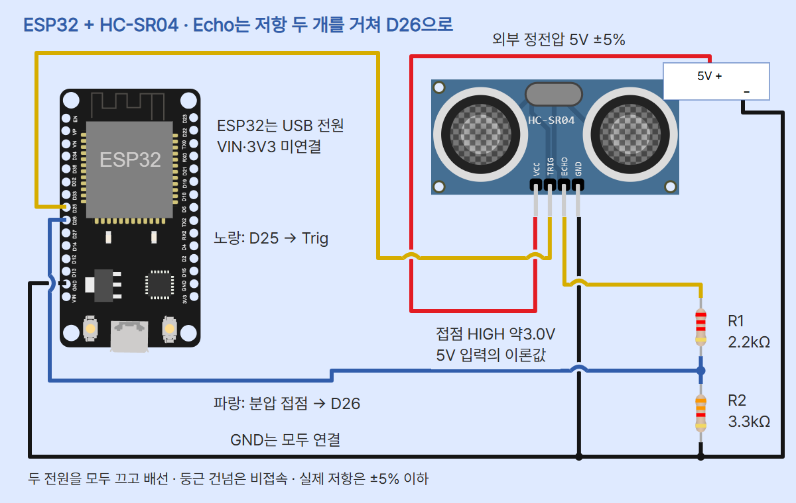
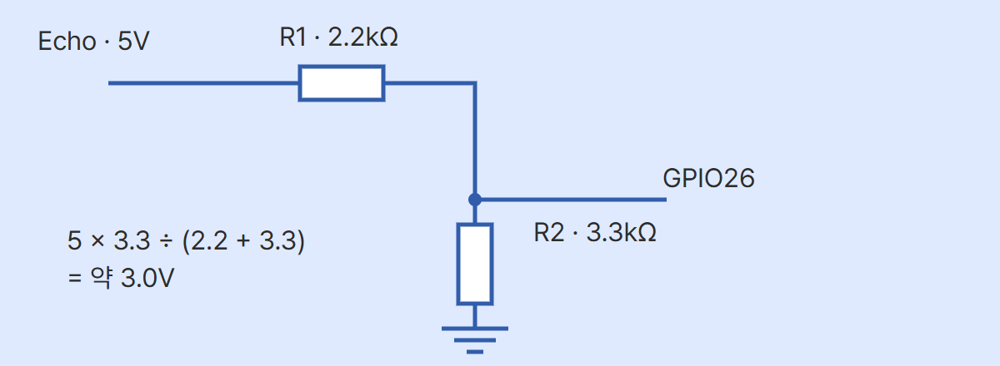
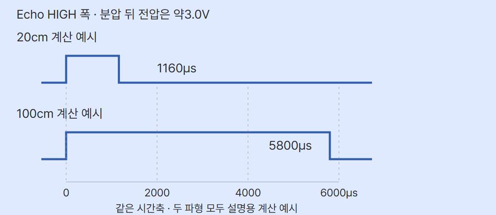

# HC-SR04 초음파 거리 · ESP32 MicroPython

대상은 ESP-WROOM-32 기반 ESP32 DevKit v1 30핀과 classic HC-SR04 5V 4핀(Adafruit 제품3942 기준)입니다. Trig는 GPIO25, Echo는 분압 뒤 GPIO26입니다. US-100·3.3V 호환 변형·방수 센서·다른 ESP32 모델로 핀과 조건을 그대로 옮기지 않습니다.

## 준비물·전원

ESP32 보드, HC-SR04, 정전압 외부5V 전원(±5% 이내, 센서의15mA 이상 여유가 있는 정격), +/−를 구분한 안전한 저전압 단자, 2.2kΩ과3.3kΩ 저항 각1개(±5% 이하), 브레드보드·짧은 점퍼선, USB 데이터 케이블, Thonny, 자와 큰 평평한 반사면을 준비합니다. 교류 전원선을 직접 가공하지 않습니다. ESP32는 PC USB로 공급합니다. 외부전원 +5V는 ESP32 VIN·3V3에 연결하지 않습니다. 두 전원의 GND만 공통으로 묶습니다.

Adafruit 자료는 센서5V 전원, Trig의3V/5V 입력과 Echo5V 논리를 구분합니다. 자료의10kΩ 두 개 예시와 달리 이 실습은 GPIO HIGH 여유를 둔2.2kΩ/3.3kΩ 비율을 사용합니다. 센서 모델·전압을 확인하지 못한 부품으로 진행하지 마세요.

## 배선

**USB와 외부5V를 모두 끈 상태**로 연결합니다. 센서 두 원통 앞면을 보고 핀을 아래로 두면 왼쪽부터 VCC·Trig·Echo·GND입니다. 실물 핀 인쇄를 최종 확인하세요. 브레드보드의 전원 레일은 중간에서 끊길 수 있습니다. 네 핀과 저항 양끝을 서로 다른 연결 줄에 꽂습니다.

| 연결점 | 연결 대상 | 역할 |
| --- | --- | --- |
| 외부 정전압5V + | HC-SR04 VCC | 센서전원 |
| 외부 −, ESP32 왼쪽 VIN 위 GND(GND.2), HC-SR04 GND | 모두 연결 | 공통 기준 |
| ESP32 D25(GPIO25) | Trig | 시작 요청 출력 |
| Echo | R1 2.2kΩ 한쪽 | 5V 신호 입력 |
| R1 반대쪽·R2 3.3kΩ 한쪽·D26(GPIO26) | 같은 접점 | 분압 신호 입력 |
| R2 반대쪽 | 공통GND | 분압 아래쪽 |



빨강은 외부5V, 검정은 공통GND, 노랑은 Trig와 분압 전 Echo, 파랑은 분압 접점입니다. 둥근 건넘은 비접속이며 접점은 점으로 표시합니다. ESP32에는 USB만 연결하고 VIN·3V3에는 선을 넣지 않습니다. 회로는 핀 연결 안내이며 실제 브레드보드 조립 사진이 아닙니다. 외부 전원 박스는 단자를 나타낸 설명용 그림입니다.

## Echo를 분압하는 이유

ESP32의3.3V GPIO에 센서 Echo의5V를 직결하지 않습니다. R1=2.2kΩ을 Echo 쪽에, R2=3.3kΩ을 GND 쪽에 두고 가운데에서 읽습니다. 저항은 극성이 없지만 두 값의 위치에는 의미가 있습니다. 저항 한 개만 직렬로 넣는 것은 이 분압 회로가 아닙니다.



이상적인 고임피던스 입력을 가정하면 V접점=VEcho×R2/(R1+R2)입니다. Echo가5.0V인 계산에서는5×3.3/(2.2+3.3)=3.0V입니다. 공급4.75~5.25V와 저항 각각±5%의 조합에서, Echo HIGH가 공급과 같다는 계산 가정하에 약2.74~3.27V입니다. 이 값은 실제 Echo 전압·입력 파형을 측정한 결과가 아닙니다. 실제 로직 임계값·부품 오차·배선·에지 지연은 보드와 전원에서 확인해야 하며, 분압 계산만으로 실물 통신 성공을 보장하지 않습니다. 두 저항을 바꾸거나3.3V 단자와 직결하지 않습니다.

## 요청·초음파·Echo의 차이

코드는 Trig를 LOW2µs, HIGH10µs, 다시LOW로 만듭니다. 이는 시작 요청입니다. 자료상 센서는40kHz 초음파8주기를 보내고 반사를 받아 Echo HIGH 폭으로 왕복 시간을 나타냅니다. Trig HIGH10µs·초음파40kHz·Echo HIGH 폭은 서로 다른 값입니다. 이번 코드에는 PWM·ADC가 없습니다.



파형은 분압 뒤 Echo의 설명용 계산 예시이며 실제 캡처·실측이 아닙니다.1160µs/58=20cm와5800µs/58=100cm를 같은0~6000µs 축에서 비교합니다. 전압 높이를 거리로 읽지 않습니다. 거리=음속×왕복시간÷2라는 관계에서, 이번 코드는 기술자료의 근사 환산계수58µs/cm를 선택했습니다. 이미 왕복이 반영되어 다시2로 나누지 않습니다. 자료의340m/s와58을 정확히 동일한 상수라고 주장하지 않습니다. 주변 온도·습도·물체 각도·표면에 따라 오차가 생기며 보정은 기준 거리에서 여러 값을 기록한 뒤 해야 합니다. 표시 소수 한 자리는0.1cm 정확도를 뜻하지 않습니다.

## 설정·실행·관찰

1. MicroPython v1.29.0 ESP32_GENERIC과 Thonny를 사용합니다. [ESP32 기본 세팅](../001-basic-setup/)의 USB·펌웨어·포트 절차를 따릅니다. 펌웨어를 다시 쓰기 전 보드의 기존 파일을 백업합니다. 다른 ESP32-S3/C3 펌웨어로 대체하지 않습니다.
2. 두 전원을 끄고 배선을 확인합니다. ESP32 USB를 연결하고 센서 외부5V를 켭니다. 공통GND를 유지합니다. Thonny 오른쪽 아래에서 MicroPython (ESP32)와 실제 COM 포트를 선택합니다. 메뉴·위치는 Thonny 버전·언어에 따라 다릅니다. 이 문서에는 실제 실행 화면 캡처를 넣지 않았습니다.
3. 새 편집 탭에 아래 전체 코드를 붙이고 PC에 main.py로 저장합니다. 실행 버튼 또는F5로 실행합니다. 표준 machine/time 모듈만 사용해 추가 라이브러리 설치는 없습니다. 보드에 main.py로 저장하면 재전원 때 자동 실행할 수 있어 처음에는 PC 파일 실행으로 확인합니다.
4. 아래 Shell의 READY 뒤 echo_us와distance_cm를 확인합니다. READY는 시작 안내로 배선 성공 판정이 아닙니다. 센서 앞면부터20·40·60cm 등 여러 위치에 큰 평평한 물체를 놓고 자로 잰 거리와 출력값을 기록합니다. 물·사람에게 센서를 직접 들이대지 마세요.
5. 물체가 기울거나 작거나 소리를 잘 흡수하면 반사가 약해질 수 있습니다. Adafruit는 실용 비교 구간으로10~250cm를 권합니다. 코드의2~400cm 출력 허용은 이 범위 전체의 정확도 보장이 아닙니다. 실제 오차·보정값은 만들어 넣지 않았습니다.
6. Ctrl+C로 멈춥니다. STOP 뒤Trig를LOW로 정리합니다. 전원이 꺼지는 것은 아니므로 배선을 바꾸려면 USB와 외부5V를 모두 끕니다.

아래는 출력 자리만 설명한 형식이며 실제 측정값은 없습니다.

```text
READY: HC-SR04 -> GPIO25/GPIO26
echo_us = <내가 읽은 양의 µs>, distance_cm = <계산된 cm>
NO_ECHO: <0 또는 음수 반환값>
OUT_OF_RANGE
SENSOR_ERROR: <읽기 오류 정보>
STOP
```

## 전체 코드

```python
from machine import Pin, time_pulse_us
from time import sleep_us, sleep_ms

TRIG_PIN = 25
ECHO_PIN = 26
TIMEOUT_US = 30000
SAMPLE_MS = 100
US_PER_CM = 58.0
trig = Pin(TRIG_PIN, Pin.OUT, value=0)
echo = Pin(ECHO_PIN, Pin.IN)

try:
    print("READY: HC-SR04 -> GPIO25/GPIO26")
    while True:
        sleep_ms(SAMPLE_MS)
        try:
            trig.value(0)
            sleep_us(2)
            trig.value(1)
            sleep_us(10)
            trig.value(0)
            echo_us = time_pulse_us(echo, 1, TIMEOUT_US)
            if echo_us <= 0:
                print("NO_ECHO:", echo_us)
                continue
            distance_cm = echo_us / US_PER_CM
            if 2 <= distance_cm <= 400:
                print("echo_us = {}, distance_cm = {:.1f}".format(
                    echo_us, distance_cm))
            else:
                print("OUT_OF_RANGE")
        except OSError as error:
            print("SENSOR_ERROR:", error)
except KeyboardInterrupt:
    print("STOP")
finally:
    trig.value(0)
```

## 각 줄의 역할

| 코드 | 역할 |
| --- | --- |
| from machine import Pin, time_pulse_us | GPIO와 펄스 시간 읽기를 가져옵니다. |
| from time import sleep_us, sleep_ms | µs와 ms 단위로 기다릴 때 씁니다. |
| TRIG_PIN=25 / ECHO_PIN=26 | 회로의 D25와 분압 접점 D26을 지정합니다. |
| TIMEOUT_US=30000 | 시작 대기와 펄스 측정 각각에 적용하는 30ms 제한입니다. 전체 호출이 항상 30ms 이내라는 뜻은 아닙니다. |
| SAMPLE_MS=100 | 첫 회차와 오류 뒤를 포함해 매번 먼저 100ms 기다립니다. |
| US_PER_CM=58.0 | 기술자료의 근사 환산값 58µs/cm입니다. 실측 보정 상수가 아닙니다. |
| trig=Pin(...OUT,value=0) | 요청 핀을 출력 LOW로 시작합니다. |
| echo=Pin(...IN) | 분압 뒤 신호를 입력으로 읽습니다. 내부 풀업은 쓰지 않습니다. |
| try / print READY / while True | 시작 안내를 출력하고 반복합니다. 중단되면 아래 정리 구간으로 갑니다. |
| sleep_ms(SAMPLE_MS) | 측정 전 100ms 기다립니다. 처리 시간이 더해지므로 정확한 10Hz는 아닙니다. |
| trig.value(0),sleep_us(2) | 시작 요청 전에 LOW 상태를 둡니다. |
| trig.value(1),sleep_us(10),trig.value(0) | HIGH 10µs를 요청한 뒤 LOW로 돌립니다. 실제 GPIO 펄스 폭을 측정한 것은 아닙니다. |
| time_pulse_us(echo,1,TIMEOUT_US) | 분압 뒤 HIGH 폭을 µs로 받습니다. |
| if echo_us<=0 / NO_ECHO / continue | 양의 펄스 폭을 얻지 못하면 거리 계산을 건너뛰고 다음 100ms 대기로 갑니다. |
| distance_cm=echo_us/US_PER_CM | 근사식으로 거리를 cm 단위로 계산합니다. |
| if 2<=distance_cm<=400 / print | 허용 범위의 거리와 원시 시간을 표시합니다. |
| else / OUT_OF_RANGE | 범위 밖 계산값을 정상 거리로 표시하지 않습니다. |
| except OSError / SENSOR_ERROR | 읽기 오류를 표시하고 다음 회차에서 다시 기다립니다. |
| except KeyboardInterrupt / STOP | Ctrl+C 종료를 알립니다. |
| finally / trig.value(0) | 반복 종료 뒤 Trig를 LOW로 유지합니다. |

MicroPython time_pulse_us의 −2는 요청한 HIGH 시작을 기다리다 제한을 넘었다는 뜻이고, −1은 HIGH를 재는 중 제한을 넘었다는 뜻입니다. 0도 거리 계산에 쓰지 않습니다. UNO pulseIn의 0 반환과 같은 API라고 가정하지 마세요. 핀이 이미 HIGH이면 호출 시점부터 측정하므로 정상적인 LOW 대기 상태와 타이밍은 실물에서 확인해야 합니다. 객체 생성과 import 오류는 반복 재시도 대상이 아니며 일반 오류로 표시됩니다.

## 실패할 때

- NO_ECHO: 0cm나 물체 없음을 확정한 결과가 아닙니다. 두 전원을 끄고 센서 전원, 공통 GND, Trig/Echo 뒤바뀜, 분압 접점, 저항값과 접촉을 확인한 뒤 큰 평평한 반사면을 정면에 둡니다.
- OUT_OF_RANGE: 시간은 얻었지만 계산값이 2~400cm 밖입니다. 소수 한 자리 표시만으로 정확하다고 보지 마세요.
- SENSOR_ERROR: 실행 대상, 핀 API, 배선을 확인합니다. 잘못된 전압이 항상 오류 코드로 검출되는 것은 아닙니다.
- 출력 없음: Thonny 실행 대상, COM 포트, USB 데이터 케이블과 실행 버튼을 확인합니다.
- 비정상 발열: USB와 외부 5V를 모두 빼고 쇼트나 5V 직결을 점검합니다. 물이 없는 책상에서 실습합니다.

## 검증 범위·원본

편집 원본은 episode.json, 배선 원본은 diagram.json과 circuit_preview.html, 파형 원본은 circuit_preview_control.html, 분압 원본은 circuit_preview_do.html입니다. verify.py는 호스트의 합성 펄스로 분기, 계산, 대기, 오류, 중단과 Trig LOW 정리를 검사합니다. 원시 음향, 전압, GPIO 펄스, 실제 거리 보정, ESP32 펌웨어와 Wokwi 시뮬레이션은 미시험입니다. 호스트 검사는 실물 동작 검증이 아닙니다. 공식 Wokwi CDN과 로컬 Pretendard 경로를 쓰므로 오프라인 단일 HTML 실행은 보장하지 않습니다.

검수 기록(2026-11-01): verify.py의 합성 입력·분기·정리 검사와 공식 Wokwi 런타임 핀 좌표 11개 대조를 통과했습니다. 10장 PNG의 크기·배경·하단 겹침·사진 로딩, 모바일 가로 넘침, ZIP 순서와 편집기 저장·복사·이미지 붙여넣기를 확인했습니다. 파형·분압 SVG 구조 검사는 폰트 경로를 제외한 사본에서 통과했습니다. 원본의 로컬 Pretendard 경로는 단일 파일 자산 규칙의 예외로 남깁니다. 적용 스킬은 educational-circuit-diagram, codeplant-design, diagram-design, ui-ux-pro-max, humanizer입니다.

## 출처와 사용 조건

- [HC-SR04 5V Echo·3V Trig](https://www.adafruit.com/product/3942) · 2026-11-01 확인
- [Elecfreaks 표기 HC-SR04 기술자료](https://cdn.sparkfun.com/datasheets/Sensors/Proximity/HCSR04.pdf) · 2026-11-01 확인
- [MicroPython time_pulse_us](https://docs.micropython.org/en/v1.29.0/library/machine.html#machine.time_pulse_us) · 2026-11-01 확인
- [ESP32 Pin API](https://docs.micropython.org/en/v1.29.0/esp32/quickref.html#pins-and-gpio) · 2026-11-01 확인
- [ESP32 핀 좌표](https://github.com/wokwi/wokwi-elements/blob/main/src/esp32-devkit-v1-element.ts) · 2026-11-01 확인
- [HC-SR04 핀 좌표](https://github.com/wokwi/wokwi-elements/blob/main/src/hc-sr04-element.ts) · 2026-11-01 확인
- [저항 핀 좌표](https://github.com/wokwi/wokwi-elements/blob/main/src/resistor-element.ts) · 2026-11-01 확인
- [HC-SR04 사진](https://cdn-shop.adafruit.com/970x728/3942-02.jpg) · 2026-11-01 확인
- [ESP32 사진](https://www.sunfounder.com/collections/esp32-1/products/esp-wroom-32-esp32-esp-32s-development-board) · 2026-11-01 확인

사진은 같은 모델의 기존 ESP32·UNO HC-SR04 편에 보관한 SunFounder·Adafruit 공식 원본을 표시 크기만 조절해 사용했습니다. 사진의 별도 자유 이용 라이선스와 상업적 재배포 허가는 확인하지 못했습니다. 원권리자의 사용 조건을 확인하세요. 회로의 보드·센서·저항 도형은 Wokwi(MIT), 전원 단자·파형·분압도는 CODEPLANT가 만든 설명용 도식입니다.

CODEPLANT 채널 https://www.youtube.com/@codeplant2024 을 2026-11-01 조회했지만 페이지를 가져오지 못해 목록과 자막을 확인하지 못했습니다. 기술 근거는 위 공식 자료이며 실제 교사·학생 피드백 기록은 아닙니다.
