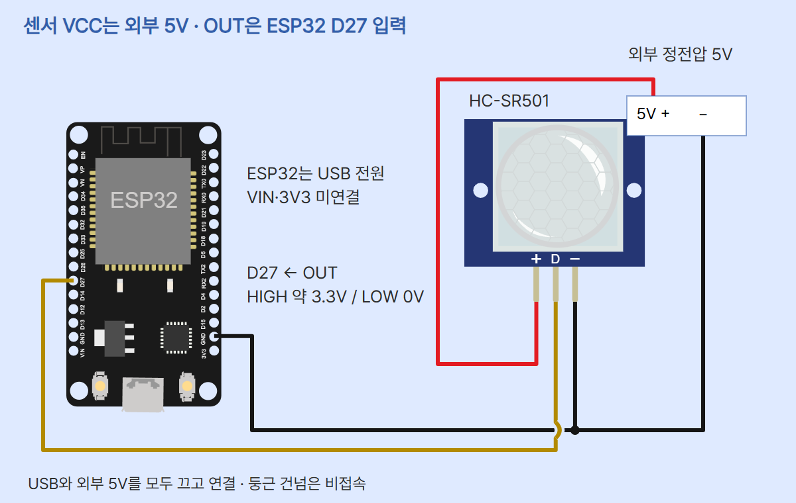
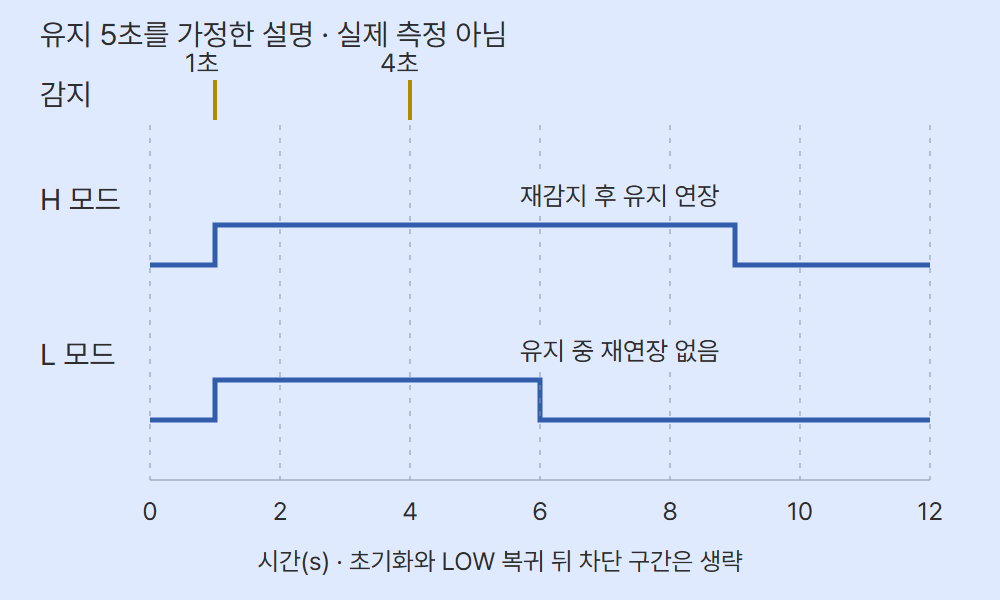
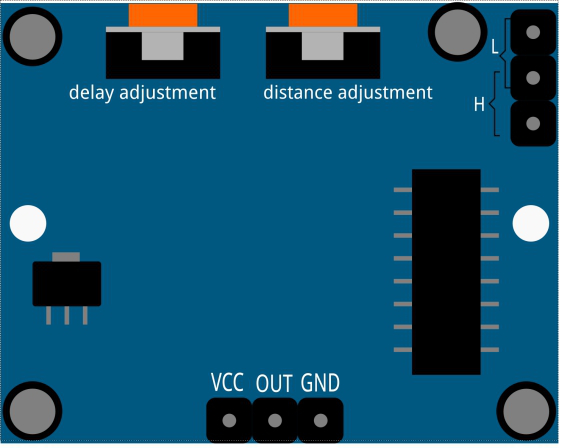

# HC-SR501 PIR · ESP32 MicroPython

ESP-WROOM-32 기반 ESP32 DevKit v1 30핀과 SunFounder HC-SR501을 사용합니다. 센서는 외부 정전압 5V로, ESP32는 PC USB로 공급합니다. OUT은 GPIO27 입력입니다. 내장 LED·모터·릴레이 제어는 없습니다. 다른 ESP32 모델이나 5V 출력 센서로 자동 대체하지 마세요.

## 준비물과 전원

보드, 해당 PIR, 외부 정전압 5V 전원, +/−를 구분한 안전한 저전압 단자, 브레드보드·점퍼선, USB 데이터 케이블, PC와 Thonny를 준비합니다. 교류 전원선을 직접 가공하지 않습니다. SunFounder 판매 자료는 전원 4.5~20V, OUT HIGH 3.3V/LOW 0V를 제시하고, 학습 자료는 전원 5~20V를 제시합니다. 두 자료에 공통인 5V를 선택합니다. 전원 전압을 OUT 전압으로 읽지 마세요. 다른 모듈은 자체 핀표와 출력 조건을 확인합니다.

## 연결

USB와 외부 전원을 모두 끄고 연결합니다. 실물의 VCC·OUT(또는 DO)·GND 이름을 우선합니다. 앞뒤가 바뀌면 좌우 순서도 달라집니다. 브레드보드에서는 세 핀이 서로 연결되지 않은 줄에 꽂혀야 합니다.

| 연결점 | 대상 | 역할 |
| --- | --- | --- |
| 외부 정전압 +5V | 센서 VCC | 센서 전원 |
| 외부 −·ESP32 오른쪽 3V3 바로 위 GND(GND.1) | 센서 GND | 공통 접지 |
| ESP32 D27(GPIO27) | 센서 OUT/DO | 3.3V 디지털 입력 |

외부 +5V를 ESP32 VIN·3V3에 연결하지 않습니다. 센서는 3V3에서 공급하지 않습니다. 이 모델은 OUT을 직접 입력으로 읽으며 추가 분압·풀업이 필요하지 않습니다. OUT으로 LED·모터·릴레이를 직접 구동하지 않습니다. GPIO27을 출력으로 바꾸지 마세요.



보드·센서는 Wokwi 도형이며 실제 조립 사진이 아닙니다. 외부 전원 박스는 단자를 나타내는 자체 설명 그림입니다. 빨강은 5V, 검정은 공통 GND, 노랑은 OUT입니다. 둥근 건넘은 비접속이고 검정 접점은 점으로 표시했습니다. 도형의 핀 순서를 실물 사진의 방향에 그대로 대입하지 마세요.

## 무엇을 읽나요

PIR은 수동 적외선 감지입니다. 모듈은 두 감지 영역에 들어오는 적외선의 차이를 이용해 움직임에 반응합니다. 앞을 가로질러 움직이면 OUT이 HIGH가 되고, ESP32는 이를 1로 읽습니다. 출력 유지가 끝나 LOW가 되면 0으로 읽습니다. 숫자는 거리·체온·사람 수가 아닙니다. LOW만으로 사람 없음을 확정하지 않습니다.

전원 직후 흔들림을 피하려고 이 코드는 먼저 60000ms 기다립니다. READY는 코드 대기가 끝났다는 안내이며 센서 안정화 측정값은 아닙니다. 계속 불안정하면 더 기다리고 전원·배선·환경을 확인합니다.

## H/L 모드와 서로 다른 시간

H는 유지 중 새 감지가 있으면 HIGH 유지가 늘어날 수 있고, L은 유지 중 재연장하지 않습니다. HIGH가 끝난 뒤 새 감지를 받지 않는 차단 구간이 있습니다. SunFounder 문서의 지연 상한 200s/300s, 차단 8s/제품 페이지 2.5s 표기는 서로 다릅니다. 해당 모듈에서 직접 확인해야 하므로 고정 상한·차단 시간을 보장하지 않습니다.



이 파형은 HIGH 유지 5초, 1초와 4초의 감지를 가정한 개념 예시입니다. 같은 0~12s 축에서 H는 마지막 감지 뒤 5초인 9초까지, L은 첫 감지 뒤 5초인 6초까지 그렸습니다. 실제 전압·응답·지연 측정이 아닙니다. 시작 지연·초기화·LOW 뒤 차단 구간은 생략했습니다. 50ms 샘플링으로 이 시각을 정확히 검출한다는 뜻도 아닙니다.



지연 조절기는 HIGH 유지 시간을, 감도 조절기는 감지 반응을 바꿉니다. 특정 거리의 정확한 설정값은 아닙니다. 점퍼·조절기를 만지기 전 두 전원을 끄고 실물 H/L 표시를 확인하세요. 코드의 SAMPLE_MS=50은 매번 읽은 뒤 기다리는 시간이며 모듈의 유지·차단 시간과 다릅니다. 처리 시간이 더해져 정확한 20Hz가 아니고 샘플 사이의 짧은 변화는 놓칠 수 있습니다.

## 설정·실행·관찰

1. MicroPython v1.29.0 ESP32_GENERIC과 Thonny를 사용합니다. [ESP32 기본 세팅](../001-basic-setup/)의 USB·펌웨어·COM 포트 절차를 확인합니다. 펌웨어를 다시 쓰기 전 기존 보드 파일을 백업하세요. S3/C3용 펌웨어로 대체하지 않습니다.
2. 두 전원을 끄고 표대로 연결합니다. USB를 연결하고 센서의 외부 5V를 켭니다. 프로그램 시작 직전에 센서 전원을 켜면 초기 대기와 맞춰 관찰하기 쉽습니다.
3. Thonny 오른쪽 아래에서 MicroPython (ESP32)와 실제 COM 포트를 선택합니다. 아래 전체 코드를 새 탭에 붙이고 PC에 main.py로 저장한 뒤 실행 버튼 또는 F5를 누릅니다. 추가 라이브러리는 없습니다. 보드에 main.py로 저장하면 재전원 때 자동 실행할 수 있으므로 처음에는 PC 파일 실행으로 확인합니다. UI 위치는 버전·언어별로 다릅니다. 실제 ESP32 실행 화면 캡처는 없습니다.
4. Shell에 WAIT_60S가 나오면 60초 기다립니다. READY 뒤 첫 0 또는 1도 출력됩니다. 상태가 같으면 새 줄이 나오지 않습니다. 센서 앞을 천천히 가로지른 뒤 멈추고 LOW로 돌아오기까지 관찰합니다. 유지 시간을 직접 기록하고 설정을 바꿨다면 조건도 남기세요.
5. Ctrl+C로 종료하면 STOP을 출력합니다. 센서 전원은 계속 켜져 있으므로 배선을 바꾸려면 USB와 외부 5V를 모두 끕니다. 코드 종료 시 GPIO는 입력 상태이며 LED나 전원을 끄는 기능은 없습니다.

아래는 표시 형식입니다. 실제 측정 로그가 아닙니다. 첫 상태와 이후 순서는 환경에 따라 달라집니다.

```text
WAIT_60S
READY: GPIO27 input
pir = <0 또는 1>, level = <LOW 또는 HIGH>
STOP
```

## 전체 코드

```python
from machine import Pin
from time import sleep_ms

PIR_PIN = 27
WARMUP_MS = 60000
SAMPLE_MS = 50
pir = Pin(PIR_PIN, Pin.IN, pull=None)
last_state = None

try:
    print("WAIT_60S")
    sleep_ms(WARMUP_MS)
    print("READY: GPIO27 input")
    while True:
        state = pir.value()
        if state != last_state:
            level = "HIGH" if state else "LOW"
            print("pir = {}, level = {}".format(state, level))
            last_state = state
        sleep_ms(SAMPLE_MS)
except KeyboardInterrupt:
    print("STOP")
```

## 코드 줄별 역할

| 코드 | 역할 |
| --- | --- |
| from machine import Pin | 디지털 핀 기능을 가져옵니다. |
| from time import sleep_ms | 밀리초 단위 대기 함수입니다. |
| PIR_PIN = 27 | OUT을 연결한 GPIO27입니다. |
| WARMUP_MS = 60000 | 첫 읽기 전 60초 기다립니다. |
| SAMPLE_MS = 50 | 매 회차 읽기 뒤 최소 50ms 기다립니다. |
| pir = Pin(..., Pin.IN, pull=None) | 입력으로 설정하고 내부 풀업·풀다운을 끕니다. |
| last_state = None | 처음 읽은 0·1과 다르게 두어 첫 값도 표시합니다. |
| try / print WAIT_60S / sleep_ms(WARMUP_MS) | 시작 대기를 알리고 기다립니다. 이때 센서를 읽지 않습니다. |
| print READY / while True | 대기 종료를 알리고 읽기를 반복합니다. |
| state = pir.value() | GPIO 입력을 0 또는 1로 읽습니다. 전압을 숫자 V로 측정하지 않습니다. |
| if state != last_state | 직전 표시값과 다를 때만 아래 줄을 실행합니다. |
| level = ... | 1이면 HIGH, 0이면 LOW라는 표시 문자열을 만듭니다. |
| print(...) | 입력값과 문자열을 Shell에 표시합니다. |
| last_state = state | 방금 표시한 값을 다음 비교용으로 저장합니다. |
| sleep_ms(SAMPLE_MS) | 값이 바뀌지 않은 회차에도 기다립니다. |
| except KeyboardInterrupt / print STOP | Ctrl+C를 받으면 종료를 알립니다. |

잘못된 실행 대상·import·핀 읽기 오류는 일반 오류로 실행이 멈춥니다. 코드가 배선 단선·5V 오접속을 자동 판정하지는 않습니다. OUT이 빠져 떠 있는 입력의 0/1도 유효한 감지로 해석하지 마세요. MCU GPIO를 물리적으로 다시 설정하는 finally 구간은 필요하지 않은 입력 전용 예제입니다.

## 예상과 다르면

- 계속 1: 모듈 지연·H 모드 재감지와 주변 열원·직사광·바람을 확인합니다. 멈춘 뒤 충분히 기다리세요.
- 계속 0: 두 전원을 끄고 VCC·OUT·GND, GPIO27, 입력 설정과 접촉을 확인합니다. 정면에서 가만히 서 있기보다 앞을 가로지릅니다.
- READY 전 신호: 코드는 대기 중 읽지 않습니다. 다른 프로그램 출력인지 확인하세요.
- 글씨가 없거나 오류: Thonny 실행 대상·COM 포트·USB 데이터 케이블·파일을 확인합니다. REPL 전송속도는 이 코드에서 별도 지정하지 않습니다.
- 비정상 발열·배선 수정: USB와 외부 5V를 모두 끄고 쇼트나 잘못된 전원을 점검합니다.

## 검증·원본

episode.json은 카드 편집 원본, diagram.json과 circuit_preview.html은 배선 원본, circuit_preview_control.html은 파형 원본입니다. verify.py의 합성 입력 검사는 호스트 코드 분기 검사입니다. 실제 HC-SR501 전압·유지 시간·감지, ESP32 펌웨어 실행과 Wokwi 시뮬레이션은 미시험입니다. 실물 동작 검증 완료라고 표시하지 않습니다. Wokwi CDN과 로컬 Pretendard 경로를 사용하므로 오프라인 단일 HTML 실행은 보장하지 않습니다.

2026-11-02 검수: verify.py 합성 입력·오류·중단·대기 검사와 4개 배선망 검사를 통과했습니다. 공식 Wokwi 런타임 핀 좌표 5개를 대조했습니다. 10장 PNG 크기·순서·배경·사진 로딩·하단·모바일과 편집기 저장·캡션 복사·이미지 붙여넣기·ZIP 검사를 통과했습니다. 범용 회로 검사기는 PIR 미지원이라 편별 검사로 대조했습니다. 파형 SVG는 로컬 글꼴 경로를 제외한 사본에서 구조 검사를 통과했으며 원본의 단일 파일 자산 규칙 예외는 남습니다. 적용 스킬은 educational-circuit-diagram, codeplant-design, diagram-design, ui-ux-pro-max, humanizer입니다.

## 출처·사용 조건

- [HC-SR501 전원·출력 전압](https://www.sunfounder.com/products/hcsr501-human-sensor) · 2026-11-02 확인
- [HC-SR501 원리·초기화·H/L](https://docs.sunfounder.com/projects/umsk/en/latest/01_components_basic/12-component_pir_motion.html) · 2026-11-02 확인
- [ESP32 공식 PIR 예제(Arduino C++)](https://docs.sunfounder.com/projects/umsk/en/latest/03_esp32/esp32_lesson12_pir_motion.html) · 2026-11-02 확인
- [MicroPython Pin](https://docs.micropython.org/en/v1.29.0/library/machine.Pin.html) · 2026-11-02 확인
- [MicroPython time](https://docs.micropython.org/en/v1.29.0/library/time.html) · 2026-11-02 확인
- [PIR 핀 좌표](https://github.com/wokwi/wokwi-elements/blob/main/src/pir-motion-sensor-element.ts) · 2026-11-02 확인
- [ESP32 핀 좌표](https://github.com/wokwi/wokwi-elements/blob/main/src/esp32-devkit-v1-element.ts) · 2026-11-02 확인
- [PIR 사진](https://docs.sunfounder.com/projects/umsk/en/latest/_images/12_pir_module.png) · 2026-11-02 확인
- [PIR 뒷면 설명 그림](https://docs.sunfounder.com/projects/umsk/en/latest/_images/12_pir_module_back.png) · 2026-11-02 확인
- [ESP32 사진](https://www.sunfounder.com/collections/esp32-1/products/esp-wroom-32-esp32-esp-32s-development-board) · 2026-11-02 확인

SunFounder ESP32와 HC-SR501 사진, 뒷면 설명 그림은 기존 같은 모델 편에 보관한 공식 원본을 표시 크기만 바꿔 사용했습니다. 뒷면 그림은 실제 사진이 아닙니다. 별도 자유 이용 라이선스·상업적 재배포 허가는 확인하지 못했으며 원권리자 조건을 확인해야 합니다. Wokwi 도형은 MIT, 외부 전원 단자와 파형은 CODEPLANT 설명용 자체 도식입니다.

SunFounder의 ESP32 예제는 GPIO25와 Arduino C++를 사용합니다. 이 편은 공식 입력 원리를 참고해 GPIO27·MicroPython으로 새로 작성했습니다. 예제의 핀·문구·통신속도를 그대로 복사하지 않습니다. CODEPLANT 채널 https://www.youtube.com/@codeplant2024 및 기존 PIR 영상 https://www.youtube.com/watch?v=8FfPgJ3KDgQ 조회는 페이지 내용을 가져오지 못해 영상 시청·자막 확인을 주장하지 않습니다. 실제 교사·학생 피드백은 받지 않았습니다.
