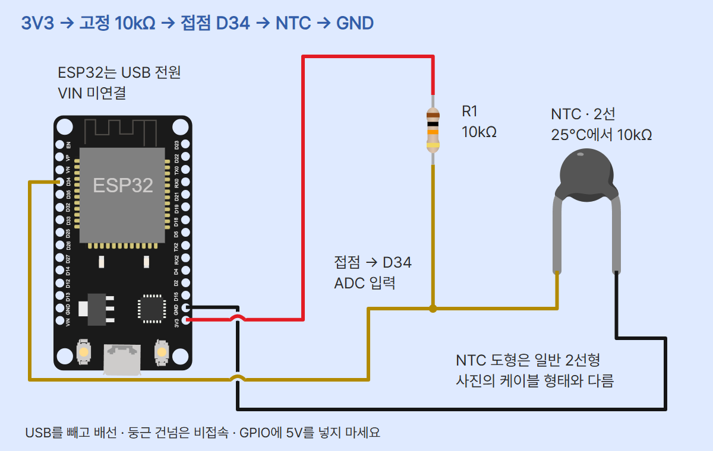
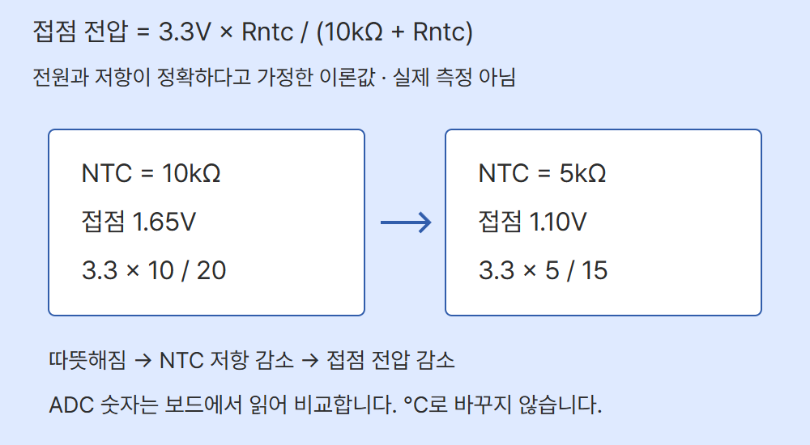

# NTC 저항의 온도 변화를 ADC로 읽기 · ESP32

이 편은 Adafruit 372 2선 NTC와 고정 10kΩ 저항으로 온도 변화의 방향을 관찰합니다. GPIO34에서 얻은 ADC 원시값 10개의 정수 평균을 표시하며 °C를 계산하지 않습니다. 다른 부품의 계수를 추정하거나 보정하지 않은 ADC 숫자를 온도라고 쓰지 않습니다.

## 준비물·연결

ESP-WROOM-32 기반 ESP32 DevKit v1 30핀, Adafruit 372(25°C에서 10kΩ ±1%, B25/50=3950 ±1%), 고정 10kΩ 1% 저항, 브레드보드·점퍼선, USB 데이터 케이블, Thonny를 준비합니다. ESP32는 PC USB 전원만 씁니다. 3핀 NTC 모듈과 혼동하지 마세요.

USB를 빼고 연결합니다. NTC 두 선과 고정 저항의 양끝을 서로 다른 연결 줄에 꽂고 가운데에서만 세 선을 모읍니다. NTC에는 극성이 없지만 두 부품을 놓는 위치는 아래와 같아야 합니다.

| ESP32·접점 | 연결 | 역할 |
| --- | --- | --- |
| 3V3 | 고정 10kΩ 한쪽 | 분압 전원 |
| D34(GPIO34) | 고정 저항 반대쪽·NTC 한 선 | 세 선이 만나는 같은 접점 |
| 오른쪽 3V3 바로 위 GND(GND.1) | NTC 나머지 선 | 공통 접지 |

VIN·5V·내장 LED는 사용하지 않습니다. GPIO34는 ADC1 입력 전용 핀입니다. 이 예제는 디지털 HIGH/LOW·풀업·PWM을 쓰지 않습니다. 브레드보드 전원 레일이 중간에 끊기는지 확인하고 GPIO에 5V를 넣지 마세요.



빨강은 3V3, 검정은 GND, 노랑은 접점·ADC 신호입니다. 점은 접속, 둥근 건넘은 비접속입니다. NTC는 Fritzing 일반 2선 도형으로 실제 케이블형 제품 사진과 다릅니다. Wokwi 보드·저항과 이 도형을 조합한 교육용 그림이며 실제 조립 사진·Wokwi 시뮬레이션 프로젝트가 아닙니다.

## 온도에서 숫자까지

NTC는 따뜻해질수록 저항이 줄어드는 서미스터입니다. 이 배선은 3V3 → 고정 저항 → 접점 → NTC → GND입니다. 접점 전압은 공급 전압 × Rntc/(R고정+Rntc)입니다. 따라서 따뜻해져 Rntc가 줄면 전압도 내려갑니다. ADC(아날로그-디지털 변환기)는 이 전압을 원시 숫자로 읽습니다.



3.3V와 고정 10kΩ이 정확하다고 가정하면 NTC 10kΩ에서는 1.65V, NTC 5kΩ에서는 1.10V입니다. 이는 저항·전압의 계산 예시이며 실제 측정이나 특정 온도의 기록이 아닙니다. 25°C의 공칭 10kΩ이 실물에서 정확히 그 저항임을 보장하지 않습니다. 고정 저항과 NTC를 바꾸어 놓으면 변화 방향과 환산식이 달라집니다.

## ADC 숫자의 의미와 한계

MicroPython v1.29.0의 read_u16()은 원시값을 0~65535로 환산해 돌려줍니다. 이 범위가 16비트 정확도를 뜻하지 않습니다. 일반 ESP32의 ADC는 비선형성과 보드별 오차가 있습니다. ATTN_11DB는 입력 감쇠 설정이며 근사 선형 측정 범위는 약 150~2450mV입니다. 3V3로 공급해도 그 전체 범위를 정확히 측정하지 않습니다. 0·65535는 끝값일 수 있으며 끝값이 아닌 숫자도 선형 범위와 정확도를 보장하지 않습니다. 평균은 포화나 계통 오차를 없애지 않습니다.

이 코드는 온도를 계산하지 않으므로 B 계수를 코드에 넣지 않습니다. 온도를 구하려면 실제 공급 전압·고정 저항·ADC 보정과 선형 범위, 기준 온도에서의 R0, B 계수 또는 제품의 저항-온도 표를 확인해야 합니다. read_u16/65535×3.3을 정확한 전압으로 가정해 UNO의 변환식을 복사하지 마세요. 공식 read_uv()는 eFuse 보정값을 사용하지만 선형 범위에서만 보정이 유효합니다. 이 편에는 그 기능과 °C 보정을 구현하지 않았습니다.

## 실행·관찰

1. MicroPython v1.29.0 ESP32_GENERIC과 Thonny를 사용합니다. [기본 세팅](../001-basic-setup/)의 USB·펌웨어·COM 포트 절차를 확인하세요. 펌웨어를 다시 쓰기 전 보드의 기존 파일을 백업합니다. S3/C3 펌웨어로 자동 대체하지 않습니다.
2. USB를 빼고 표대로 연결한 뒤 USB를 다시 연결합니다. Thonny 오른쪽 아래에서 MicroPython (ESP32)와 실제 COM 포트를 선택합니다. 메뉴 위치는 버전·언어에 따라 다릅니다.
3. 아래 전체 코드를 새 탭에 붙이고 PC에 main.py로 저장한 뒤 실행 버튼 또는 F5를 누릅니다. 표준 machine/time만 사용하며 추가 라이브러리는 없습니다. 보드에 main.py로 저장하면 재전원 시 자동 실행할 수 있으므로 처음에는 PC 파일 실행으로 확인합니다. 이 문서에는 실제 ESP32 실행 화면 캡처가 없습니다.
4. READY 뒤 raw_u16를 여러 줄 기록합니다. 검은 센서 끝을 손으로 가볍게 감쌌다가 놓고 내려갔다 돌아오는지 관찰합니다. 센서가 반응할 시간을 두고, 바뀐 조건과 값을 직접 기록하세요. 불·뜨거운 물·침수는 쓰지 않습니다.
5. Ctrl+C로 종료하면 STOP이 나옵니다. 코드 종료는 USB 전원 차단이 아니므로 배선 수정은 USB를 뺀 뒤 합니다.

출력 형식만 나타내면 아래와 같습니다. 실제 센서 수치는 만들지 않았습니다.

```text
READY: NTC raw input GPIO34
raw_u16 = <10번 읽은 정수 평균>
ADC_ENDPOINT raw_u16 = <개별 끝값이 포함된 평균>
ADC_ERROR: <핀 읽기 등 오류>
STOP
```

## 전체 코드

```python
from machine import ADC, Pin
from time import sleep_ms

ADC_PIN = 34
SAMPLES = 10
GAP_MS = 10
WAIT_MS = 1000
adc = ADC(Pin(ADC_PIN), atten=ADC.ATTN_11DB)

try:
    print("READY: NTC raw input GPIO34")
    while True:
        sleep_ms(WAIT_MS)
        total = 0
        endpoint = False
        for _ in range(SAMPLES):
            value = adc.read_u16()
            total += value
            if value == 0 or value == 65535:
                endpoint = True
            sleep_ms(GAP_MS)
        raw = total // SAMPLES
        if endpoint:
            print("ADC_ENDPOINT raw_u16 =", raw)
        else:
            print("raw_u16 =", raw)
except KeyboardInterrupt:
    print("STOP")
except OSError as error:
    print("ADC_ERROR:", error)
```

## 각 줄의 역할

| 코드 | 역할 |
| --- | --- |
| from machine import ADC, Pin | ADC와 핀 설정 기능을 가져옵니다. |
| from time import sleep_ms | ms 단위 대기 함수입니다. |
| ADC_PIN=34 | 실제 접점의 GPIO34입니다. |
| SAMPLES=10 | 한 표시값에 사용할 개별 읽기 수입니다. |
| GAP_MS=10 | 각 읽기 뒤 대기입니다. 마지막 읽기 뒤에도 기다립니다. |
| WAIT_MS=1000 | 매 회차의 첫 읽기 전에 기다립니다. |
| adc=ADC(Pin(...),atten=ADC.ATTN_11DB) | GPIO34 ADC1과 입력 감쇠를 지정합니다. |
| try / print READY / while True | 시작을 알리고 반복합니다. READY는 배선 성공 판정이 아닙니다. |
| sleep_ms(WAIT_MS) | 첫 회차를 포함해 먼저 1000ms 기다립니다. |
| total=0 / endpoint=False | 합계와 끝값 플래그를 회차마다 초기화합니다. |
| for _ in range(SAMPLES) | 10번 읽습니다. |
| value=adc.read_u16() / total+=value | 개별 원시값을 읽어 합합니다. |
| if value==0 or value==65535 / endpoint=True | 한 번이라도 끝값이 있으면 표시해 둡니다. |
| sleep_ms(GAP_MS) | 매번 읽은 뒤 10ms 기다립니다. |
| raw=total//SAMPLES | 정수 평균을 계산합니다. //는 양수 나눗셈의 소수를 버립니다. |
| if endpoint / print ADC_ENDPOINT | 평균에 가려질 수 있는 개별 끝값을 알립니다. |
| else / print raw_u16 | 그 외에는 평균만 표시합니다. |
| except KeyboardInterrupt / STOP | 대기·읽기 중 Ctrl+C를 받으면 끝냅니다. |
| except OSError / ADC_ERROR | 읽기 오류를 표시하고 실행을 끝냅니다. 자동 재시도하지 않습니다. |

1000ms + 10회×10ms + 읽기·출력 처리 시간이 더해지므로 정확한 1Hz가 아닙니다. 개별 샘플 시작 간격도 정확한 10ms가 아닙니다. import·객체 생성 오류는 try 구간 밖에서 일반 오류로 종료합니다. GPIO를 출력으로 쓰지 않으며 전원을 끄거나 단선 위치를 자동 판별하지 않습니다.

## 실패하면

- ADC_ENDPOINT: USB를 빼고 고정 저항값, 3V3·GND, 같은 접점과 접촉을 확인합니다. 이 안내만으로 단선·쇼트를 확정하지 않습니다.
- 값이 거의 안 변함: 센서 끝과 주변 온도 차이, 반응 시간, 접점을 확인합니다. 반대 방향으로 변하면 저항과 NTC의 위치를 확인하세요.
- ADC_ERROR/출력 없음: 실행 대상·COM 포트·파일·API를 확인합니다. 9600 baud 설정은 이 코드에 없습니다.
- 비정상 발열: USB를 빼고 쇼트·잘못된 전압을 확인합니다.

## 검증과 출처

2026-11-03: verify.py 합성 입력·분기·대기·중단 검사와 4개 배선망 검사를 통과했습니다. 공식 Wokwi 런타임 핀 좌표 5개와 Fritzing 원본을 대조했습니다. check.mjs의 10장 PNG 크기·순서·ZIP·사진·배경·하단·모바일, 편집기 저장·캡션 복사·분류 문구·이미지 붙여넣기·쓰기 경계를 통과했습니다. 범용 회로 검사기는 NTC를 지원하지 않아 편별 검사를 썼습니다. 개념도는 로컬 글꼴 경로를 제외한 사본에서 SVG 구조를 검사하며 원본은 로컬 자산 의존성이 남습니다. 다섯 적용 스킬은 educational-circuit-diagram, codeplant-design, diagram-design, ui-ux-pro-max, humanizer입니다.

episode.json은 카드 편집 원본입니다. diagram.json과 circuit_preview.html은 배선 원본, circuit_preview_control.html은 분압 개념도 원본입니다. verify.py의 합성 입력은 소프트웨어 분기 검사입니다. 실제 ESP32·NTC 배선, 전압·온도·반응 시간·ADC 보정, 펌웨어 실행과 시뮬레이션은 미시험입니다. 실제 교사·학생 피드백을 받지 않았습니다. 로컬 Pretendard와 Wokwi CDN을 쓰므로 오프라인 단일 HTML 실행은 보장하지 않습니다.

- [NTC372 사양·공식 사진](https://www.adafruit.com/product/372)
- [NTC 분압 원리](https://learn.adafruit.com/thermistor/using-a-thermistor)
- [MicroPython ADC 반환 범위](https://docs.micropython.org/en/v1.29.0/library/machine.ADC.html)
- [일반 ESP32 ADC1·감쇠·비선형성](https://docs.micropython.org/en/v1.29.0/esp32/quickref.html#adc-analog-to-digital-conversion)
- [Fritzing NTC 원본](https://github.com/fritzing/fritzing-parts/blob/develop/svg/core/breadboard/ceramic_disk_thermistor_leg.svg)
- [Fritzing 부품 저작자](https://github.com/fritzing/fritzing-parts/blob/develop/core/thermistor_300mil.fzp)
- [Fritzing 라이선스](https://github.com/fritzing/fritzing-parts/blob/develop/LICENSE.txt)
- [ESP32 핀 좌표](https://github.com/wokwi/wokwi-elements/blob/main/src/esp32-devkit-v1-element.ts)
- [Wokwi 저항 좌표](https://github.com/wokwi/wokwi-elements/blob/main/src/resistor-element.ts)
- [NTC 사진](https://cdn-shop.adafruit.com/970x728/372-01.jpg)
- [ESP32 사진](https://www.sunfounder.com/collections/esp32-1/products/esp-wroom-32-esp32-esp-32s-development-board)

사진은 기존 같은 모델 편에 보관한 SunFounder ESP32·Adafruit372 공식 원본을 표시 크기만 조절해 사용했습니다. 별도 자유 이용·재배포 허가는 확인하지 못했으며 원권리자 조건을 확인해야 합니다. Fritzing NTC 도형은 Brendan Howell, CC BY-SA 3.0입니다. 다리가 보이도록 viewBox를 확장하고 배율·라벨·선을 추가했습니다. circuit.png, circuit_preview.html, cards/03.png도 CC BY-SA 3.0으로 제공합니다. Wokwi 보드·저항은 MIT, 분압 개념도는 자체 설명용 SVG입니다. Fritzing 원본 SVG·라이선스는 로컬에 보관했고 공개 배선 HTML에는 도형을 포함했습니다. 웹 도구의 Fritzing 조회는 실패했지만 GitHub API로 공식 SVG를 다시 받아 보관 원본과 바이트 일치를 확인했습니다. 공식 부품 정의의 Brendan Howell 저작자와 LICENSE.txt의 CC BY-SA 3.0도 재확인했습니다.

CODEPLANT https://www.youtube.com/@codeplant2024/search?query=NTC 조회도 실패해 일치 영상을 확인하지 못했습니다. 영상 내용이나 실측을 추정하지 않았습니다.
