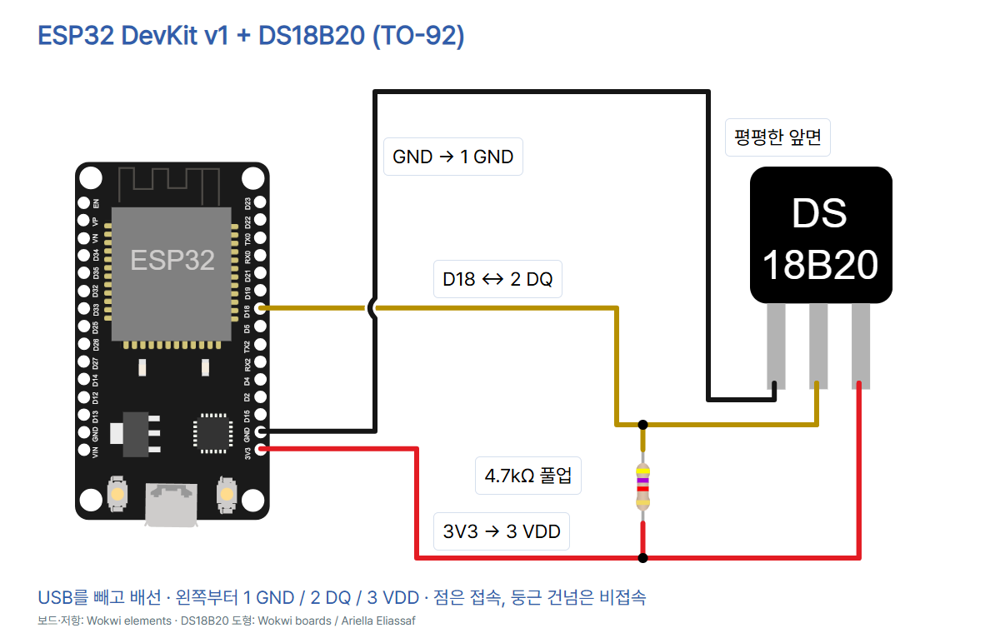

# ESP32 12 · DS18B20로 디지털 온도 읽기

ESP32 DevKit v1 (ESP-WROOM-32 30핀), DS18B20 TO-92 한 개, 4.7kΩ 저항, 브레드보드, 점퍼선, USB 데이터 케이블을 준비합니다. 기생 전원 대신 VDD에 3.3V를 공급합니다.



| TO-92 앞면, 다리 아래 | 연결 |
| --- | --- |
| 왼쪽 1 GND | ESP32 GND (3V3 바로 위) |
| 가운데 2 DQ | D18 (GPIO18) |
| 오른쪽 3 VDD | 3V3 |
| 4.7kΩ 양 끝 | DQ와 3V3 사이 |

USB를 빼고 배선하세요. 5V를 DQ나 이 회로의 전원에 연결하지 않습니다. 검은 점은 접점, 둥근 건넘은 비접속입니다. 방수 프로브·모듈은 핀 배열이 다를 수 있으므로 제품 문서를 확인합니다.

## 실행

1. 기본 세팅 편에 따라 일반 ESP32용 MicroPython 펌웨어를 준비합니다. 예제는 MicroPython v1.29.0 문서 기준입니다.
2. USB를 연결하고 Thonny의 도구 → 옵션 → 인터프리터에서 MicroPython(ESP32)과 실제 USB 포트를 선택합니다. 버전에 따라 메뉴 위치가 다를 수 있습니다.
3. 새 편집창에 아래 코드를 붙여 넣고 실행(F5)합니다. 반복 실행을 중단하려면 정지 버튼이나 Ctrl+C를 사용합니다.
4. 아래쪽 Shell에서 섭씨 표시를 봅니다. 손으로 센서 몸체를 감싸기 전후 값을 비교하세요. 12비트 설정에서 해상도는 0.0625°C이며, 소수점 두 자리 표시는 정확도와 별개입니다.

## 전체 코드

```python
from machine import Pin
import onewire
import ds18x20
from time import sleep_ms

sensor = ds18x20.DS18X20(onewire.OneWire(Pin(18)))

while True:
    try:
        roms = [rom for rom in sensor.scan() if rom[0] == 0x28]
        if len(roms) != 1:
            print("Connect exactly one DS18B20:", len(roms))
        else:
            sensor.convert_temp()
            sleep_ms(750)
            temperature = sensor.read_temp(roms[0])
            print("{:.2f} C".format(temperature))
    except Exception as error:  # The driver raises Exception for CRC errors.
        print("1-Wire error:", error)
    sleep_ms(1000)
```

- 처음 네 줄은 GPIO, 1-Wire 통신, 온도 센서 드라이버, 밀리초 대기 기능을 불러옵니다.
- Pin(18)은 D18을 선택합니다. OneWire는 하나의 DQ 선으로 요청과 응답을 주고받습니다. 풀업은 통신 장치가 선을 놓았을 때 HIGH를 유지합니다.
- while은 측정을 반복합니다. scan은 주소를 검색하고 0x28 계열 DS18B20만 선택합니다. 한 개가 아니면 찾은 개수를 표시합니다.
- convert_temp는 센서에 변환을 요청합니다. sleep_ms(750)은 12비트 변환 최대 시간을 기다립니다. read_temp는 주소에 해당하는 센서의 섭씨 값을 읽습니다.
- format은 소수점 두 자리로 정리하고 print는 Shell에 보냅니다. 예시 형식은 23.50 C이며 실제 측정값은 주변 조건에 따라 달라집니다.
- except는 배선이나 통신 오류가 났을 때 메시지를 표시합니다. 마지막 sleep_ms(1000)은 다음 검색까지 기다립니다.

센서 수가 0이거나 통신 오류가 반복되면 전원을 빼고 핀과 풀업을 확인하세요. 전원 직후 85°C가 보일 때는 변환과 대기 순서, 전원 안정성을 확인하세요. 85°C 자체는 실제로 측정 가능한 온도입니다.

## 출처와 사용 조건

- [MicroPython DS18X20 드라이버](https://github.com/micropython/micropython-lib/blob/master/micropython/drivers/sensor/ds18x20/ds18x20.py): CRC 오류 처리 근거.

- [Analog Devices DS18B20 자료](https://www.analog.com/en/products/ds18b20.html), [데이터시트](https://www.analog.com/media/en/technical-documentation/data-sheets/ds18b20.pdf)
- [MicroPython ESP32 v1.29.0, 1-Wire](https://docs.micropython.org/en/v1.29.0/esp32/quickref.html#onewire-driver)
- [SunFounder ESP32 사진](https://www.sunfounder.com/collections/esp32-1/products/esp-wroom-32-esp32-esp-32s-development-board), [Adafruit 제품 374 사진](https://cdn-shop.adafruit.com/970x728/374-02.jpg). 동일 모델의 기존 보관 사진을 사용했습니다. 별도 자유 이용·재배포 허락은 확인되지 않았습니다.
- Wokwi elements 보드·저항(MIT), [Wokwi DS18B20 도형·핀](https://github.com/wokwi/wokwi-boards/blob/main/boards/ds18b20/board.json)(Ariella Eliassaf, 별도 이용 조건 미확인).
- [CODEPLANT 채널](https://www.youtube.com/@codeplant2024)은 이번 조회에서 페이지를 가져오지 못했습니다.

실제 하드웨어 및 전기 신호 측정은 수행하지 않았습니다.

2026-11-04 검수: 8장 PNG(1080×1350), 순서·ZIP·사진·배경·하단·모바일 및 편집기 저장·캡션 복사·이미지 붙여넣기를 확인했습니다. 배선 5개와 4.7kΩ 풀업을 대조했고 합성 입력으로 GPIO18, 변환→750ms→읽기, 음수 표시, 센서 누락·복수·다른 계열, CRC 오류 처리 분기를 검사했습니다.
