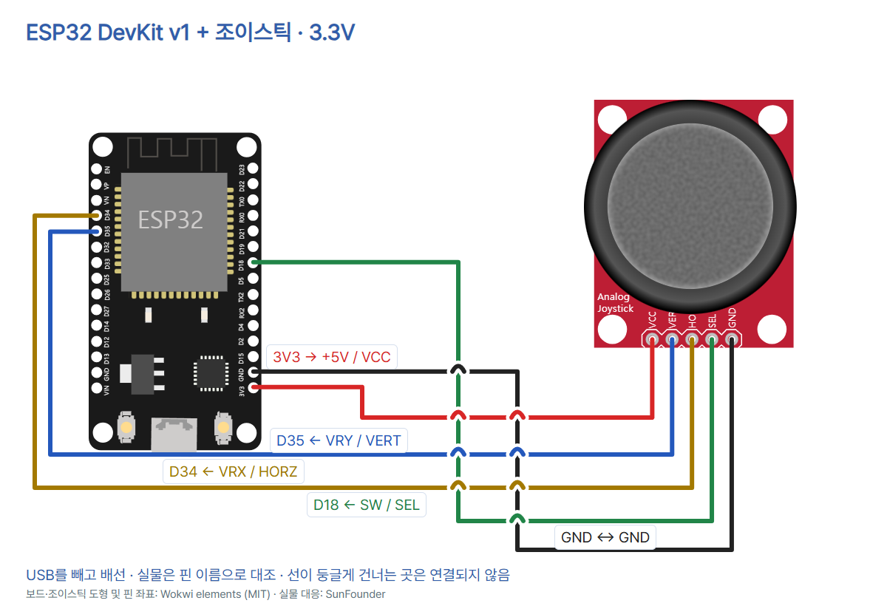

# ESP32 13 · 조이스틱의 두 축과 누름 읽기

ESP32 DevKit v1(ESP-WROOM-32 30핀), SunFounder VRX/VRY/SW 조이스틱, 점퍼선 5개, USB 데이터 케이블, Thonny가 필요합니다. 3.3V 급전을 지원하는 모듈을 사용하세요. USB를 빼고 배선합니다.



| 모듈 인쇄 | ESP32 | 그림 표기 |
| --- | --- | --- |
| +5V | 3V3 | VCC |
| GND | GND(3V3 바로 위) | GND |
| VRX | D34 | HORZ |
| VRY | D35 | VERT |
| SW | D18 | SEL |

핀의 물리적 순서는 사진과 그림이 다릅니다. 인쇄된 이름을 따라 연결하세요. ESP32 입력에 5V를 공급하지 마세요. SW는 GND로 닫히는 접점입니다. D18의 내부 풀업이 열린 상태에서 HIGH를 유지합니다.

## 실행

1. 일반 ESP32용 MicroPython을 설치합니다. 이 코드는 v1.29.0 문서의 ADC API를 기준으로 합니다.
2. USB를 연결하고 Thonny 도구 → 옵션 → 인터프리터에서 MicroPython(ESP32)과 USB 포트를 선택하세요.
3. 아래 코드를 붙여 넣고 F5로 실행합니다. Shell은 편집창 아래쪽입니다. Ctrl+C나 정지 버튼으로 반복을 끝낼 수 있습니다.

```python
from machine import ADC, Pin
from time import sleep_ms

x_axis = ADC(Pin(34), atten=ADC.ATTN_11DB)
y_axis = ADC(Pin(35), atten=ADC.ATTN_11DB)
button = Pin(18, Pin.IN, Pin.PULL_UP)

while True:
    x = x_axis.read_u16()
    y = y_axis.read_u16()
    pressed = button.value() == 0
    state = "pressed" if pressed else "released"
    print("X={} Y={} SW={}".format(x, y, state))
    sleep_ms(150)
```

- ADC는 GPIO34·35에 들어온 전압을 숫자로 바꿉니다. 두 핀은 원래 ESP32의 ADC1 입력입니다. ATTN_11DB는 입력 범위를 넓히는 감쇠 설정입니다.
- Pin은 GPIO18을 디지털 입력으로 설정하고 내부 풀업을 켭니다. 버튼이 GND에 닫히면 0을 읽으므로 코드에서 pressed가 참이 됩니다.
- while은 두 축과 버튼을 반복해서 읽습니다. format과 print는 세 값을 한 줄로 표시합니다. 예시 형식은 `X=31000 Y=30000 SW=released`이며 숫자는 설명용입니다.
- sleep_ms(150)은 표시 사이에 150ms를 기다립니다. 읽기와 출력 시간도 들어갑니다.

손을 뗀 상태에서 중앙의 변동 범위를 기록하고 한 축씩 끝까지 움직여 보세요. 증가 방향은 실제 모듈과 장착 방향으로 확인합니다. `read_u16()`의 표현 범위는 0~65535이며 ESP32의 12비트 변환값을 늘려 표현합니다. ATTN_11DB의 근사 선형 범위는 약 0.15~2.45V이므로 3.3V 급전 시 끝 구간은 포화될 수 있습니다. 원시값을 각도나 정확한 전압으로 바꾸려면 별도 보정이 필요합니다. 버튼을 한 번씩 세는 응용에는 짧은 접점 떨림을 걸러내는 디바운싱이 필요합니다. 이 코드는 상태를 표시하므로 빠른 누름은 놓칠 수 있습니다.

## 자료와 사용 조건

- [SunFounder 조이스틱 모듈](https://docs.sunfounder.com/projects/esp32-starter-kit/en/latest/components/component_joystick_module.html)
- [MicroPython ESP32 ADC·GPIO](https://docs.micropython.org/en/v1.29.0/esp32/quickref.html)
- [Wokwi 조이스틱](https://docs.wokwi.com/parts/wokwi-analog-joystick), [Wokwi elements](https://github.com/wokwi/wokwi-elements) 도형 MIT
- [ESP32 사진](https://www.sunfounder.com/collections/esp32-1/products/esp-wroom-32-esp32-esp-32s-development-board), [조이스틱 사진](https://docs.sunfounder.com/projects/umsk/en/latest/_images/09_joystick.png). 이전에 확인한 같은 제품의 공식 사진을 사용했습니다. 별도 재배포 허락은 확인되지 않았습니다.
- [CODEPLANT 채널](https://www.youtube.com/@codeplant2024)은 이번 조회에서 페이지를 가져오지 못했습니다.

실제 보드와 조이스틱의 동작은 시험하지 않았습니다.

2026-11-05 검수: 배선망 5개, 합성 입력에서 X/Y 경계값·누름 두 상태·150ms 대기, 코드와 README 일치, 8장 PNG·모바일·편집기 검사를 확인했습니다.
