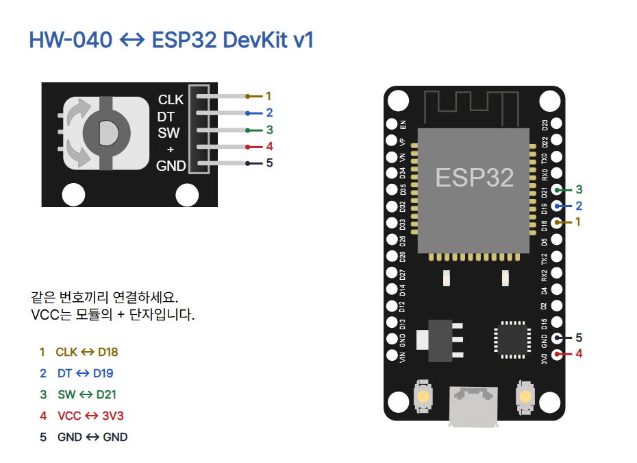

# 14 · 회전 방향을 읽는 로터리 엔코더

ESP32 DevKit v1 (ESP-WROOM-32 30핀), SunFounder HW-040 5핀 모듈, 점퍼선 5개, USB 데이터 케이블, MicroPython 펌웨어와 Thonny를 준비하세요. 모듈에 인쇄된 단자 이름을 확인하고 USB를 뺀 뒤 배선합니다.

| HW-040 | ESP32 | 역할 |
|---|---|---|
| CLK | D18 | A 신호 |
| DT | D19 | B 신호 |
| SW | D21 | 누름 스위치 |
| + (VCC) | 3V3 | 3.3V |
| GND | GND | 공통 접지 |



모듈의 풀업 전압이 GPIO에도 걸릴 수 있으므로 5V나 VIN을 사용하지 마세요. 입력 풀업은 접점이 열렸을 때 HIGH를 유지합니다. 접점이 닫히면 GND와 이어져 LOW가 됩니다.

## Thonny에서 실행

1. [ESP32 기본 세팅](../001-basic-setup/README.md)에 따라 해당 보드에 MicroPython을 설치합니다.
2. 배선을 다시 확인하고 USB를 꽂습니다. Thonny의 실행 → 인터프리터 선택에서 MicroPython (ESP32)와 실제 포트를 고릅니다.
3. 아래 코드나 [main.py](main.py)를 편집창에 열어 F5를 누릅니다. 아래 Shell에서 출력을 봅니다. 메뉴 위치는 Thonny 버전·언어에 따라 다를 수 있습니다. 중지할 때는 Ctrl+C를 누르세요.

```python
from machine import Pin
from time import sleep_ms, ticks_ms, ticks_diff

CLK = Pin(18, Pin.IN, Pin.PULL_UP)
DT = Pin(19, Pin.IN, Pin.PULL_UP)
SW = Pin(21, Pin.IN, Pin.PULL_UP)
DEBOUNCE_MS = 30

# Index: previous A/B followed by current A/B.
STEP = (0, -1, 1, 0, 1, 0, 0, -1, -1, 0, 0, 1, 0, 1, -1, 0)

def read_ab():
    return (CLK.value() << 1) | DT.value()

def advance(previous, current, pending):
    if (previous ^ current) == 3:
        return 0, 0
    pending += STEP[(previous << 2) | current]
    if pending == 4:
        return 0, 1
    if pending == -4:
        return 0, -1
    return pending, 0

def run():
    previous = read_ab()
    pending = position = 0
    stable = raw = SW.value()
    changed_at = ticks_ms()
    print("pos=", position, "sw=", stable)
    while True:
        current = read_ab()
        pending, delta = advance(previous, current, pending)
        previous = current
        position += delta

        sample = SW.value()
        now = ticks_ms()
        if sample != raw:
            raw, changed_at = sample, now
        changed = raw != stable and ticks_diff(now, changed_at) >= DEBOUNCE_MS
        if changed:
            stable = raw
        if delta or changed:
            print("pos=", position, "sw=", stable)
        sleep_ms(1)

if __name__ == "__main__":
    run()
```

## 코드 읽기와 관찰

- `Pin(..., Pin.IN, Pin.PULL_UP)`은 CLK·DT·SW를 풀업 입력으로 엽니다. `read_ab()`는 CLK를 앞 비트, DT를 뒤 비트에 넣습니다.
- `advance()`는 이전 두 비트와 현재 두 비트로 STEP 표를 조회합니다. 같은 상태는 0, 정상 전이는 +1 또는 −1입니다. 두 비트가 함께 바뀌면 누적값을 버립니다. 누적값이 ±4에 도달하면 pos에 ±1을 적용합니다.
- `ticks_ms()`와 `ticks_diff()`로 SW가 마지막으로 바뀐 뒤 흐른 시간을 계산합니다. 30ms 이상 유지되면 상태를 확정합니다. 시작 줄의 sw는 시작 시점의 첫 샘플입니다.
- `print()`는 시작 시와 카운트 또는 확정된 SW가 바뀔 때만 실행합니다. `sleep_ms(1)`은 매 반복에 최소 대기를 넣습니다. 샘플 간격에는 실행·출력 시간도 더해집니다.

한쪽으로 천천히 돌리면 pos가 한 방향으로 바뀌고, 반대로 돌리면 반대 방향으로 바뀝니다. 11→01→00→10→11은 코드상 +1 예시입니다. 물리적 회전 방향의 부호와 걸림당 카운트는 모듈에서 확인하세요. pos는 상대 카운트이며 각도나 회전수가 아닙니다. 누르면 sw=0, 놓으면 sw=1을 예상합니다. 짧은 누름이나 빠른 회전은 놓칠 수 있습니다. 값이 고정되면 USB를 뺀 뒤 CLK·DT·SW와 GND 연결을 확인하세요.

## 검증과 출처

`python verify.py`는 Python 구문, 정·역방향과 왕복 바운스·누락 전이, 풀업 설정과 5개 연결을 확인합니다. check.mjs로 카드 9장 1080×1350 PNG, 모바일 배치, 배경색, 캡션 복사와 편집기 저장을 확인했습니다. 실제 하드웨어와 Wokwi 동작 시뮬레이션은 미시험입니다.

- [SunFounder HW-040 부품과 사진](https://docs.sunfounder.com/projects/umsk/en/latest/01_components_basic/17-component_rotary_encoder.html), [ESP32 실습](https://docs.sunfounder.com/projects/umsk/en/latest/03_esp32/esp32_lesson17_rotary_encoder.html), [3.3V 연결 예시](https://docs.sunfounder.com/projects/ai-lab-kit/en/latest/python/2.12_rotatary_encoder_python.html)
- [SunFounder ESP32 공식 사진](https://docs.sunfounder.com/projects/esp32-starter-kit/en/latest/components/component_esp32.html). 사진은 표시 크기만 조절했습니다. 별도 자유 이용 라이선스 미확인으로 원권리자 사용 조건이 적용됩니다.
- [MicroPython Pin](https://docs.micropython.org/en/latest/library/machine.Pin.html), [Wokwi KY-040](https://docs.wokwi.com/parts/wokwi-ky-040), [Wokwi 도형 소스(MIT)](https://github.com/wokwi/wokwi-elements)
- [CODEPLANT 채널](https://www.youtube.com/@codeplant2024)은 이번 조회에서 페이지 내용을 확인할 수 없어 기술 근거로 사용하지 않았습니다.
