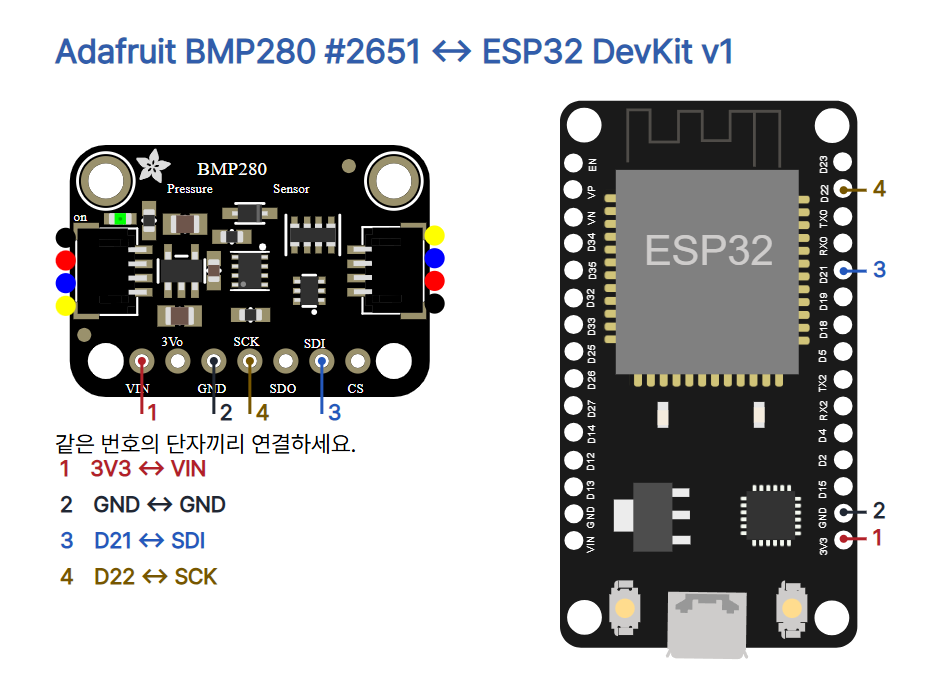

# 15 · 공기의 압력을 읽는 BMP280

ESP32 DevKit v1(ESP-WROOM-32 30핀), Adafruit BMP280 #2651 STEMMA QT(rev C), 점퍼선 4개, USB 데이터 케이블, MicroPython과 Thonny를 준비하세요. USB를 빼고 배선합니다.

| ESP32 | BMP280 | 역할 |
|---|---|---|
| 3V3 | VIN | 3.3V 전원 |
| GND | GND | 공통 접지 |
| GPIO21 | SDI | I²C SDA 데이터 |
| GPIO22 | SCK | I²C SCL 클록 |



3Vo는 모듈의 전압 조정기 출력입니다. 3Vo·SDO·CS와 QT 커넥터는 비워 둡니다. 핀 이름이나 회로가 다른 BMP280 모듈에는 해당 제품의 설명서를 먼저 확인하세요.

## Thonny 실행

1. [ESP32 기본 세팅](../001-basic-setup/README.md)에 따라 해당 보드에 MicroPython을 설치하세요.
2. 배선을 확인한 뒤 USB를 꽂습니다. Thonny에서 MicroPython (ESP32) 인터프리터와 실제 포트를 고릅니다.
3. 아래 전체 코드나 [main.py](main.py)를 편집창에 열고 F5를 누릅니다. 아래 Shell에서 먼저 I²C 주소 목록, 이어서 온도와 기압을 확인합니다. 메뉴 이름은 버전과 언어에 따라 달라질 수 있습니다. 멈출 때는 Ctrl+C를 누르세요.

```python
from machine import I2C, Pin
from time import sleep_ms
from struct import unpack

def compensate(raw_t, raw_p, trim):
    t1, t2, t3, p1, p2, p3, p4, p5, p6, p7, p8, p9 = trim
    dt = raw_t / 16384 - t1 / 1024
    fine = dt * t2 + (raw_t / 131072 - t1 / 8192) ** 2 * t3
    v = fine / 2 - 64000
    offset = (v * v * p6 / 32768 + v * p5 * 2) / 4 + p4 * 65536
    gain = (1 + (p3 * v * v / 524288 + p2 * v) / 524288 / 32768) * p1
    if gain == 0:
        raise ValueError("BMP280 trim")
    pressure = (1048576 - raw_p - offset / 4096) * 6250 / gain
    pressure += (p9 * pressure * pressure / 2147483648
                 + pressure * p8 / 32768 + p7) / 16
    return fine / 5120, pressure / 100

def run():
    i2c = I2C(0, sda=Pin(21), scl=Pin(22), freq=100000)
    sleep_ms(10)
    addresses = i2c.scan()
    print("I2C:", [hex(a) for a in addresses])
    matches = [a for a in (0x77, 0x76) if a in addresses
               and i2c.readfrom_mem(a, 0xD0, 1) == b'\x58']
    if len(matches) != 1:
        raise ValueError("Connect exactly one BMP280 (ID 0x58)")
    addr = matches[0]
    trim = unpack("<HhhHhhhhhhhh", i2c.readfrom_mem(addr, 0x88, 24))
    while True:
        i2c.writeto_mem(addr, 0xF4, b'\x25')
        sleep_ms(20)
        if i2c.readfrom_mem(addr, 0xF3, 1)[0] & 0x08:
            raise OSError("BMP280 conversion still busy")
        data = i2c.readfrom_mem(addr, 0xF7, 6)
        raw_p = int.from_bytes(data[:3], "big") >> 4
        raw_t = int.from_bytes(data[3:], "big") >> 4
        if 0x80000 in (raw_t, raw_p):
            raise ValueError("BMP280 measurement unavailable")
        temp_c, pressure_hpa = compensate(raw_t, raw_p, trim)
        print("T={:.2f} C  P={:.2f} hPa".format(temp_c, pressure_hpa))
        sleep_ms(1000)

if __name__ == "__main__":
    run()
```

## 코드의 역할

| 코드 | 역할 |
|---|---|
| I2C / scan | GPIO21·22로 100kHz 버스를 열고 주소를 찾습니다. |
| matches | 0x77 또는 0x76에서 ID 0x58을 읽습니다. BMP280 하나만 연결합니다. |
| unpack | 0x88부터 24바이트를 읽어 칩별 보정 계수 12개를 복원합니다. |
| 0xF4 / 0x25 | 온도와 기압을 각각 1회 샘플링하는 강제 측정을 요청합니다. |
| sleep_ms(20) / status | 측정이 끝날 시간을 주고, 아직 측정 중이면 오류를 표시합니다. |
| readfrom_mem / shift | 기압·온도 각 3바이트의 위 20비트를 읽습니다. |
| compensate | 온도 보정 중 구한 fine을 기압 보정에도 쓰고, Pa를 100으로 나눠 hPa로 바꿉니다. |
| print / sleep_ms(1000) | 변환한 값을 Shell에 표시하고 다음 측정 전 1초 쉽니다. |

## 관찰과 점검

같은 위치에서 여러 줄을 적어 표시가 얼마나 흔들리는지 보세요. 안전하게 이동할 수 있으면 다른 층에서 같은 방법으로 기록합니다. 일반적으로 높은 곳에서 기압이 낮아지지만 층간 변화가 작은 경우 환경 변화나 센서의 흔들림과 구별하기 어려울 수 있습니다. 기상 앱의 해면 보정 기압은 센서가 그 자리에서 읽은 기압과 기준이 다를 수 있습니다. 표시 소수 자릿수와 센서 정확도도 구분하세요.

주소 목록에 장치가 없다면 USB를 뺀 상태에서 3V3·GND·SDA·SCL을 점검하세요. 이 모듈의 기본 주소는 0x77이고 SDO를 GND에 연결한 구성은 0x76입니다. 주소가 보여도 칩 ID가 다르면 부품 표기를 확인하세요. 예제에는 습도 읽기 기능이 없습니다.

## 검증과 출처

verify.py는 보정 계산 예시(25.08 °C, 약 1006.53 hPa), 잘못된 기압 분모의 거부, 배선 4개와 코드·README 일치를 검사합니다. 예시 수치는 합성 입력에 대한 계산이며 실물 측정값이 아닙니다. check.mjs로 1080×1350 PNG 8장, 모바일 레이아웃과 편집기 동작을 확인했습니다. 실제 하드웨어와 Wokwi 실행은 미시험입니다.

- [Bosch BMP280 데이터시트](https://www.bosch-sensortec.com/media/boschsensortec/downloads/datasheets/bst-bmp280-ds001.pdf), [MicroPython I²C](https://docs.micropython.org/en/latest/library/machine.I2C.html)
- [Adafruit #2651 제품 사진](https://www.adafruit.com/product/2651), [모듈 핀 안내](https://learn.adafruit.com/adafruit-bmp280-barometric-pressure-plus-temperature-sensor-breakout/pinouts), [Adafruit Fritzing 도형](https://github.com/adafruit/Fritzing-Library), [Wokwi ESP32 도형(MIT)](https://github.com/wokwi/wokwi-elements)
- [SunFounder ESP32 공식 사진](https://docs.sunfounder.com/projects/esp32-starter-kit/en/latest/components/component_esp32.html). 두 제품 사진은 표시 크기만 조절했으며 별도 자유 이용 라이선스는 확인되지 않았습니다. 원권리자 사용 조건이 적용됩니다.
- [CODEPLANT 채널](https://www.youtube.com/@codeplant2024)은 이번 조회에서 페이지 본문을 확인하지 못해 기술 근거로 사용하지 않았습니다.
