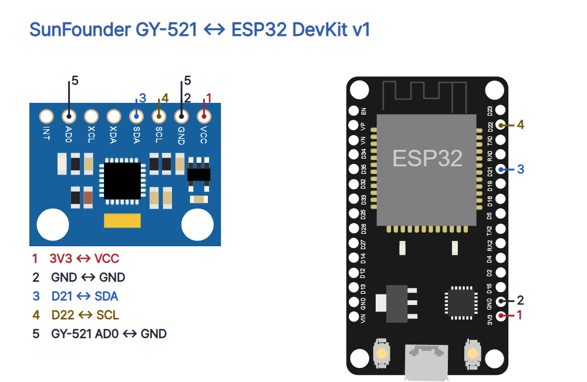

# 16 · 기울기와 회전의 변화를 읽는 MPU6050

ESP32 DevKit v1(ESP-WROOM-32 30핀), SunFounder GY-521 8핀 모듈, 점퍼선 5개, USB 데이터 케이블, MicroPython과 Thonny를 준비하세요. 분기에는 브레드보드를 사용할 수 있습니다. USB를 빼고 연결합니다.

| GY-521 | ESP32 | 역할 |
|---|---|---|
| VCC | 3V3 | 3.3V 전원 |
| GND | GND | 공통 접지 |
| SDA | GPIO21 | I²C 데이터 |
| SCL | GPIO22 | I²C 클록 |
| AD0 | GND | 주소 0x68 |
| INT·XDA·XCL | 미연결 | 이번 예제에서 사용하지 않음 |



3.3V 전원은 SunFounder의 ESP32 예시를 따릅니다. 핀 순서·전압 조정기와 풀업 회로가 다른 모듈은 실제 제조사 사양을 먼저 확인하세요. ESP32 GPIO에 5V를 넣지 마세요. 통신이 안 될 때 임의로 전원을 높이지 말고 배선과 제품 사양을 확인합니다.

## Thonny에서 실행

1. [ESP32 기본 세팅](../001-basic-setup/README.md)에 따라 보드에 MicroPython을 설치하세요.
2. 배선을 확인하고 USB를 연결합니다. Thonny에서 MicroPython (ESP32) 인터프리터와 실제 포트를 선택하세요.
3. [main.py](main.py)나 아래 코드를 편집창에 열어 F5를 누릅니다. 하단 Shell에 I²C 주소와 두 줄의 센서 값이 나옵니다. 메뉴 이름은 Thonny 버전·언어에 따라 다를 수 있습니다. Ctrl+C로 종료합니다.

```python
from machine import I2C, Pin
from time import sleep_ms
from struct import unpack

ADDR = 0x68
ACCEL_SCALE = 16384.0
GYRO_SCALE = 131.0

def decode(data):
    if len(data) != 14:
        raise ValueError("Expected 14 bytes")
    ax, ay, az, temp, gx, gy, gz = unpack(">7h", data)
    accel_g = (ax / ACCEL_SCALE, ay / ACCEL_SCALE, az / ACCEL_SCALE)
    gyro_dps = (gx / GYRO_SCALE, gy / GYRO_SCALE, gz / GYRO_SCALE)
    return accel_g, gyro_dps

def run():
    i2c = I2C(0, sda=Pin(21), scl=Pin(22), freq=100000)
    sleep_ms(100)
    print("I2C:", [hex(a) for a in i2c.scan()])
    if i2c.readfrom_mem(ADDR, 0x75, 1) != b'\x68':
        raise ValueError("MPU6050 ID mismatch")
    i2c.writeto_mem(ADDR, 0x6B, b'\x01')
    sleep_ms(100)
    i2c.writeto_mem(ADDR, 0x1A, b'\x03')
    i2c.writeto_mem(ADDR, 0x19, b'\x09')
    i2c.writeto_mem(ADDR, 0x1B, b'\x00')
    i2c.writeto_mem(ADDR, 0x1C, b'\x00')
    while True:
        data = i2c.readfrom_mem(ADDR, 0x3B, 14)
        accel_g, gyro_dps = decode(data)
        print("a[g] X={:.2f} Y={:.2f} Z={:.2f}".format(*accel_g))
        print("w[deg/s] X={:.2f} Y={:.2f} Z={:.2f}".format(*gyro_dps))
        sleep_ms(200)

if __name__ == "__main__":
    run()
```

## 코드의 각 부분

| 코드 | 역할 |
|---|---|
| ADDR | AD0를 GND로 둔 주소 0x68입니다. WHO_AM_I 값도 0x68인지 검사합니다. |
| I2C | GPIO21 SDA와 GPIO22 SCL을 100kHz로 설정합니다. |
| 0x6B ← 0x01 | 절전 상태를 풀고 X축 자이로 PLL 클록을 선택합니다. |
| 0x1A ← 0x03 | 디지털 저역통과 필터를 설정합니다. |
| 0x19 ← 0x09 | 내부 1kHz를 10으로 나눠 100Hz 샘플 설정을 사용합니다. |
| 0x1B·0x1C ← 0 | 자이로 ±250°/s, 가속도 ±2g 범위입니다. |
| 0x3B / 14 | 가속도 3축, 내부 온도, 자이로 3축의 연속 14바이트를 읽습니다. |
| unpack(">7h") | 상위 바이트가 먼저 오는 부호 있는 16비트 정수 7개로 복원합니다. |
| decode | 가속도를 16384 LSB/g, 자이로를 131 LSB/(°/s)로 나눕니다. |
| print / sleep_ms(200) | 값을 표시하고 다음 읽기 전 200ms 쉽니다. 실제 간격에는 통신과 출력 시간이 더해집니다. |

## 관찰과 보정

모듈의 인쇄된 축을 보고 평평하게 놓은 값, 옆으로 기울인 값, 축을 중심으로 돌릴 때와 멈춘 뒤의 값을 기록하세요. 가속도계에는 중력이 반영되어 정지 상태의 3축 크기가 대략 1g입니다. g는 약 9.81m/s²를 기준으로 한 단위입니다. 자이로는 회전 속도를 °/s로 나타냅니다. 정지 상태의 자이로 오프셋과 값의 흔들림을 여러 줄로 비교하세요.

이 예제는 자동 보정이나 각도 추정을 수행하지 않습니다. 정지 오프셋을 구해 빼는 보정을 확장할 때는 움직이지 않는 상태에서 충분히 표본을 모으고, 온도와 장착 조건이 달라지면 다시 확인해야 합니다. 흔들면서 읽은 가속도에는 움직임이 더해져 단순 기울기 해석이 어려울 수 있습니다. 내부 100Hz 샘플 설정과 약 200ms마다 보는 Shell 간격을 구분하세요. 출력 사이의 빠른 변화는 놓칠 수 있습니다.

주소가 없으면 USB를 뺀 뒤 전원·GND·SDA·SCL·AD0를 점검하세요. ID가 다르면 실제 칩을 확인합니다. 숫자가 범위 끝에서 멈추면 설정 범위를 벗어난 움직임인지 확인하고, 측정 범위를 바꿀 때는 변환 계수도 함께 바꿔야 합니다.

## 검증과 출처

verify.py에서 부호 있는 16비트 경계·1g 및 1°/s 합성 입력과 5개 연결을 확인합니다. 합성 입력은 실제 센서 측정 기록이 아닙니다. check.mjs로 9장 1080×1350 PNG, 모바일 가독성과 편집기 저장·캡션 복사를 확인했습니다. 실제 하드웨어와 Wokwi 실행은 미시험입니다.

- [SunFounder ESP32 3.3V 연결 예시](https://docs.sunfounder.com/projects/summary-of-fun-projects/en/latest/esp32/angle_controller.html), [GY-521 제품과 사진](https://www.sunfounder.com/products/3pcs-gy-521-mpu-6050-mpu6050-3-axis-accelerometer-gyroscope-module-6-dof-6-axis-accelerometer-gyroscope-sensor-module-16-bit-ad-converter-data-output-iic-i2c-for-arduino)
- [TDK 레지스터 맵](https://invensense.tdk.com/wp-content/uploads/2015/02/MPU-6000-Register-Map.pdf), [MicroPython I²C](https://docs.micropython.org/en/latest/library/machine.I2C.html)
- [Wokwi 도형(MIT)](https://github.com/wokwi/wokwi-elements), [SunFounder ESP32 사진](https://docs.sunfounder.com/projects/esp32-starter-kit/en/latest/components/component_esp32.html). 사진은 표시 크기만 변경했습니다. 별도 자유 이용 라이선스는 확인되지 않았으며 원권리자 사용 조건이 적용됩니다.
- [CODEPLANT 채널](https://www.youtube.com/@codeplant2024)은 이번 조회에서 본문을 가져오지 못해 기술 근거로 사용하지 않았습니다.
