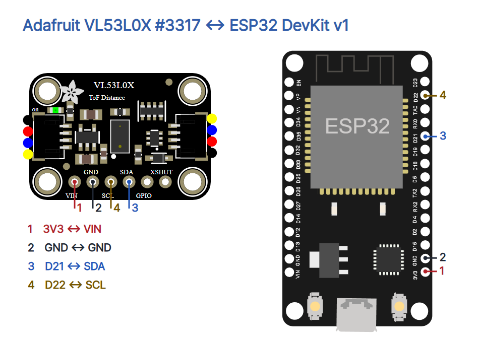

# 17 · 빛의 왕복으로 거리를 읽는 VL53L0X

ESP32 DevKit v1(ESP-WROOM-32 30핀), Adafruit VL53L0X #3317 STEMMA QT(rev C), 점퍼선 4개, USB 데이터 케이블, MicroPython과 Thonny, 자와 큰 평평한 물체를 준비하세요. 이 예제는 기본 단일 측정 모드를 사용합니다.

| ESP32 | #3317 | 역할 |
|---|---|---|
| 3V3 | VIN | 3.3V 전원 |
| GND | GND | 공통 접지 |
| GPIO21 | SDA | I²C 데이터 |
| GPIO22 | SCL | I²C 클록 |



USB를 빼고 연결하세요. GPIO·XSHUT와 QT 커넥터는 비워 둡니다. 다른 VL53L0X 모듈은 전원·신호 사양을 먼저 확인하세요. ESP32 GPIO에 5V를 넣지 마세요. 센서의 광학 창을 가리거나 분해·개조하지 않습니다.

## 드라이버 설치와 Thonny 실행

1. [ESP32 기본 세팅](../001-basic-setup/README.md)에 따라 MicroPython과 Thonny를 준비합니다.
2. [고정 버전 vl53l0x.py](https://raw.githubusercontent.com/kapetan/MicroPython_VL53L0X/1cb1518e44f92c4b4b7942239018b1a8f304063c/vl53l0x.py)를 내려받습니다. kapetan/MicroPython_VL53L0X의 커밋 1cb1518e44f92c4b4b7942239018b1a8f304063c이며 MIT입니다. 파일 안의 저작권·라이선스 주석을 보존합니다.
3. Thonny에서 내려받은 파일을 열고 파일 → 다른 이름으로 저장 → MicroPython 장치를 선택해 장치 루트의 vl53l0x.py로 저장합니다. main.py와 같은 파일명이 아닙니다. 메뉴 이름은 버전·언어에 따라 다를 수 있습니다.
4. 아래 전체 예제를 새 편집창에 붙여 넣고 F5로 실행합니다. 하단 Shell의 I²C 목록에 0x29가 있는지 확인합니다. Ctrl+C로 중지합니다.

```python
from machine import I2C, Pin
from time import sleep_ms
from vl53l0x import VL53L0X

MIN_MM = 50
MAX_MM = 1000

def sample(sensor):
    distance_mm = sensor.range
    if MIN_MM <= distance_mm <= MAX_MM:
        return distance_mm
    return None

def run():
    i2c = I2C(0, sda=Pin(21), scl=Pin(22), freq=100000)
    sleep_ms(100)
    addresses = i2c.scan()
    print("I2C:", [hex(a) for a in addresses])
    if 0x29 not in addresses:
        raise OSError("VL53L0X address 0x29 not found")
    sensor = VL53L0X(i2c, io_timeout_ms=1000)
    sensor.measurement_timing_budget = 33000
    while True:
        distance_mm = sample(sensor)
        if distance_mm is None:
            print("CHECK_TARGET")
        else:
            print("distance_mm=", distance_mm)
        sleep_ms(200)

if __name__ == "__main__":
    run()
```

## 코드 설명

| 코드 | 역할 |
|---|---|
| import | I²C 버스·GPIO, 대기 함수와 장치에 저장한 드라이버를 불러옵니다. |
| MIN_MM / MAX_MM | 이번 실습의 비교 범위를 50~1000mm로 정합니다. 센서 사양의 정의가 아닙니다. |
| sample | 드라이버의 range 속성으로 단일 측정 결과를 읽고 실습 범위 밖이면 None을 반환합니다. |
| I2C / scan | GPIO21 SDA·GPIO22 SCL을 100kHz로 열고 응답 주소를 표시합니다. |
| VL53L0X | 초기화·식별 레지스터 확인과 드라이버 내부 기준 보정 절차를 수행합니다. 대기 제한은 1000ms입니다. |
| measurement_timing_budget | 측정 시간 예산을 33000µs(33ms)로 정합니다. 출력 전체 간격이나 측정 정확도 보장은 아닙니다. |
| print / sleep_ms(200) | 거리 또는 점검 문구를 출력하고 200ms 쉽니다. 실제 간격에는 측정·통신·출력 시간이 더해집니다. |

## 관찰과 오류

센서 앞면에서 물체까지 자로 거리를 재고, 100·300·500mm 등에서 각각 여러 줄의 출력을 기록하세요. 같은 위치의 흔들림과 자의 값과의 차이를 비교합니다. 물체의 색·기울기·크기·주변 빛에 따라 읽기가 달라질 수 있습니다. mm 단위 정수 출력이 1mm 정확도를 의미하지 않습니다.

CHECK_TARGET은 앱의 50~1000mm 범위 밖 숫자라는 뜻입니다. 이 드라이버의 range는 원시 거리 레지스터를 읽으며 ST의 전체 유효성 상태를 판정하지 않습니다. 범위 안 숫자에도 이상값이 포함될 수 있어 이 비교만으로 정상 측정을 확정할 수 없습니다. 오류가 반복되면 물체와 배선을 점검하세요. RuntimeError 시간 초과, OSError 통신 실패 또는 식별 오류가 나면 프로그램을 중단하고 USB를 뺀 뒤 전원·GND·SDA·SCL을 확인합니다.

드라이버 생성 중 내부 기준 보정이 실행되는 것과 실물 거리 오차를 확인한 것은 구분합니다. 이 예제는 실물 오프셋·크로스토크 보정을 수행하지 않습니다. 제조사 사용 조건과 보정 절차는 ST API 문서를 확인하세요.

## 검증 범위와 출처

verify.py는 범위 경계·범위 밖 결과, 시간 초과 전파 및 4개 배선과 README 전체 코드 일치를 확인합니다. check.mjs로 1080×1350 PNG 9장, 모바일 배경·여백, 캡션 복사와 편집기 저장을 확인했습니다. 실제 하드웨어와 Wokwi 실행은 미시험입니다.

- [Adafruit 제품·사진](https://www.adafruit.com/product/3317), [핀 안내](https://learn.adafruit.com/adafruit-vl53l0x-micro-lidar-distance-sensor-breakout/pinouts), [ST API 사용자 설명서](https://www.st.com/resource/en/user_manual/um2039-world-smallest-timeofflight-ranging-and-gesture-detection-sensor-application-programming-interface-stmicroelectronics.pdf)
- [드라이버 원문과 MIT 고지](https://github.com/kapetan/MicroPython_VL53L0X/tree/1cb1518e44f92c4b4b7942239018b1a8f304063c). MicroPython 1.12용으로 이식된 드라이버의 현재 API를 확인했으며 실제 ESP32 펌웨어와의 호환 동작은 시험하지 않았습니다.
- [Adafruit Fritzing Library](https://github.com/adafruit/Fritzing-Library), [Wokwi ESP32 도형](https://github.com/wokwi/wokwi-elements). 센서 도형은 Adafruit / kattni, CC BY-SA 3.0입니다. 파생 회로 이미지·HTML과 3번 회로 카드도 CC BY-SA 3.0으로 제공합니다. ESP32 도형은 MIT입니다.
- [SunFounder ESP32 사진](https://docs.sunfounder.com/projects/esp32-starter-kit/en/latest/components/component_esp32.html). 제품 사진은 표시 크기만 바꿨습니다. 별도 자유 이용 라이선스는 확인되지 않았으며 원권리자 사용 조건이 적용됩니다.
- [CODEPLANT 채널](https://www.youtube.com/@codeplant2024)은 이번 조회에서 본문을 확인하지 못해 기술 근거로 사용하지 않았습니다.
