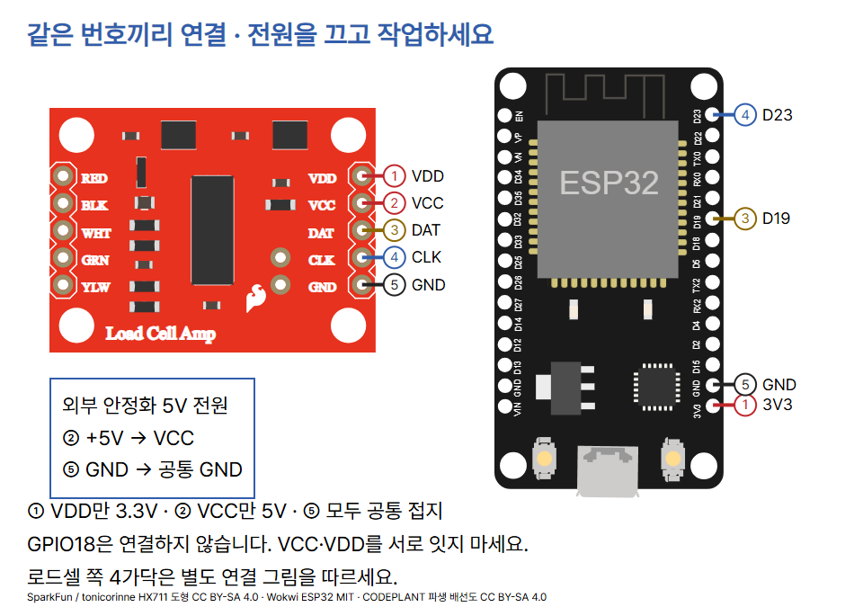
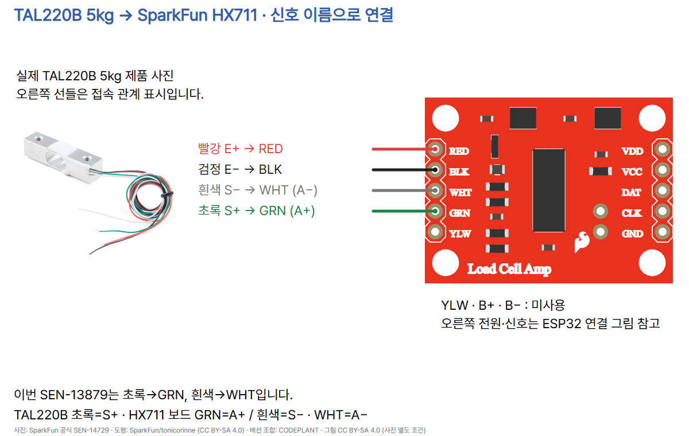

# 18 · 로드셀의 작은 변화를 무게 숫자로 읽기

ESP32 DevKit v1 (ESP-WROOM-32 30핀), SparkFun HX711 SEN-13879, TAL220B 5kg SEN-14729 전용입니다. 로드셀이 힘을 받으면 스트레인 게이지의 저항과 브리지 출력 전압이 바뀝니다. HX711이 이를 증폭하고 24비트 디지털 값으로 변환합니다. 원시값은 질량 단위가 없으며, 빈 판 영점과 기준 추 보정을 거쳐 g로 환산합니다. 실제 하드웨어 실행과 측정 정확도는 시험하지 않았습니다.

## 준비물과 고정

위 세 부품, USB 데이터 케이블, Thonny, MicroPython 펌웨어가 설치된 ESP32, 외부 안정화 DC 5V 전원, 점퍼선·절연재·납땜된 헤더, 받침·받침판·간격재·실제 치수에 맞는 나사, g 질량이 확인된 기준 추가 필요합니다. HX711의 VCC/VDD를 분리할 수 없는 다른 모듈에 이 배선을 적용하지 마세요.

로드셀의 한쪽 끝을 아래 받침에, 반대 끝을 위 받침판에 고정하고 중앙부가 휠 공간을 간격재로 확보하세요. 양끝을 같은 바닥에 고정하거나 바닥에 눕힌 채 눌러 측정하지 않습니다. 하중 방향 표시와 제조사 치수도를 확인하세요. 판·나사·추를 포함한 총 하중은 5kg 이내입니다. 물체를 떨어뜨리거나 비틀지 마세요. 코드의 5000g 입력 제한은 물리적 과부하를 방지하지 않습니다.

## 두 전원을 끄고 연결

| 출발 | SEN-13879 | 역할 |
|---|---|---|
| ESP32 3V3 | VDD | 디지털 논리 전원 3.3V |
| 외부 안정화 +5V | VCC | 아날로그·로드셀 여자 전원 |
| ESP32 D19 | DAT | HX711 DOUT → SPI MISO |
| ESP32 D23 | CLK (도형 SCK) | SPI MOSI → HX711 PD_SCK |
| ESP32 GND·외부 전원 GND | GND | 공통 접지 |



ESP32는 USB로 공급합니다. 외부 +5V는 HX711 VCC에만 연결하고 ESP32 VIN·3V3에는 넣지 마세요. VDD와 VCC를 서로 연결하지 않습니다. VDD를 5V로 공급하면 데이터의 논리 전압이 ESP32에 위험합니다. HX711의 CLK는 I²C SCL이 아니며 I²C 주소도 없습니다.

이 드라이버는 SPI의 **MOSI 데이터 비트**를 HX711 읽기 펄스로 사용합니다. SPI2의 실제 SCK인 GPIO18은 코드 초기화에만 필요하며 외부에 아무 선도 연결하지 않습니다. MOSI23이 HX711 CLK, MISO19가 DAT입니다. 다른 SPI 장치와 공유하지 마세요. 1MHz는 SPI 비트 속도이며 질량 측정 횟수나 HX711 변환 속도가 아닙니다. HX711 PD_SCK가 60µs 이상 HIGH면 절전으로 들어가므로 임의의 print/sleep을 펄스 생성 중간에 넣지 않습니다. 실제 펄스 폭은 로직 분석기로 확인하지 않았습니다.

| TAL220B 선 | HX711 인쇄 | 신호 |
|---|---|---|
| 빨강 | RED | E+ |
| 검정 | BLK | E− |
| 초록 | GRN | S+ / A+ |
| 흰색 | WHT | S− / A− |
| 연결 없음 | YLW·B+·B− | 미사용 |



SparkFun 일반 설명의 White=A+ / Green=A− 표기와 SEN-13879 PCB·공식 Fritzing의 GRN=A+ / WHT=A−가 다릅니다. 이 예제는 TAL220B 데이터시트의 초록=S+, 흰색=S−와 해당 PCB JP4·공식 커넥터를 함께 대조한 연결을 사용합니다. 다른 제품의 색상은 별도 확인하세요. 사진 옆 선은 접속 관계를 표시하며 실제 케이블 끝의 위치를 측정한 그림은 아닙니다.

## Thonny에서 준비하고 실행

1. Thonny는 Python 코드를 편집하고 보드에서 실행하는 프로그램입니다. ESP32용 MicroPython 펌웨어를 설치한 뒤 실행 환경에서 MicroPython(ESP32)와 실제 연결된 포트를 선택합니다. [공식 ESP32 시작 안내](https://docs.micropython.org/en/latest/esp32/tutorial/intro.html)와 [Thonny](https://thonny.org/)를 참고하세요. 이 문서에 실제 실행 화면 캡처는 포함하지 않았습니다.
2. [고정 버전 hx711_spi.py](https://raw.githubusercontent.com/robert-hh/hx711/a5502c9400b72cc79c4343eb082a153f1ae2f3a5/hx711_spi.py)를 열어 원본 전체를 저장합니다. Thonny의 파일 저장에서 MicroPython 장치를 고르고 **hx711_spi.py**로 저장하세요. MIT 고지를 유지합니다. GPIO/PIO 버전으로 임의 대체하지 마세요.
3. 아래 전체 코드를 보드의 **main.py**로 저장하고 실행합니다. ImportError이면 드라이버 파일명과 저장 위치부터 확인하세요.
4. 빈 판이 안정되면 Shell의 `Press Enter to tare:`에서 Enter를 누릅니다. `ZERO_OK raw=` 뒤의 숫자는 10회 평균 영점입니다.
5. `Known mass in grams:`에 직접 가진 기준 추의 확인된 g 질량을 입력합니다. 예를 들어 실제 100g 추가 있을 때만 100을 입력합니다. 0·음수·NaN·무한대·5000 초과는 거부됩니다. 받침판을 포함한 총 하중 제한은 별도로 지켜야 합니다.
6. 바로 그 추를 같은 위치에 올려 안정된 뒤 `Press Enter to calibrate:`에서 Enter를 누릅니다. `CAL_OK counts_per_g=` 이후에 `raw=`와 `mass_g=`가 반복됩니다. 코드가 추의 질량이나 안정 여부를 자동 확인하지는 않습니다.
7. 추를 내려 영점으로 돌아오는지, 같은 추를 다시 올려 반복되는지 확인하고 다른 확인된 질량의 추도 비교합니다. 추 보정과 확인은 실제로 수행해 기록해야 합니다. 설치·온도·받침판이 바뀌거나 리셋하면 영점과 보정을 다시 진행하세요.

## 복사해 실행할 전체 코드

```python
from machine import Pin, SPI
from time import sleep_ms
from math import isfinite
from hx711_spi import HX711

SAMPLES = 10


def average_raw(sensor):
    total = 0
    for _ in range(SAMPLES):
        value = sensor.read()
        if value <= -8388608 or value >= 8388607:
            raise ValueError("ADC_SATURATED")
        total += value
    return total / SAMPLES


def calibrate(zero_raw, loaded_raw, known_g):
    if not isfinite(known_g) or not 0 < known_g <= 5000:
        raise ValueError("KNOWN_MASS_G_INVALID")
    counts_per_g = (loaded_raw - zero_raw) / known_g
    if not isfinite(counts_per_g) or abs(counts_per_g) < 1:
        raise ValueError("CALIBRATION_TOO_SMALL")
    return counts_per_g


def run():
    # HX711 SCK is driven by SPI MOSI; GPIO18 stays disconnected.
    clock = Pin(23, Pin.OUT, value=0)
    data = Pin(19, Pin.IN)
    spi = SPI(2, baudrate=1000000, polarity=0, phase=0,
              sck=Pin(18), mosi=clock, miso=data)
    try:
        sensor = HX711(clock, data, spi, gain=128)
        print("Remove load; wait until the empty platform is stable.")
        input("Press Enter to tare: ")
        zero_raw = average_raw(sensor)
        print("ZERO_OK raw=", zero_raw)
        known_g = float(input("Known mass in grams: "))
        if not isfinite(known_g) or not 0 < known_g <= 5000:
            raise ValueError("KNOWN_MASS_G_INVALID")
        print("Place that known mass; wait until stable.")
        input("Press Enter to calibrate: ")
        loaded_raw = average_raw(sensor)
        counts_per_g = calibrate(zero_raw, loaded_raw, known_g)
        print("CAL_OK counts_per_g=", counts_per_g)
        while True:
            raw = average_raw(sensor)
            mass_g = (raw - zero_raw) / counts_per_g
            print("raw=", raw, "mass_g=", round(mass_g, 1))
            sleep_ms(300)
    finally:
        spi.deinit()
        clock.init(Pin.OUT, value=0)


if __name__ == "__main__":
    try:
        run()
    except (OSError, ValueError) as error:
        print("STOP:", error)
        print("Power off both supplies before checking wiring/load.")
```

## 코드의 각 줄이 하는 일

| 코드 | 역할 |
|---|---|
| machine / time / math / hx711_spi import | GPIO·SPI, 대기, 유한수 판정, 외부 드라이버를 불러옵니다. |
| SAMPLES = 10 | 한 결과를 만들 때 읽을 원시값 수입니다. |
| average_raw / total / for | 원시값 10개를 누적합니다. 읽기 중 드라이버가 무응답이면 OSError를 전달합니다. |
| value 경계 비교 / raise | 24비트 부호 있는 ADC 양 끝값을 포화 의심으로 중단합니다. 모든 이상 배선을 검출하는 기능은 아닙니다. |
| return total / SAMPLES | 평균 원시값을 반환합니다. 평균은 정밀도 보증이 아닙니다. |
| calibrate / isfinite / 질량 범위 | 기준 질량이 유한하고 양수인지, 코드 한도 5000g 이하인지 확인합니다. |
| counts_per_g 계산 / abs < 1 | 추를 올린 값과 영점의 차이를 g 질량으로 나눕니다. 1count/g 미만은 이 예제의 보정 거부 기준이며 제조사 정확도 기준이 아닙니다. |
| return counts_per_g | 설치·신호 방향에 따른 음수 계수도 유지합니다. |
| Pin23 / Pin19 / SPI2 | MOSI23→HX711 CLK, MISO19←DAT. GPIO18은 배선하지 않습니다. 1MHz·mode0을 사용합니다. |
| HX711(... gain=128) | 채널 A·128배 증폭을 선택합니다. 드라이버 초기화에서도 읽기가 일어납니다. |
| print / input / float | 사용자가 빈 판과 기준 추를 안정시킨 뒤 Enter로 진행하고 확인된 g 질량을 입력합니다. |
| zero_raw / loaded_raw | 각각 빈 판·기준 추의 10회 평균 원시값입니다. |
| mass_g 계산 / round | 영점을 뺀 원시값을 보정계수로 나눠 g로 바꾸고 소수 한 자리로 표시합니다. |
| sleep_ms(300) | 읽기와 출력이 끝난 뒤 300ms 쉽니다. 실제 출력 간격에는 10번의 변환 대기가 더해집니다. |
| finally / spi.deinit / clock.init | 정상 종료·오류·Ctrl+C에도 SPI를 해제하고 HX711 클록을 LOW로 둡니다. |
| __main__ / except | 직접 실행하면 run을 호출합니다. 통신·입력 오류는 STOP을 출력하고 종료합니다. |

## 관찰과 오류

0 근처 복귀·반복 측정·다른 기준 추를 비교하고 raw와 mass_g를 함께 적으세요. 원시값은 부호 있는 24비트 수이며 24비트가 24비트의 유효 정밀도를 보장하지는 않습니다. 소수 한 자리 출력도 0.1g 정확도라는 뜻이 아닙니다. 영점 드리프트·노이즈·설치·온도·하중 위치에 따라 달라질 수 있습니다.

`Sensor does not respond`는 드라이버가 약 1000회의 1ms 대기에서 DAT LOW를 보지 못했다는 뜻입니다. 실제 경과 시간은 실행 오버헤드가 더해집니다. `ADC_SATURATED`는 원시 ADC 끝값, `CALIBRATION_TOO_SMALL`은 보정 변화량 부족, `KNOWN_MASS_G_INVALID`는 입력 범위 오류입니다. 오류를 정상 질량으로 바꾸어 표시하지 않습니다. 두 전원을 끄고 핀과 공통 접지·하중을 점검하세요. 보정계수는 전압 오류·기계적 과부하를 해결하지 못합니다. Ctrl+C로 중단한 뒤 다시 실행하면 모든 보정이 초기화됩니다.

## 검증 범위

실제 하드웨어, 설치 고정, 펌웨어와 드라이버의 조합, SPI 펄스 폭, 실물 보정·정확도는 미시험입니다. verify.py로 합성 원시값의 평균·포화·시간 초과 전파·양/음 보정과 입력 경계를 점검하고, 배선 전원 분리 및 README 코드 일치를 확인합니다. check.mjs로 PNG 10장(1080×1350), 모바일·배경·잘림·하단 여백, 캡션 복사·저장·이미지 붙여넣기와 전체 ZIP 순서를 확인했습니다. 합성 장치로 전체 영점→보정→50g 산식 표시 및 오류·Ctrl+C의 SPI 정리를 확인했습니다. 여기의 50g은 합성 검증 입력이며 실측값이 아닙니다. 내부 episode.validation에도 검증 범위를 기록합니다. 이 교육용 도형의 HX711은 Wokwi 실행 모델이 아닙니다.

## 출처와 사용 조건

- [SparkFun 설치·전원 안내](https://learn.sparkfun.com/tutorials/load-cell-amplifier-hx711-breakout-hookup-guide/all/): 3.3V 마이크로컨트롤러용 VCC 5V·VDD 3.3V 분리와 로드셀 고정 원리.
- [TAL220B 데이터시트](https://cdn.sparkfun.com/assets/e/5/f/5/6/TAL220B.pdf), [HX711 데이터시트](https://cdn.sparkfun.com/assets/b/f/5/a/e/hx711F_EN.pdf).
- [SEN-13879 공식 PCB](https://github.com/sparkfun/HX711-Load-Cell-Amplifier/blob/38228f8f6602e1349d7130c7a382a436ceaca26e/hardware/SparkFun_HX711_Load_Cell.brd), [SparkFun Fritzing 도형](https://github.com/sparkfun/Fritzing_Parts/blob/71b17bbea66f92123f0a39dcf6f8c9ae566e31d1/products/13879_sfe_load_cell_amplifier-hx711.fzpz). SparkFun/tonicorinne CC BY-SA 4.0. 배치·번호·한국어 설명을 추가한 파생 배선 PNG·HTML과 3·5번 카드의 도형·배선 기여분도 [CC BY-SA 4.0](https://creativecommons.org/licenses/by-sa/4.0/)입니다. 사진·상표의 별도 권리는 유지됩니다.
- [robert-hh/hx711 드라이버·MIT](https://github.com/robert-hh/hx711/tree/a5502c9400b72cc79c4343eb082a153f1ae2f3a5). 고정 버전 hx711_spi.py의 API·대기·부호 변환과 펄스 패턴을 소스에서 확인했습니다. 라이브러리 전체를 이 예제 저장소에 복제하지 않습니다.
- [SunFounder ESP32 사진](https://docs.sunfounder.com/projects/esp32-starter-kit/en/latest/components/component_esp32.html), [SparkFun HX711 제품·사진](https://www.sparkfun.com/sparkfun-load-cell-amplifier-hx711.html), [TAL220B 제품·사진](https://www.sparkfun.com/load-cell-5kg-straight-bar-tal220b.html). 지정 실습의 기존 원본 사진을 재사용하고 표시 크기만 조절했습니다. 별도 자유 이용 라이선스는 확인하지 못했으며 원권리자 사용 조건을 따릅니다.
- [Wokwi ESP32 공식 핀·도형](https://github.com/wokwi/wokwi-elements/blob/main/src/esp32-devkit-v1-element.ts), MIT. 연결 번호는 공식 핀 좌표를 배율 변환한 위치에 표시합니다.
- [CODEPLANT YouTube](https://www.youtube.com/@codeplant2024)는 이번 조회에서 본문을 가져오지 못해 영상 시청·실습 근거로 사용하지 않았습니다.
