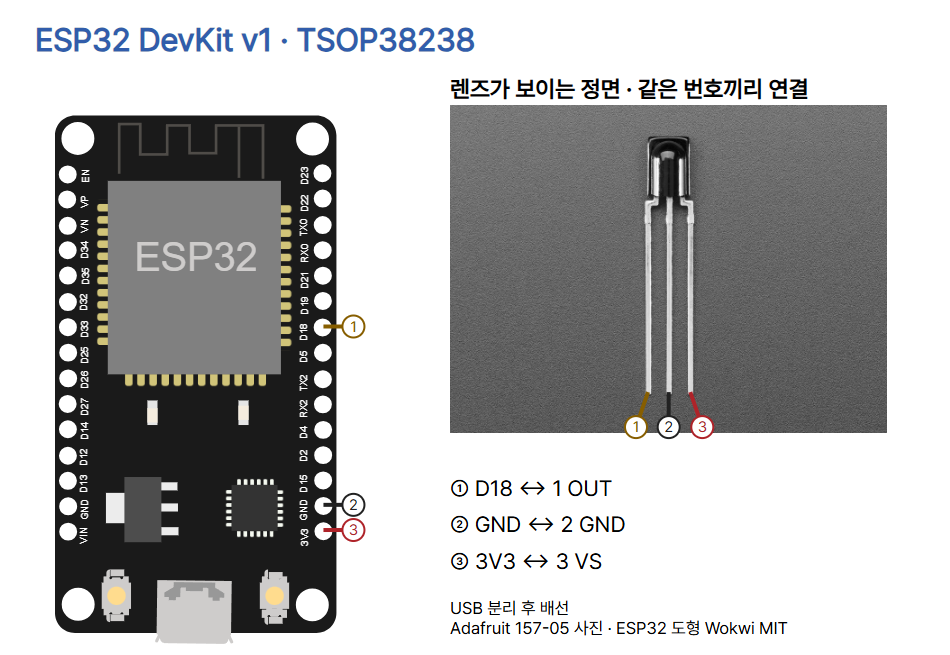

# 19 · 리모컨 신호를 읽는 적외선 수신기

ESP32 DevKit v1(ESP-WROOM-32 30핀)과 Vishay TSOP38238(Adafruit #157)으로 NEC 8비트 주소 리모컨의 주소와 명령을 읽습니다. 38 kHz는 리모컨 적외선의 반송 주파수입니다. 수신기가 이 빠른 빛 묶음을 LOW 펄스로 바꾸고, ESP32는 펄스 사이 HIGH 구간의 길이로 0과 1을 구분합니다. NEC 데이터 구간의 명목 HIGH 시간은 약 0.56 ms 또는 1.69 ms입니다. 지정 드라이버는 약 1.12 ms를 기준으로 판단하고 주소와 명령의 반전값을 검사합니다.

## 준비물과 연결

ESP32 DevKit v1, TSOP38238, NEC 8비트 주소 리모컨과 해당 배터리, 브레드보드, 점퍼선, USB 데이터 케이블, ESP32용 MicroPython과 Thonny가 필요합니다. 리모컨의 프로토콜은 제품 설명에서 확인하세요. 38 kHz가 같아도 신호 규칙은 다를 수 있습니다.

USB를 뺀 상태에서 둥근 렌즈가 보이는 정면 기준으로 연결하세요.

| TSOP38238 | ESP32 | 역할 |
|---|---|---|
| 1 OUT (왼쪽) | D18 (GPIO18) | 수신기 디지털 출력 → ESP32 입력 |
| 2 GND (가운데) | GND (3V3 바로 위) | 공통 접지 |
| 3 VS (오른쪽) | 3V3 | 3.3 V 전원 |



ESP32 입력에 5 V를 넣지 마세요. 다른 수신기와 기판형 모듈은 제조사 핀 순서를 확인합니다. 전원 리플이나 스파이크가 강한 환경은 Vishay 데이터시트의 전원 필터 회로를 참고하세요.

## Thonny에서 실행

1. USB 데이터 케이블로 보드를 연결하세요. Thonny 오른쪽 아래 인터프리터 메뉴에서 MicroPython (ESP32)과 연결된 포트를 고릅니다. 처음 설정하는 보드는 [ESP32 MicroPython 시작 안내](https://docs.micropython.org/en/latest/esp32/tutorial/intro.html)를 따르세요. 메뉴 위치나 표기는 Thonny 버전에 따라 달라질 수 있습니다.
2. [고정 버전 드라이버](https://github.com/peterhinch/micropython_ir/tree/014231c2cb0358694bc9c713e87ce28655a24462/ir_rx)의 `__init__.py`와 `nec.py`를 다운로드하세요. 보드에 `/lib/ir_rx/` 폴더를 만들고 두 파일을 원래 이름으로 저장하세요. 저작권·MIT 고지를 유지하세요.
3. 아래 코드를 Thonny 편집기에 붙여 넣고 MicroPython 장치에 `main.py`로 저장하세요. 실행 버튼을 누르거나 F5로 시작합니다. 출력은 창 아래 Shell에서 봅니다.
4. READY가 나오면 렌즈 쪽을 향해 두 버튼을 각각 짧게 눌러 ADDR·CMD를 비교하세요. 길게 눌러 REPEAT 또는 같은 명령이 다시 표시되는지 기록하세요. 실제 숫자는 리모컨에 따라 달라집니다. Ctrl+C로 중단합니다.

## 전체 코드

```python
from machine import Pin
from time import sleep_ms
from ir_rx.nec import NEC_8


def on_receive(data, addr, ctrl):
    if data < 0:
        print("REPEAT")
    else:
        print("ADDR={:02X} CMD={:02X}".format(addr, data))


def on_error(code):
    print("RX_ERROR", code)


receiver = NEC_8(Pin(18, Pin.IN), on_receive)
receiver.error_function(on_error)
try:
    print("READY")
    while True:
        sleep_ms(100)
finally:
    receiver.close()
```

## 코드 읽기

| 코드 | 동작 |
|---|---|
| `Pin`, `sleep_ms`, `NEC_8` 가져오기 | GPIO 입력, 대기, NEC 8비트 주소 해석에 사용합니다. |
| `on_receive(data, addr, ctrl)` | 드라이버가 해석한 명령, 주소, 제어 값을 받습니다. NEC의 ctrl은 0이며 이 예제에서는 사용하지 않습니다. |
| `data < 0` | 드라이버의 반복 코드에 REPEAT를 표시합니다. |
| `{:02X}` | 정상 주소와 명령을 두 자리 대문자 16진수로 표시합니다. |
| `on_error` 및 `error_function` | 해석 오류를 숫자로 출력합니다. 오류 코드는 고정 버전 드라이버 문서를 확인하세요. |
| `NEC_8(Pin(18, Pin.IN), on_receive)` | GPIO18의 신호 변화를 기록하고 해석이 끝나면 콜백을 호출합니다. |
| `READY` 및 `sleep_ms(100)` | 준비 상태를 표시한 뒤 루프를 유지합니다. 펄스 시간은 드라이버가 별도로 기록합니다. |
| `finally` 및 `receiver.close()` | 실행을 멈출 때 핀과 타이머 인터럽트를 정리합니다. |

READY가 없다면 포트와 저장 경로를 먼저 확인하세요. `ImportError`가 나오면 두 드라이버 파일의 이름과 `/lib/ir_rx/` 위치를 확인합니다. READY 이후 반응이 없거나 RX_ERROR가 반복되면 USB를 뺀 뒤 3V3·GND·D18, 렌즈 방향과 리모컨 배터리를 확인하세요. 강한 빛을 피하고 NEC 8비트 주소 리모컨인지 확인합니다. Shell에 뜨는 값은 해석된 리모컨 코드입니다.

## 출처와 검증 범위

- [Vishay TSOP38238 데이터시트](https://www.vishay.com/docs/82491/tsop382.pdf), Rev. 2.1. 핀 배열, 3.3 V 공급 가능 범위, 38 kHz와 active LOW 출력의 근거입니다.
- [Peter Hinch 드라이버와 MIT 라이선스](https://github.com/peterhinch/micropython_ir/tree/014231c2cb0358694bc9c713e87ce28655a24462). 위 버전의 `ir_rx/nec.py`와 수신기 설명을 확인했습니다.
- [Adafruit 제품 157](https://www.adafruit.com/product/157)의 [표지 원본](https://cdn-shop.adafruit.com/970x728/157-02.jpg)과 [정면 원본](https://cdn-shop.adafruit.com/970x728/157-05.jpg), [SunFounder ESP32 사진](https://docs.sunfounder.com/projects/esp32-starter-kit/en/latest/components/component_esp32.html). 사진에는 원권리자 조건이 적용되며 별도 자유 이용 라이선스는 확인되지 않았습니다. 정면 사진에 배선 번호를 추가했습니다.
- [Wokwi ESP32 도형 및 핀 좌표](https://github.com/wokwi/wokwi-elements/blob/main/src/esp32-devkit-v1-element.ts), MIT. 배선 HTML과 JSON은 물리 연결을 설명합니다.
- [CODEPLANT 채널](https://www.youtube.com/@codeplant2024)은 이번 조회에서 본문을 가져오지 못했습니다.

실제 하드웨어와 시뮬레이터는 미시험입니다. 실제 버튼 코드·거리·펄스 측정 결과나 이번 실행 화면 캡처는 포함하지 않습니다.


verify.py로 정상·반복·오류 합성 출력, 3개 연결과 6개 핀 좌표, README의 전체 코드 일치를 확인했습니다. check.mjs로 1080×1350 PNG 9장, 모바일·배경·하단 여백, 편집기 저장·캡션 복사·이미지 삽입을 확인했습니다.
