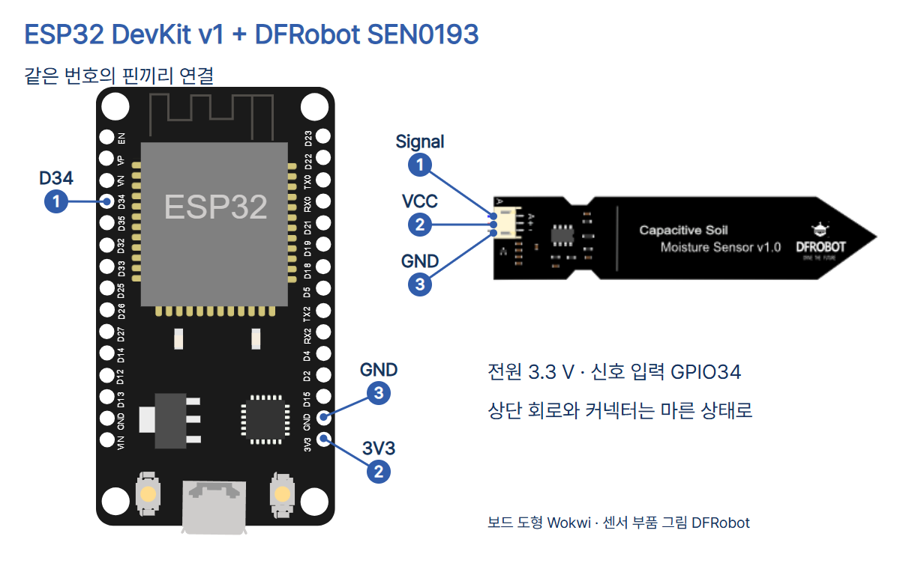
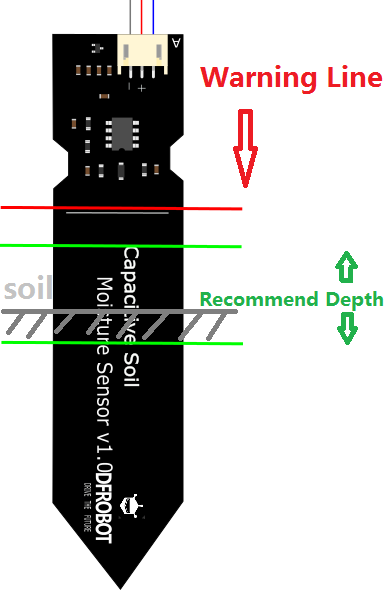

# 20 · 흙의 변화를 읽는 수분 센서

ESP32 DevKit v1 (ESP-WROOM-32 30핀) · MicroPython · DFRobot SEN0193

## 준비물과 연결

ESP32, SEN0193, 제품에 맞는 PH2.0-3P 케이블, 점퍼선, USB 데이터 케이블, 같은 종류의 흙과 물을 준비합니다. 제조사 전원 사양은 3.3~5.5 V, 아날로그 출력 사양은 0~3.0 V입니다. 이 실습은 ESP32의 3V3로 센서에 전원을 공급합니다.

USB를 빼고 연결하세요. 핀 이름을 먼저 확인하세요.

| SEN0193 | ESP32 | 역할 |
|---|---|---|
| 노랑 Signal | D34 (GPIO34, ADC1) | 전압 입력 |
| 빨강 VCC | 3V3 | 3.3 V 전원 |
| 검정 GND | 3V3 위의 GND | 공통 접지 |



ESP32 입력 핀에 5 V를 연결하지 마세요. 회로도에서 같은 번호끼리 연결합니다. 보드는 Wokwi의 공식 DevKit v1 도형을 사용했고 센서는 제조사 배선 그림에서 잘라 배치했습니다. diagram.json은 핀과 연결 기록입니다.



빨간 경계선 아래 프로브만 흙에 넣으세요. 센서의 상단 회로, 커넥터와 ESP32는 젖지 않게 두세요.

## Thonny에서 실행

ESP32용 MicroPython이 설치된 보드를 USB로 연결하세요. Thonny의 실행 → 인터프리터 선택에서 MicroPython (ESP32)와 보드의 포트를 고릅니다. main.py를 열어 F5로 실행하고 Shell의 raw 값을 확인하세요. 실행을 멈출 때는 정지 버튼을 누르거나 Shell에서 Ctrl+C를 누르세요.

```python
from machine import ADC, Pin
from time import sleep_ms

sensor = ADC(Pin(34), atten=ADC.ATTN_11DB)

while True:
    raw = sensor.read_u16()
    print('raw:', raw)
    sleep_ms(500)
```

- 첫 줄은 전압을 숫자로 읽는 ADC와 핀을 지정하는 Pin을 가져옵니다. 두 번째 줄은 밀리초 단위로 기다리는 함수를 가져옵니다.
- ADC 설정에서 GPIO34를 선택합니다. ATTN_11DB를 적용하면 더 높은 입력 전압까지 읽을 수 있습니다.
- while True는 읽기, 출력, 대기를 반복합니다. read_u16()은 입력을 0~65535 범위로 환산해 반환합니다. print()는 Shell에 원시값을 표시하고 sleep_ms(500)는 다음 읽기까지 0.5초 기다립니다.

## 관찰

흙에 물을 섞으면 센서 주변의 정전용량이 달라집니다. SEN0193은 그 변화를 출력 전압으로 바꾸고 ESP32의 ADC가 GPIO34 전압을 숫자로 읽습니다.

같은 흙을 두 용기에 나눠 한쪽에만 물을 섞으세요. 센서를 같은 깊이로 넣고 다짐 정도도 비슷하게 맞춥니다. 각 조건에서 raw 값을 여러 번 적고 값의 방향과 차이를 비교하세요. raw는 수분 함량을 표시하는 퍼센트가 아닙니다. 감쇠를 적용해도 ESP32 ADC의 응답은 입력 전압 전 범위에서 선형이 아니고 높은 쪽에서 포화될 수 있습니다. 비슷한 최대값만 이어지면 ADC 포화 여부와 배선을 확인하세요.

## 출처와 검증 범위

- [DFRobot SEN0193](https://wiki.dfrobot.com/sen0193)의 제품 사양, 공식 제품 사진, 배선·삽입 그림을 참고했습니다.
- [MicroPython ESP32 ADC](https://docs.micropython.org/en/latest/esp32/quickref.html#adc-analog-to-digital-conversion)와 [Wokwi ESP32 DevKit v1 핀 좌표](https://raw.githubusercontent.com/wokwi/wokwi-elements/main/src/esp32-devkit-v1-element.ts)를 참고했습니다.
- ESP32 제품 사진 출처는 [SunFounder](https://docs.sunfounder.com/projects/esp32-starter-kit/en/latest/components/component_esp32.html)입니다. 제품 사진·삽입 그림: DFRobot 공식 자료. ESP32 사진: SunFounder 공식 자료. 사진과 제조사 그림의 별도 공개 라이선스는 확인되지 않았으며 출처를 유지합니다. 보드 배선 도형: Wokwi(MIT).
- 실제 ESP32·센서로 실행하거나 전압과 토양 수분을 측정하는 시험은 진행하지 않았습니다.

