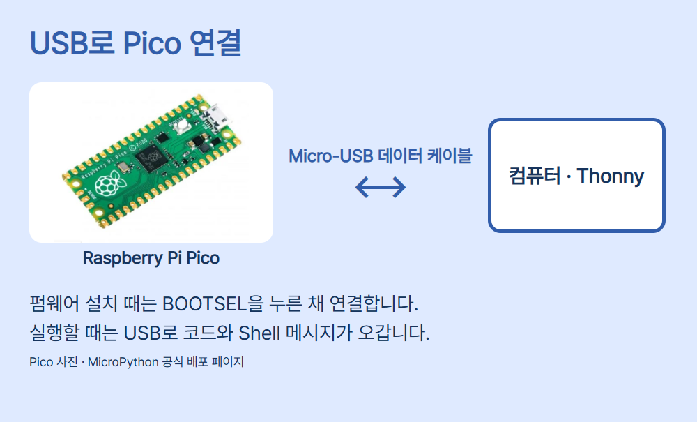
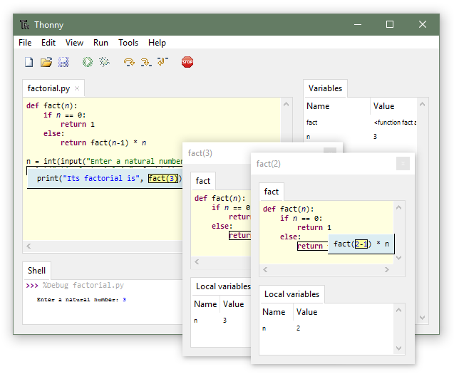

# 01 · Raspberry Pi Pico에 MicroPython 설치하고 첫 코드 실행하기

Raspberry Pi Pico(RP2040), Micro-USB 데이터 케이블, Windows 컴퓨터를 준비합니다. Pico W와 Pico 2 계열에는 각 모델의 펌웨어가 필요합니다. 내장 LED는 RP2040의 GP25에 연결되어 있으므로 이번 실습은 USB 외에 다른 배선이 필요 없습니다.

## MicroPython 설치

1. [Pico 전용 MicroPython 배포 페이지](https://micropython.org/download/RPI_PICO/)에서 안정판 UF2를 받습니다. 2026-11-13 확인 기준 v1.29.0입니다.
2. Pico에서 USB를 뺍니다. BOOTSEL을 누른 채 Micro-USB 데이터 케이블로 컴퓨터에 연결합니다. Windows에 RPI-RP2 드라이브가 보이면 버튼을 놓습니다.
3. 받은 UF2를 RPI-RP2에 복사합니다. 복사 후 Pico가 재시작하며 드라이브가 사라집니다.



## Thonny 설치와 실행

1. [Thonny 공식 사이트](https://thonny.org/)에서 Windows 버전을 받습니다. 2026-11-13 기준 5.0.1이며 PC의 CPU에 맞춰 x64 또는 Arm64를 고릅니다.
2. Thonny의 Run → Select interpreter에서 MicroPython (Raspberry Pi Pico)를 선택합니다. Port에는 Pico를 연결할 때 새로 나타난 COM 포트를 선택하세요. 버전과 표시 언어에 따라 메뉴 문구가 조금 다를 수 있습니다.
3. 아래 Thonny 공식 참고 화면에서 위쪽 코드 편집기와 아래쪽 Shell의 위치를 확인하세요. Pico 연결 직후 Shell의 모델 표시와 첫 명령 예시는 [Raspberry Pi 공식 SDK 안내 4.1절 그림 6](https://datasheets.raspberrypi.com/pico/sdk/pico_python_sdk.pdf)을 참고하세요.
4. main.py를 열고 F5를 누르세요. 저장 위치를 묻는 경우 첫 시험은 컴퓨터에 저장해도 됩니다. 전원을 연결할 때마다 자동 실행하려면 Raspberry Pi Pico에 main.py 이름으로 저장하세요.



```python
from machine import Pin
from time import sleep_ms

led = Pin("LED", Pin.OUT, value=0)
print("Pico ready")

for _ in range(3):
    led.on()
    sleep_ms(500)
    led.off()
    sleep_ms(500)

print("Done")
```

- `from machine import Pin`은 핀을 다루는 도구를 가져옵니다.
- `from time import sleep_ms`는 밀리초 단위로 기다리는 함수를 가져옵니다.
- `Pin("LED", Pin.OUT, value=0)`은 내장 LED를 출력으로 설정하고 끈 상태로 시작합니다.
- 첫 `print`는 Shell에 `Pico ready`를 보냅니다.
- `for _ in range(3)`은 들여쓴 줄을 세 번 실행합니다.
- `led.on()`과 `led.off()`는 내장 LED를 켜고 끕니다. 두 `sleep_ms(500)`은 각 상태를 0.5초씩 유지합니다.
- 마지막 `print`는 세 번의 반복이 끝났을 때 Shell에 `Done`을 보냅니다.

정상 동작에서는 LED가 세 번 깜박이고 Shell에 두 메시지가 순서대로 표시됩니다. Shell에 `machine`을 찾을 수 없다는 메시지가 나오면 Thonny가 컴퓨터용 Python을 선택하고 있는지 먼저 확인하세요. 드라이브와 COM 포트가 모두 보이지 않으면 데이터 전송을 지원하는 케이블로 바꾸고 USB 허브 대신 컴퓨터 포트에 연결해 보세요.

## 출처와 검증 범위

- [Raspberry Pi MicroPython 설치](https://www.raspberrypi.com/documentation/microcontrollers/micropython.html) · [Pico 내장 LED와 Micro-USB](https://magazine.raspberrypi.com/articles/programming-raspberry-pi-pico-with-python-and-micropython) · [공식 SDK의 Thonny 화면](https://datasheets.raspberrypi.com/pico/sdk/pico_python_sdk.pdf).
- Pico 사진: MicroPython 공식 Pico 배포 페이지. Thonny 화면: Thonny 공식 사이트. 출처를 표시하며 별도의 사진·화면 재배포 라이선스는 확인되지 않았습니다.
- 실제 Pico 펌웨어 설치·USB 연결·LED 점등은 시험하지 않았습니다.
