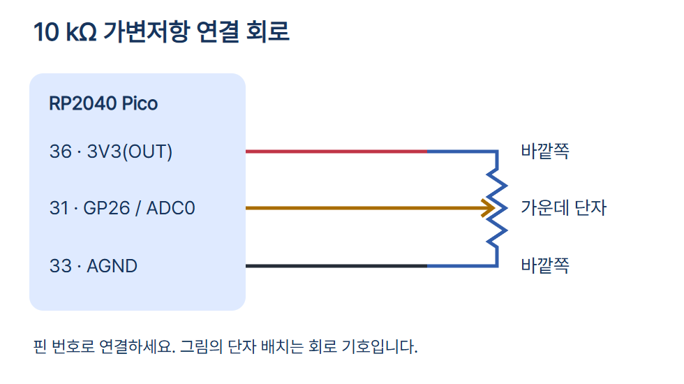
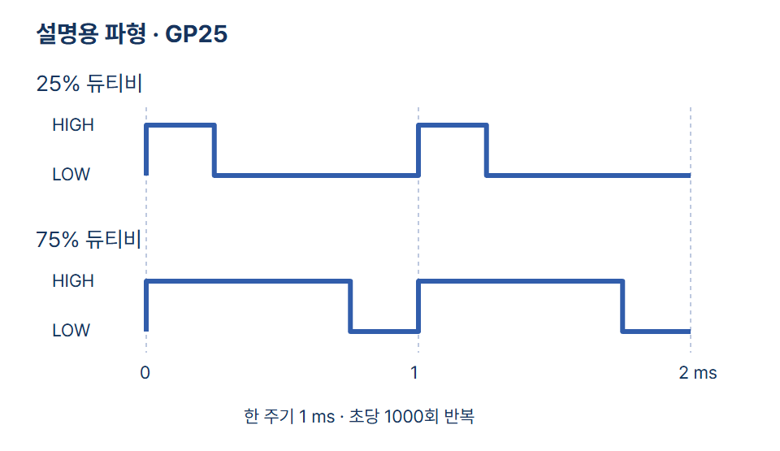

# 02 · Pico의 입력과 출력

Raspberry Pi Pico(RP2040), 10 kΩ 선형 가변저항(Adafruit #562), 브레드보드와 점퍼선, Micro-USB 데이터 케이블, Thonny를 준비하세요. Pico에 핀 헤더가 없다면 배선 전에 호환 헤더를 장착합니다. Pico용 MicroPython v1.29.0 기준입니다.

## 연결

USB를 빼고 가변저항 다리를 서로 다른 브레드보드 줄에 꽂습니다. Pico의 3V3(OUT) 36번을 바깥쪽 한 단자에, AGND 33번을 다른 바깥 단자에, GP26/ADC0 31번을 가운데 단자에 연결합니다. USB로만 전원을 공급하고 ADC/GPIO에 5 V를 연결하지 마세요. 바깥 두 단자를 서로 바꾸면 손잡이에 따른 변화 방향이 반대가 됩니다. [제조사 핀 배치도](https://datasheets.raspberrypi.com/pico/Pico-R3-A4-Pinout.pdf)에서 실제 보드 위치를 확인하세요.



## 실행과 관찰

[기본 세팅](../001-basic-setup/)을 마친 뒤 배선을 확인하고 USB를 연결합니다. Thonny에서 Pico 인터프리터와 COM 포트를 선택해 main.py를 F5로 실행합니다. Shell의 숫자를 손잡이 양끝과 중간에서 기록하고 내장 LED 밝기와 비교하세요. Ctrl+C로 중단합니다.

```python
from machine import ADC, Pin, PWM
from time import sleep_ms

adc = ADC(Pin(26))
led = PWM(Pin("LED"), freq=1000, duty_u16=0)

try:
    while True:
        raw = adc.read_u16()
        led.duty_u16(raw)
        print(raw)
        sleep_ms(200)
finally:
    led.deinit()
    Pin("LED", Pin.OUT, value=0)
```

- import 두 줄은 ADC, GPIO, PWM, 대기 함수를 불러옵니다.
- ADC(Pin(26))은 GP26을 아날로그 입력으로 설정합니다. 표준 입력 범위는 0~3.3 V입니다.
- PWM은 내장 LED GP25에 초당 1000주기 출력을 설정하고, 처음에는 듀티비를 0으로 둡니다.
- while은 ADC 원시값 읽기, 듀티비 설정, Shell 출력, 200 ms 대기를 반복합니다.
- read_u16()의 반환 범위와 duty_u16()의 명령 범위는 둘 다 0~65535입니다. 12비트 ADC의 실제 분해능과 듀티 명령의 표현 범위는 별개입니다.
- finally는 실행이 중단되거나 오류가 나면 PWM을 해제하고 LED를 끕니다.



주기는 ON/OFF 한 묶음에 걸리는 시간입니다. 1 kHz에서는 한 주기가 1 ms입니다. 듀티비는 주기 중 HIGH의 비율입니다. 25%는 설명용 기준으로 0.25 ms, 75%는 0.75 ms 동안 HIGH입니다. 이 값은 실측 결과가 아닙니다.

## 출처와 검증

- [Raspberry Pi Pico](https://www.raspberrypi.com/documentation/microcontrollers/pico-series.html) · [MicroPython RP2 ADC·PWM](https://docs.micropython.org/en/v1.29.0/rp2/quickref.html) · [Adafruit #562](https://www.adafruit.com/product/562)
- 사진: MicroPython 공식 Pico 배포 페이지, Adafruit #562 공식 사진. 표시 크기를 조정했으며 별도 자유 이용 라이선스는 확인되지 않았습니다.
- 실제 Pico 배선·전압·LED 밝기와 시뮬레이터는 시험하지 않았습니다.

[편집 가능한 PWM 파형 원본](circuit_preview_control.html)