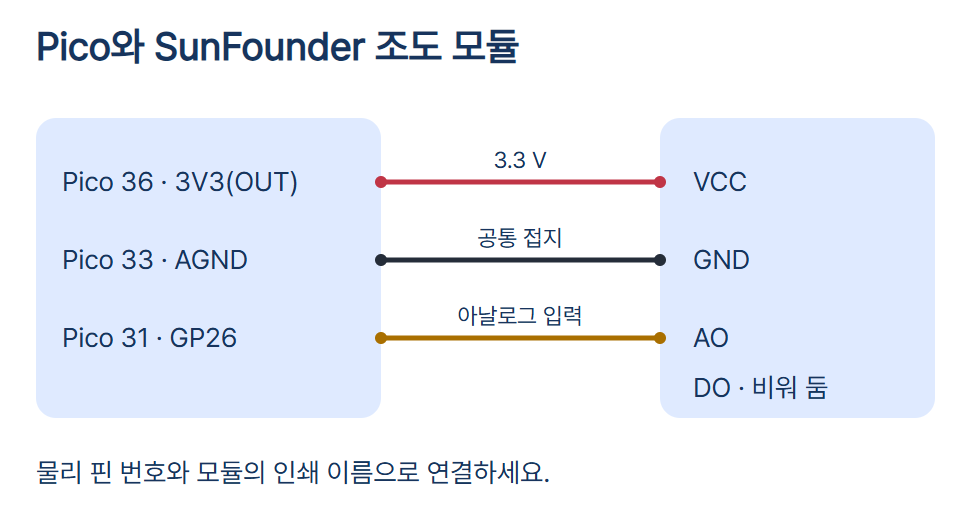

# 03 · 빛의 변화를 읽는 조도센서

Raspberry Pi Pico(RP2040), SunFounder Universal Maker Sensor Kit의 VCC/GND/AO/DO 4핀 Photoresistor Module, 점퍼선 3개, 브레드보드, Micro-USB 데이터 케이블, Thonny를 준비하세요. 보드에 헤더가 없다면 전원을 연결하기 전에 호환 헤더를 장착합니다.

## 연결

USB를 빼고 연결하세요. 제조사가 안내하는 모듈 전원 범위는 3.3~5 V입니다. 이 실습은 Pico의 3.3 V만 사용합니다. VBUS나 5 V를 Pico GPIO·ADC에 연결하지 마세요.

| Pico 물리 핀 | 조도 모듈 | 역할 |
|---|---|---|
| 36 · 3V3(OUT) | VCC | 3.3 V 전원 |
| 33 · AGND | GND | 공통 전압 기준 |
| 31 · GP26/ADC0 | AO | 아날로그 전압 |
| 미연결 | DO | 디지털 출력 |



그림에서 단자는 전기 연결을 나타냅니다. 실제 보드 위치는 [Raspberry Pi 공식 핀 배치도](https://datasheets.raspberrypi.com/pico/Pico-R3-A4-Pinout.pdf)를 보고 모듈은 인쇄된 이름으로 확인하세요. 모듈의 조절 나사는 DO 임계값을 바꾸므로 이 실습에서 돌릴 필요가 없습니다.

## 빛과 숫자의 관계

LDR은 빛이 강해지면 저항이 작아집니다. 모듈 내부의 분압 회로가 저항 변화를 AO 전압으로 바꿉니다. 이 SunFounder 모델은 밝을수록 AO 전압이 낮습니다. 다른 모듈을 쓰면 출력 방향이 다를 수 있습니다. Pico의 GP26/ADC0가 전압을 읽고 코드는 8회 평균을 USB로 Shell에 보냅니다.

RP2040 ADC는 12비트이고 Pico의 표준 ADC 입력 범위는 0~3.3 V입니다. MicroPython의 read_u16()은 값을 0~65535로 환산해 반환합니다. 그 숫자는 실제 16비트 측정 정밀도나 lux를 뜻하지 않습니다.

## 실행과 관찰

[기본 세팅](../001-basic-setup/)에서 Pico 펌웨어와 Thonny 설정을 마치세요. MicroPython v1.29.0을 기준으로, 배선을 확인한 뒤 USB를 연결합니다. Thonny에서 MicroPython (Raspberry Pi Pico), 연결된 COM 포트를 선택하고 main.py를 F5로 실행합니다. 아래는 Thonny 공식 참고 화면입니다. 실제 Pico 실행 결과에 해당하지 않습니다.


```python
from machine import ADC, Pin
from time import sleep_ms

adc = ADC(Pin(26))

def read_average():
    return sum(adc.read_u16() for _ in range(8)) // 8

try:
    while True:
        print("AO raw:", read_average())
        sleep_ms(300)
except KeyboardInterrupt:
    print("Stopped")
```

- 첫 두 줄은 ADC, 핀 지정과 밀리초 대기 함수를 불러옵니다.
- ADC(Pin(26))은 GP26을 아날로그 입력으로 설정합니다.
- read_average()에서 read_u16()을 여덟 번 호출하고 합계를 정수로 나눕니다.
- while 루프는 평균을 출력하고 300 ms 기다립니다. 읽기 시간과 출력 시간이 대기에 더해집니다.
- Ctrl+C를 누르면 KeyboardInterrupt를 처리하고 Stopped를 표시합니다.

빛을 비추거나 가린 상태에서 AO raw를 여러 줄 적고 두 조건을 비교하세요. 손으로 가릴 때 핀을 만지지 마세요. 값이 계속 비슷하면 전원을 분리한 뒤 AO와 DO를 바꿔 꽂지 않았는지 확인하고 광원 위치를 조절해 보세요.

## 출처와 검증 범위

- [SunFounder 모듈 사양과 핀](https://docs.sunfounder.com/projects/umsk/en/latest/01_components_basic/11-component_photoresistor.html)
- [MicroPython RP2 ADC](https://docs.micropython.org/en/v1.29.0/rp2/quickref.html#adc-analog-to-digital-conversion) · [MicroPython Pico 사진](https://micropython.org/download/RPI_PICO/) · [Thonny 공식 화면](https://thonny.org/)
- Pico 사진: MicroPython 공식 배포 페이지. 조도 모듈 사진: SunFounder 공식 자료. 표시 크기를 조정했으며 별도 재배포 라이선스는 확인되지 않았습니다. Thonny 공식 참고 화면의 별도 재배포 라이선스도 확인되지 않았습니다.
- 실제 Pico의 배선, 광량, ADC 출력 및 시뮬레이터는 시험하지 않았습니다.
