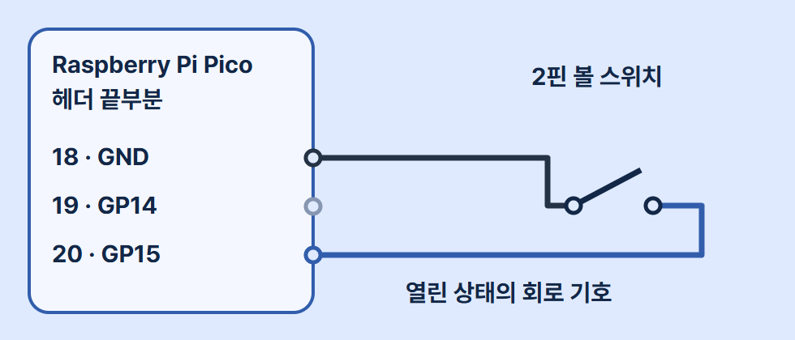

# 04 · 2핀 볼 스위치로 기울기 감지하기

Raspberry Pi Pico(RP2040)와 MicroPython을 사용합니다. 볼 스위치 안의 금속 공이 두 접점을 이으면 GP15가 GND에 연결되어 0입니다. 공이 접점에서 떨어지면 내부 풀업으로 1을 읽습니다. 스위치로 어느 방향에서 접점이 바뀌는지 볼 수 있습니다.

## 준비물과 연결

Pico, Adafruit PID 173 형태의 수동 2핀 볼 스위치, 브레드보드, 점퍼선 2개, USB 데이터 케이블, Thonny, Pico용 MicroPython 펌웨어를 준비하세요. 아래 번호는 Pico 공식 핀맵의 헤더 번호입니다.

| Pico | 물리 핀 | 스위치 |
| --- | ---: | --- |
| GP15 | 20 | 한쪽 다리 |
| GND | 18 | 다른 쪽 다리 |

USB를 분리한 상태에서 연결하세요. 스위치의 두 다리는 서로 다른 브레드보드 줄에 꽂습니다. 3V3, VBUS 등의 전원 핀에 스위치를 연결하지 마세요.



## Thonny에서 실행하기

1. Pico에 전용 MicroPython UF2가 없다면 [RPI_PICO 펌웨어](https://micropython.org/download/RPI_PICO/)를 내려받습니다. BOOTSEL을 누른 채 USB를 연결하고 나타난 RPI-RP2 드라이브에 UF2를 복사합니다.
2. 배선을 확인하고 Pico를 USB에 연결합니다. Thonny의 **Run → Select interpreter** 또는 **Tools → Options → Interpreter**에서 **MicroPython (Raspberry Pi Pico)**와 연결된 포트를 선택합니다. Thonny 버전에 따라 메뉴 위치가 달라질 수 있습니다.
3. 아래 코드를 편집기 탭에 붙여넣고 **Run current script**(F5)를 누릅니다. 자동 시작이 필요할 때는 Pico에 `main.py`로 저장하세요.
4. 아래쪽 Shell에서 첫 상태를 확인한 뒤 천천히 기울이세요. 같은 상태를 유지하면 상태 줄은 더 나오지 않습니다. 중지 버튼 또는 Shell의 Ctrl+C로 멈출 수 있습니다.


## 전체 코드

```python
# CODEPLANT TECH 04 - Raspberry Pi Pico / MicroPython 1.29.0
from machine import Pin
from time import ticks_ms, ticks_diff, sleep_ms

TILT_PIN = 15
DEBOUNCE_MS = 50
POLL_MS = 5

tilt = Pin(TILT_PIN, Pin.IN, Pin.PULL_UP)
try:
    last_raw = tilt.value()
    stable = None
    changed_at = ticks_ms()
    print("READY: GP15, pull-up, debounce 50ms")
    while True:
        raw = tilt.value()
        now = ticks_ms()
        if raw != last_raw:
            last_raw = raw
            changed_at = now
        if (stable is None or raw != stable) and (
            ticks_diff(now, changed_at) >= DEBOUNCE_MS
        ):
            stable = raw
            contact = "CLOSED" if stable == 0 else "OPEN"
            print("state =", stable, "contact =", contact)
        sleep_ms(POLL_MS)
except KeyboardInterrupt:
    print("STOP")
except OSError as exc:
    print("PIN_ERROR:", exc)
```

## 코드 읽기

- `from machine`에서 Pico의 GPIO를 제어하는 `Pin`을, `from time`에서 밀리초 시각을 읽고 비교하고 쉬는 함수를 가져옵니다.
- `TILT_PIN`은 GP15이고, `DEBOUNCE_MS`와 `POLL_MS`는 각각 입력을 확정하는 대기 시간 50 ms와 루프 끝에 쉬는 시간 5 ms입니다.
- `Pin.IN`과 `Pin.PULL_UP`으로 입력과 내부 풀업을 설정합니다.
- `last_raw`에는 직전 값, `stable`에는 확정한 값을 저장합니다. `None`은 아직 확정된 값이 없다는 뜻입니다. `changed_at`은 직전 변화 시점입니다.
- `while True`에서 현재 입력 `raw`와 시각 `now`를 얻습니다. 값이 바뀌면 `last_raw`와 `changed_at`을 갱신합니다.
- `ticks_diff`로 경과 시간을 계산해 타이머 값이 순환하는 경우도 처리합니다. 첫 입력 또는 이전 확정 상태와 다른 입력이 50 ms 유지되면 `stable`을 갱신합니다.
- `contact`는 0이면 CLOSED, 1이면 OPEN입니다. `print`가 확정된 상태를 Shell에 표시합니다.
- `sleep_ms`로 잠깐 쉬고 다시 읽습니다. Ctrl+C는 STOP, 입출력 오류는 PIN_ERROR를 표시합니다.

두 자세에서 각각 예상되는 출력은 `state = 1 contact = OPEN`과 `state = 0 contact = CLOSED`입니다. 실제 전환 방향은 스위치의 제품과 장착 방향에 따라 달라집니다.

## 출처와 검증 범위

- [Raspberry Pi Pico 공식 핀맵](https://datasheets.raspberrypi.com/pico/Pico-R3-A4-Pinout.pdf), [MicroPython v1.29.0 RP2 GPIO](https://docs.micropython.org/en/v1.29.0/rp2/quickref.html#pins-and-gpio), [Adafruit PID 173](https://www.adafruit.com/product/173).
- Pico 사진은 [MicroPython 공식 보드 페이지](https://micropython.org/download/RPI_PICO/) 출처입니다. 해당 사진의 별도 재사용 허가 표기는 확인되지 않았습니다. 스위치 사진은 lady ada / Adafruit [asset 496](https://learn.adafruit.com/assets/496), [CC BY-SA 3.0](https://creativecommons.org/licenses/by-sa/3.0/)입니다.
- [Thonny 공식 참고 화면](https://thonny.org/)은 도구 화면 안내입니다. 이번 실습의 출력 캡처는 아닙니다.
- 실제 Pico와 볼 스위치 및 시뮬레이터에서는 시험하지 않았습니다.

- 호스트에서 GPIO와 시간 함수를 대체하여 GP15 풀업 설정, 짧은 입력 흔들림, 50 ms 확정, 타이머 순환 및 README 코드 일치를 확인했습니다.
