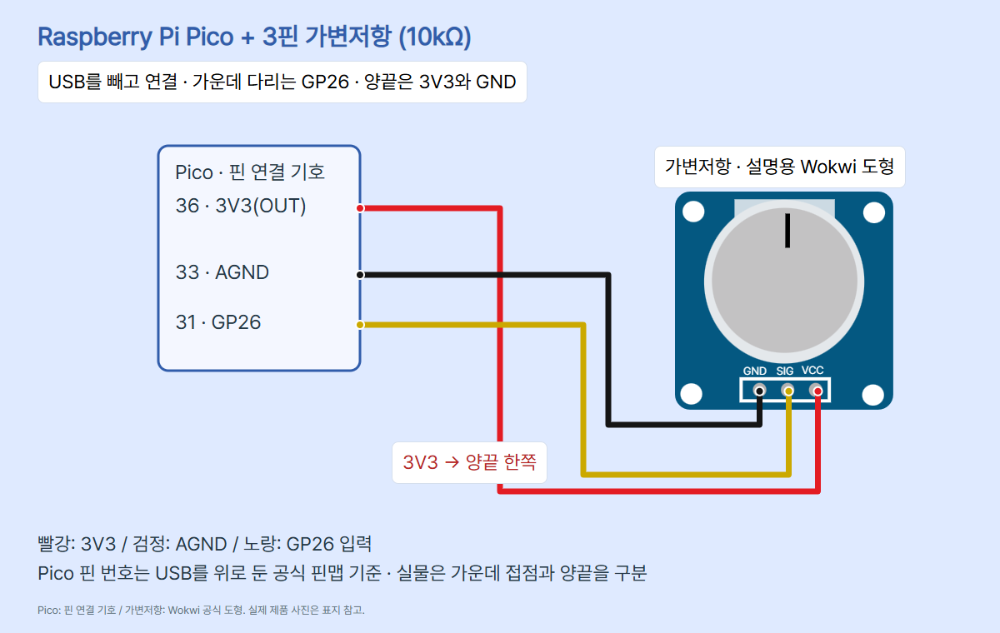

# 07 · 손잡이를 돌려 숫자를 바꾸는 가변저항

Raspberry Pi Pico(RP2040), MicroPython v1.29.0, Adafruit #562 10kΩ 선형 가변저항을 기준으로 합니다.

## 준비물과 연결

Pico, 10kΩ 선형 가변저항, 브레드보드, 점퍼선 3개, USB 데이터 케이블과 Thonny를 준비하세요. USB를 분리한 뒤 연결합니다.

| Pico | 물리 핀 | 가변저항 |
| --- | --- | --- |
| 3V3(OUT) | 36 | 양끝 한쪽 |
| AGND | 33 | 양끝 다른 쪽 |
| GP26 / ADC0 | 31 | 가운데 접점 |

실제 부품의 가운데 접점과 양끝은 제조사 핀표로 대조하세요. 세 다리를 서로 다른 브레드보드 연결 줄에 꽂습니다. VBUS·VSYS·5V를 가변저항에 연결하지 마세요.



Pico 상자는 핀 연결 기호입니다. 물리 핀은 USB를 위로 둔 공식 핀맵으로 확인하세요. 가변저항은 설명용 Wokwi 도형입니다.

## 움직임에서 숫자까지

손잡이를 돌리면 저항 트랙 위의 접점 위치가 달라집니다. 양끝에 3.3V와 GND를 연결하면 가운데 전압이 변합니다. 이를 분압이라고 합니다. ADC는 그 전압을 단계가 있는 정수로 바꿉니다.

RP2040 ADC는 12비트 변환을 수행합니다. read_u16()은 결과를 0~65535로 표현합니다. 표준 입력 범위는 0~3.3V입니다. 늘려 표현한 범위가 실제 16비트 측정 정밀도를 뜻하지는 않습니다. 원시값에는 V·Ω·각도 단위가 없습니다. 전압을 추정하려면 기준 전압·노이즈·보정 조건도 고려해야 합니다.

## Thonny 설정과 실행

1. Pico용 MicroPython UF2를 공식 배포 페이지에서 내려받습니다. BOOTSEL을 누른 채 USB를 연결하고 RPI-RP2 드라이브에 UF2를 복사합니다. 펌웨어가 이미 설치되어 있다면 기존 파일을 백업하고 필요한 경우에만 바꿉니다.
2. Thonny의 도구 → 옵션 → 인터프리터에서 MicroPython (Raspberry Pi Pico)와 실제 COM 포트를 선택합니다. 버전에 따라 메뉴 위치가 달라질 수 있습니다.
3. 아래 코드를 편집기에 붙여넣고 F5로 실행합니다. Shell에 READY와 raw_u16 값이 반복되는지 확인합니다.
4. 한쪽 끝·가운데·반대쪽 끝에서 멈추고 여러 줄을 기록합니다. 같은 위치에서 숫자의 작은 흔들림도 살펴보세요.
5. Ctrl+C로 멈춘 뒤 PRINT_MS를 500으로 바꾸어 다시 실행합니다. 100ms와 500ms의 출력 간격을 비교하세요.


이 화면은 Thonny의 일반 UI 참고입니다. 이번 Pico 실습의 실행 캡처와는 구성이 다를 수 있습니다.

## 전체 코드

```python
from machine import Pin, ADC
from time import sleep_ms

POT_PIN = 26
PRINT_MS = 100
adc = ADC(Pin(POT_PIN))
try:
    print("READY: potentiometer -> GP26")
    while True:
        raw = adc.read_u16()
        print("raw_u16 =", raw)
        sleep_ms(PRINT_MS)
except KeyboardInterrupt:
    print("STOP")
except OSError as error:
    print("ADC_ERROR:", error)
```

## 각 줄의 역할

| 코드 | 역할 |
| --- | --- |
| from machine import Pin, ADC | 보드 핀과 ADC 기능을 가져옵니다. |
| from time import sleep_ms | 밀리초 단위 대기 함수를 가져옵니다. |
| POT_PIN = 26 | 가운데 접점이 연결된 GP26을 지정합니다. |
| PRINT_MS = 100 | 읽기와 출력 뒤 100ms 이상 기다립니다. |
| adc = ADC(Pin(POT_PIN)) | GP26을 ADC 입력으로 설정합니다. |
| try | 입력 중단과 읽기 오류를 처리할 영역입니다. |
| print READY | 실행 시작과 사용할 핀을 알립니다. |
| while True | 읽기와 출력을 반복합니다. |
| raw = adc.read_u16() | ADC 결과를 0~65535 정수로 얻습니다. |
| print raw_u16 | 읽은 값을 Shell에 표시합니다. |
| sleep_ms(PRINT_MS) | 표시 간격을 확보합니다. |
| except KeyboardInterrupt | Ctrl+C 입력을 처리해 STOP을 표시합니다. |
| except OSError as error | 읽기 오류 내용을 ADC_ERROR로 표시합니다. |

100ms 대기에는 코드와 출력 시간이 더해집니다. 정확히 10Hz로 측정했다고 기록하지 않습니다. 양끝·가운데의 값은 실제로 관찰해 기록하세요. 한쪽 끝 0, 중간 32768, 반대쪽 끝 65535가 정확히 나온다고 보장하지 않습니다.

## 값이 이상할 때

값이 고정되면 USB를 분리하고 GP26·가운데 접점·양끝 전원을 확인하세요. 심한 흔들림은 빠진 선·느슨한 접촉을 확인합니다. 전원을 높여 해결하지 마세요. 발열이 있으면 즉시 USB를 빼세요. 손잡이는 기계적 끝을 넘겨 억지로 돌리지 않습니다.

## 출처와 사용 조건

- [Pico 공식 핀맵](https://datasheets.raspberrypi.com/pico/Pico-R3-A4-Pinout.pdf), [MicroPython RP2 v1.29.0 ADC](https://docs.micropython.org/en/v1.29.0/rp2/quickref.html#adc-analog-to-digital-conversion).
- [Adafruit #562](https://www.adafruit.com/product/562), [제조사 P160 핀표](https://cdn-shop.adafruit.com/product-files/562/p160.pdf).
- Pico 사진은 Raspberry Pi Foundation / [MicroPython](https://micropython.org/download/RPI_PICO/), 가변저항 사진은 [Adafruit 원본](https://cdn-shop.adafruit.com/970x728/562-03.jpg)입니다. 원본 비율을 유지해 크기를 조절했습니다. 별도 재배포 허가 표기는 확인하지 못했습니다.
- 가변저항 도형은 [Wokwi(MIT)](https://github.com/wokwi/wokwi-elements/blob/main/src/potentiometer-element.ts)입니다.
- [Thonny 공식 참고 화면](https://thonny.org/img/screenshot.png)은 별도 재배포 허가 표기를 확인하지 못했습니다.
- [CODEPLANT 채널](https://www.youtube.com/@codeplant2024)은 이번 조회에 실패했습니다.

실제 Pico·가변저항·전압 측정 및 시뮬레이터는 시험하지 않았습니다.

## 확인 범위

전용 `verify.py`에서 3개 배선 네트와 위험 배선 변형, ADC 모의 입력, 출력 순서, 100ms 대기, Ctrl+C 및 오류 처리를 확인했습니다. 모의 값은 실측 결과가 아닙니다. `check.mjs`의 10장 1080×1350·모바일·배경색·편집 기능 검사를 통과하고 전체 PNG를 시각 검수했습니다.

제조사 P160 PDF는 이번 웹 조회에서 직접 열리지 않았습니다. 실물 부품의 핀 배치는 연결 전에 제조사 자료와 다시 대조하세요.
