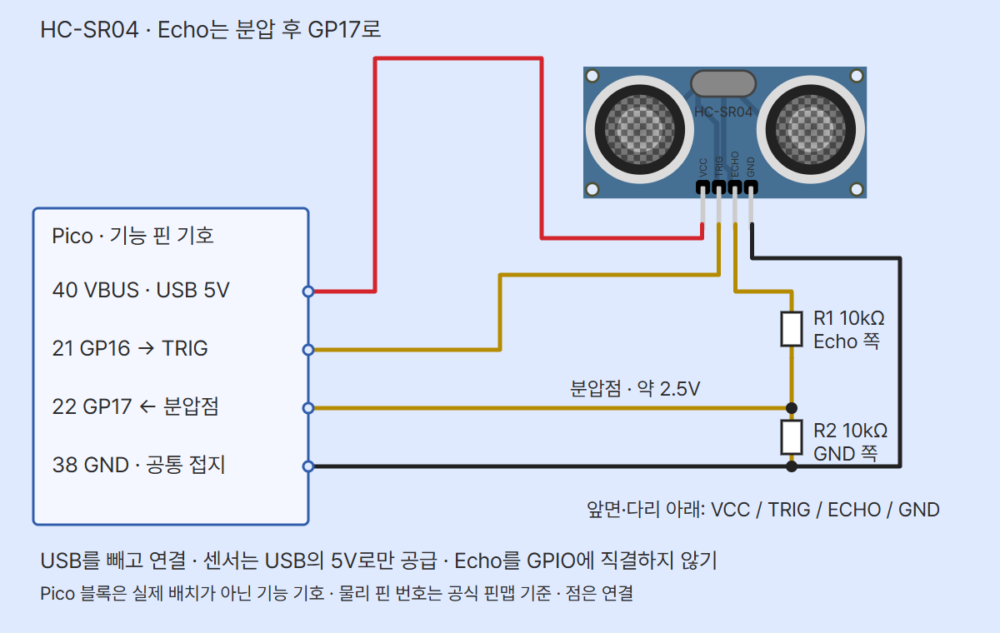
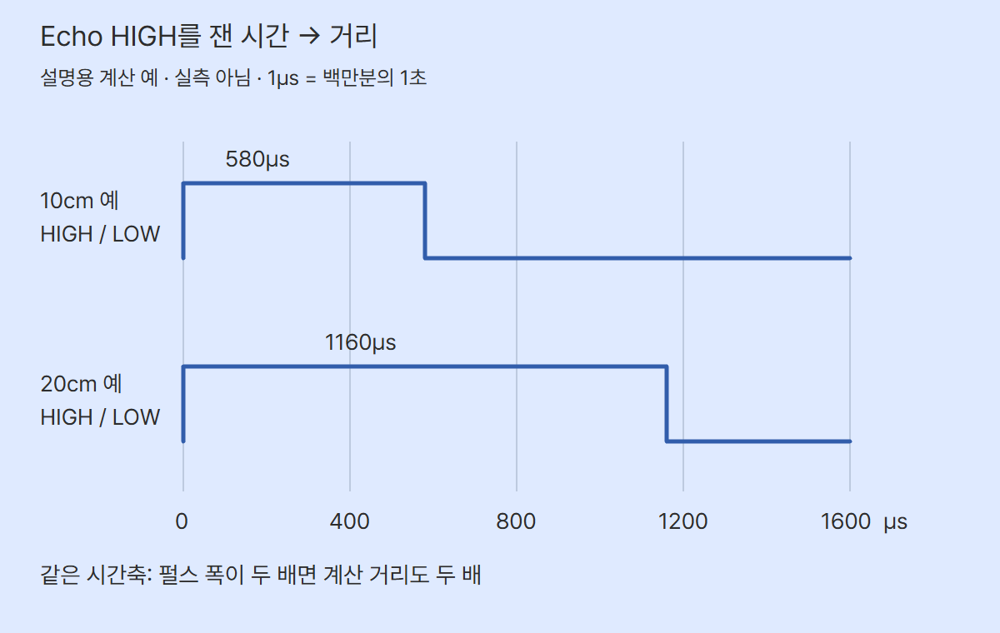

# HC-SR04로 거리 읽기 · Raspberry Pi Pico

평면 물체의 위치를 바꾸며 초음파 응답의 펄스 폭과 계산 거리를 비교합니다. RP2040 Pico와 Adafruit 제품 3942의 4핀 HC-SR04를 기준으로 합니다. Pico W·Pico 2로 자동 대체하지 않습니다.

## 준비물과 전원

Pico(RP2040), HC-SR04 #3942, 10kΩ 저항 두 개, 브레드보드, 점퍼선, Micro-USB 데이터 케이블, 자와 넓고 단단한 평면 물체를 준비하세요. 핀헤더는 연결 가능한 상태여야 합니다.

USB를 빼고 연결합니다. 이 구성은 USB 전원 하나만 사용합니다. HC-SR04 VCC에는 Pico VBUS의 USB 5V를 공급합니다. 3V3(OUT)로 센서 전원을 대체하지 말고 외부 5V를 함께 추가하지 마세요. VBUS·VSYS·3V3는 서로 다른 핀입니다.

## 핀 연결

| Pico / 부품 | HC-SR04 / 연결 | 역할 |
|---|---|---|
| VBUS, 물리 40번 | VCC | USB 5V |
| GP16, 물리 21번 | TRIG | 3.3V 시작 신호 |
| ECHO | R1 10kΩ의 한쪽 | 센서 5V 응답 |
| R1의 다른 쪽 | GP17(물리 22번)과 R2의 한쪽 | 약 2.5V 분압점 |
| R2 10kΩ의 다른 쪽 | GND | 분압 하단 |
| GND, 물리 38번 | HC-SR04 GND와 R2 하단 | 공통 기준 |

센서의 둥근 두 진동자 앞면을 보고 핀을 아래로 두면 왼쪽부터 VCC, TRIG, ECHO, GND입니다. 실물 인쇄를 먼저 대조하세요. 다른 모델·복제품의 전원·입력 임계값은 같다고 가정하지 않습니다.



회로의 Pico 블록은 기능 핀 기호이며 실제 보드 배치를 흉내 낸 그림이 아닙니다. 공식 핀맵에서 물리 번호를 찾아 연결하세요. 센서 도형은 Wokwi 공식 SVG와 pinInfo를 사용하며 실물 사진과 구분합니다. diagram.json은 교육용 도면 메타데이터로, Wokwi에서 시뮬레이션 실행이 확인된 파일이 아닙니다.

Echo는 R1 → 분압점 → R2 → GND로 이어집니다. Pico 입력은 분압점에 연결합니다. 공칭 Echo 5V에서 분압점은 5×10/(10+10)=2.5V입니다. 저항을 빠뜨리거나 Echo를 GP17에 직접 연결하지 마세요. 저항값·전원·접촉에 따른 실제 전압은 계측기로 확인해야 합니다. 제품 3942는 3V 또는 5V TRIG를 받을 수 있다고 판매자가 명시합니다.

## MicroPython과 Thonny

1. 이미 Pico 기본 세팅을 마쳤다면 설치를 반복하지 않습니다. Pico용 공식 MicroPython을 사용합니다. 제작 시 확인한 공식 안정 버전은 v1.29.0입니다.
2. Thonny의 실행 인터프리터에서 MicroPython (Raspberry Pi Pico)를 고르고 연결한 실제 COM 포트를 선택합니다. 메뉴 표현은 Thonny 버전·OS에 따라 다를 수 있습니다. 다른 장치의 COM 번호를 그대로 쓰지 않습니다.
3. 아래 전체 코드를 새 편집 탭에 붙여 넣고 PC의 main.py로 저장합니다. F5(실행)를 눌러 Shell을 확인합니다. 자동 실행이 필요할 때만 장치에 main.py로 저장합니다.
4. READY 뒤 distance_cm 또는 NO_READING이 반복됩니다. 아래 그림은 설명용 파형이며 실제 Thonny 실행 캡처가 아닙니다. Ctrl+C 또는 중지 버튼으로 멈춥니다.

추가 패키지는 없습니다. machine과 time은 Pico용 MicroPython 내장 모듈입니다.

## 전체 코드

```python
"""RP2040 Pico + Adafruit HC-SR04 #3942. Echo divider: 10k + 10k."""
from machine import Pin, time_pulse_us
from time import sleep_us, sleep_ms

TRIG_GP = 16
ECHO_GP = 17
TIMEOUT_US = 30000
WAIT_MS = 100

trig = Pin(TRIG_GP, Pin.OUT, value=0)
echo = Pin(ECHO_GP, Pin.IN)

def measure_cm():
    trig.value(0)
    sleep_us(2)
    trig.value(1)
    sleep_us(10)
    trig.value(0)
    pulse_us = time_pulse_us(echo, 1, TIMEOUT_US)
    if pulse_us < 0:
        return None
    distance_cm = pulse_us / 58.0
    if not 2 <= distance_cm <= 400:
        return None
    return distance_cm

sleep_ms(WAIT_MS)
print("READY: HC-SR04, cm")
try:
    while True:
        distance = measure_cm()
        if distance is None:
            print("NO_READING: check target and wiring")
        else:
            print("distance_cm=%.1f" % distance)
        sleep_ms(WAIT_MS)
except KeyboardInterrupt:
    print("STOP")
finally:
    trig.value(0)
```

## 코드 줄의 역할

| 줄 / 명령 | 역할 |
|---|---|
| from machine / from time | 디지털 핀·펄스 시간 측정·대기 함수를 가져옵니다. |
| TRIG_GP=16, ECHO_GP=17 | GP 번호입니다. 물리 16·17번을 뜻하지 않습니다. |
| TIMEOUT_US=30000 | HIGH 대기 단계와 HIGH 길이 측정 단계에 각각 적용되는 시간 제한입니다. 총 실행이 반드시 30ms 안에 끝난다는 뜻은 아닙니다. |
| WAIT_MS=100 | 시작 후와 매 측정 뒤 100ms 쉽니다. 측정 시간이 더해지므로 정확한 10Hz를 보장하지 않습니다. |
| Pin(... OUT, value=0) / Pin(... IN) | TRIG를 LOW 출력, Echo를 입력으로 준비합니다. |
| def measure_cm() | 한 번 측정해서 거리 또는 None을 돌려줍니다. |
| value(0), sleep_us(2) | 시작 전에 TRIG를 잠깐 LOW로 둡니다. |
| value(1), sleep_us(10), value(0) | 10μs HIGH 시작 펄스를 보냅니다. |
| time_pulse_us(echo,1,...) | Echo HIGH의 폭을 μs로 측정합니다. 이미 HIGH면 즉시 측정을 시작합니다. |
| pulse_us < 0 / return None | -2(시작 대기 시간 초과), -1(측정 시간 초과)을 거리로 환산하지 않습니다. |
| pulse_us / 58.0 | 데이터시트의 근사식으로 왕복 시간을 편도 cm로 바꿉니다. |
| 2 <= distance_cm <= 400 | 데이터시트 범위 밖이면 이 회차를 유효값으로 표시하지 않습니다. |
| return distance_cm | 유효한 계산 거리를 호출한 쪽에 넘깁니다. |
| print READY | 측정 반복 시작을 알립니다. |
| try / while True | 중지할 때까지 측정을 반복합니다. |
| if distance is None / else | 실패 메시지와 거리 숫자를 구분합니다. |
| %.1f | 소수 한 자리 표시 형식입니다. 센서 정확도가 0.1cm라는 뜻은 아닙니다. |
| sleep_ms(WAIT_MS) | 다음 시작 신호까지 충분히 쉽니다. 데이터시트는 60ms를 넘는 측정 주기를 권합니다. |
| except KeyboardInterrupt / finally | Ctrl+C 중지를 알리고 TRIG를 LOW로 돌립니다. |

## 소리에서 숫자까지

시작 펄스를 받은 센서는 40kHz 초음파 8주기를 보내고 반사를 확인합니다. Echo HIGH 길이가 길수록 계산 거리가 커집니다. 예를 들어 580μs/58=10cm, 1160μs/58=20cm는 계산 예이며 실측값이 아닙니다. 이 편은 ADC·PWM을 사용하지 않습니다. 디지털 펄스의 시간을 잽니다.



음속은 온도 등 환경에 따라 달라집니다. 58로 나누는 근사식과 데이터시트의 340m/s 설명은 근삿값이므로 완전히 같은 계수가 아닙니다. 표시값을 정밀 계측기의 보증값으로 사용하지 않습니다.

## 비교 활동과 오류 점검

센서 앞에 자를 놓고 넓은 평면 물체를 10·20·30cm에 차례로 둡니다. 센서 전면을 거리 기준으로 삼고 각 위치에서 여러 줄 기록합니다. 같은 위치의 흔들림, 자와의 차이, 멀어질 때 값이 커지는 경향을 확인하세요. 실제 기록 칸은 학생이 측정해서 채웁니다. 제작자가 측정한 값은 제공하지 않습니다.

NO_READING은 응답 시간 초과나 범위 밖의 결과입니다. 0cm를 뜻하지 않습니다. 센서와 물체 방향, 반사면 크기·재질, 전원·분압점·공통 GND·핀 번호를 점검하세요. 배선을 바꿀 때는 Ctrl+C 후 USB부터 뺍니다. 응답이 계속 HIGH에 머무는 불량 모듈도 있으므로 반복 재시도로 해결됐다고 간주하지 않습니다.

## 검증 범위

실물 하드웨어·MicroPython 펌웨어·시뮬레이터는 실행하지 않았습니다. verify.py의 가짜 machine/time 모듈 검사는 환산·시간 초과·범위·반복 대기·중지 분기 확인용이며 센서 동작이나 전압을 증명하지 않습니다. 렌더링·핀 연결·공식 문서 대조 결과는 episode.json 내부 review와 제작 기록에 구분합니다.

## 출처와 사용 조건

- [센서 전원·3.3V TRIG·5V Echo·10k 분압](https://www.adafruit.com/product/3942)
- [HC-SR04 타이밍과 거리 계산](https://cdn.sparkfun.com/datasheets/Sensors/Proximity/HCSR04.pdf)
- [Pico 공식 핀맵](https://datasheets.raspberrypi.com/pico/Pico-R3-A4-Pinout.pdf)
- [Pico 전원](https://www.raspberrypi.com/documentation/microcontrollers/pico-series.html)
- [MicroPython v1.29 time_pulse_us](https://docs.micropython.org/en/v1.29.0/library/machine.html)
- [Pico 공식 펌웨어·사진](https://micropython.org/download/RPI_PICO/)
- [HC-SR04 도형·pinInfo](https://github.com/wokwi/wokwi-elements/blob/main/src/hc-sr04-element.ts)

- [Pico 원본 사진](https://micropython.org/resources/micropython-media/boards/RPI_PICO/rp2-pico.jpg): Raspberry Pi / MicroPython 공식 배포 페이지.
- [HC-SR04 원본 사진](https://cdn-shop.adafruit.com/970x728/3942-02.jpg): Adafruit 제품 3942. 두 사진 모두 종횡비 유지·표시 크기 조절만 적용했습니다. 별도 사진 재배포 허가 표기는 확인되지 않았으며 원권리자의 조건이 적용됩니다. 교육 활용에 별도 권리 확인이 필요한 경우 원권리자에게 문의하세요.
- [Wokwi Elements MIT License](https://github.com/wokwi/wokwi-elements/blob/main/LICENSE): HC-SR04 도형. 저작권·허가문은 아래에 보존합니다. 도형은 제품 실사진·실행 증거가 아닙니다.
- [CODEPLANT 채널](https://www.youtube.com/@codeplant2024): 2026-11-21 조회가 Cache miss로 실패하여 특정 영상을 확인했다고 표기하지 않습니다. 기술 근거는 위 공식 제품·보드·API 자료입니다.

### Wokwi 도형 허가문

The MIT License (MIT)

Copyright (c) 2020 Uri Shaked

Permission is hereby granted, free of charge, to any person obtaining a copy
of this software and associated documentation files (the "Software"), to deal
in the Software without restriction, including without limitation the rights
to use, copy, modify, merge, publish, distribute, sublicense, and/or sell
copies of the Software, and to permit persons to whom the Software is
furnished to do so, subject to the following conditions:

The above copyright notice and this permission notice shall be included in
all copies or substantial portions of the Software.

THE SOFTWARE IS PROVIDED "AS IS", WITHOUT WARRANTY OF ANY KIND, EXPRESS OR
IMPLIED, INCLUDING BUT NOT LIMITED TO THE WARRANTIES OF MERCHANTABILITY,
FITNESS FOR A PARTICULAR PURPOSE AND NONINFRINGEMENT. IN NO EVENT SHALL THE
AUTHORS OR COPYRIGHT HOLDERS BE LIABLE FOR ANY CLAIM, DAMAGES OR OTHER
LIABILITY, WHETHER IN AN ACTION OF CONTRACT, TORT OR OTHERWISE, ARISING FROM,
OUT OF OR IN CONNECTION WITH THE SOFTWARE OR THE USE OR OTHER DEALINGS IN
THE SOFTWARE.
