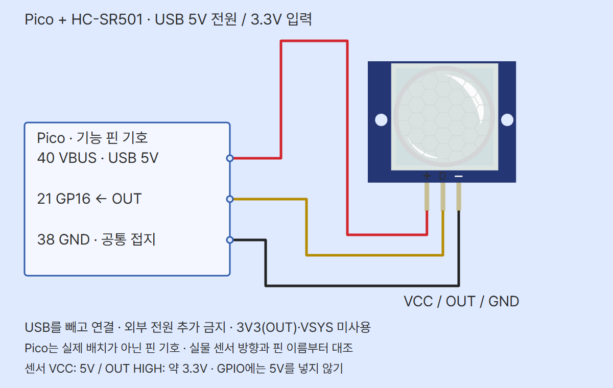
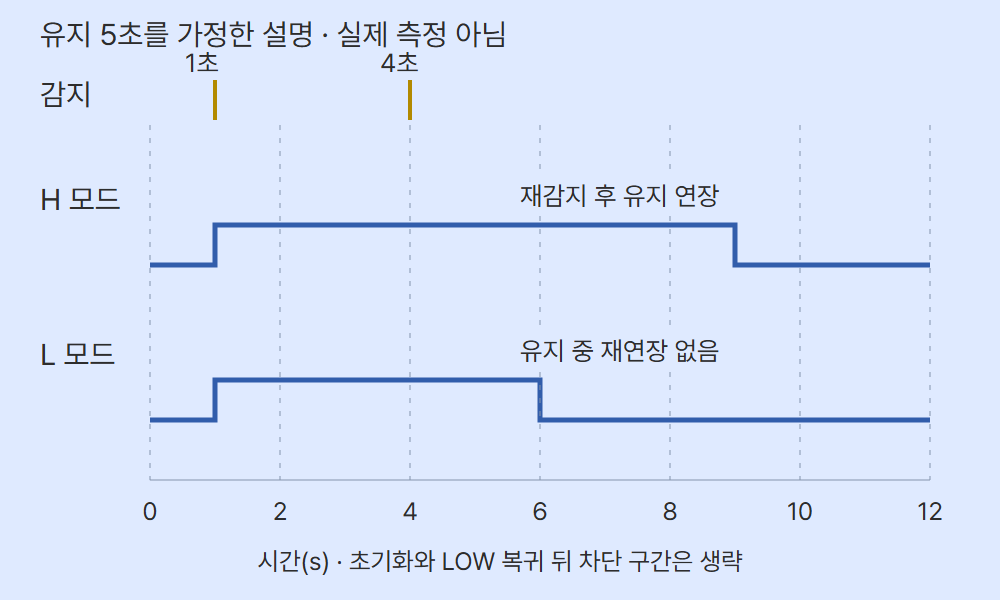
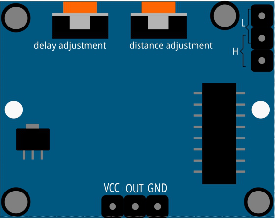

# HC-SR501 PIR · Raspberry Pi Pico MicroPython

RP2040 Raspberry Pi Pico와 SunFounder HC-SR501의 OUT을 GP16 입력으로 읽습니다. LED·모터·릴레이는 연결하지 않습니다. 다른 센서의 전압·핀 순서가 같다고 가정하지 않습니다.

## 준비물과 연결

Pico, HC-SR501, 브레드보드·점퍼선, Micro-USB 데이터 케이블, PC와 Thonny를 준비하세요. 핀헤더는 연결 가능한 상태여야 하며 브레드보드의 세 핀은 서로 다른 줄에 꽂습니다. USB를 빼고 실물 핀 이름을 확인한 뒤 연결하세요.

| Pico | HC-SR501 | 역할 |
|---|---|---|
| VBUS, 물리 40번 | VCC | USB 5V 전원 |
| GP16, 물리 21번 | OUT / DO | 약 3.3V 디지털 입력 |
| GND, 물리 38번 | GND | 공통 접지 |

코드의 Pin(16)은 GP16이며 물리 16번이 아닙니다. 전원은 USB 하나만 사용하고 외부 전원은 추가하지 않습니다. 3V3(OUT)와 VSYS는 사용하지 않습니다. SunFounder 판매 자료는 전원 4.5~20V, 학습 자료는 5~20V로 제시해 공통인 5V를 선택했습니다. 출력은 HIGH 3.3V/LOW 0V입니다. VCC 전압을 OUT 전압으로 착각하거나 GPIO에 5V를 넣지 마세요. 이 모델은 추가 분압·외부 풀업이 필요하지 않습니다.



Pico 블록은 실제 배치가 아닌 기능 핀 기호입니다. 물리 위치는 공식 핀맵을 보세요. 센서는 Wokwi 공식 도형이며 실제 조립 사진이 아닙니다. 도형과 실물의 앞뒤·방향이 다를 수 있어 VCC·OUT·GND 이름을 우선합니다. diagram.json은 교육용 도면 메타데이터이며 시뮬레이터 실행 확인 파일이 아닙니다.

## 무엇을 읽나요

PIR은 수동 적외선 감지입니다. 모듈은 두 감지 영역에 들어오는 적외선의 차이를 이용해 움직임에 반응합니다. 앞을 가로질러 움직이면 OUT이 HIGH가 되고, Pico는 이를 1로 읽습니다. 출력 유지가 끝나 LOW가 되면 0으로 읽습니다. 숫자는 거리·체온·사람 수가 아닙니다. LOW만으로 사람 없음을 확정하지 않습니다.

전원 직후 흔들림을 피하려고 이 코드는 먼저 60000ms 기다립니다. READY는 코드 대기가 끝났다는 안내이며 센서 안정화 측정값은 아닙니다. 계속 불안정하면 더 기다리고 전원·배선·환경을 확인합니다.

## H/L 모드와 서로 다른 시간

H는 유지 중 새 감지가 있으면 HIGH 유지가 늘어날 수 있고, L은 유지 중 재연장하지 않습니다. HIGH가 끝난 뒤 새 감지를 받지 않는 차단 구간이 있습니다. SunFounder 문서의 지연 상한 200s/300s, 차단 8s/제품 페이지 2.5s 표기는 서로 다릅니다. 해당 모듈에서 직접 확인해야 하므로 고정 상한·차단 시간을 보장하지 않습니다.



이 파형은 HIGH 유지 5초, 1초와 4초의 감지를 가정한 개념 예시입니다. 같은 0~12s 축에서 H는 마지막 감지 뒤 5초인 9초까지, L은 첫 감지 뒤 5초인 6초까지 그렸습니다. 실제 전압·응답·지연 측정이 아닙니다. 시작 지연·초기화·LOW 뒤 차단 구간은 생략했습니다. 50ms 샘플링으로 이 시각을 정확히 검출한다는 뜻도 아닙니다.



지연 조절기는 HIGH 유지 시간을, 감도 조절기는 감지 반응을 바꿉니다. 특정 거리의 정확한 설정값은 아닙니다. 점퍼·조절기를 만지기 전 USB 전원을 끄고 실물 H/L 표시를 확인하세요. 코드의 SAMPLE_MS=50은 매번 읽은 뒤 기다리는 시간이며 모듈의 유지·차단 시간과 다릅니다. 처리 시간이 더해져 정확한 20Hz가 아니고 샘플 사이의 짧은 변화는 놓칠 수 있습니다.

## 설정·실행·관찰

1. 공식 RPI_PICO용 MicroPython v1.29.0과 Thonny를 사용합니다. Pico 기본 세팅을 이미 마쳤다면 설치를 반복하지 않습니다. 다른 보드 펌웨어로 바꾸지 마세요. 재설치가 필요하면 보드 파일부터 백업합니다.
2. USB를 빼고 표대로 연결한 뒤 USB를 꽂습니다. USB 하나가 Pico와 센서를 함께 공급하며 외부 전원은 추가하지 않습니다.
3. Thonny에서 MicroPython (Raspberry Pi Pico)와 실제 COM 포트를 선택합니다. 아래 코드를 새 탭에 붙여 PC의 main.py로 저장하고 F5를 누릅니다. 추가 라이브러리는 없으며 메뉴 위치는 버전·OS에 따라 다를 수 있습니다. 자동 실행이 필요할 때만 보드에 main.py로 저장합니다.
4. WAIT_60S 뒤 60초 기다리면 READY가 나오고 첫 값이 한 번 표시됩니다. 이후 같은 상태에서는 줄이 추가되지 않습니다. 가로지르기→멈추기→다시 움직이기를 비교하고 H/L·조절기 조건과 HIGH 유지 시간을 직접 기록하세요.
5. Ctrl+C는 STOP을 출력하지만 센서 전원을 끄지는 않습니다. 배선을 고치거나 비정상 발열이 있으면 USB를 빼세요. OUT이 빠져 떠 있는 입력의 0·1을 감지 결과로 해석하지 않습니다.

아래는 표시 형식입니다. 실제 측정 로그가 아닙니다. 첫 상태와 이후 순서는 환경에 따라 달라집니다.

```text
WAIT_60S
READY: GP16 input
pir = <0 또는 1>, level = <LOW 또는 HIGH>
STOP
```

## 전체 코드

```python
from machine import Pin
from time import sleep_ms

PIR_PIN = 16
WARMUP_MS = 60000
SAMPLE_MS = 50
pir = Pin(PIR_PIN, Pin.IN, pull=None)
last_state = None

try:
    print("WAIT_60S")
    sleep_ms(WARMUP_MS)
    print("READY: GP16 input")
    while True:
        state = pir.value()
        if state != last_state:
            level = "HIGH" if state else "LOW"
            print("pir = {}, level = {}".format(state, level))
            last_state = state
        sleep_ms(SAMPLE_MS)
except KeyboardInterrupt:
    print("STOP")
```

## 코드 줄별 역할

| 코드 | 역할 |
| --- | --- |
| from machine import Pin | 디지털 핀 기능을 가져옵니다. |
| from time import sleep_ms | 밀리초 단위 대기 함수입니다. |
| PIR_PIN = 16 | OUT을 연결한 GP16입니다. |
| WARMUP_MS = 60000 | 첫 읽기 전 60초 기다립니다. |
| SAMPLE_MS = 50 | 매 회차 읽기 뒤 최소 50ms 기다립니다. |
| pir = Pin(..., Pin.IN, pull=None) | 입력으로 설정하고 내부 풀업·풀다운을 끕니다. |
| last_state = None | 처음 읽은 0·1과 다르게 두어 첫 값도 표시합니다. |
| try / print WAIT_60S / sleep_ms(WARMUP_MS) | 시작 대기를 알리고 기다립니다. 이때 센서를 읽지 않습니다. |
| print READY / while True | 대기 종료를 알리고 읽기를 반복합니다. |
| state = pir.value() | GPIO 입력을 0 또는 1로 읽습니다. 전압을 숫자 V로 측정하지 않습니다. |
| if state != last_state | 직전 표시값과 다를 때만 아래 줄을 실행합니다. |
| level = ... | 1이면 HIGH, 0이면 LOW라는 표시 문자열을 만듭니다. |
| print(...) | 입력값과 문자열을 Shell에 표시합니다. |
| last_state = state | 방금 표시한 값을 다음 비교용으로 저장합니다. |
| sleep_ms(SAMPLE_MS) | 값이 바뀌지 않은 회차에도 기다립니다. |
| except KeyboardInterrupt / print STOP | Ctrl+C를 받으면 종료를 알립니다. |

잘못된 실행 대상·import·핀 읽기 오류는 일반 오류로 실행이 멈춥니다. 코드가 배선 단선·5V 오접속을 자동 판정하지는 않습니다. OUT이 빠져 떠 있는 입력의 0/1도 유효한 감지로 해석하지 마세요. MCU GPIO를 물리적으로 다시 설정하는 finally 구간은 필요하지 않은 입력 전용 예제입니다.

## 예상과 다르면

- 계속 1: 모듈 지연·H 모드 재감지와 주변 열원·직사광·바람을 확인합니다. 멈춘 뒤 충분히 기다리세요.
- 계속 0: USB 전원을 끄고 VCC·OUT·GND, GP16, 입력 설정과 접촉을 확인합니다. 정면에서 가만히 서 있기보다 앞을 가로지릅니다.
- READY 전 신호: 코드는 대기 중 읽지 않습니다. 다른 프로그램 출력인지 확인하세요.
- 글씨가 없거나 오류: Thonny 실행 대상·COM 포트·USB 데이터 케이블·파일을 확인합니다. REPL 전송속도는 이 코드에서 별도 지정하지 않습니다.
- 비정상 발열·배선 수정: USB를 빼고 쇼트나 잘못된 전원을 점검합니다.

## 검증 범위

실물 Pico·HC-SR501, 펌웨어 실행과 시뮬레이션은 미시험입니다. 호스트 verify.py의 합성 입력 검사는 코드의 출력·대기·중지 분기 검사이며 실제 전압·감지·유지 시간을 증명하지 않습니다. 실제 사람의 검수 피드백을 받았다고 쓰지 않습니다. 자체 검수 결과는 내부 episode.json review에 구분합니다.

## 출처·사용 조건

- [HC-SR501 전원·출력](https://www.sunfounder.com/products/hcsr501-human-sensor) · 2026-11-22 확인
- [PIR 원리·초기화·H/L](https://docs.sunfounder.com/projects/umsk/en/latest/01_components_basic/12-component_pir_motion.html) · 2026-11-22 확인
- [Pico 전원과 보드](https://www.raspberrypi.com/documentation/microcontrollers/pico-series.html) · 2026-11-22 확인
- [Pico 핀맵](https://datasheets.raspberrypi.com/pico/Pico-R3-A4-Pinout.pdf) · 2026-11-22 확인
- [MicroPython Pin](https://docs.micropython.org/en/v1.29.0/library/machine.Pin.html) · 2026-11-22 확인
- [Pico 펌웨어·사진](https://micropython.org/download/RPI_PICO/) · 2026-11-22 확인
- [PIR 도형 pinInfo](https://github.com/wokwi/wokwi-elements/blob/main/src/pir-motion-sensor-element.ts) · 2026-11-22 확인

- [Pico 공식 사진](https://micropython.org/resources/micropython-media/boards/RPI_PICO/rp2-pico.jpg)
- [HC-SR501 공식 사진](https://docs.sunfounder.com/projects/umsk/en/latest/_images/12_pir_module.png), [공식 뒷면 설명 그림](https://docs.sunfounder.com/projects/umsk/en/latest/_images/12_pir_module_back.png): SunFounder. 이번 직접 다운로드가 403으로 실패해 같은 모델 편에 보존된 해당 공식 원본을 재사용했습니다. 뒷면은 실제 실험 사진이 아닌 제조사 설명 그림입니다. 비율 유지·표시 크기 조절만 적용했습니다. 별도 재배포 허가 표기는 확인되지 않았으며 원권리자 조건을 확인해야 합니다.
- [CODEPLANT 채널](https://www.youtube.com/@codeplant2024): 이번 조회 Cache miss로 특정 영상 열람·시청·자막 확인은 주장하지 않습니다. 기술 근거는 위 제품·보드·API 자료입니다.
- [Wokwi MIT 허가문](https://github.com/wokwi/wokwi-elements/blob/main/LICENSE): PIR 도형. 아래 허가문 보존.


The MIT License (MIT)

Copyright (c) 2020 Uri Shaked

Permission is hereby granted, free of charge, to any person obtaining a copy
of this software and associated documentation files (the "Software"), to deal
in the Software without restriction, including without limitation the rights
to use, copy, modify, merge, publish, distribute, sublicense, and/or sell
copies of the Software, and to permit persons to whom the Software is
furnished to do so, subject to the following conditions:

The above copyright notice and this permission notice shall be included in
all copies or substantial portions of the Software.

THE SOFTWARE IS PROVIDED "AS IS", WITHOUT WARRANTY OF ANY KIND, EXPRESS OR
IMPLIED, INCLUDING BUT NOT LIMITED TO THE WARRANTIES OF MERCHANTABILITY,
FITNESS FOR A PARTICULAR PURPOSE AND NONINFRINGEMENT. IN NO EVENT SHALL THE
AUTHORS OR COPYRIGHT HOLDERS BE LIABLE FOR ANY CLAIM, DAMAGES OR OTHER
LIABILITY, WHETHER IN AN ACTION OF CONTRACT, TORT OR OTHERWISE, ARISING FROM,
OUT OF OR IN CONNECTION WITH THE SOFTWARE OR THE USE OR OTHER DEALINGS IN
THE SOFTWARE.
