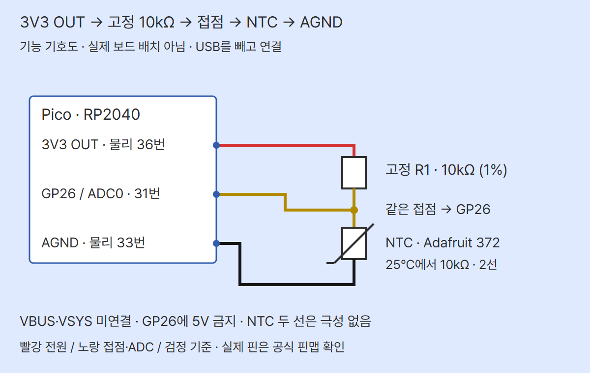
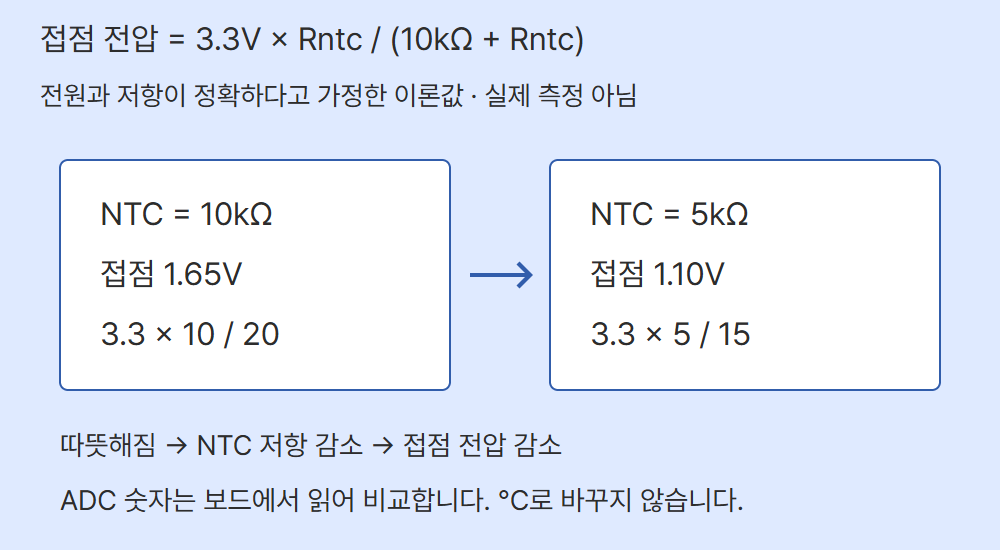

# Pico 11 · 온도에 따라 저항이 바뀌는 NTC

RP2040 Raspberry Pi Pico에서 Adafruit372의 온도 변화에 따른 ADC 원시값을 비교합니다. °C를 계산하는 온도계 예제가 아닙니다.

## 준비물과 연결

일반 RP2040 Pico, Micro-USB 데이터 케이블, Adafruit372 2선 NTC, 고정10kΩ 저항(1%), 브레드보드·점퍼선·Thonny. MicroPython v1.29.0 RPI_PICO를 사용하며 추가 라이브러리는 없습니다. Adafruit372 사양은25°C에서10kΩ ±1%, B25/50=3950 ±1%입니다. 이 코드는 원시값 비교이므로 B 계수를 사용하지 않습니다.

| Pico | 연결 대상 | 역할 |
|---|---|---|
| 3V3 OUT · 물리36 | 고정10kΩ 한쪽 | 분압 전원 |
| GP26/ADC0 · 물리31 | 저항 반대쪽과 NTC 한 선이 만나는 같은 접점 | 전압 입력 |
| AGND · 물리33 | NTC 나머지 선 | 아날로그 기준 |

USB를 빼고 배선합니다. VBUS·VSYS·외부 전원을 쓰지 않으며 GP26에5V를 넣지 않습니다. 공식 핀맵에서 USB 방향과 물리 핀 번호를 확인합니다. NTC에는 극성이 없지만 고정저항과 NTC의 위치를 바꾸면 변화 방향도 바뀝니다. 브레드보드에서는 같은 접점만 같은 연결 줄에 꽂고 NTC 양 끝을 단락하지 않습니다.



배선은 명시적인 핀 번호를 가진 기능 기호도이며 실제 보드나 케이블 센서의 외형·배치가 아닙니다.

## 저항 변화에서 표시까지

따뜻해짐 → NTC 저항 감소 → 분압 접점 전압 감소 → GP26의 ADC 값 감소 →10개 값의 정수 평균 표시.
전원3.3V와 고정저항10kΩ가 정확하다는 이론에서 V접점=3.3×Rntc/(10000+Rntc)입니다. Rntc10kΩ이면1.65V,5kΩ이면1.10V입니다. 실제 측정값이나 특정 온도에서의 ADC 수치가 아닙니다.



Pico ADC는12비트이며 read_u16()은0~65535로 늘려 반환합니다. 반환 범위가16비트여도16비트 해상도·정확도가 아닙니다. 표준 입력 범위는0~3.3V입니다. ADC 오차·기준 전압·저항 오차·센서 자기 발열 등이 결과에 영향을 줄 수 있습니다. 평균은 변동을 줄일 수 있지만 포화·계통 오차를 보정하지 않습니다. °C 변환에는 실제 저항값·기준 전압·ADC 보정·R0·기준온도·B계수 또는 제품 저항-온도표가 추가로 필요합니다.

## 실행·관찰

1. MicroPython v1.29.0 RPI_PICO과 Thonny를 사용합니다. [기본 세팅](../001-basic-setup/)의 USB·펌웨어·COM 포트 절차를 확인하세요. 펌웨어를 다시 쓰기 전 보드의 기존 파일을 백업합니다. Pico W/2 펌웨어로 자동 대체하지 않습니다.
2. USB를 빼고 표대로 연결한 뒤 USB를 다시 연결합니다. Thonny 오른쪽 아래에서 MicroPython (Raspberry Pi Pico)와 실제 COM 포트를 선택합니다. 메뉴 위치는 버전·언어에 따라 다릅니다.
3. 아래 전체 코드를 새 탭에 붙이고 PC에 main.py로 저장한 뒤 실행 버튼 또는 F5를 누릅니다. 표준 machine/time만 사용하며 추가 라이브러리는 없습니다. 보드에 main.py로 저장하면 재전원 시 자동 실행할 수 있으므로 처음에는 PC 파일 실행으로 확인합니다. 이 문서에는 실제 Pico 실행 화면 캡처가 없습니다.
4. READY 뒤 raw_u16를 여러 줄 기록합니다. 검은 센서 끝을 손으로 가볍게 감쌌다가 놓고 내려갔다 돌아오는지 관찰합니다. 센서가 반응할 시간을 두고, 바뀐 조건과 값을 직접 기록하세요. 불·뜨거운 물·침수는 쓰지 않습니다.
5. Ctrl+C로 종료하면 STOP이 나옵니다. 코드 종료는 USB 전원 차단이 아니므로 배선 수정은 USB를 뺀 뒤 합니다.

출력 형식만 나타내면 아래와 같습니다. 실제 센서 수치는 만들지 않았습니다.

```text
READY: NTC raw input GP26
raw_u16 = <10번 읽은 정수 평균>
ADC_ENDPOINT raw_u16 = <개별 끝값이 포함된 평균>
ADC_ERROR: <핀 읽기 등 오류>
STOP
```

## 전체 코드

```python
from machine import ADC, Pin
from time import sleep_ms

ADC_PIN = 26
SAMPLES = 10
GAP_MS = 10
WAIT_MS = 1000
adc = ADC(Pin(ADC_PIN))

try:
    print("READY: NTC raw input GP26")
    while True:
        sleep_ms(WAIT_MS)
        total = 0
        endpoint = False
        for _ in range(SAMPLES):
            value = adc.read_u16()
            total += value
            if value == 0 or value == 65535:
                endpoint = True
            sleep_ms(GAP_MS)
        raw = total // SAMPLES
        if endpoint:
            print("ADC_ENDPOINT raw_u16 =", raw)
        else:
            print("raw_u16 =", raw)
except KeyboardInterrupt:
    print("STOP")
except OSError as error:
    print("ADC_ERROR:", error)
```

## 각 줄의 역할

| 코드 | 역할 |
| --- | --- |
| from machine import ADC, Pin | ADC와 핀 설정 기능을 가져옵니다. |
| from time import sleep_ms | ms 단위 대기 함수입니다. |
| ADC_PIN=26 | 실제 접점의 GP26입니다. |
| SAMPLES=10 | 한 표시값에 사용할 개별 읽기 수입니다. |
| GAP_MS=10 | 각 읽기 뒤 대기입니다. 마지막 읽기 뒤에도 기다립니다. |
| WAIT_MS=1000 | 매 회차의 첫 읽기 전에 기다립니다. |
| adc=ADC(Pin(...)) | GP26/ADC0를 아날로그 입력으로 설정합니다. |
| try / print READY / while True | 시작을 알리고 반복합니다. READY는 배선 성공 판정이 아닙니다. |
| sleep_ms(WAIT_MS) | 첫 회차를 포함해 먼저 1000ms 기다립니다. |
| total=0 / endpoint=False | 합계와 끝값 플래그를 회차마다 초기화합니다. |
| for _ in range(SAMPLES) | 10번 읽습니다. |
| value=adc.read_u16() / total+=value | 개별 원시값을 읽어 합합니다. |
| if value==0 or value==65535 / endpoint=True | 한 번이라도 끝값이 있으면 표시해 둡니다. |
| sleep_ms(GAP_MS) | 매번 읽은 뒤 10ms 기다립니다. |
| raw=total//SAMPLES | 정수 평균을 계산합니다. //는 양수 나눗셈의 소수를 버립니다. |
| if endpoint / print ADC_ENDPOINT | 평균에 가려질 수 있는 개별 끝값을 알립니다. |
| else / print raw_u16 | 그 외에는 평균만 표시합니다. |
| except KeyboardInterrupt / STOP | 대기·읽기 중 Ctrl+C를 받으면 끝냅니다. |
| except OSError / ADC_ERROR | 읽기 오류를 표시하고 실행을 끝냅니다. 자동 재시도하지 않습니다. |

1000ms + 10회×10ms + 읽기·출력 처리 시간이 더해지므로 정확한 1Hz가 아닙니다. 개별 샘플 시작 간격도 정확한 10ms가 아닙니다. import·객체 생성 오류는 try 구간 밖에서 일반 오류로 종료합니다. GPIO를 출력으로 쓰지 않으며 전원을 끄거나 단선 위치를 자동 판별하지 않습니다.

## 실패하면

- ADC_ENDPOINT: USB를 빼고 고정 저항값, 3V3 OUT·AGND, 같은 접점과 접촉을 확인합니다. 이 안내만으로 단선·쇼트를 확정하지 않습니다.
- 값이 거의 안 변함: 센서 끝과 주변 온도 차이, 반응 시간, 접점을 확인합니다. 반대 방향으로 변하면 저항과 NTC의 위치를 확인하세요.
- ADC_ERROR/출력 없음: 실행 대상·COM 포트·파일·API를 확인합니다. 9600 baud 설정은 이 코드에 없습니다.
- 비정상 발열: USB를 빼고 쇼트·잘못된 전압을 확인합니다.

## 출처·사용 조건·검증 범위

- [Adafruit372 사양·공식 사진](https://www.adafruit.com/product/372)
- [분압 원리](https://learn.adafruit.com/thermistor/using-a-thermistor)
- [Pico ADC](https://docs.micropython.org/en/v1.29.0/rp2/quickref.html#adc-analog-to-digital-conversion)
- [ADC 반환 범위](https://docs.micropython.org/en/v1.29.0/library/machine.ADC.html)
- [Pico 공식 핀맵](https://datasheets.raspberrypi.com/pico/Pico-R3-A4-Pinout.pdf)
- [Pico 사진](https://micropython.org/download/RPI_PICO/)

사진은 기존 같은 모델 편에 보관한 MicroPython 공식 Pico와 Adafruit372 공식 사진을 재사용했습니다. 별도 사진 재배포 허가는 확인되지 않았으며 원권리자 조건을 확인해야 합니다. 배선·분압 도식은 자체 설명용 SVG입니다. HTML은 로컬 Pretendard 경로에 의존하며 단일파일 오프라인 실행은 보장하지 않습니다. diagram.json은 연결망 기록이며 Wokwi 실행 프로젝트가 아닙니다.
2026-11-23 공식 사양·분압 원리·Pico 핀맵·ADC 문서를 대조했습니다. CODEPLANT YouTube 조회는 Cache miss로 해당 영상 내용을 확인하지 못했습니다.
실물 Pico·NTC 배선, 전압·온도·반응 시간·ADC 보정·펌웨어·시뮬레이터는 미시험입니다. verify.py는 호스트 합성 입력·연결망 검사이며 실제 교사·학생 피드백을 받지 않았습니다.

2026-11-23 검수: verify.py의 4개 연결망·위험 핀 변이 거부·정수 평균·개별 끝값·대기·종료·오류·README 코드 일치 검사 통과. check.mjs의 전체10장1080×1350·순서·ZIP·모바일·배경·사진·하단·캡션·저장·이미지붙여넣기 검사를 통과했습니다. 전체 PNG와 회로를 시각 검수했습니다. 범용회로검사기는 Pico/NTC 기능기호도를 지원하지 않으며, 도식 self_check는 로컬 글꼴 CSS url을 차단합니다. 이 한계는 편별 연결망 검사와 실제 PNG 검수로 보완했으며 실물 실행을 뜻하지 않습니다. 적용 스킬: educational-circuit-diagram, codeplant-design, diagram-design, ui-ux-pro-max, humanizer.
