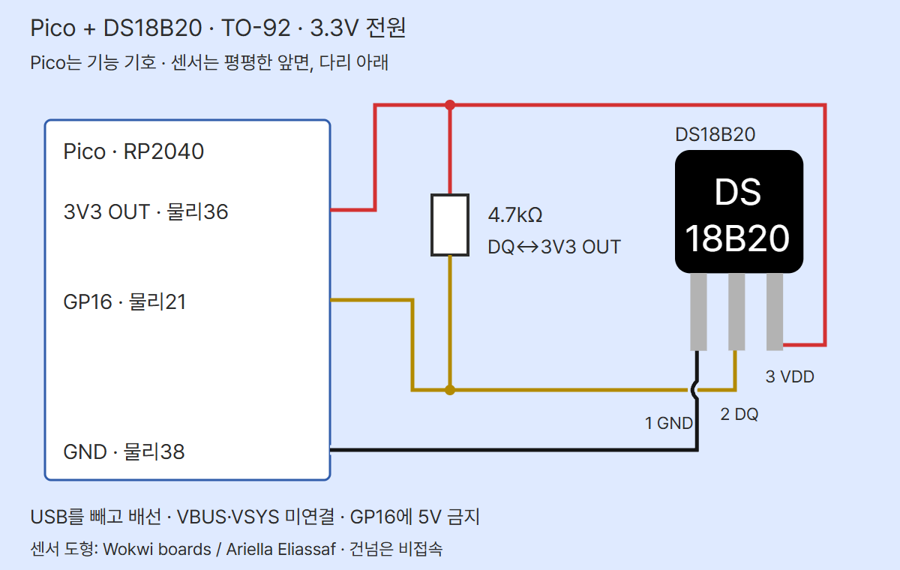

# Pico 12 · DS18B20 디지털 온도

RP2040 Pico, DS18B20 TO-92 한 개, 4.7kΩ 저항, 브레드보드·점퍼선·Micro-USB 데이터 케이블·Thonny를 준비합니다. Pico W/2·방수 프로브·모듈로 자동 대체하지 않습니다.

| 평평한 앞면·다리 아래 | Pico 연결 |
|---|---|
| 왼쪽1 GND | GND · 물리38 |
| 가운데2 DQ | GP16 · 물리21 + 저항 한쪽 |
| 오른쪽3 VDD | 3V3 OUT · 물리36 + 저항 반대쪽 |

USB를 빼고 배선하며 공식 핀맵의 물리 핀 번호를 확인합니다. VBUS·VSYS·외부전원은 미연결입니다. VDD·풀업 모두3.3V이며 GP16에5V를 넣지 않습니다. 기생 전원은 쓰지 않습니다. 같은 접점만 브레드보드의 같은 연결 줄에 꽂아 쇼트를 막습니다.



Pico는 기능 핀 기호이며 실제 보드 배치가 아닙니다. 센서는 공식 Wokwi 핀 GND(1.46,13),DQ(4,13),VCC(6.54,13)에 배율20·위치(900,200)를 적용했습니다.

## 온도 변화에서 표시까지

온도 변화→센서 내부 디지털 변환→DQ 요청·응답→GP16의1-Wire 드라이버→Shell 섭씨 표시입니다. ADC·PWM은 쓰지 않습니다.
풀업4.7kΩ은 아무도 DQ를 당기지 않을 때3.3V 쪽 HIGH로 돌려놓습니다. Pico와 센서는 LOW로 당기거나 놓으며 통신하고 GND를 기준으로 삼습니다. 내장 풀업만으로 외부 저항을 대체하지 않습니다.
센서의64비트 주소 중 첫 바이트0x28은 DS18B20 계열입니다. 해당 계열 한 개일 때만 표시합니다. 변환 요청→750ms 대기→결과 읽기 순서를 지킵니다. 12비트 최대 변환 시간750ms에1000ms와 통신·출력 시간이 더해져 정확한1초 주기가 아닙니다.
12비트 간격0.0625°C와 두 자리 출력, 제조사 정확도±0.5°C(-10~85°C)는 구분합니다. 코드에서 해상도를 직접 설정하거나 보정하지 않습니다.

## 실행

1. 기본 세팅 편에 따라 일반 RP2040 Pico용 RPI_PICO MicroPython 펌웨어를 준비합니다. 예제는 MicroPython v1.29.0 문서 기준입니다.
2. USB를 연결하고 Thonny의 도구 → 옵션 → 인터프리터에서 MicroPython (Raspberry Pi Pico)과 실제 USB 포트를 선택합니다. 버전에 따라 메뉴 위치가 다를 수 있습니다.
3. 새 편집창에 아래 코드를 붙여 넣고 실행(F5)합니다. 반복 실행을 중단하려면 정지 버튼이나 Ctrl+C를 사용합니다.
4. 아래쪽 Shell에서 섭씨 표시를 봅니다. 손으로 센서 몸체를 감싸기 전후 값을 비교하세요. 12비트 설정에서 해상도는 0.0625°C이며, 소수점 두 자리 표시는 정확도와 별개입니다.

## 전체 코드

```python
from machine import Pin
import onewire
import ds18x20
from time import sleep_ms

sensor = ds18x20.DS18X20(onewire.OneWire(Pin(16)))

try:
    while True:
        try:
            roms = [rom for rom in sensor.scan() if rom[0] == 0x28]
            if len(roms) != 1:
                print("Connect exactly one DS18B20:", len(roms))
            else:
                sensor.convert_temp()
                sleep_ms(750)
                temperature = sensor.read_temp(roms[0])
                print("{:.2f} C".format(temperature))
        except Exception as error:  # The driver raises Exception for CRC errors.
            print("1-Wire error:", error)
        sleep_ms(1000)
except KeyboardInterrupt:
    print("STOP")
```

- 처음 네 줄은 GPIO, 1-Wire 통신, 온도 센서 드라이버, 밀리초 대기 기능을 불러옵니다.
- Pin(16)은 GP16을 선택합니다. OneWire는 하나의 DQ 선으로 요청과 응답을 주고받습니다. 풀업은 통신 장치가 선을 놓았을 때 HIGH를 유지합니다.
- while은 측정을 반복합니다. scan은 주소를 검색하고 0x28 계열 DS18B20만 선택합니다. 한 개가 아니면 찾은 개수를 표시합니다.
- convert_temp는 센서에 변환을 요청합니다. sleep_ms(750)은 12비트 변환 최대 시간을 기다립니다. read_temp는 주소에 해당하는 센서의 섭씨 값을 읽습니다.
- format은 소수점 두 자리로 정리하고 print는 Shell에 보냅니다. 예시 형식은 23.50 C이며 실제 측정값은 주변 조건에 따라 달라집니다.
- except는 배선이나 통신 오류가 났을 때 메시지를 표시합니다. 마지막 sleep_ms(1000)은 다음 검색까지 기다립니다.

센서 수가 0이거나 통신 오류가 반복되면 전원을 빼고 핀과 풀업을 확인하세요. 전원 직후 85°C가 보일 때는 변환과 대기 순서, 전원 안정성을 확인하세요. 85°C 자체는 실제로 측정 가능한 온도입니다.

## 출처·사용 조건·검증 범위

- https://www.analog.com/media/en/technical-documentation/data-sheets/DS18B20.pdf
- https://docs.micropython.org/en/v1.29.0/esp8266/tutorial/onewire.html
- https://datasheets.raspberrypi.com/pico/Pico-R3-A4-Pinout.pdf
- https://raw.githubusercontent.com/micropython/micropython-lib/master/micropython/drivers/sensor/ds18x20/ds18x20.py
- https://www.adafruit.com/product/374
- https://micropython.org/download/RPI_PICO/
- https://raw.githubusercontent.com/wokwi/wokwi-boards/main/boards/ds18b20/board.json

공식 1-Wire 예제는 ESP8266 GPIO12의 API 설명이며 이 편은 Pico GP16을 씁니다. Pico 펌웨어에 onewire·ds18x20이 필요합니다. ImportError면 펌웨어·모듈 제공 상태를 확인하며 다른 계열 펌웨어로 바꾸지 않습니다. import·초기화는 try 밖이므로 일반 예외로 끝납니다. CRC 오류는 드라이버가 일반 Exception으로 발생시켜 메시지 후1000ms 기다려 재검색합니다. Ctrl+C는 바깥 KeyboardInterrupt에서 STOP으로 끝납니다.
불·뜨거운 물·침수는 쓰지 않습니다. 비정상 발열·오류 반복이면 USB를 빼고 핀·접점·풀업을 확인합니다. 실제 온도를 만들지 않았으며23.50 C는 출력 형식 예시입니다.
사진은 같은 모델 기존 Adafruit374·MicroPython Pico 공식 원본을 재사용했습니다. 별도 사진 재배포 허가 미확인으로 원권리자 조건을 따릅니다. 센서 도형은 Wokwi boards / Ariella Eliassaf, 별도 이용 조건 미확인입니다. HTML은 로컬 Pretendard 경로에 의존하며 오프라인 단일파일은 보장하지 않습니다. diagram.json은 연결망 기록이며 Wokwi 실행 프로젝트가 아닙니다.
YouTube는 Cache miss로 영상 내용 미확인입니다. 실물·전압·온도·펌웨어·시뮬레이터 미시험이며 사람의 피드백을 받은 것으로 쓰지 않습니다.

2026-11-24 검수: verify.py의 연결망·위험배선거부·주소선택·변환대기·음수·CRC·중단·코드/README일치 검사 PASS. check.mjs의10장1080×1350·순서·ZIP·모바일·사진·배경·하단·편집기 기능 검사 PASS. 전체카드·회로를 시각검수하고 교차·대비·잘림을 수정했습니다. 범용회로검사기는 미지원 조합이며 도식검사는 로컬 글꼴 URL을 차단하므로 편별검사와 시각검수로 보완했습니다. 실물 실행 검증이 아닙니다. 적용스킬: educational-circuit-diagram, diagram-design, codeplant-design, ui-ux-pro-max, humanizer.
