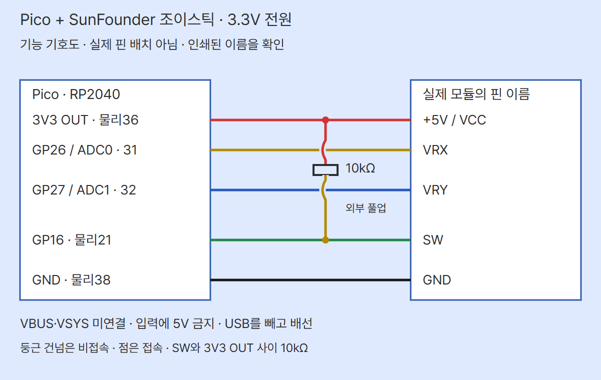

# Pico 13 · 조이스틱의 두 축과 누름 읽기

## 준비물·전원

RP2040 일반 Pico, SunFounder VRX/VRY/SW 조이스틱(공식3.3~5V 지원형), 10kΩ 외부 풀업 저항, 브레드보드·점퍼선·Micro-USB 데이터 케이블·Thonny를 준비합니다. Pico W/2나 핀표가 다른 모듈로 자동 대체하지 않습니다.

| 모듈·저항 | Pico |
|---|---|
| +5V / VCC | 3V3 OUT · 물리36 |
| GND | GND · 물리38 |
| VRX | GP26 / ADC0 · 물리31 |
| VRY | GP27 / ADC1 · 물리32 |
| SW | GP16 · 물리21 |
| 10kΩ 양 끝 | SW와3V3 OUT 사이 |

USB를 빼고 공식 Pico 핀맵에서 USB 방향·물리 번호를 확인합니다. VBUS·VSYS·외부전원은 미연결입니다. +5V로 인쇄되어도 이 지정 모듈은3.3V를 지원하므로 이번에는3V3 OUT에 연결합니다. ADC·SW에5V를 넣지 않습니다. 같은 접점만 같은 브레드보드 연결 줄에 꽂습니다.



그림은 실제 부품 외형·핀 배치가 아닌 기능 기호도입니다. 선의 양 끝은 명시된 단자 중심입니다. 둥근 건넘은 비접속, 점은 접속입니다.

## 동작과 값의 의미

손잡이 움직임→두 가변저항의 접점 전압 변화→GP26·GP27 ADC 읽기→X·Y 표시입니다. 두 축은 차례로 읽어 완전히 같은 시각의 값이 아닙니다.
Pico ADC는12비트이며 read_u16()은0~65535로 늘려 반환합니다. 입력 범위0~3.3V이며16비트 정확도·각도·보정된 전압을 뜻하지 않습니다. 중앙이32768이거나 방향이 항상 같은 것은 아닙니다. 전원·부품 오차와 잡는 방향을 포함해 실제로 비교합니다.
SW는 누르면 GND에 닫히는 접점입니다. 공식 모듈 문서가 외부 풀업을 요구하므로 이 편은10kΩ으로3.3V에 연결합니다. 놓으면 HIGH1, 누르면 LOW0입니다. 저항으로 누름 때 전원이 직접 단락되지 않게 하며 이상적 전류3.3/10000=0.33mA는 계산값, 실측이 아닙니다. 코드는 내부 풀업을 따로 켜지 않습니다.
접점 떨림을 걸러내는 디바운싱·누름 횟수 세기는 구현하지 않습니다. 150ms 대기와 처리 시간이 더해져 정확한 주기·빠른 누름 검출을 보장하지 않습니다.

## Thonny 실행·관찰

1. Pico 기본 세팅을 완료한 RP2040 Pico와 MicroPython v1.29.0 RPI_PICO를 사용합니다. 기존 파일을 지우는 펌웨어 재설치는 이 편에 필요하지 않습니다. 펌웨어 변경 전 파일을 백업합니다.
2. USB를 빼고 배선한 뒤 다시 연결합니다. Thonny 오른쪽 아래 인터프리터에서 MicroPython (Raspberry Pi Pico), 실제 COM 포트를 선택합니다. 메뉴 위치는 버전·언어에 따라 다릅니다.
3. 전체 코드를 새 탭에 붙여 PC에 main.py로 저장하고 F5 또는 실행 버튼을 누릅니다. 처음에는 PC 파일로 실행합니다. 보드에 main.py로 저장하면 재전원 때 자동 실행할 수 있습니다. 추가 라이브러리는 없습니다.
4. Shell에서 손을 뗀 X·Y 범위를 여러 줄 기록합니다. 한 축씩 움직이며 주로 달라지는 숫자를 확인합니다. 천천히 누르고 떼면서 SW의 pressed/released를 확인합니다. 출력 형식은 X=<원시값> Y=<원시값> SW=<상태>이며 실제 센서값을 만들지 않았습니다.
5. Ctrl+C는 STOP으로 종료합니다. 종료는 전원 차단이 아닙니다. 배선 변경·발열·값 고정 때 USB를 빼고 핀·접점·저항을 확인합니다. 값이 끝에서 멈춰도 전압을 높이지 않습니다. 코드에는 단선 자동 진단이 없습니다.

## 전체 코드

```python
from machine import ADC, Pin
from time import sleep_ms

x_axis = ADC(Pin(26))
y_axis = ADC(Pin(27))
button = Pin(16, Pin.IN)  # External 10k pull-up to 3V3 OUT

try:
    while True:
        x = x_axis.read_u16()
        y = y_axis.read_u16()
        pressed = button.value() == 0
        state = "pressed" if pressed else "released"
        print("X={} Y={} SW={}".format(x, y, state))
        sleep_ms(150)
except KeyboardInterrupt:
    print("STOP")
```

## 각 줄의 역할

| 코드 | 역할 |
|---|---|
| from machine import ADC, Pin | 아날로그 읽기와 GPIO 기능 |
| from time import sleep_ms | ms 단위 대기 |
| x_axis=ADC(Pin(26)) | VRX의 GP26을 ADC0로 설정 |
| y_axis=ADC(Pin(27)) | VRY의 GP27을 ADC1로 설정 |
| button=Pin(16,Pin.IN) | 외부10kΩ 풀업이 있는 GP16 디지털 입력 |
| try / while True | 종료 신호를 처리하며 반복 |
| x=... / y=... | 두 ADC를 순서대로 읽기 |
| pressed=button.value()==0 | LOW면 누름으로 판단 |
| state=... | 참이면 pressed, 아니면 released |
| print(...format(...)) | 세 값을 Shell 한 줄로 표시 |
| sleep_ms(150) | 매 출력 뒤150ms 대기 |
| except KeyboardInterrupt / STOP | Ctrl+C로 종료 |

import·객체 생성·일반 읽기 오류는 예외를 숨기지 않고 Thonny 오류로 끝납니다. 자동 재시도하지 않습니다. STOP은 KeyboardInterrupt만 처리합니다.

## 출처와 검증 범위

- https://docs.sunfounder.com/projects/esp32-starter-kit/en/latest/components/component_joystick_module.html
- https://docs.micropython.org/en/v1.29.0/rp2/quickref.html
- https://docs.micropython.org/en/v1.29.0/library/machine.ADC.html
- https://datasheets.raspberrypi.com/pico/Pico-R3-A4-Pinout.pdf
- https://micropython.org/download/RPI_PICO/
- https://docs.sunfounder.com/projects/umsk/en/latest/_images/09_joystick.png

SunFounder 공식 문서에서3.3~5V 전원·가변저항 두 개·외부 SW 풀업 요구를 확인했습니다. 기존 ESP32 편의 내부 풀업 설명을 이번 Pico 편에 그대로 복사하지 않았습니다. 사진은 같은 모델 기존 공식 보관본을 재사용했으며 별도 재배포 허가는 미확인입니다. 원권리자 조건을 따릅니다. 기능 도식은 자체 SVG입니다. 로컬 Pretendard 경로에 의존하므로 HTML 단일파일 오프라인 실행은 보장하지 않습니다. diagram.json은 연결망 기록이며 Wokwi 실행 프로젝트가 아닙니다.
YouTube는 Cache miss로 영상 내용을 확인하지 못했습니다. 실물·전압·펌웨어·시뮬레이터 미시험이며 교사·학생의 실제 피드백을 받은 것으로 쓰지 않습니다.

2026-11-25 검수: verify.py의7개net·위험변이거부·ADC두축경계·SW두상태·순차읽기·150ms·Ctrl+C·오류전파·README코드일치 PASS. check.mjs의10장1080×1350·순서·ZIP·사진·배경·모바일·하단·편집기 기능 PASS. 전체카드와 회로를 시각검수했습니다. 범용회로검사기는 미지원 조합이며 도식검사기는 로컬글꼴 URL을 차단하므로 편별검사와 실제 PNG로 보완했습니다. 실물실행 검증은 아닙니다. 적용스킬: educational-circuit-diagram, diagram-design, codeplant-design, ui-ux-pro-max, humanizer.
