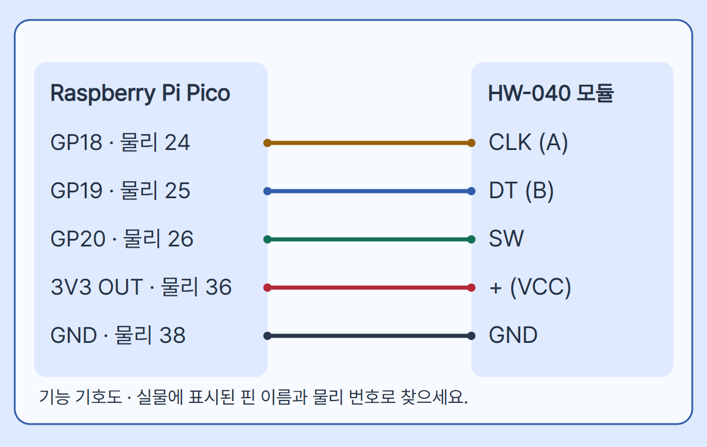
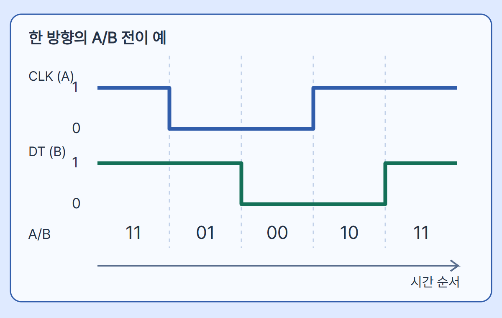

# 14 · 회전 방향을 읽는 로터리 인코더

Raspberry Pi Pico(RP2040), SunFounder HW-040 5핀 모듈, 점퍼선 5개, Micro-USB 데이터 케이블, Pico용 MicroPython, Thonny가 필요합니다.

## 3.3V 배선

USB를 뺀 뒤 연결하세요. GP는 코드에서 쓰는 이름이고 물리 번호는 보드의 핀 위치입니다.

| 모듈 | Pico 연결 | 역할 |
|---|---|---|
| CLK (A) | GP18 (물리 24) | 회전 신호 A |
| DT (B) | GP19 (물리 25) | 회전 신호 B |
| SW | GP20 (물리 26) | 누름 입력 |
| + (VCC) | 3V3 OUT (물리 36) | 3.3V 전원 |
| GND | GND (물리 38) | 공통 접지 |

실제 핀은 [Pico 공식 핀맵](https://datasheets.raspberrypi.com/pico/Pico-R3-A4-Pinout.pdf)과 모듈에 인쇄된 이름으로 찾으세요. VBUS와 VSYS는 비워 둡니다. GPIO와 모듈 +에 5V를 넣지 마세요. SW는 손을 떼면 풀업에 의해 1(HIGH)이고 누르면 GND에 이어져 0(LOW)입니다.

## Thonny에서 실행

1. [Pico 기본 세팅](../001-basic-setup/README.md)에 따라 RP2040 Pico용 UF2를 설치합니다. 코드는 MicroPython 1.29.0의 Pin·time API 기준입니다.
2. 배선을 확인하고 USB를 꽂습니다. Thonny 우측 하단에서 **MicroPython (Raspberry Pi Pico)**와 실제 COM 포트를 선택합니다. 환경에 따라 **Run → Select interpreter** 또는 **Tools → Options → Interpreter**에서 설정을 엽니다.
3. **File → Open**에서 PC에 저장한 [main.py](main.py)를 열고 **Run → Run current script (F5)**를 누릅니다. **View → Shell**로 아래 출력창을 열 수 있습니다. 중지는 Ctrl+C입니다. 별도 라이브러리는 필요 없습니다.
4. [Thonny 공식 화면](https://thonny.org/)은 편집창과 Shell의 위치를 찾는 참고 화면입니다. 이 화면에는 Thonny 기본 Python 예제가 표시됩니다. Pico 인터프리터는 2단계에서 별도로 선택하세요.

[공식 참고 화면 원본](https://thonny.org/img/screenshot.png)

## 전체 코드

~~~python
from machine import Pin
from time import sleep_ms, ticks_ms, ticks_diff

CLK = Pin(18, Pin.IN, Pin.PULL_UP)
DT = Pin(19, Pin.IN, Pin.PULL_UP)
SW = Pin(20, Pin.IN, Pin.PULL_UP)
DEBOUNCE_MS = 30

# Index: previous A/B followed by current A/B.
STEP = (0, -1, 1, 0, 1, 0, 0, -1, -1, 0, 0, 1, 0, 1, -1, 0)

def read_ab():
    return (CLK.value() << 1) | DT.value()

def advance(previous, current, pending):
    if (previous ^ current) == 3:
        return 0, 0
    pending += STEP[(previous << 2) | current]
    if pending == 4:
        return 0, 1
    if pending == -4:
        return 0, -1
    return pending, 0

def run():
    previous = read_ab()
    pending = position = 0
    stable = raw = SW.value()
    changed_at = ticks_ms()
    print("pos=", position, "sw=", stable)
    while True:
        current = read_ab()
        pending, delta = advance(previous, current, pending)
        previous = current
        position += delta

        sample = SW.value()
        now = ticks_ms()
        if sample != raw:
            raw, changed_at = sample, now
        changed = raw != stable and ticks_diff(now, changed_at) >= DEBOUNCE_MS
        if changed:
            stable = raw
        if delta or changed:
            print("pos=", position, "sw=", stable)
        sleep_ms(1)

if __name__ == "__main__":
    run()
~~~

## 신호에서 코드로

| 코드 | 역할 |
|---|---|
| Pin, Pin.IN, Pin.PULL_UP | GP18·GP19·GP20을 풀업 입력으로 설정합니다. |
| STEP, read_ab() | CLK를 앞 비트, DT를 뒤 비트에 넣습니다. STEP 표에 이전 조합과 새 조합을 넣어 전이 방향을 구분합니다. |
| advance() | 두 비트가 함께 바뀌면 누적을 초기화합니다. 정상 전이가 한쪽으로 네 번 쌓이면 pos를 +1 또는 −1 바꿉니다. |
| previous, pending, position | 직전 입력 조합, 남은 전이 누적, 상대 카운트입니다. |
| sample, raw, stable, changed_at | SW의 현재 샘플, 마지막 변화 때의 값, 확정한 값, 마지막 변화 시각을 저장합니다. |
| ticks_ms(), ticks_diff(), DEBOUNCE_MS | 새 상태가 30ms 이상 유지됐는지 계산합니다. |
| print() | 시작할 때 한 줄을 표시하고, 이후에는 pos나 확정한 SW가 바뀔 때 출력합니다. |
| sleep_ms(1) | 반복 사이에 1ms 대기합니다. 샘플 간격에는 읽기와 출력 시간도 더해집니다. |
| if __name__ == "__main__" | 파일을 직접 실행할 때 run()을 시작합니다. |

## 관찰과 점검

- 손잡이를 놓고 시작하면 pos= 0 sw= 1을 예상할 수 있습니다. 한 방향으로 천천히 돌린 뒤 반대로 돌려 값의 변화 방향을 확인하세요.
- 입력 조합 11 → 01 → 00 → 10 → 11을 이 코드에서는 +1로 셉니다. 역순이면 −1입니다. 부호와 걸림당 카운트는 실물에서 확인하세요. pos는 시작한 위치를 기준으로 한 카운트이며 각도나 회전수로 직접 환산할 수 없습니다.
- 30ms 이상 눌렀다 떼어 sw= 0과 sw= 1을 확인하세요. 빠른 회전이나 짧은 누름은 놓칠 수 있습니다.
- 값이 바뀌지 않거나 불규칙하면 USB를 빼고 CLK·DT·SW와 공통 GND를 확인하세요.

## 검증과 출처

python verify.py로 CPython 구문, 합성 A/B·SW 입력, 배선망과 코드 일치를 검사합니다. 실제 보드·부품의 동작과 펌웨어 실행은 시험하지 않았습니다.

- [SunFounder 모듈 사양과 사진](https://docs.sunfounder.com/projects/umsk/en/latest/01_components_basic/17-component_rotary_encoder.html), [Pico 계열 실습](https://docs.sunfounder.com/projects/umsk/en/latest/04_pi_pico/pico_lesson17_rotary_encoder.html), [3.3V 배선 예](https://docs.sunfounder.com/projects/ai-lab-kit/en/latest/python/2.12_rotatary_encoder_python.html)
- [MicroPython Pico 배포와 보드 사진](https://micropython.org/download/RPI_PICO/), [Pin API](https://docs.micropython.org/en/v1.29.0/library/machine.Pin.html), [time API](https://docs.micropython.org/en/v1.29.0/library/time.html)
- 제품 사진은 표시 크기를 조정했습니다. 별도 재배포 라이선스는 확인하지 못했으며 원권리자의 사용 조건을 따릅니다.
- [CODEPLANT 유튜브](https://www.youtube.com/@codeplant2024)는 이번 조회에서 영상 목록을 확인하지 못했습니다.
