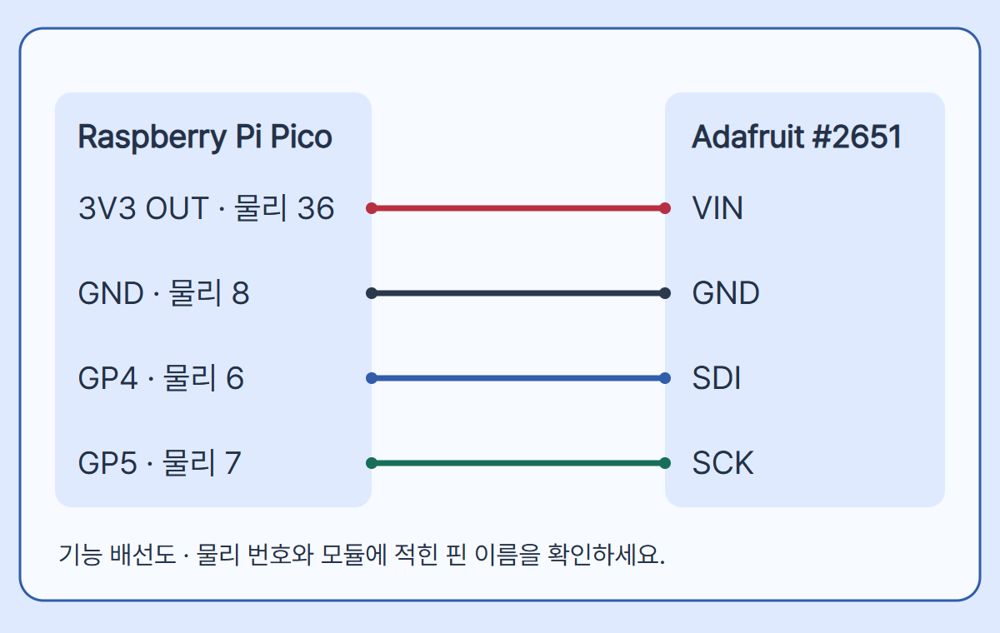
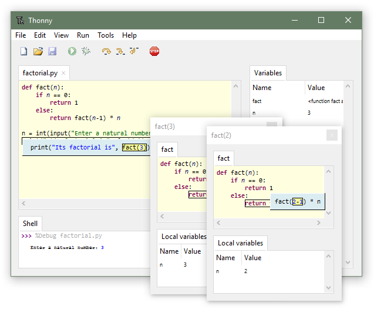
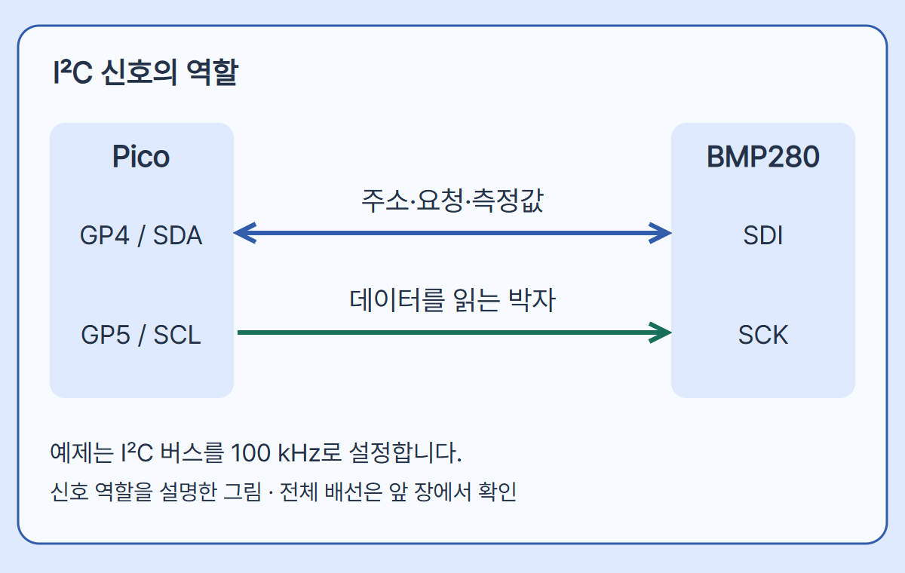

# 15 · 공기의 압력과 온도를 읽는 BMP280

Raspberry Pi Pico(RP2040), Adafruit BMP280 #2651 STEMMA QT 브레이크아웃, 점퍼선 4개, Micro-USB 데이터 케이블, Pico용 MicroPython과 Thonny가 필요합니다. 센서의 통기구는 가리지 마세요.

## 배선

USB를 뺀 뒤 모듈 핀 헤더를 연결합니다. 아래 GP 번호는 코드의 GPIO 이름이고, 물리 번호는 보드에서 핀을 찾을 때 사용합니다.

| Pico | Adafruit BMP280 | 역할 |
|---|---|---|
| 3V3 OUT (물리 36) | VIN | 3.3V 전원 |
| GND (물리 8) | GND | 공통 접지 |
| GP4 (물리 6) | SDI | I²C 데이터 SDA |
| GP5 (물리 7) | SCK | I²C 클록 SCL |

[Pico 공식 핀맵](https://datasheets.raspberrypi.com/pico/Pico-R3-A4-Pinout.pdf)에서 실제 핀 위치를 찾고 모듈에 인쇄된 단자 이름을 확인하세요. 3Vo는 이 모듈의 조정기 출력입니다. 3Vo·SDO·CS 및 QT 커넥터를 연결하지 않습니다. Pico의 VBUS와 VSYS도 비워 두고 GPIO에 5V를 넣지 마세요. 다른 이름이나 전원 사양의 BMP280 모듈에는 그 제품의 설명서를 먼저 확인하세요.

## Thonny에서 실행

1. [Pico 기본 세팅](../001-basic-setup/README.md)에 따라 RP2040 Pico용 UF2를 설치하세요. 이 예제는 MicroPython 1.29.0의 I²C API를 기준으로 작성했고 별도 라이브러리는 필요 없습니다.
2. 배선을 확인하고 USB를 연결한 뒤, Thonny 우측 하단에서 **MicroPython (Raspberry Pi Pico)**와 실제 COM 포트를 선택합니다. 버전과 언어에 따라 **Run → Select interpreter** 또는 **Tools → Options → Interpreter**에 같은 설정이 있습니다.
3. **File → Open**에서 [main.py](main.py)를 열고 **Run → Run current script (F5)**를 누르세요. 주소 목록과 온도·기압이 아래 **Shell**에 나타나는지 확인하세요. 숨겨져 있으면 **View → Shell**을 선택합니다. 중지는 Shell에서 Ctrl+C입니다.

아래는 편집창과 Shell 위치를 보여 주는 [Thonny 공식 참고 화면](https://thonny.org/img/screenshot.png)입니다. 그림 속 코드는 기본 Python 예제입니다. Pico 인터프리터는 위 2단계에서 선택하세요.

## 전체 코드

~~~python
from machine import I2C, Pin
from time import sleep_ms
from struct import unpack

def compensate(raw_t, raw_p, trim):
    t1, t2, t3, p1, p2, p3, p4, p5, p6, p7, p8, p9 = trim
    dt = raw_t / 16384 - t1 / 1024
    fine = dt * t2 + (raw_t / 131072 - t1 / 8192) ** 2 * t3
    v = fine / 2 - 64000
    offset = (v * v * p6 / 32768 + v * p5 * 2) / 4 + p4 * 65536
    gain = (1 + (p3 * v * v / 524288 + p2 * v) / 524288 / 32768) * p1
    if gain == 0:
        raise ValueError("BMP280 trim")
    pressure = (1048576 - raw_p - offset / 4096) * 6250 / gain
    pressure += (p9 * pressure * pressure / 2147483648
                 + pressure * p8 / 32768 + p7) / 16
    return fine / 5120, pressure / 100

def run():
    i2c = I2C(0, sda=Pin(4), scl=Pin(5), freq=100_000)
    sleep_ms(10)
    addresses = i2c.scan()
    print("I2C:", [hex(a) for a in addresses])
    matches = [a for a in (0x77, 0x76) if a in addresses
               and i2c.readfrom_mem(a, 0xD0, 1) == b'\x58']
    if len(matches) != 1:
        raise ValueError("Connect exactly one BMP280 (ID 0x58)")
    addr = matches[0]
    if i2c.readfrom_mem(addr, 0xF3, 1)[0] & 0x01:
        raise OSError("BMP280 calibration data not ready")
    trim = unpack("<HhhHhhhhhhhh", i2c.readfrom_mem(addr, 0x88, 24))
    while True:
        i2c.writeto_mem(addr, 0xF4, b'\x25')
        sleep_ms(20)
        if i2c.readfrom_mem(addr, 0xF3, 1)[0] & 0x08:
            raise OSError("BMP280 conversion still busy")
        data = i2c.readfrom_mem(addr, 0xF7, 6)
        raw_p = int.from_bytes(data[:3], "big") >> 4
        raw_t = int.from_bytes(data[3:], "big") >> 4
        temp_c, pressure_hpa = compensate(raw_t, raw_p, trim)
        print("T={:.2f} C  P={:.2f} hPa".format(temp_c, pressure_hpa))
        sleep_ms(1000)

if __name__ == "__main__":
    run()
~~~

## 코드의 역할

| 코드 | 역할 |
|---|---|
| I2C(0, sda=Pin(4), scl=Pin(5), freq=100_000) | Pico I²C0을 100 kHz로 열고 GP4에 데이터, GP5에 클록을 배정합니다. |
| scan(), matches | 장치의 7비트 주소를 목록으로 얻습니다. 0x77과 0x76 중 ID 레지스터 0xD0에서 0x58을 돌려주는 장치가 하나인지 확인합니다. |
| 0xF3 비트 0, 0x88, unpack() | 내부 보정값 복사가 끝났는지 확인하고 0x88부터 24바이트를 읽어 온도·기압 계수 12개를 복원합니다. |
| writeto_mem(…, 0xF4, b'\x25') | 온도와 기압 각각 1회 샘플링을 활성화하고 강제 측정 한 번을 시작합니다. |
| sleep_ms(20), 0xF3 비트 3 | 최대 변환 시간에 여유를 두고 기다린 뒤, 아직 변환 중인지 검사합니다. |
| readfrom_mem(…, 0xF7, 6), int.from_bytes(), >> 4 | 기압과 온도의 각 3바이트에서 상위 20비트의 원시값을 읽습니다. |
| compensate() | 원시 온도와 계수로 fine과 °C를 구합니다. fine, 원시 기압, 기압 계수를 함께 적용해 Pa를 계산한 뒤 100으로 나눠 hPa로 바꿉니다. |
| print(), sleep_ms(1000) | Shell에 T(°C)와 P(hPa)를 찍고 다음 측정 전 1초 쉽니다. 통신과 변환 시간이 더해집니다. |

## 관찰과 점검

- 주소 목록에 기본 0x77이 있는지 확인하세요. 0x76은 SDO를 GND에 묶어 주소를 변경한 경우입니다. 주소가 보여도 ID가 다르면 부품 표기를 확인하세요. 이 코드는 BMP280 한 개를 대상으로 합니다.
- 온도는 칩에서 읽은 값입니다. 센서와 보드 주변의 열 영향을 받을 수 있으므로 기상 관측소 기온과 같다고 가정하지 않습니다.
- 같은 위치에서 기압을 기록합니다. 안전하게 접근할 수 있다면 다른 층에서도 같은 방법으로 기록하세요. 높은 곳에서 기압이 낮아지는 경향이 있지만, 가까운 층 사이의 차이가 같은 자리의 변동 폭보다 작으면 이 실습에서 쉽게 구분되지 않을 수 있습니다.
- 기상 앱의 해면 보정 기압과 이 코드의 현지 기압은 기준이 다를 수 있습니다. 두 자리로 표시되는 값의 자릿수와 센서 정확도를 구분하세요.
- 주소 목록이 비면 USB를 뺀 뒤 3V3 OUT, GND, SDI, SCK를 확인하세요. 습도를 재려면 습도 측정이 가능한 부품을 골라야 합니다.

## 검증과 출처

python verify.py는 CPython에서 구문, 4개 배선망, 센서 주소와 ID 검사, 강제 측정 명령 및 20비트 해석, 합성 입력 보정 계산과 오류 처리를 확인합니다. 실제 Pico·BMP280, 전압, 펌웨어 및 하드웨어 시뮬레이터는 시험하지 않았습니다.

- [Bosch BMP280 데이터시트](https://www.bosch-sensortec.com/media/boschsensortec/downloads/datasheets/bst-bmp280-ds001.pdf)의 보정식과 레지스터 표를 참고했습니다.
- [Adafruit #2651 제품 사진과 전원 사양](https://www.adafruit.com/product/2651), [모듈 핀 안내](https://learn.adafruit.com/adafruit-bmp280-barometric-pressure-plus-temperature-sensor-breakout/pinouts), [Adafruit I²C 기본 주소 안내](https://learn.adafruit.com/adafruit-bmp280-barometric-pressure-plus-temperature-sensor-breakout?view=all)
- [Raspberry Pi Pico 핀맵](https://datasheets.raspberrypi.com/pico/Pico-R3-A4-Pinout.pdf), [MicroPython RP2 하드웨어 I²C](https://docs.micropython.org/en/v1.29.0/rp2/quickref.html#hardware-i2c-bus), [MicroPython Pico 배포와 보드 사진](https://micropython.org/download/RPI_PICO/)
- 제품 사진과 참고 화면은 원권리자의 사용 조건을 따릅니다. 별도 재배포 라이선스는 확인하지 못했습니다.
- [CODEPLANT 유튜브](https://www.youtube.com/@codeplant2024)는 조회했으나 페이지 본문을 확인하지 못했습니다.
