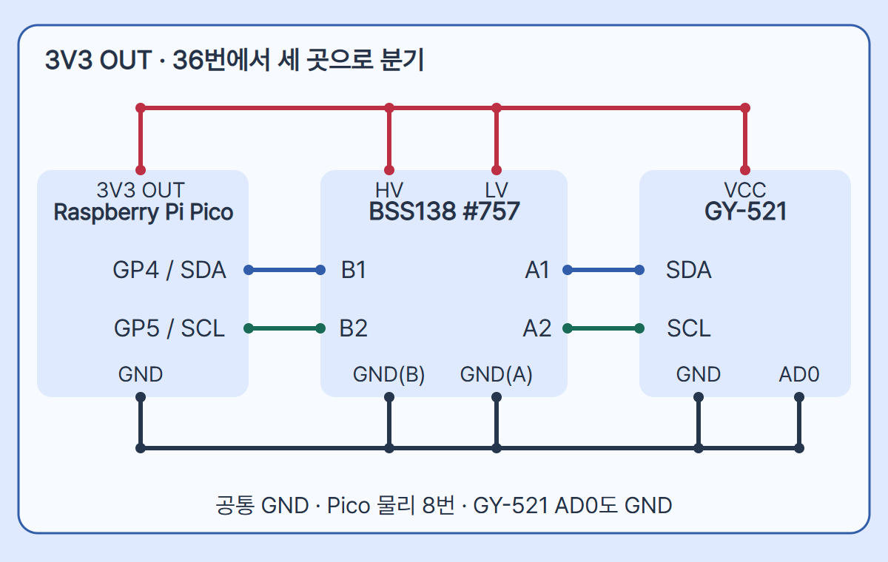
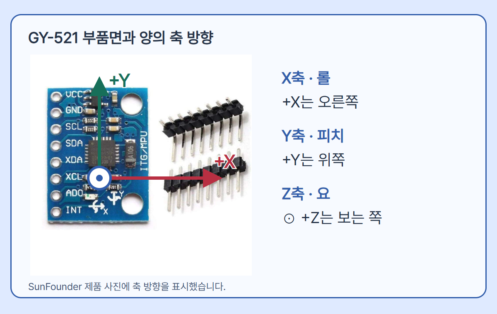

# 16 · 기울기와 상대 회전을 읽는 MPU6050

Raspberry Pi Pico(RP2040), 파란색 8핀 SunFounder GY-521(SF-0122) 3.3V 공급 지원형, Adafruit #757 BSS138 양방향 I²C 변환기, 브레드보드·점퍼선, USB 데이터 케이블, Thonny를 준비하세요. 모듈에는 3.3V 레귤레이터가 탑재돼 있습니다. 외형이 비슷한 모듈은 VCC 지원 범위와 핀 이름을 제조사 자료에서 따로 확인하세요.

## 1. 전원과 배선

USB를 빼고 연결합니다. VBUS나 VSYS는 사용하지 않습니다. GPIO에 5V를 넣지 마세요.

| Pico 또는 모듈 핀 | 연결 경로 |
|---|---|
| 3V3 OUT · 물리 36 | GY-521 VCC, 변환기 LV, 변환기 HV에 분기 |
| GND · 물리 8 | GY-521 GND와 변환기 양쪽 GND에 분기 |
| GP4 · 물리 6 | B1을 거쳐 변환기 A1쪽에서 GY-521 SDA로 |
| GP5 · 물리 7 | B2를 거쳐 변환기 A2쪽에서 GY-521 SCL로 |
| GY-521 AD0 | GY-521 GND와 연결해 7비트 주소 0x68 선택 |
| XDA·XCL·INT와 변환기 채널 3·4 | 미연결 |

전원선은 모듈에 전기를 공급합니다. LV와 HV는 양쪽 I²C 신호가 HIGH로 올라갈 때의 기준입니다. I²C 장치는 연결선을 LOW로 끌어내리거나 놓습니다. 풀업은 장치가 선을 놓을 때 그 선을 기준 전압 쪽으로 끌어올립니다. 이 실습에서는 3V3 OUT 하나를 사용해 변환기 양쪽의 신호 기준과 모듈의 공급 전압을 3.3V로 맞춥니다. BSS138은 양쪽의 LOW를 전달하며 이 배선에서는 두 쪽의 HIGH 기준이 같습니다. [Nexperia AN10441](https://assets.nexperia.com/documents/application-note/AN10441.pdf)는 두 기준 전압이 같은 조건을 포함합니다. 변환기에는 10 kΩ 풀업이 있어 추가 풀업을 넣지 않습니다. B1–A1과 B2–A2 사이에 점퍼를 따로 꽂지 마세요.

회로는 연결 관계를 읽는 기능 배선도입니다. [Pico 공식 핀맵](https://datasheets.raspberrypi.com/pico/Pico-R3-A4-Pinout.pdf)에서 물리 위치를 확인하세요. 변환기 양쪽에 GND가 인쇄돼 있으며 그림의 GND(B)와 GND(A)는 어느 쪽인지 알려 주는 표기입니다. GY-521의 XDA·XCL은 보조 I²C, INT는 이벤트 알림 출력입니다. 이 예제는 주 I²C의 SDA와 SCL을 주기적으로 읽습니다.

## 2. Thonny에서 실행

1. [Pico 기본 세팅](../001-basic-setup/README.md)을 따라 RP2040 Pico용 MicroPython UF2를 설치하세요. 예제는 MicroPython 1.29.0의 I²C와 time API를 기준으로 작성했습니다. 외부 라이브러리는 필요 없습니다.
2. 배선을 확인하고 USB를 연결하세요. Thonny 오른쪽 아래에서 **MicroPython (Raspberry Pi Pico)**와 실제 COM 포트를 고릅니다. 버전과 언어에 따라 **Run → Select interpreter** 또는 **Tools → Options → Interpreter**에서 같은 설정을 엽니다.
3. PC에 저장한 [main.py](main.py)를 **File → Open**에서 열고 **Run → Run current script (F5)**를 누르세요. 하단 **Shell**에서 I²C 주소와 정지 안내를 확인합니다. 출력창이 숨겨져 있으면 **View → Shell**을 선택합니다.
4. 부품면을 위로 둔 채 약 2초 동안 손을 떼세요. READY가 나온 뒤 움직입니다. 정지 보정부터 다시 하려면 Ctrl+C로 멈추고 평평한 상태에서 다시 F5를 누르세요.

[Thonny 공식 참고 화면](https://thonny.org/img/screenshot.png)은 편집창과 Shell 위치를 설명하는 그림입니다. 그림 속 코드는 Thonny 기본 Python 예제입니다.

## 3. 전체 코드

~~~python
from machine import I2C, Pin
from math import asin, atan2, cos, pi, sin, sqrt
from struct import unpack
from time import sleep_ms, ticks_diff, ticks_us

ADDRESS = 0x68
DEG = 180 / pi
RAD = pi / 180
GRAVITY_GAIN = 2.0
CAL_SAMPLES = 100

def decode(data):
    ax, ay, az, _temperature, gx, gy, gz = unpack(">7h", data)
    return (ax / 16384, ay / 16384, az / 16384,
            gx / 131, gy / 131, gz / 131)

def configure(i2c):
    addresses = i2c.scan()
    print("I2C:", [hex(address) for address in addresses])
    if ADDRESS not in addresses:
        raise OSError("MPU6050 0x68 not found; check AD0, wiring and power")
    if i2c.readfrom_mem(ADDRESS, 0x75, 1) != b'\x68':
        raise ValueError("MPU6050 WHO_AM_I mismatch")

    i2c.writeto_mem(ADDRESS, 0x6B, b'\x80')
    sleep_ms(100)
    i2c.writeto_mem(ADDRESS, 0x6B, b'\x01')
    sleep_ms(100)
    for register, value in ((0x1A, 4), (0x19, 19), (0x1B, 0), (0x1C, 0)):
        i2c.writeto_mem(ADDRESS, register, bytes([value]))

def read_sample(i2c):
    return decode(i2c.readfrom_mem(ADDRESS, 0x3B, 14))

def calibrate(i2c):
    print("Keep the sensor still for about 2 seconds.")
    sums = [0.0] * 6
    for _ in range(CAL_SAMPLES):
        sample = read_sample(i2c)
        for axis, value in enumerate(sample):
            sums[axis] += value
        sleep_ms(20)
    means = tuple(value / CAL_SAMPLES for value in sums)
    return means[:3], means[3:]

def initial_orientation(accel):
    ax, ay, az = accel
    magnitude = sqrt(ax * ax + ay * ay + az * az)
    if not 0.8 <= magnitude <= 1.2:
        raise ValueError("Start again with the module resting still")
    roll = atan2(ay, az)
    pitch = atan2(-ax, sqrt(ay * ay + az * az))
    cr, sr = cos(roll / 2), sin(roll / 2)
    cp, sp = cos(pitch / 2), sin(pitch / 2)
    return cr * cp, sr * cp, cr * sp, -sr * sp

def update_orientation(q, accel, corrected_dps, dt):
    w, x, y, z = q
    gx, gy, gz = (rate * RAD for rate in corrected_dps)
    ax, ay, az = accel
    magnitude = sqrt(ax * ax + ay * ay + az * az)
    if 0.90 <= magnitude <= 1.10:
        ax, ay, az = ax / magnitude, ay / magnitude, az / magnitude
        up_x = 2 * (x * z - w * y)
        up_y = 2 * (y * z + w * x)
        up_z = 1 - 2 * (x * x + y * y)
        gx += GRAVITY_GAIN * (ay * up_z - az * up_y)
        gy += GRAVITY_GAIN * (az * up_x - ax * up_z)
        gz += GRAVITY_GAIN * (ax * up_y - ay * up_x)

    half = dt / 2
    next_q = (w + half * (-x * gx - y * gy - z * gz),
              x + half * (w * gx + y * gz - z * gy),
              y + half * (w * gy - x * gz + z * gx),
              z + half * (w * gz + x * gy - y * gx))
    length = sqrt(sum(value * value for value in next_q))
    return tuple(value / length for value in next_q)

def angles(q):
    w, x, y, z = q
    roll = atan2(2 * (w * x + y * z), 1 - 2 * (x * x + y * y)) * DEG
    sin_pitch = max(-1.0, min(1.0, 2 * (w * y - z * x)))
    pitch = asin(sin_pitch) * DEG
    yaw = atan2(2 * (w * z + x * y), 1 - 2 * (y * y + z * z)) * DEG
    return roll, pitch, (yaw + 180) % 360 - 180

def run():
    i2c = I2C(0, sda=Pin(4), scl=Pin(5), freq=100_000)
    sleep_ms(100)
    configure(i2c)
    accel, gyro_bias = calibrate(i2c)
    q = initial_orientation(accel)
    print("gyro_bias [deg/s]:", gyro_bias)
    print("READY: roll_deg  pitch_deg  yaw_rel_deg")
    previous = last_print = ticks_us()

    while True:
        sleep_ms(20)
        sample = read_sample(i2c)
        now = ticks_us()
        dt = ticks_diff(now, previous) / 1_000_000
        previous = now
        if not 0 < dt <= 0.1:
            raise OSError("Sample timing gap; restart while the sensor is still")
        rotation = tuple(value - bias for value, bias in zip(sample[3:], gyro_bias))
        q = update_orientation(q, sample[:3], rotation, dt)
        if ticks_diff(now, last_print) >= 250_000:
            roll, pitch, yaw = angles(q)
            print("R={:.1f} P={:.1f} Yrel={:.1f} deg dt={:.1f} ms".format(
                  roll, pitch, yaw, dt * 1000))
            last_print = now

if __name__ == "__main__":
    run()
~~~

## 4. 신호를 읽고 각도를 구하는 과정

| 코드 | 하는 일 |
|---|---|
| I2C(0, sda=Pin(4), scl=Pin(5), freq=100_000) | RP2040 I²C0을 열고 데이터 SDA와 클록 SCL을 설정합니다. |
| scan(), readfrom_mem(… 0x75 …) | AD0가 LOW일 때의 버스 주소 0x68을 찾습니다. 별도의 식별 레지스터 WHO_AM_I에서 0x68을 읽는지도 확인합니다. |
| 0x6B = 0x80, 0x01 | 기존 설정을 초기화합니다. 이후 절전을 풀고 X축 자이로 PLL을 기준 클록으로 고릅니다. 각각 100ms 기다립니다. |
| 0x1A = 4, 0x19 = 19 | 디지털 저역통과 필터를 설정하고 자이로의 필터 적용 1kHz 기준을 20으로 나눠 내부 50Hz를 설정합니다. |
| 0x1B = 0, 0x1C = 0 | 자이로 ±250°/s와 가속도 ±2g 범위를 설정합니다. |
| 0x3B부터 14바이트, unpack(">7h") | 가속도 세 축, 칩 온도, 자이로 세 축을 상위 바이트 먼저인 부호 있는 16비트 수로 읽습니다. 온도는 자세 계산에 쓰지 않습니다. |
| decode() | 가속도는 16,384 LSB/g, 각속도는 131 LSB/(°/s)로 나눕니다. |
| calibrate() | 정지 상태의 100개 값을 평균합니다. 가속도 평균으로 기울기의 시작 기준을 구하고, 자이로 평균을 이후 읽기에서 뺍니다. |
| initial_orientation() | atan2(ay, az)와 atan2(−ax, √(ay²+az²))로 시작 롤·피치를 추정하고 요 0°를 기준으로 둡니다. |
| ticks_us(), ticks_diff() | 두 읽기 사이의 실제 마이크로초를 초 단위 dt로 바꿉니다. 100ms를 넘는 공백이면 정지 상태에서 재시작하도록 안내합니다. |
| update_orientation() | 3축 각속도를 rad/s로 바꿔 자세를 나타내는 네 성분인 쿼터니언을 갱신합니다. 가속도 크기가 0.90~1.10g일 때 추정한 위쪽 방향을 가속도 방향에 서서히 맞춥니다. 이 범위 안의 이동 가속도도 추정에 영향을 줄 수 있습니다. |
| angles(), print() | ZYX 순서의 롤·피치·요를 도 단위로 표시합니다. 250ms 이상 경과할 때마다 출력하며 표시 간격에는 반복과 출력 시간이 더해집니다. |

내부 샘플 설정은 50Hz입니다. Pico는 20ms씩 쉬면서 실제 데이터 읽기 간격을 잽니다. Shell에 출력하는 줄의 간격과 센서 내부 샘플 설정은 다릅니다.

## 5. 축과 관찰

부품면을 위로 하고 평평하게 놓으면 일반적으로 +Z 쪽에 약 1g가 나타납니다. 아래는 오른손 방향과 평평한 출발 자세를 기준으로 한 활동입니다.

| 움직임 | 볼 값 |
|---|---|
| +Y 가장자리를 천천히 들어 올립니다. | X축 기준 롤 R이 변합니다. |
| 원위치로 둔 뒤 +X 가장자리를 조금 내립니다. | Y축 기준 피치 P가 변합니다. |
| 평평하게 놓고 위에서 보아 반시계 방향으로 돌립니다. | Z축 기준 Yrel이 변합니다. |

1g는 약 9.81 m/s²입니다. 급하게 흔들면 이동으로 생긴 가속도가 더해집니다. 먼저 한 축씩 작은 각도로 움직여 보세요. 피치가 ±90° 근처에 이르면 이 Euler 표시에서 롤과 요를 따로 읽기 어렵습니다.

가속도로 위아래 방향은 추정할 수 있지만, 평평한 상태에서 어느 방위를 바라보는지는 알 수 없습니다. 나침반 센서가 없는 MPU6050에서 요는 시작 방향을 기준으로 한 추정입니다. 남은 자이로 편향이 쌓이면 멈춘 뒤에도 값이 서서히 달라질 수 있습니다. [Analog Devices 기울기 앱노트](https://www.analog.com/en/resources/app-notes/an-1057.html)는 가속도를 기울기로 해석할 때의 조건을 설명합니다. 출력은 −180° 이상, +180° 미만 범위로 접습니다. +179°에서 −179°로 이어져도 큰 역회전을 뜻하지 않습니다.

표시 형식의 예시는 R=<롤> P=<피치> Yrel=<상대 요> deg dt=<갱신 간격> ms입니다. 이 칸의 값은 센서를 연결해 직접 기록하세요. 0x68이 보이지 않으면 USB를 빼고 공통 GND, 3V3 분기, SDA·SCL 채널과 AD0를 점검하세요.

## 6. 검증과 출처

python verify.py는 배선망 및 코드 일치, 합성 I²C 읽기, 변환 범위, 정지·롤·피치·요의 합성 입력을 검사합니다. 실제 Pico/GY-521·BSS138 조합의 전압, 자세 정확도, 펌웨어 실행 및 하드웨어 시뮬레이터는 시험하지 않았습니다.

- [SunFounder SF-0122 제품과 사진](https://www.sunfounder.com/products/3pcs-gy-521-mpu-6050-mpu6050-3-axis-accelerometer-gyroscope-module-6-dof-6-axis-accelerometer-gyroscope-sensor-module-16-bit-ad-converter-data-output-iic-i2c-for-arduino), [SunFounder 3.3V 전원 예시](https://docs.sunfounder.com/projects/sensorkit-v2-pi/en/latest/lesson_32.html), [Raspberry Pi의 Pico MPU6050 배선 예제](https://github.com/raspberrypi/pico-examples/blob/master/i2c/mpu6050_i2c/mpu6050_i2c.c)
- [TDK InvenSense MPU6050 사양서](https://product.tdk.com/system/files/dam/doc/product/sensor/mortion-inertial/imu/data_sheet/mpu-6000-datasheet1.pdf), [TDK 레지스터 맵 목록](https://www.invensense.tdk.com/en-us/search-result?query=6050), [MicroPython RP2 I²C](https://docs.micropython.org/en/v1.29.0/rp2/quickref.html#hardware-i2c-bus)
- [Adafruit #757 BSS138](https://www.adafruit.com/product/757), [Nexperia AN10441](https://assets.nexperia.com/documents/application-note/AN10441.pdf)
- [Pico 사진과 펌웨어](https://micropython.org/download/RPI_PICO/). 사진 및 Thonny 참고 화면의 별도 재배포 라이선스는 확인하지 못했습니다. 원권리자의 사용 조건을 따릅니다.
- [CODEPLANT 유튜브](https://www.youtube.com/@codeplant2024)는 조회했으나 페이지 본문을 확인하지 못했습니다.
